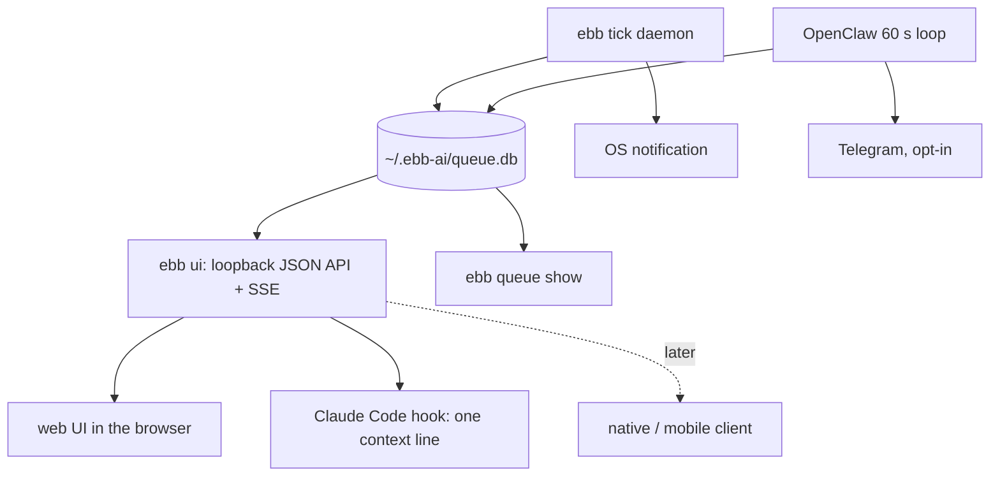

# Task Visibility and Continuation - Plan

## Goal Capsule

- **Objective:** A user who deferred a task through any ebb-ai host (CLI, Claude Code or Cursor via MCP, OpenClaw) can see when and which task will run, read the result and its receipt when it ran, learn that it finished without polling, and continue the work from that result without leaving the machine's privacy boundary.
- **Means:** One local HTTP API and web UI served by the CLI (`ebb ui`) over the existing `~/.ebb-ai/queue.db`, a `ebb queue show` command, a parent-child task relation that stores message history so a completed task can be replied to, a completion signal per host, and a `quota_reset` deadline kind.
- **Authority:** Vitalii's brief (<session notes, not in the repo>), then this plan, then the scout report (<session notes, not in the repo>) for current-state facts. Where this plan and repo evidence disagree, the planner stops and reports.
- **Open blockers:** four questions under Outstanding Questions / Resolve Before Planning: the quota source, acceptance of text-only continuation for the first release, the UI packaging, and whether the InfoQ article names `ebb ui`.
- **Who finishes:** the pipeline stops at open, reviewed PRs. Vitalii merges and decides whether `ebb ui` is named in the InfoQ article.

---

## Product Contract

### Summary

Add a local, loopback-only task viewer and API to the CLI (`ebb ui`), a `ebb queue show <id>` command, and the data needed to render them: a title, the originating host, a read marker, a parent link and the message history.
"Continue the work" in the first release is a reply: a child task that carries the parent's history and runs through the same provider adapter.
Completion reaches the user through an OS notification from the `ebb tick` daemon and a context line injected by a Claude Code plugin hook; Telegram delivery stays as it is in OpenClaw.
A `quota_reset` deadline kind lets a task be scheduled to the cleanest hour before a subscription limit resets.
The agent-session runner (deferred tasks that edit a repo and can be attached to as a live session), a paused `needs_input` state, and native or mobile clients are later areas on the same API.

### Problem Frame

Every host writes to one SQLite ledger, but no surface shows a task's prompt, deadline and result together. `ebb queue list` prints id, status, scheduled time, region and budget (`packages/cli/src/commands/queue.ts:38-55`). `check_queue_status` in list mode prints no deadline or preview and in single mode prints the whole `DispatchResult` JSON including the raw vendor payload, never the prompt (`packages/mcp-server/src/server.ts:917-1020`). The public site's `/queue` page is a static explainer that cannot read the local ledger (`apps/web/src/app/queue/page.tsx:1-8`), and `README.md:347` still promises a queue viewer.

The user learns that a task finished only by asking. In Claude Code the only paths are `/ebb-ai:check` or watching an `--output` file (`packages/claude-code-plugin/commands/defer.md:58-64`); the CLI writes counters to `~/.ebb/tick.log`; push exists only in OpenClaw (`packages/openclaw-plugin/src/delivery.ts`).

Nothing can be continued. A task is one single-turn Messages call with no tools and no history (`packages/core-ts/src/providers/anthropic.ts:283-293`); the record has no parent, session or origin field (`packages/core-ts/src/types.ts:194-248`). `retry_task` re-sends the same body. `/defer "refactor X"` produces text, not an edit. A task cannot ask a question because nothing in the dispatch path can pause.

Vitalii's related idea: weekly subscription limits reset at a known time; work queued to run before that time uses quota that would otherwise be lost. The scheduler already takes a deadline and picks the cleanest window inside it; it only lacks a way to express "the reset instant" as that deadline.

### Key Decisions

- **One local API under the CLI; every client reads it.** The web UI, later native and mobile apps, and the Claude Code hook all consume the same loopback JSON API; nothing reads `queue.db` from a second code path. Governs R8, R9, R12. (session-settled: user-directed — chosen over a separate stack per client: Vitalii's constraint "they must sit on the same local API as the web UI".)
- **The UI ships inside the CLI package, not in `apps/web`.** The Vercel site cannot reach `localhost`, and npm users do not have the monorepo. `apps/web` stays a launcher and docs site; its `/queue` page points at `ebb ui`. Governs R8, R22.
- **Server-to-client updates use SSE, not WebSocket.** The UI needs one direction of push; replies are plain POSTs. Governs R9.
- **"Continue" in the first release is a reply through the provider adapter.** A child task stores the parent's history and the new user message and is dispatched like any task. No agent session, no tools. Governs R4, R5, R16, R17. (session-settled: user-approved — chosen over an agent-session runner for the first release: an unattended agent with repo access needs a permission model and multi-step receipts that do not exist yet; see Shapes Compared, D.)
- **No `needs_input` state in the first release.** Nothing in the dispatch path can pause, so a paused state would never be entered. A question the model asks in its answer is a completed task the user replies to (R16). The state arrives with the agent-session runner. Governs R3.
- **The inbox is "completed or failed and not yet read", per task, across hosts.** One `read_at` marker, set by whichever surface showed the result. Governs R3, R10, R14.
- **Quota reset is a deadline kind, not a scheduler change.** `deadline_kind = quota_reset` resolves to the next configured reset instant minus a margin and is scheduled by the existing window picker. Governs R6, R19, R20, R21.
- **Nothing leaves the machine by default.** The API binds to `127.0.0.1`, the UI loads no remote asset, and the only off-machine channel is the existing opt-in Telegram delivery in OpenClaw. Email is not added. Governs R8, R13, R15.

### Shapes Compared

Each shape is listed with what it needs from the data model, what each host must do, and its privacy cost. "In" means first release.

- A. `ebb ui` — local web UI plus HTTP API served by the CLI. **In.**
  - **Data model:** title, origin host, read marker, deadline kind; result and receipt already stored.
  - **Hosts:** CLI serves it. MCP and OpenClaw change nothing; their tasks appear because the ledger is shared.
  - **Privacy:** zero network egress. Prompts and results are rendered in a browser on loopback; a browser extension with page access can read them, so the UI opens in the default browser with a per-run token and no CORS.
- B. Push per host — Claude Code hook, OS notification, Telegram via OpenClaw, email. **In for OS notification from `ebb tick` and a Claude Code hook; Telegram unchanged; email out.**
  - **Data model:** read marker (so a hook can say "finished since you last looked").
  - **Hosts:** CLI tick daemon posts the OS notification (code moves from the OpenClaw plugin to core). Claude Code plugin gains a hook that runs a CLI query on session start and prompt submit and injects one context line; MCP has no server push, so a hook is the only mechanism. OpenClaw keeps its delivery modes.
  - **Privacy:** OS notification and hook stay local. Telegram already leaves the machine under opt-in. Email would add an outbound channel and an SMTP credential for no new capability; rejected.
  - **Deep links:** a notification carries the task id and the `ebb ui` URL when the server is running; otherwise the `ebb queue show <id>` command text.
- C. "Questions" as a task state (`needs_input`). **Deferred.**
  - **Data model:** a new status plus a question field and an answer path.
  - **Hosts:** every host would need an answer path back into the task.
  - **Why deferred:** a single-turn provider call cannot stop to ask. The state is real only when a runner can pause, which is D(2). In the first release a question in the answer is handled by reply (R16); the inbox shows it as an unread completed task.
- D. "Continue the work": what a session is for a deferred task.
  - D(1) Store the message history on the task and offer reply. **In.** Needs `parent_task_id` and a history array; works for every provider adapter and every host; costs grow per turn because the full history is re-sent; tool access none; receipts stay one per dispatch; security unchanged.
  - D(2) Run deferred tasks as a Claude Code session (`claude -p` with a session id, later `claude --resume`). **Deferred to the next area.** Gives real repo edits and a true "attach". Needs the `claude` binary and a logged-in subscription on the machine, a `runner` field and a session reference on the task, a permission mode for an unattended agent at 3 a.m. (the choice is between a sandboxed allowlist and skipping permissions; both need a decision Vitalii has not made), a cost model (a session's token count is only known after it ends), and a receipt for a multi-step run (one receipt from the session's total usage, not per call). Only the Claude Code host benefits; OpenClaw and plain CLI tasks would still be D(1).
  - D(2) via a pane driver: herdr (herdr.dev, Apache 2.0, v0.9.5; macOS, Linux, Windows beta) runs CLI agents in terminals owned by a background server, marks each pane working, blocked or idle, and exposes a CLI and socket API; magnum (github.com/zhuravel/magnum, MIT, macOS only) uses it so that "every agent works in a herdr pane you can watch or take over" and keeps sessions so a re-review continues the earlier conversation. For ebb this is one concrete attach mechanism: dispatch an agentic task into a herdr pane and let the user open the pane. It requires the herdr daemon running and the agent CLI logged in; it is a local server with a "Herdr Cloud" that is "coming soon" and not needed. Treated as an optional runner backend for D(2), never a dependency of the first release. Magnum's Codex budget caps (automatic rounds wait at 80 % and 95 % of usage) show that usage can be read from an agent CLI, which is relevant to E.
  - D(3) Hybrid: text tasks use D(1), agentic tasks use D(2). **Target shape after D(2) ships.** The history stored for D(1) is the input a D(2) runner would receive, so D(1) data needs no migration.
- E. Quota-reset deadline kind. **In.**
  - **Data model:** `deadline_kind` and a per-provider reset schedule in local config.
  - **Hosts:** CLI and MCP accept the kind at enqueue; the UI shows the reset instant as a labelled marker.
  - **Privacy:** none; the reset time is user-entered.
  - **Caveat:** API-key dispatch does not consume a subscription quota. Until a subscription-backed runner exists (D(2), or an OpenClaw runtime bridge that is subscription-backed), the kind schedules work before the reset but does not spend quota. Outstanding Question 1.

### Actors

- A1. The user, on the machine that holds the ledger, in a browser, a terminal, Claude Code or Cursor, or Telegram.
- A2. The dispatcher: the `ebb tick` daemon (launchd or systemd, about every 5 minutes) or the OpenClaw in-process loop (every 60 seconds).
- A3. The `ebb ui` server process, started by the user, reading and writing the same ledger.
- A4. The Claude Code plugin hook, run by Claude Code on session start and prompt submit.

### Requirements

**Data model**

- R1. A task carries a title: given at enqueue, or the first line of the prompt cut to 80 characters.
- R2. A task carries its origin host (`cli`, `mcp`, `openclaw`) and, when known, the working directory it was enqueued from.
- R3. A task carries a `read_at` timestamp set the first time a surface shows its result or error to the user; the inbox is the set of completed or failed tasks with no `read_at`.
- R4. A task may carry `parent_task_id` pointing at the task it continues.
- R5. A task carries its message history as an ordered list of user and assistant turns; a first-generation task has one user turn and, after completion, one assistant turn.
- R6. A task carries `deadline_kind`, one of `by` (default) or `quota_reset`.
- R7. The Python port reads a ledger that has these columns without failing; whether it writes them is decided in planning.

**Local API and UI**

- R8. `ebb ui` starts an HTTP server bound to `127.0.0.1` only, with a per-run bearer token, prints the URL and opens it in the default browser unless `--no-open` is given.
- R9. The API serves the task list, one task with prompt, history, result text, receipt and routing decision, the forecast curve for the task's region, and a stream of task changes; it accepts a reply (R16) and a cancel.
- R10. The UI has three views: a timeline of queued and scheduled tasks drawn on the forecast curve with each task's deadline marker, a task detail page, and an inbox of unread results. Opening a task detail marks it read (R3).
- R11. The task detail page shows the stored prompt as stored (redacted after a terminal transition, per the existing rule in `packages/core-ts/src/scheduler.ts`), the result text, the receipt, and the raw vendor payload behind a toggle that is closed by default.
- R12. The UI loads no asset from any remote origin and makes no request to any host but its own loopback address.
- R13. The UI never dispatches. It shows when the dispatcher last ran and, when no tick daemon is installed, the `ebb install` command.

**CLI**

- R14. `ebb queue show <id>` prints what the task detail page shows (R11) in text. `ebb queue list` gains a title column and a deadline column, and `--unread` filters to the inbox (R3).
- R15. `ebb tick` posts one OS notification per task that reached `completed` or `failed` during that tick, with the title, grams and the task id; the notification code is shared with the OpenClaw `os` delivery mode. `--quiet` disables it.

**Continuation**

- R16. A completed task can be replied to from the UI, from `ebb queue reply <id> "<text>"` and from a `reply_task` MCP tool: the reply creates a child task (R4) whose history is the parent's history plus the new user turn (R5), with its own deadline that defaults to one hour ahead.
- R17. A child task is dispatched through the same provider adapter as its parent with the full history as the messages array; the adapter interfaces accept a messages array where today they accept one prompt.
- R18. The task detail page and `ebb queue show` display the chain: parent link, children, and the history in order.

**Quota-reset deadline**

- R19. Local config holds, per provider, a weekly reset instant (weekday and local time) and a margin in hours; the CLI, the `/defer` command and `schedule_task` accept `--by quota-reset` / `deadline_kind: quota_reset` with an optional provider.
- R20. A `quota_reset` deadline resolves at enqueue to the next reset instant minus the margin; if that instant is already past, the following week's reset is used. The scheduler picks the window exactly as for a `by` deadline.
- R21. The UI and `ebb queue show` label the deadline "quota reset (<provider>)" with the resolved instant and the margin.

**Documentation**

- R22. `README.md` and the site's `/queue` page describe `ebb ui` and `ebb queue show`; the "queue viewer" claim at `README.md:347` is replaced by the real command.

**Claude Code**

- R23. The Claude Code plugin registers a hook on session start and on prompt submit that queries the inbox (R3) through the CLI and injects at most one line: the count of unread tasks, their titles, and the `/ebb-ai:check <id>` command; when nothing is unread it injects nothing.

### Key Flows

- F1. Defer, wait, read
  - **Trigger:** A1 defers a task from Claude Code with `/ebb-ai:defer`.
  - **Actors:** A1, A2, A3, A4
  - **Steps:** The MCP server enqueues the task with origin `mcp`, the title from the prompt and the Claude Code working directory. A2 dispatches it at the chosen window and posts an OS notification. A1 opens `ebb ui`; the inbox lists the task; the detail page shows prompt, result, receipt and marks it read. The next Claude Code session shows no injected line because nothing is unread.
  - **Covers R1, R2, R3, R8, R10, R11, R15, R23.**
- F2. Reply
  - **Trigger:** A1 reads a result that ends in a question or needs refinement.
  - **Actors:** A1, A2, A3
  - **Steps:** A1 types a reply on the detail page. A3 creates a child task with the parent's history plus the reply and a one-hour deadline. A2 dispatches it with the full history. The child appears under the parent in the chain; the inbox shows it when it completes.
  - **Covers R4, R5, R16, R17, R18.**
- F3. Quota-reset deferral
  - **Trigger:** A1 runs `ebb queue add "<prompt>" --by quota-reset --provider anthropic` on a Thursday; config says the reset is Monday 10:00 local with a 2-hour margin.
  - **Actors:** A1, A2
  - **Steps:** The deadline resolves to Monday 08:00. The scheduler picks the cleanest window between now and Monday 08:00. The timeline shows the task on the curve with the marker "quota reset (anthropic) Mon 08:00, margin 2 h".
  - **Covers R6, R19, R20, R21.**
- F4. Live update
  - **Trigger:** `ebb ui` is open while A2 completes a task.
  - **Actors:** A2, A3
  - **Steps:** A2 writes the terminal state to the ledger. A3 observes the change and pushes it on the stream. The browser moves the task from the timeline to the inbox without a reload.
  - **Covers R9, R13.**

### Acceptance Examples

- AE1. **Covers R3, R23.** Given two tasks completed since the user last opened any surface, when a Claude Code session starts, then one line is injected naming both titles and the check command; when the user opens one in `ebb ui`, then the next session names only the other.
- AE2. **Covers R11.** Given a completed task whose prompt contained an API key, when the detail page renders, then the prompt shows the redacted form and the raw vendor payload is hidden until the toggle is opened.
- AE3. **Covers R16, R17.** Given a completed task with one user and one assistant turn, when the user replies, then the child's history has three turns in order and the provider receives all three as messages.
- AE4. **Covers R16.** Given a failed or cancelled task, when the user opens its detail page, then no reply control is shown.
- AE5. **Covers R20.** Given a reset configured for Monday 10:00 with a 2-hour margin and the current time Monday 09:00, when a `quota_reset` task is enqueued, then its deadline is the following Monday 08:00.
- AE6. **Covers R8, R12.** Given `ebb ui` running, when a request arrives on a non-loopback interface or without the token, then it is refused; when the page loads, then the browser makes requests only to the loopback origin.
- AE7. **Covers R13.** Given no tick daemon installed, when the timeline renders a scheduled task, then the page shows that nothing will dispatch it and prints the `ebb install` command.
- AE8. **Covers R15.** Given a tick that completes two tasks and fails one, when it exits, then three OS notifications were posted and `~/.ebb/tick.log` holds the same counters as today.

### Scope Boundaries

**Deferred for later**

- The agent-session runner (D(2)): `claude -p` sessions, a `runner` field, a session reference, the unattended permission model, multi-step receipts, and herdr as an optional pane backend.
- The `needs_input` state and an answer path per host (C); arrives with the runner.
- Native macOS, Windows and mobile clients on the API from R8-R9; a mobile client needs the API reachable off loopback, which is an explicit opt-in to design then.
- Reply-to-task linkage for Telegram messages in OpenClaw.
- Reading the reset instant or usage percentage from an agent CLI instead of config (R19 is manual entry).
- A UI mockup image; Vitalii can produce one later in a browser image tool.

**Outside this product's identity**

- A hosted or cloud copy of the ledger, a sync service, or a remote dashboard.
- Email delivery.
- Aggregate statistics in the UI; `/stats` on the site refuses them on purpose and the local UI shows per-task receipts only.

### Dependencies / Assumptions

- The ledger stays one SQLite file shared by every host; new columns are nullable and added by the existing idempotent ALTER path.
- Claude Code hooks can run a shell command on session start and prompt submit and inject its stdout as context; verified in planning against the Claude Code documentation of the installed version.
- Provider adapters (Anthropic, OpenAI, Gemini, Ollama) all accept a messages array; the Batch paths accept one too.
- A web UI bundled in the CLI package must build to static files with no runtime framework server; the framework choice is a planning decision bounded by package size.

### Outstanding Questions

**Resolve Before Planning**

- Q1. Which dispatch path, if any, consumes a subscription quota today? If none, is `quota_reset` acceptable in the first release as a scheduling label whose quota effect lands with the agent-session runner?
- Q2. Is text-only continuation (D(1)) accepted as the first release's "continue the work", with the agent-session runner (D(2)) as the next area?
- Q3. UI packaging: a static bundle inside `@ebb-ai/cli` (one more package to build), or a new `@ebb-ai/ui` package the CLI depends on? Either way it is a second UI codebase next to `apps/web`; is sharing components through a workspace package wanted now or later?
- Q4. Does the InfoQ article name `ebb ui`? If yes, the first PR must land before the article's deadline.

**Deferred to Planning**

- Q5. Whether the Python port writes the new columns or only tolerates them (R7).
- Q6. Default port and whether `ebb ui` should also run the tick loop in-process behind a flag; R13 holds for the default.
- Q7. The reply's default deadline (R16 says one hour) and whether a reply may use `expedite` semantics.
- Q8. How `ebb ui` observes ledger changes for the stream: polling interval or a file watcher.
- Q9. Which PR carries what: data model, CLI and API in the first PR; notifications, hook and quota-reset in the second.

### Sources / Research

- <session notes, not in the repo>.
- Ledger schema and task record: `packages/core-ts/src/storage/sqlite.ts:58-130`, `packages/core-ts/src/types.ts:194-303`.
- Single-turn dispatch and redaction: `packages/core-ts/src/providers/anthropic.ts:283-293`, `packages/core-ts/src/scheduler.ts:1499-1508`, `2121-2133`.
- Window selection against a deadline: `packages/core-ts/src/scheduler.ts:1071-1117`, `packages/core-ts/src/recommend.ts`.
- Existing push and OS notification code: `packages/openclaw-plugin/src/delivery.ts`.
- Claude Code plugin without hooks: `packages/claude-code-plugin/.claude-plugin/plugin.json`, `commands/defer.md`.
- Static `/queue` page and the README claim: `apps/web/src/app/queue/page.tsx`, `README.md:345-347`.
- Forecast chart and deadline components that a bundled UI can copy or share: `apps/web/src/components/forecast-chart.tsx`, `deadline-field.tsx`, `best-window.tsx`.
- Pane driver input for D(2): herdr.dev (v0.9.5, Apache 2.0, background server, CLI and socket API, 22 agents detected) and github.com/zhuravel/magnum (MIT, macOS daemon, "every agent works in a herdr pane you can watch or take over", Codex usage caps at 80 % and 95 %).

---

<!-- ce-section: work-relationships -->
## How This Work Fits Together

This plan covers the first area: visibility, text continuation, local notifications and the quota-reset deadline. The breakdown below is the current understanding, not a committed roadmap.

- Agent-session runner (D(2)): deferred tasks run as a Claude Code session and the user attaches with `claude --resume` or a herdr pane.
  - Depends on this plan's history field (R5) and parent link (R4) as the runner's input.
  - Still to decide: the unattended permission model, cost cap per session, one receipt per session.
- `needs_input` state and answer path (C).
  - Depends on the agent-session runner, the only thing that can pause.
  - Shares the inbox (R3, R10) as the place a question appears.
- Native and mobile clients.
  - Depends on the API (R8, R9) and on an opt-in way to reach it off loopback.
  - Can proceed independently of the agent-session runner.
- Quota-aware dispatch (read usage from an agent CLI, pause at a threshold, as magnum does).
  - Depends on the agent-session runner and on R19's config shape.
