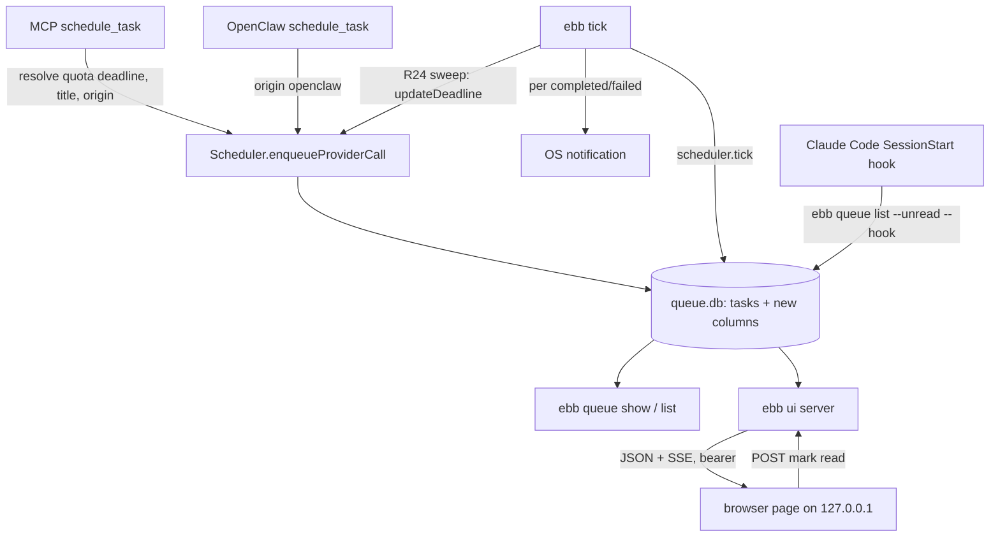
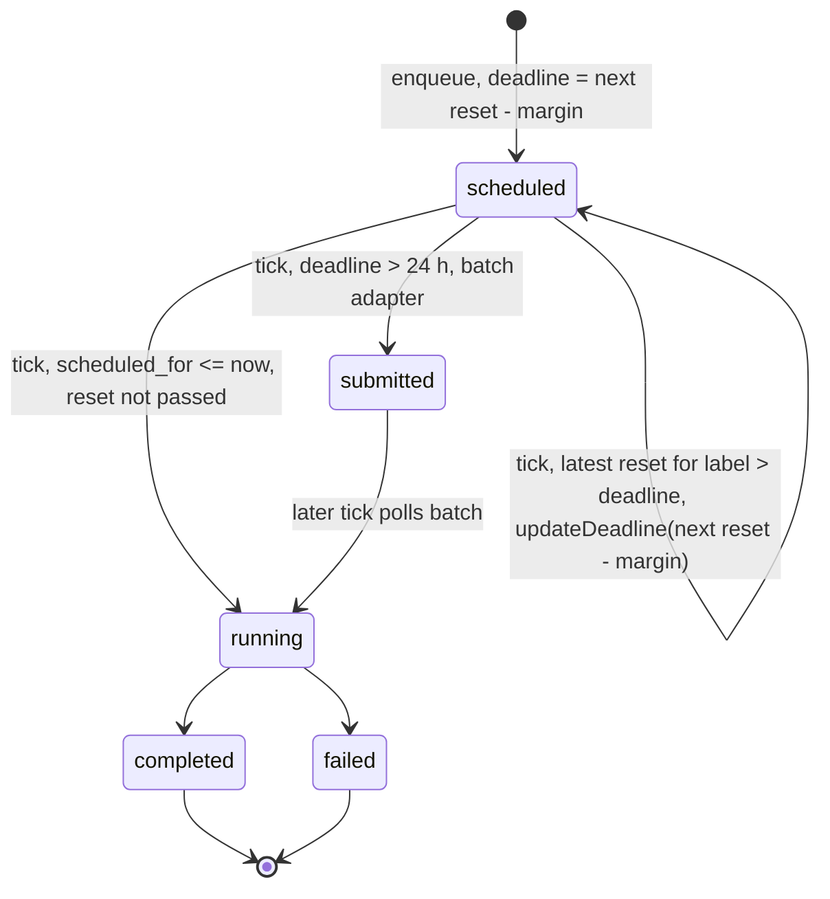
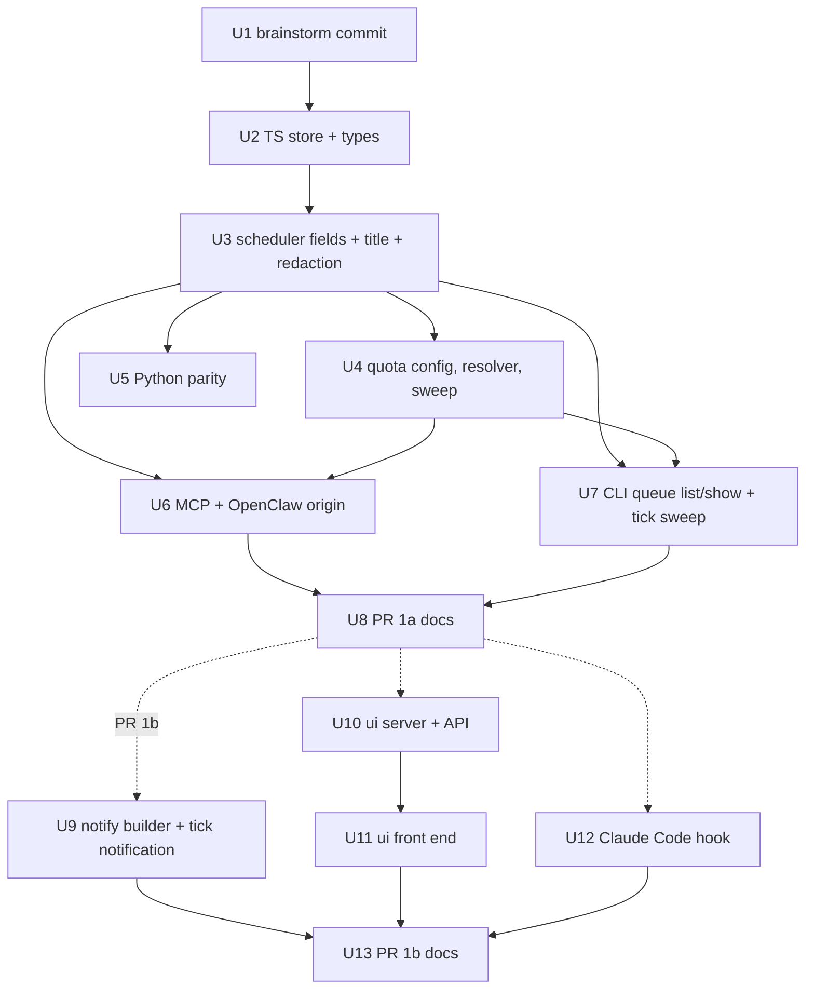

# Task Visibility PR 1 (data model, quota reset, queue show, ebb ui, notifications) - Plan

## Goal Capsule

- **Objective:** A user who deferred a task through any ebb-ai host can see which tasks are queued and when they will run (including a "before the weekly quota reset" list), read one task's prompt, result and receipt, and learn that a task finished without polling, all without data leaving the machine.
- **Means:** New nullable ledger columns plus a history field inside `body_json` (KTD1, KTD2), a `quota_reset` deadline kind resolved by the host at enqueue and re-resolved by `ebb tick` (KTD5, KTD6), `ebb queue show`, `ebb ui` served from `@ebb-ai/cli` over loopback (KTD8 to KTD10), an OS notification from `ebb tick` and a Claude Code SessionStart hook (KTD11, KTD12).
- **Authority:** the orchestrator brief of 2026-10-15 (settled decisions below), then the origin brainstorm `docs/plans/2026-10-15-1219-feat-task-visibility-continuation-plan.md` for product scope, then repository evidence. Where the brief and the brainstorm disagree, the brief wins; the deviations are listed under Planning Contract / Deviations from Origin.
- **Delivery shape:** two stacked PRs from this one plan. PR 1a (U1 to U8) on branch `feat/task-visibility-1`. PR 1b (U9 to U13) on branch `feat/task-visibility-1b`, created from the PR 1a branch head. The split exists because one PR would cover four packages, a Python port, an HTTP server and a front end, which is too much for one review pass.
- **Stop conditions:** stop and report if a unit needs a change to the window picker (`selectWindow`, `scheduleProviderCall` scoring) or to the provider adapters; both are out of scope. Stop if a gate fails twice the same way.
- **Execution profile:** TS core first, then Python parity, then hosts (MCP, CLI, OpenClaw), then UI and notifications. No version bump, no release.
- **Who finishes:** the pipeline ends at two open, reviewed PRs. Vitalii merges PR 1a, then PR 1b.

---

## Product Contract

Product Contract preservation: origin R-IDs kept; this plan adopts R1 to R15 and R19 to R23, adds R24, and lists every change under Planning Contract / Deviations from Origin and Scope Boundaries / Deferred to Follow-Up Work. R16 to R18 (reply and chain) are PR 2.

### Summary

Add title, origin, read marker, parent link and deadline kind to every task, keep a message-history field ready for PR 2, and add a `quota_reset` deadline kind configured per provider.
Add `ebb queue show <id>`, a title/deadline/kind view in `ebb queue list`, and `--unread` / `--kind` filters.
Add `ebb ui`: a loopback-only page with a timeline on the forecast curve, a task detail view and an unread inbox.
`ebb tick` posts an OS notification per finished task, and the Claude Code plugin injects one "N unread tasks" line at session start.

### Problem Frame

See origin, Problem Frame. In short: the shared ledger `~/.ebb-ai/queue.db` holds prompt, deadline and result, but no surface shows them together (`packages/cli/src/commands/queue.ts:38-55`, `packages/mcp-server/src/server.ts:917-1020`), nobody is told when a task finishes outside OpenClaw, and there is no way to say "run this before my weekly limit resets".

### Key Decisions

Carried from origin (see origin: Key Decisions): one local API under the CLI that every client reads; the UI ships inside the CLI package; SSE not WebSocket; no `needs_input` state; the inbox is "completed or failed and not yet read"; quota reset is a deadline kind, not a scheduler change; nothing leaves the machine by default.

Added by the orchestrator brief (settled 2026-10-15):

- **`quota_reset` ships in PR 1, with a resolver that `ebb tick` re-runs when the reset has passed.** Governs R6, R19, R20, R21, R24. (session-settled: user-directed — chosen over the origin's Q9 placement of quota reset in a later PR: Vitalii wants the weekly-limit list in v1.)
- **The deadline kinds are `absolute` and `quota_reset`.** Governs R6. (session-settled: user-directed — chosen over the origin's `by` label.)
- **Reply ("continue") is PR 2; PR 1 stores everything PR 2 needs, so PR 2 adds no migration.** Governs R4, R5. (session-settled: user-directed — chosen over shipping reply in the same PR: keeps PR 1 reviewable.)
- **`ebb ui` lives in `@ebb-ai/cli`, no separate package, no React build step.** Governs R8, R10. (session-settled: user-directed — chosen over a new `@ebb-ai/ui` package: origin Q3 answered.)

### Requirements

Origin IDs are kept. Text is restated only where PR 1 narrows or changes it.

**Data model**

- R1. A task carries a title: given at enqueue, else the first line of the redacted prompt cut to 80 characters.
- R2. A task carries its origin host (`cli`, `mcp`, `openclaw`, or null for library callers) and, when known, the working directory it was enqueued from.
- R3. A task carries `read_at`, set the first time a surface shows its result or error; the inbox is completed or failed tasks with no `read_at`.
- R4. A task may carry `parent_task_id`. PR 1 stores and displays it; nothing in PR 1 sets it.
- R5. A task's message history is derivable as an ordered list of user and assistant turns; PR 1 stores prior turns for future child tasks and derives first-generation history from prompt plus result.
- R6. A task carries `deadline_kind`, `absolute` (default; also the meaning of a legacy null) or `quota_reset`, plus the quota provider label when the kind is `quota_reset`.
- R7. The Python port reads and writes a ledger that has these columns without failing and without erasing values another writer set.

**Local API and UI (PR 1b)**

- R8. `ebb ui` starts an HTTP server bound to `127.0.0.1` only, with a per-run bearer token, prints the URL and opens it in the default browser unless `--no-open` is given.
- R9. The API serves the task list (filterable by status, kind, unread), one task with prompt, history, result text, receipt and routing decision, the forecast curve for a region, a status object, and a stream of task changes. It accepts one write: mark read. Reply and cancel are not in PR 1.
- R10. The UI has three views: a timeline of queued and scheduled tasks on the forecast curve with deadline markers, a list of `submitted` (provider batch) tasks, and a separate "Before quota reset" group, a task detail page, and an inbox of unread results. Opening a finished task's detail marks it read.
- R11. The detail page shows the stored prompt (redacted on completion or cancellation, as today; a failed task keeps its prompt for retry), the result text, the receipt, and the raw vendor payload behind a toggle that starts closed.
- R12. The UI loads no asset from any remote origin and makes no request to any host but its own loopback address.
- R13. The UI never dispatches. When no tick daemon is installed it shows that nothing will dispatch the scheduled tasks and prints the `ebb install` command.

**CLI**

- R14. `ebb queue show <id>` prints what the detail page shows (R11) in text and marks a finished task read. `ebb queue list` gains title, deadline and kind columns, `--unread` and `--kind <absolute|quota_reset>`.
- R15. `ebb tick` posts one OS notification per task that reached `completed` or `failed` in that tick, with title, grams and task id; the command builder is shared with the OpenClaw `os` delivery mode. `--no-notify` and `EBB_NOTIFY=0` in `~/.ebb-ai/config` turn it off.

**Quota-reset deadline**

- R19. `~/.ebb-ai/config` holds, per provider label, a weekly reset (weekday, local time, optional IANA timezone) and a margin in hours. MCP `schedule_task` accepts `deadline_kind: "quota_reset"` with an optional `quota_provider`; `deadline` becomes optional only for that kind.
- R20. A `quota_reset` deadline resolves at enqueue to the next reset instant minus the margin; when that deadline (reset minus margin) is not after now, the following week's reset is used. The window picker runs unchanged.
- R21. The UI, `ebb queue show` and MCP `check_queue_status` label the deadline "quota reset (<provider>)" with the resolved instant and the margin.
- R24. When a ticker (`ebb tick` or the OpenClaw loop) finds a `queued` or `scheduled` `quota_reset` task whose reset has passed (the most recent reset for its label is later than its stored deadline), it re-resolves the deadline to the next reset minus margin and reschedules the task through the normal window picker before the due sweep runs.

**Documentation and Claude Code**

- R22. `README.md` and the site's `/queue` page describe `ebb ui` and `ebb queue show`; the "queue viewer" claim at `README.md:345-347` is replaced.
- R23. The Claude Code plugin registers a SessionStart hook that prints at most one line: the count of unread tasks, up to three titles, and the `/ebb-ai:check <id>` command. It prints nothing when nothing is unread or when `ebb` is not installed.

### Acceptance Examples

Carried from origin: AE1 (narrowed to SessionStart), AE2, AE5, AE6, AE7, AE8. AE3 and AE4 are PR 2. New:

- AE9. **Covers R24.** Given a scheduled `quota_reset` task for provider `claude` with reset Monday 10:00 and margin 2 h, and the machine asleep until Monday 11:00, when `ebb tick` runs and the cleanest window before the new deadline is later than now, then the task's deadline becomes the following Monday 08:00, its status stays `scheduled` with a new `scheduled_for`, and it is not dispatched synchronously in that tick. As with any deadline more than 24 h away, a batch-capable adapter may submit it to the provider Batch API in the same tick (status `submitted`).
- AE10. **Covers R3, R7.** Given a ledger with 40 completed tasks from v0.16.0, when any v0.17 process opens it for the first time, then the inbox is empty.
- AE11. **Covers R1.** Given a prompt whose first line is `use key sk-ant-abc123... to summarize`, when it is enqueued without a title, then the stored title contains the redacted form, never the key.

### Scope Boundaries

**Deferred for later** (carried from origin): agent-session runner, `needs_input`, native and mobile clients, Telegram reply linkage, reading the reset or usage from an agent CLI, a UI mockup.

**Outside this product's identity** (carried from origin): hosted ledger or sync, email, aggregate statistics in the UI.

### Deferred to Follow-Up Work

- PR 2: `ebb queue reply`, `reply_task` MCP tool, reply control in the UI, adapters accepting a messages array (origin R16, R17, R18, AE3, AE4).
- Cancel from the UI (origin R9 "accepts a cancel").
- An `ebb queue add` command. The CLI has no enqueue command today, so origin F3 (`ebb queue add ... --by quota-reset`) has no host to land in; PR 1 enqueues `quota_reset` tasks through MCP `schedule_task` and `/ebb-ai:defer`.
- A `UserPromptSubmit` hook (origin R23 named it; the brief names session start only).
- `deadline_kind` on the OpenClaw `schedule_task` (OpenClaw keeps `deadline` required).

**Considered and not built**

- A notification deep link to a running `ebb ui`: it needs a discovery file that would hold the bearer token on disk. The notification carries the `ebb queue show <id>` command instead. Revisit if users ask for click-through.
- A "last tick ran at" timestamp in the UI (origin R13 first clause): there is no record of tick runs; adding one is a new write path in the tick. PR 1 shows daemon-installed status only. Revisit with the tick log work.
- A per-request CSRF token: the bearer token in an `Authorization` header plus the Host check already blocks cross-origin and DNS-rebinding requests (KTD9).

---

## Planning Contract

### Deviations from Origin

| Origin | This plan | Source |
|---|---|---|
| `deadline_kind` values `by` / `quota_reset` | `absolute` / `quota_reset` | brief |
| Quota reset resolved at enqueue only | Also re-resolved by `ebb tick` when the reset passed (R24) | brief |
| Quota reset in the second PR (origin Q9) | In PR 1a | brief |
| Hook on session start and prompt submit | Session start only | brief |
| `ebb queue add --by quota-reset` (F3) | MCP `schedule_task` only; no CLI enqueue exists | repo: `packages/cli/src/index.ts:87-107` registers only `queue list` |
| `--quiet` disables tick notifications (R15) | `--no-notify` flag and `EBB_NOTIFY=0` in `~/.ebb-ai/config` | plan: `--quiet` would also hide the tick counters |
| UI shows when the dispatcher last ran (R13) | Daemon-installed status only | plan: no record of tick runs exists; see Considered and not built |
| UI accepts a cancel (R9) | Not in PR 1 | plan; see Deferred to Follow-Up Work |
| History "stored on the task" | Prior turns live in `body_json.messages`, current turn is `prompt`, assistant turn is derived from `result.text` | KTD2 |

### Key Technical Decisions

- KTD1. **New columns are nullable and added by the existing idempotent ALTER path in both cores.** Columns: `title`, `origin_host`, `origin_cwd`, `read_at`, `parent_task_id`, `deadline_kind`, `quota_provider`, plus an index on `parent_task_id`. TS `ensureColumns` (`packages/core-ts/src/storage/sqlite.ts:114-136`) and the Python `_ensure_*_column` family (`packages/core-py/src/ebb_ai/scheduler.py:580-678`) are the pattern. No schema version table exists and none is added. Governs R1 to R4, R6.
- KTD2. **Message history lives in `body_json`, not in a new column.** `ProviderCallSpec` gains an optional `messages` array of prior `{role, content}` turns; the current user turn stays in `prompt`; the assistant turn is `result.text`. A pure helper `taskHistory(record)` derives the full ordered list. Rationale: `body_json` is already the dispatch input PR 2's adapters will read, and `redactBodyJson` already runs on completion and cancellation (not on failure, so retry can re-send) (`packages/core-ts/src/scheduler.ts:2121-2133`, Python mirror `_redact_body_json` at `scheduler.py:198`), so extending it to redact `messages[].content` keeps the privacy rule in one place. A separate `messages_json` column would duplicate the prompt outside the redaction path. Governs R5. It meets the brief's constraint that PR 2 needs no second migration.
- KTD3. **Identity columns are insert-only; `read_at` is written only by `markRead`.** TS `upsert` inserts `title`, `origin_host`, `origin_cwd`, `parent_task_id` but leaves them out of `ON CONFLICT DO UPDATE`. `deadline_kind` and `quota_provider` update with `COALESCE(excluded.x, tasks.x)`. `read_at` is never in `upsert`; `TaskStore.markRead(taskId, at)` runs `UPDATE ... SET read_at = ? WHERE task_id = ? AND read_at IS NULL AND status IN ('completed','failed')`. Rationale: `upsert` today overwrites every listed column (`sqlite.ts:222-250`), and the tick and the UI are separate processes; an in-memory record without `read_at` must not clear a mark set by the UI. The Python `upsert` (`scheduler.py:758-800`) lists its columns explicitly, so it already preserves columns it does not name. Governs R3, R7.
- KTD4. **Backfill `read_at` once, when the column is first added.** In the same migration step that adds `read_at`, set `read_at = completed_at` for rows already `completed` or `failed`. Both cores do it; whichever process migrates first runs it. Rationale: without it every existing user sees all historic tasks as unread (AE10). Governs R3.
- KTD5. **Quota config lives in `~/.ebb-ai/config` and is parsed in core, next to the carbon-budget loader.** Keys: `EBB_QUOTA_RESET_<LABEL>=<mon..sun> <HH:MM> [<IANA tz>]` and optional `EBB_QUOTA_MARGIN_H_<LABEL>=<hours>` (default 2). `<LABEL>` is a free-form provider label (`CLAUDE`, `CODEX`), lowercased on read; it is not tied to `ProviderName` because subscription quotas belong to products, not API adapters. A new `packages/core-ts/src/quota.ts` exports `loadQuotaResetConfig({path})` (file read only, same rule as `loadCarbonBudgetConfig` in `packages/core-ts/src/budget.ts:258-290`) and a pure `resolveQuotaDeadline(schedule, now)` that uses `Intl.DateTimeFormat` for timezone offsets (no dependency). Malformed lines disable that label and never throw. Governs R19, R20.
- KTD6. **The host resolves the quota deadline; the scheduler only persists the kind.** The MCP `schedule_task` handler resolves the concrete ISO deadline and passes it with `deadlineKind` and `quotaProvider` through `DeferOptions` to `enqueueProviderCall`. The R24 sweep is a core helper `sweepQuotaDeadlines` in `packages/core-ts/src/quota.ts` that wraps the existing public `Scheduler.updateDeadline` (`scheduler.ts:862-893`), which re-runs window selection. Both tickers call it before `scheduler.tick`: `ebb tick` and the OpenClaw interval loop (`packages/openclaw-plugin/src/index.ts`, the loop around `scheduler.tick` near line 430). The sweep condition does not depend on the margin: a task is re-resolved when the most recent reset for its label (from the current schedule) is later than its stored deadline, so a margin edit after enqueue cannot misfire. `updateDeadline` may pick the current hour (or dispatch-now when no window exists), and a deadline more than 24 h out makes the task batch-eligible; both are existing scheduler behavior and R24 accepts them. Rationale: the brief fixes "the scheduler itself does not change"; `updateDeadline` already exists and is the supported reschedule path. When a label's config is missing at tick time, the task is left as is and the tick message names the label. Governs R20, R24.
- KTD7. **Title is derived in core at enqueue from the redacted prompt.** `enqueueProviderCall` computes the title with the same `redactPrompt` call used for receipts (`scheduler.ts:2093`) and the spec's `redactInReceipt` patterns; a caller-given title is redacted the same way. Rationale: the title is never rewritten at terminal transitions, so it must be safe when stored (AE11). Governs R1.
- KTD8. **`ebb ui` is a `node:http` server in `packages/cli/src/ui/`, with static assets in `packages/cli/ui/` added to the package `files`.** Assets are plain HTML, one ES module and one CSS file, no framework, no bundler; the forecast curve is hand-drawn SVG. The server resolves the asset directory relative to its own module URL so it works from `src` in tests and from `dist` when published. Rationale: the CLI build is plain `tsc` (`packages/cli/package.json`), and `apps/web`'s React and recharts components cannot be reused without adding a bundler. Governs R8, R10, R12. (session-settled: user-directed — chosen over a React build: brief asks for a dependency-free front end.)
- KTD9. **Auth: random port by default, 32-byte token in the URL fragment, `Authorization: Bearer` on every API call, Host header pinned.** The printed URL is `http://127.0.0.1:<port>/#token=<t>`; the fragment never reaches the server or logs. The page moves the token to memory and strips the fragment. Requests whose `Host` is not `127.0.0.1:<port>` or `localhost:<port>` get 403 (DNS rebinding). No CORS headers are sent. The static page itself is served without a token; it contains no data. `--port` overrides the port; `--host` is not offered. Governs R8, R12, AE6.
- KTD10. **Change stream: poll `PRAGMA data_version` every 2 s and push SSE events on change.** `data_version` changes when another connection commits, so an idle ledger costs one cheap pragma per poll. On change the server re-lists tasks and sends a `tasks` event with ids whose status or `read_at` changed. `data_version` does not change for the server's own writes, so after a successful mark-read the server emits the `tasks` event itself. The client reads SSE with `fetch` streaming so the bearer header still applies, and reconnects with backoff. A file watcher was rejected: WAL writes touch `-wal`, not the main file, and `fs.watch` is unreliable across platforms. Governs R9, F4. Resolves origin Q8.
- KTD11. **The OS notification command builder moves to core as a pure function; hosts spawn it.** `osNotifyCommand` (`packages/openclaw-plugin/src/delivery.ts:471-490`) moves to `packages/core-ts/src/notify.ts` with no `child_process` import (core stays side-effect-free; `packages/core-ts/test/environment-purity.test.ts` must stay green). OpenClaw re-exports it from `delivery.ts`. While moving it, fix the injection path: the win32 branch must not embed title or body in the PowerShell script text (pass them through environment variables set on the spawn), and the linux branch puts `--` before the title. Title, preview and error text are untrusted (prompt and model output). The CLI spawns it with a 5 s timeout and ignores failures. Governs R15.
- KTD12. **The Claude Code hook calls the installed CLI, never `npx`.** `packages/claude-code-plugin/hooks/hooks.json` registers a `SessionStart` command hook that runs `ebb queue list --unread --hook` when `ebb` is on `PATH` and exits 0 silently otherwise. Rationale: `npx -y` at every session start adds network latency and can prompt; the hook must be invisible when the CLI is absent. SessionStart hook stdout is added to Claude's context. Governs R23.
- KTD13. **Mark-read surfaces in PR 1: `ebb queue show`, MCP `check_queue_status` single-task mode, and the UI detail view.** List views never mark read. `ebb queue show --no-mark-read` exists for scripts. Governs R3, R14.
- KTD14. **Python parity is storage-level; quota resolution and UI are TS-only.** Python mirrors: the seven columns and the index, the `read_at` backfill, `TaskRecord` fields read defensively, insert-only write of the identity fields, `messages` redaction in `_redact_body_json`, title derivation in `enqueue_provider_call`, and a `mark_read` store method. Python does not get the quota config loader, the resolver, the tick sweep or any CLI or UI, because no Python host enqueues `quota_reset` tasks or runs a tick for TS hosts. Governs R7. Resolves origin Q5.

### High-Level Technical Design

Data flow after PR 1b:

`quota_reset` lifecycle:

Inbox predicate (directional): `status IN ('completed','failed') AND read_at IS NULL`. Kind filter: `absolute` matches `deadline_kind IS NULL OR deadline_kind = 'absolute'`.

API surface for PR 1b (directional, all under `/api`, all require the bearer token):

| Method and path | Returns |
|---|---|
| `GET /api/tasks?status=&kind=&unread=1` (timeline default: queued, scheduled, submitted) | task summaries: id, title, status, origin, kind, quota label, deadline, scheduled_for, completed_at, read_at, region, estimated grams |
| `GET /api/tasks/:id` | summary plus prompt, history, result text, receipt, routing decision, raw payload, parent id |
| `POST /api/tasks/:id/read` | 204; 409 when the task is not finished |
| `GET /api/forecast?region=&hours=` | forecast points from `buildDefaultGridFeed(env.grid)`, hours capped at 72 |
| `GET /api/status` | daemon status `installed` / `not_installed` / `unknown` (new probe, U10), db path, quota config labels with next reset |
| `GET /api/events` | SSE stream (KTD10) |

### Sequencing

Order is sequential by default. U5 and U6 touch disjoint packages and may run in parallel after U3 and U4. In PR 1b, U9, U10 and U12 all touch `packages/cli/src/index.ts`, so run them in order U9, U10, U12, then U11.

### Assumptions

- Node's `node:sqlite` and `better-sqlite3` both support `PRAGMA data_version` (standard SQLite pragma; KTD10). If one backend does not, fall back to a 2 s re-list with a fingerprint of `(task_id, status, read_at, scheduled_for)`.
- A LaunchAgent can post `osascript` notifications in the user session; `notify-send` under a systemd user unit may lack `DBUS_SESSION_BUS_ADDRESS` and then fails silently (KTD11 ignores failures).
- The MCP server's `process.cwd()` is the host's project directory (Claude Code and Cursor launch MCP servers from the workspace). If it is `/` or the home directory, store null.
- Origin Q4 (does the InfoQ article name `ebb ui`) does not affect the plan; it affects only when Vitalii merges.

---

## Implementation Units

| U-ID | Title | Key files | Depends on | PR |
|---|---|---|---|---|
| U1 | Commit the brainstorm | `docs/plans/2026-10-15-1219-feat-task-visibility-continuation-plan.md` | none | 1a |
| U2 | TS store and types | `packages/core-ts/src/storage/sqlite.ts`, `packages/core-ts/src/types.ts` | U1 | 1a |
| U3 | Scheduler fields, title, history redaction | `packages/core-ts/src/scheduler.ts`, `packages/core-ts/src/history.ts` | U2 | 1a |
| U4 | Quota config, resolver and sweep helper | `packages/core-ts/src/quota.ts` | U3 | 1a |
| U5 | Python storage parity | `packages/core-py/src/ebb_ai/scheduler.py`, `types.py` | U3 | 1a |
| U6 | MCP and OpenClaw (origin, quota sweep in the OpenClaw loop) | `packages/mcp-server/src/server.ts`, `packages/core-ts/src/tool-surface.ts`, `packages/openclaw-plugin/src/index.ts` | U3, U4 | 1a |
| U7 | CLI queue list/show and tick quota sweep | `packages/cli/src/commands/queue.ts`, `tick.ts`, `index.ts` | U3, U4 | 1a |
| U8 | PR 1a docs | `CHANGELOG.md`, `packages/claude-code-plugin/commands/defer.md`, `check.md` | U6, U7 | 1a |
| U9 | Notify builder in core, tick notification | `packages/core-ts/src/notify.ts`, `packages/cli/src/commands/tick.ts` | U8 | 1b |
| U10 | `ebb ui` server and API | `packages/cli/src/ui/*.ts`, `packages/cli/src/commands/ui.ts` | U8 | 1b |
| U11 | `ebb ui` front end | `packages/cli/ui/*` | U10 | 1b |
| U12 | Claude Code SessionStart hook | `packages/claude-code-plugin/hooks/hooks.json`, `packages/cli/src/commands/queue.ts` | U8 | 1b |
| U13 | PR 1b docs | `README.md`, `apps/web/src/app/queue/page.tsx`, `CHANGELOG.md` | U9, U11, U12 | 1b |

### U1. Commit the brainstorm

- **Goal:** the origin document is in git before any code, as the first commit of PR 1a with message `docs: task visibility brainstorm`.
- **Requirements:** none (provenance).
- **Dependencies:** none.
- **Files:** `docs/plans/2026-10-15-1219-feat-task-visibility-continuation-plan.md` (add unchanged), and this plan file in the same or the next docs commit.
- **Approach:** commit the file exactly as it is. Do not edit its Outstanding Questions; this plan records their answers.
- **Test expectation:** none -- docs only.
- **Verification:** `git log` on the branch shows the docs commit first.

### U2. TS store and types

- **Goal:** the ledger stores and returns the new fields, supports mark-read, unread and kind filters, and exposes a change counter.
- **Requirements:** R1 to R4, R6, R7, AE10; KTD1, KTD3, KTD4.
- **Dependencies:** U1.
- **Files:**
  - modify `packages/core-ts/src/storage/sqlite.ts`
  - modify `packages/core-ts/src/types.ts`
  - modify `packages/core-ts/src/index.ts` (export new types)
  - test `packages/core-ts/test/storage.test.ts`, `packages/core-ts/test/cross-process.test.ts`
- **Approach:**
  1. Add the seven columns to the `SCHEMA` constant and to `ensureColumns`; create `tasks_parent_idx` after the ALTERs.
  2. Detect "`read_at` was just added" inside `ensureColumns` and run the KTD4 backfill in that branch only.
  3. Extend `upsert` per KTD3 and `rowToRecord` for the new fields (null `deadline_kind` reads as `"absolute"`).
  4. Extend `list` with optional `unread` and `deadlineKind` filters; add `markRead` and `dataVersion`.
  5. `TaskRecord` gains `title`, `originHost`, `originCwd`, `readAt`, `parentTaskId`, `deadlineKind`, `quotaProvider`; `DeferOptions` gains `title`, `originHost`, `originCwd`, `parentTaskId`, `deadlineKind`, `quotaProvider`; `ProviderCallSpec` gains optional `messages`. Add a `TaskOriginHost` and a `DeadlineKind` union.
- **Patterns to follow:** existing `addColumn` closure and its duplicate-column swallow; `claimScheduled` for a guarded single-row `UPDATE` that reports `changes`.
- **Test scenarios:**
  - A fresh `:memory:` store has all seven columns and the parent index.
  - Covers AE10. A file DB created with the v0.16 schema and holding one completed, one failed and one scheduled row gets `read_at = completed_at` on the two finished rows and null on the scheduled one after the new store opens it; reopening does not re-run the backfill on a row later marked unread by hand.
  - `upsert` of a record with no `readAt` after `markRead` keeps `read_at`.
  - `upsert` of a record whose `title` differs from the stored one keeps the stored title.
  - `markRead` on a scheduled task changes 0 rows; on a completed task it sets the timestamp once and a second call does not move it.
  - `list({unread: true})` returns only finished, unread rows; `list({deadlineKind: "absolute"})` includes legacy null rows.
  - `dataVersion` changes after a write from a second `TaskStore` handle on the same file and stays the same with no writes.
  - Two stores opening a v0.16 file at the same time both succeed (duplicate-column race).
- **Verification:** storage and cross-process tests pass; existing scheduler tests pass unchanged.

### U3. Scheduler fields, title, history redaction

- **Goal:** enqueue persists title, origin, parent, kind and quota label; history is derivable and redacted like the prompt.
- **Requirements:** R1, R2, R4, R5, R6, AE11; KTD2, KTD7.
- **Dependencies:** U2.
- **Files:**
  - modify `packages/core-ts/src/scheduler.ts` (`enqueueProviderCall`, `redactBodyJson`)
  - create `packages/core-ts/src/history.ts` (`taskHistory`, `deriveTitle`, `quotaLabel` display helper)
  - modify `packages/core-ts/src/index.ts`
  - test `packages/core-ts/test/scheduler.test.ts`, create `packages/core-ts/test/history.test.ts`
- **Approach:**
  1. In `enqueueProviderCall`, copy the new `DeferOptions` fields onto the record and set `title` per KTD7. Validate `deadlineKind` is one of the two values and that `quotaProvider` is present only with `quota_reset`.
  2. Extend `redactBodyJson` to redact each `messages[i].content` string with the same patterns.
  3. `taskHistory(record)` returns `messages` (from the parsed body) + `{user: prompt}` + `{assistant: result.text}` when the task completed; it tolerates a corrupt body by returning an empty list.
  4. `enqueue` (closure tasks) also accepts `title` and origin so `getTask` is consistent, but closure tasks are not shown specially anywhere.
- **Patterns to follow:** `redactPrompt` and `redactBodyJson` in `packages/core-ts/src/scheduler.ts:2093-2133`.
- **Test scenarios:**
  - Enqueue without title stores the first prompt line; a 200-character first line is cut to 80 characters with an ellipsis.
  - Covers AE11. A prompt whose first line contains `sk-ant-` text stores a redacted title.
  - Enqueue with `deadlineKind: "quota_reset"` and no `quotaProvider` throws; `absolute` with a `quotaProvider` throws.
  - A completed task whose body has two prior `messages` yields a four-turn history in order.
  - Completion redacts a secret inside `messages[0].content` in `body_json`; a failed task keeps it (same rule as `prompt`).
  - Enqueue with `originHost: "mcp"` and `originCwd` round-trips through the store.
- **Verification:** the new and existing scheduler tests pass; `packages/core-ts/test/environment-purity.test.ts` passes.

### U4. Quota config and resolver

- **Goal:** core can read per-label weekly reset schedules, compute the next deadline, and re-resolve passed quota deadlines.
- **Requirements:** R19, R20, R24, AE5, AE9; KTD5, KTD6.
- **Dependencies:** U3 (needs the stored `deadlineKind` and `quotaProvider`).
- **Files:**
  - create `packages/core-ts/src/quota.ts`
  - modify `packages/core-ts/src/index.ts`
  - create `packages/core-ts/test/quota.test.ts`
- **Approach:**
  1. Reuse the KEY=VALUE parser from `packages/core-ts/src/budget.ts` (export it from there or move it to a shared module; do not copy it).
  2. `loadQuotaResetConfig({path})` returns a map label to `{weekday, hour, minute, timeZone, marginH}`; default path `~/.ebb-ai/config`; default timezone is the system zone from `Intl.DateTimeFormat().resolvedOptions().timeZone`.
  3. `resolveQuotaDeadline(schedule, now)` returns `{deadline, resetAt}` where `deadline = resetAt - marginH` is strictly after `now`.
  4. `resolveQuotaProvider(config, requested)` picks the requested label, or the only configured label, else errors with the list of labels.
  5. `previousQuotaReset(schedule, now)` returns the most recent reset at or before `now`.
  6. `sweepQuotaDeadlines(scheduler, config, now)` lists `queued` and `scheduled` `quota_reset` tasks, re-resolves each whose label's `previousQuotaReset` is later than its stored deadline via `Scheduler.updateDeadline`, leaves tasks with a missing label unchanged, never throws, and returns one message per rescheduled task and per missing label.
- **Patterns to follow:** `loadCarbonBudgetConfig` (malformed input disables, never throws).
- **Test scenarios:**
  - Covers AE5. Reset Monday 10:00 Europe/Berlin, margin 2, now Monday 09:00 Berlin: deadline is the next Monday 08:00 Berlin.
  - Same schedule, now Thursday 12:00: deadline is the coming Monday 08:00.
  - A reset in the week of a DST change (Europe/Berlin, last Sunday of March and October) lands at 10:00 local wall time.
  - Missing timezone uses the system zone (test injects the zone).
  - `EBB_QUOTA_RESET_CLAUDE=funday 25:00` disables `claude` and leaves other labels.
  - Margin larger than 168 h is rejected for that label.
  - `resolveQuotaProvider` with two labels and none requested returns an error naming both.
  - `sweepQuotaDeadlines`: a task enqueued with margin 2 h (deadline Mon 08:00, reset Mon 10:00) and swept at Mon 11:00 after the margin was changed to 24 h is still re-resolved.
  - `sweepQuotaDeadlines` at Mon 09:00 (after the deadline, before the reset) leaves the task unchanged.
  - A task whose label is missing from config is left unchanged and named in the returned messages.
- **Verification:** quota tests pass without network or env reads.

### U5. Python storage parity

- **Goal:** the Python port opens, reads and writes a ledger with the new columns safely.
- **Requirements:** R1, R3, R5, R7, AE10, AE11; KTD1 to KTD4, KTD14.
- **Dependencies:** U3.
- **Files:**
  - modify `packages/core-py/src/ebb_ai/scheduler.py` (`_SCHEMA`, new `_ensure_*` helpers, `_TaskStore.upsert`, `_row_to_record`, `mark_read`, `_redact_body_json`, `enqueue_provider_call`)
  - modify `packages/core-py/src/ebb_ai/types.py` (`TaskRecord` fields)
  - test `packages/core-py/tests/test_scheduler.py`, create `packages/core-py/tests/test_task_visibility.py`
- **Approach:**
  1. Mirror the column set, index and backfill.
  2. Insert identity fields on first insert only; keep them out of the `DO UPDATE SET` list, matching KTD3.
  3. Read every new column defensively like `batch_id` (`scheduler.py:1004-1011`).
  4. `enqueue_provider_call` accepts `title`, `origin_host`, `origin_cwd`, `parent_task_id`; title derivation matches TS byte for byte on the shared fixture.
  5. `_redact_body_json` redacts `messages[].content`.
- **Patterns to follow:** `_ensure_routing_decision_column`; the parity-fixture style of `packages/core-py/tests/test_sampling_parity.py`.
- **Test scenarios:**
  - A DB file created by raw SQL with the TS v0.17 schema and a row holding title, `read_at` and `deadline_kind = 'quota_reset'` reads into `TaskRecord` with those values.
  - A Python `upsert` of that row (status change) keeps `read_at`, title and `deadline_kind`.
  - Covers AE10. Opening a v0.16-shaped DB backfills `read_at` on finished rows.
  - Title derivation for three fixture prompts (short, long, containing a key) equals the TS output listed in the fixture.
  - Completion redacts a key inside `messages`.
- **Verification:** `.venv/bin/pytest -q` and `.venv/bin/ruff check .` pass in `packages/core-py`.

### U6. MCP and OpenClaw

- **Goal:** MCP tasks carry title, origin and quota kind; `check_queue_status` shows the new fields and marks a viewed finished task read; OpenClaw tasks carry their origin.
- **Requirements:** R1, R2, R3, R6, R19, R20, R21; KTD6, KTD13.
- **Dependencies:** U3, U4.
- **Files:**
  - modify `packages/core-ts/src/tool-surface.ts` (`schedule_task`: `title`, `deadline_kind`, `quota_provider` as MCP-only params; `deadline` optional on MCP via `optionalPerHost`)
  - modify `packages/mcp-server/src/server.ts` (`schedule_task` handler, `update_deadline` handler, `formatTask`, `formatQueueSummary`, single-mode mark-read)
  - modify `packages/openclaw-plugin/src/index.ts` (enqueue at line 719 passes `originHost: "openclaw"`; the interval loop calls `sweepQuotaDeadlines` before `scheduler.tick`, reading quota config from `~/.ebb-ai/config`)
  - update snapshot `packages/core-ts/test/__snapshots__/` (tool-surface divergence canary)
  - test `packages/core-ts/test/tool-surface.test.ts`, `packages/mcp-server/test/server.protocol.test.ts`, `packages/mcp-server/test/tool-surface-derivation.test.ts`, `packages/openclaw-plugin/test/plugin.test.ts`, `packages/openclaw-plugin/test/tool-surface-derivation.test.ts`
- **Approach:**
  1. `schedule_task`: when `deadline_kind` is `quota_reset`, load quota config, resolve the label and the deadline (U4), ignore any passed `deadline`, and pass kind, label, title, `originHost: "mcp"`, `originCwd: process.cwd()` to `enqueueProviderCall`. Without `deadline` and without `quota_reset`, return the existing validation error. The same resolution applies to `dry_run`.
  2. `update_deadline` with an explicit deadline on a `quota_reset` task sets the kind to `absolute` (one store write after `updateDeadline`).
  3. `formatTask` adds `title`, `origin`, `deadline_kind` label (R21), `parent`, `read_at`, and a `prompt:` line from the stored body; the `Result:` block stays as it is so `/ebb-ai:check` output is stable.
  4. `formatQueueSummary` adds title and a `quota` marker per line.
  5. Single-mode `check_queue_status` calls `markRead` for finished tasks.
- **Patterns to follow:** `optionalPerHost` on `regionParam` in `packages/core-ts/src/tool-surface.ts`; existing handler error shape in `server.ts`.
- **Test scenarios:**
  - `schedule_task` with `deadline_kind: "quota_reset"`, no `deadline`, one configured label (temp config file) persists a task whose deadline equals the resolver output and whose kind and label are stored.
  - Same call with two labels and no `quota_provider` returns an error naming both labels and persists nothing.
  - `schedule_task` with neither `deadline` nor `quota_reset` still fails validation.
  - `check_queue_status` with a task id of a completed task prints title, origin and the prompt, and the store then shows `read_at` set; list mode does not set it.
  - `update_deadline` on a `quota_reset` task flips the kind to `absolute`.
  - OpenClaw `schedule_task` stores `origin_host = 'openclaw'`.
  - Covers AE9. The OpenClaw loop with a past-reset `quota_reset` task in the ledger reschedules it instead of dispatching it (forecast stub whose cleanest hour is later than now).
  - Tool-surface snapshot shows the new params as MCP-only and `deadline` optional on MCP only.
- **Verification:** MCP, core and OpenClaw tests pass; `pnpm --filter @ebb-ai/mcp smoke` still lists the tools.

### U7. CLI queue list/show and tick quota sweep

- **Goal:** the CLI lists and shows tasks with the new fields and `ebb tick` re-resolves passed quota deadlines.
- **Requirements:** R3, R14, R21, R24, AE9; KTD6, KTD13.
- **Dependencies:** U3, U4.
- **Files:**
  - modify `packages/cli/src/commands/queue.ts` (`renderQueue` columns, `--unread`, `--kind`, `--json`; new `runQueueShow`)
  - modify `packages/cli/src/commands/tick.ts` (quota sweep before `scheduler.tick`)
  - modify `packages/cli/src/index.ts` (register `queue show <id>` with `--db`, `--raw`, `--json`, `--no-mark-read`; new list options)
  - test `packages/cli/test/queue.test.ts`, `packages/cli/test/tick.test.ts`
- **Approach:**
  1. `queue list` columns: task_id, status, title (32), deadline, kind (`abs`/`quota:<label>`), scheduled_for, region. Keep `--status`. Validate `--kind`.
  2. `queue show` text layout: header block (id, title, status, origin host and cwd, parent), timing block (enqueued, scheduled_for, deadline with R21 label, completed), prompt as stored, history when `messages` is non-empty, result text, receipt summary, routing reasoning; raw vendor payload only with `--raw`; `--json` prints the record plus derived history. Unknown id exits 1 with a message.
  3. Tick sweep: call `sweepQuotaDeadlines` (U4) before `scheduler.tick` and append its messages to the tick message. It must not throw out of `runTickOnce`.
- **Patterns to follow:** `fmtCol` padding in `queue.ts`; `missingProviderKeysForPending` for a best-effort pre-pass in `tick.ts`.
- **Test scenarios:**
  - `queue list` on a ledger with one quota task and one absolute task prints both with correct kind cells; `--kind quota_reset` prints one.
  - `queue list --unread` prints only finished unread tasks.
  - `queue show <id>` for a completed task prints title, prompt, result text and receipt grams, does not print the raw payload, and sets `read_at`; with `--no-mark-read` `read_at` stays null.
  - `queue show <id> --raw` includes the raw payload.
  - `queue show` on a scheduled task does not set `read_at`.
  - `queue show missing-id` exits 1.
  - Covers AE9. With a frozen clock at Monday 11:00, a forecast stub whose cleanest hour is later than now, and a sync-only stub adapter (no `dispatchBatch`), a scheduled quota task whose deadline was Monday 08:00 (reset 10:00) is not dispatched and stays `scheduled` with deadline next Monday 08:00.
  - Same setup with a batch-capable stub adapter: the task ends `submitted` with the new deadline.
  - Same setup with a forecast whose cleanest hour is now: the task is dispatched in that tick against the new deadline.
  - Same task at Monday 09:00 (after deadline, before reset) is dispatched normally.
  - A quota task whose label was removed from config is left unchanged and the tick message names the label.
- **Verification:** CLI tests pass; `packages/cli/test/docs-lockstep.test.ts` passes.

### U8. PR 1a docs

- **Goal:** users can find the new list/show options and the quota config.
- **Requirements:** R14, R19, R21.
- **Dependencies:** U6, U7.
- **Files:**
  - modify `CHANGELOG.md` (entries under the existing `## [Unreleased]` heading; no version, no date)
  - modify `packages/claude-code-plugin/commands/defer.md` (accept "before quota reset" wording and pass `deadline_kind`)
  - modify `packages/claude-code-plugin/commands/check.md` (mention the title and prompt lines)
  - modify `packages/cli/README.md` if it lists commands
- **Approach:** CHANGELOG Added: new task fields, `quota_reset` with the config key format, `ebb queue show`, list columns and filters; Changed: `check_queue_status` output and mark-read. Do not touch any version string (`pnpm check:versions` must stay green). Add an Upgrade note: the tick daemon runs the globally installed `@ebb-ai/cli`, so users must run `npm install -g @ebb-ai/cli` after upgrading or the R24 sweep and (in PR 1b) notifications do not run.
- **Test expectation:** none -- docs and command prompts only.
- **Verification:** `pnpm check:versions` passes; `/ebb-ai:defer` text names `deadline_kind`.

### U9. Notify builder in core, tick notification

- **Goal:** `ebb tick` posts an OS notification per finished task.
- **Requirements:** R15, AE8; KTD11.
- **Dependencies:** U8 (PR 1a branch head).
- **Files:**
  - create `packages/core-ts/src/notify.ts` (`osNotifyCommand`, `taskNotificationContent`)
  - modify `packages/core-ts/src/index.ts`
  - modify `packages/openclaw-plugin/src/delivery.ts` (import and re-export from core; behavior unchanged)
  - modify `packages/cli/src/commands/tick.ts` (spawn per finished entry; `notify` option)
  - modify `packages/cli/src/index.ts` (`--no-notify` on `tick`)
  - test create `packages/core-ts/test/notify.test.ts`; `packages/cli/test/tick.test.ts`; `packages/openclaw-plugin/test/plugin.test.ts` must pass unchanged
- **Approach:**
  1. Move the pure builder and apply the KTD11 escaping fix; content is title (task title or id), result preview of 140 chars redacted as in `notificationContent`, grams, and `ebb queue show <id>`. A failed task says "failed" and the first line of the error.
  2. In `runTickOnce`, after `scheduler.tick`, for each `completed` or `failed` entry load the record and spawn the command unless `opts.notify === false` or the config file has `EBB_NOTIFY=0`. Spawning is injected so tests do not run `osascript`.
  3. The tick message and exit code stay as today.
- **Patterns to follow:** `deliverOs` in `packages/openclaw-plugin/src/delivery.ts:549-575`.
- **Test scenarios:**
  - Covers AE8. A tick with two completions and one failure calls the injected spawner three times and the message still reads `tick: 3 inspected, 2 dispatched, 1 failed`.
  - `--no-notify` and `EBB_NOTIFY=0` each result in zero spawns.
  - A spawner that throws does not change the exit code.
  - `osNotifyCommand` for darwin and linux returns the same binary as before; linux argv has `--` before the title.
  - A win32 command for a title containing `'` and `’` (and a body containing `'; Remove-Item x; '`) keeps both out of the script text; they arrive only through the spawn environment.
  - OpenClaw `os` delivery tests still pass with the new builder.
  - A submitted (batch) entry does not notify.
- **Verification:** core, CLI and OpenClaw tests pass; environment-purity test passes.

### U10. `ebb ui` server and API

- **Goal:** `ebb ui` serves the API of the High-Level Technical Design table and the static assets.
- **Requirements:** R8, R9, R12, R13, R3, AE6, AE7; KTD8 to KTD10, KTD13.
- **Dependencies:** U8.
- **Files:**
  - create `packages/cli/src/ui/server.ts` (http server, routing, auth, Host check, static files)
  - create `packages/cli/src/ui/api.ts` (handlers over `TaskStore` and the grid feed)
  - create `packages/cli/src/ui/events.ts` (data_version poller, SSE fan-out)
  - create `packages/cli/src/commands/ui.ts` (option parsing, token, URL print, browser open)
  - modify `packages/cli/src/index.ts` (register `ui` with `--db`, `--port`, `--no-open`, `--region`)
  - modify `packages/cli/package.json` (`files` adds `ui`)
  - modify `packages/cli/src/platform/index.ts` (`daemonStatus()`)
  - test create `packages/cli/test/ui-server.test.ts`
- **Approach:**
  1. One `TaskStore` handle for the server's life; close on SIGINT/SIGTERM.
  2. Every `/api` route checks the bearer token with a constant-time compare and the Host header (KTD9). Static routes check Host only and serve a fixed map (`/` to `index.html`, `/app.js`, `/app.css`); every other path is 404 and no request path is joined to a directory.
  3. Task summaries never include `body_json` or raw payload; the detail route does.
  4. `POST /api/tasks/:id/read` is the only write; after it succeeds the server emits a `tasks` SSE event itself (KTD10). The timeline's default task query includes `submitted`.
  5. `/api/status` reports daemon status from a new `daemonStatus()` in `packages/cli/src/platform/index.ts`: `installed` when the file `runInstall` writes exists (macOS LaunchAgent plist, Linux systemd user timer), `not_installed` when it does not, `unknown` on Windows (where `ebb install` only prints a schtasks command). It also reports the configured quota labels with their next reset.
  6. Browser open: `open` on macOS, `xdg-open` on Linux, `cmd /c start` on Windows; failure prints the URL only.
  7. Set `Content-Security-Policy: default-src 'self'; connect-src 'self'` and `X-Content-Type-Options: nosniff` on every response.
- **Patterns to follow:** `runTickOnce` for reading env and the grid feed (`loadEnvFileIntoProcess`, `readEnvCredentials`, `buildDefaultGridFeed`).
- **Test scenarios:** (server started on port 0 against a temp DB, requests via `fetch`)
  - Covers AE6. `/api/tasks` without a token returns 401; with a wrong token 401; with the token 200.
  - Covers AE6. A request with `Host: evil.example:PORT` returns 403.
  - The server's listening address is `127.0.0.1`.
  - `/api/tasks?kind=quota_reset` and `?unread=1` filter as the store does.
  - `/api/tasks/:id` returns history and receipt; the summary list does not contain the prompt.
  - `POST /api/tasks/:id/read` on a completed task returns 204 and sets `read_at`; on a scheduled task returns 409.
  - An SSE client receives a `tasks` event within 3 s after a second `TaskStore` completes a task.
  - Covers AE7. `/api/status` returns `not_installed` when the stubbed probe reports no unit file, and `unknown` on a stubbed win32 platform.
  - `GET /..%2f..%2fpackage.json` and `GET /%2e%2e/%2e%2e/README.md` return 404.
  - An SSE client receives a `tasks` event after `POST /api/tasks/:id/read`.
  - Static `/` is served with the CSP header and contains no `http://` or `https://` URL.
- **Verification:** UI server tests pass; `npm pack --dry-run` in `packages/cli` lists `ui/index.html`, `ui/app.js`, `ui/app.css`.

### U11. `ebb ui` front end

- **Goal:** the page shows the timeline, the detail view and the inbox, live.
- **Requirements:** R10, R11, R12, R13, R21, F4; KTD8 to KTD10.
- **Dependencies:** U10.
- **Files:**
  - create `packages/cli/ui/index.html`, `packages/cli/ui/app.js`, `packages/cli/ui/app.css`
  - test extend `packages/cli/test/ui-server.test.ts` (asset checks)
- **Approach:**
  1. Read the token from `location.hash`, keep it in memory, `history.replaceState` to strip it.
  2. Hash routes: `#/timeline` (default), `#/inbox`, `#/task/<id>`.
  3. Timeline: SVG line of forecast intensity for the selected region (72 h max), one marker per queued or scheduled task at `scheduled_for`, a deadline tick per task, and a "Before quota reset" list grouped by label with the resolved reset instant and margin. Markers sharing a time slot collapse into one counted marker. The chart has an accessible label and a text list of the same tasks beneath it; tasks beyond the forecast horizon appear only in that list. `submitted` tasks are listed as "Submitted to provider batch (runs within 24 h)" and are not plotted; submitted `quota_reset` tasks also appear in their quota group.
  4. Detail: title, status, origin, deadline label, prompt (preformatted), history, result text, receipt table, routing reasoning, raw payload in a closed toggle. Opening a finished task posts mark-read once.
  5. Inbox: unread finished tasks, newest first, with title, status, completed time.
  6. Banner when daemon status is `not_installed`, with the `ebb install --laptop` command; nothing when `unknown`.
  7. SSE via `fetch` streaming with reconnect backoff; on a `tasks` event refetch the current view.
  8. Light and dark via `prefers-color-scheme`; no web fonts.
  9. Navigation: a persistent header with Timeline and Inbox links and an unread-count badge on Inbox, updated on every `tasks` event. Task markers, list rows and inbox rows link to `#/task/<id>`; the detail page links back. All links are keyboard-focusable with a visible focus style.
  10. States: no token or a 401 shows a full-page "Session expired. Run `ebb ui` again to get a new link." with no retry loop. A lost stream shows a "Disconnected, retrying" line and keeps the last data. Empty timeline: "No queued tasks." Empty inbox: "Nothing unread." Unknown task id: "Task not found" with a link to the timeline. A running task's detail shows status only. A failed mark-read is ignored.
- **Patterns to follow:** visual vocabulary of `apps/web/src/components/forecast-chart.tsx` (bands, labels) without importing it.
- **Test scenarios:**
  - `index.html` references only relative asset paths.
  - `app.js` contains no `http://` or `https://` literal and no `eval` or `innerHTML` assignment with task data (render text via `textContent`).
  - Manual smoke (recorded in the PR): start `ebb ui --db <fixture>` and confirm the three views, the empty-ledger and unknown-id states, the expired-session page after a reload, keyboard navigation, the closed raw toggle (AE2), the inbox count dropping after opening a task, and a live move from timeline to inbox when a second shell runs `ebb tick` against a due fixture task (F4).
- **Execution note:** UI rendering is verified by the manual smoke and a screenshot attached to the PR; unit tests cover only the asset invariants.
- **Verification:** asset tests pass; smoke screenshots of the three views in the PR description.

### U12. Claude Code SessionStart hook

- **Goal:** a Claude Code session starts with one line naming unread tasks.
- **Requirements:** R23, AE1; KTD12.
- **Dependencies:** U8.
- **Files:**
  - create `packages/claude-code-plugin/hooks/hooks.json`
  - modify `packages/cli/src/commands/queue.ts` (`--hook` output mode for `list`)
  - modify `packages/cli/src/index.ts`
  - modify `packages/claude-code-plugin/README.md`
  - test `packages/cli/test/queue.test.ts`
- **Approach:**
  1. `ebb queue list --unread --hook` prints nothing for zero tasks, else one line: `ebb-ai: N unread task(s): "<title>", "<title>", "<title>" (+K more). Run /ebb-ai:check <newest id> or open ebb ui.` It always exits 0, including on a missing or unreadable DB.
  2. `hooks.json` registers `SessionStart` with a shell command equivalent to `command -v ebb >/dev/null 2>&1 && ebb queue list --unread --hook 2>/dev/null; exit 0`, so a missing or older CLI (one without `--hook`) stays silent.
  3. Verify the hooks file shape against the Claude Code plugin hooks documentation for the installed version before committing.
- **Test scenarios:**
  - Covers AE1. Two unread tasks produce one line naming both titles; after `markRead` on one, the line names only the other.
  - Zero unread tasks produce empty output and exit 0.
  - Five unread tasks name three titles and "+2 more".
  - A non-existent `--db` path produces empty output and exit 0.
  - A stub `ebb` on PATH that exits 1 with an unknown-option error leaves the hook output empty with exit 0 (shell-level test of the hook command).
- **Verification:** CLI tests pass; a manual Claude Code session with the plugin loaded from the worktree shows the line (recorded in the PR).

### U13. PR 1b docs

- **Goal:** README and the site describe the real commands.
- **Requirements:** R22, R15, R23.
- **Dependencies:** U9, U11, U12.
- **Files:**
  - modify `README.md` (replace the "queue viewer" claim at lines 345-347; add an `ebb ui` subsection with the security model in two sentences; mention notifications and the hook)
  - modify `apps/web/src/app/queue/page.tsx` (point at `ebb ui` and `ebb queue show`; add the missing `submitted` status)
  - modify `CHANGELOG.md` (`## [Unreleased]`: `ebb ui`, tick notifications, SessionStart hook)
  - modify `packages/cli/README.md` if it lists commands
- **Approach:** every `ebb <word>` written on the `/queue` page must be a registered command; `packages/cli/test/docs-lockstep.test.ts` enforces it.
- **Test expectation:** none -- docs only; the lockstep test is the guard.
- **Verification:** docs-lockstep test passes; `pnpm --filter @ebb-ai/web typecheck` passes.

---

## Verification Contract

Worktree setup (once per worktree, per `docs/solutions/developer-experience/worktree-environment-setup.md`):

- Python: in `packages/core-py`, `python3.11 -m venv .venv && .venv/bin/pip install -e '.[dev]'`. Never reuse or symlink the main checkout's venv.
- TypeScript: `pnpm install`, then `pnpm build` before `pnpm typecheck` or `pnpm test` (`@ebb-ai/core` resolves through `dist/`).

| Gate | Command | When |
|---|---|---|
| Build | `pnpm build` | every unit that touches TS |
| Types | `pnpm typecheck` | every unit that touches TS |
| TS tests | `pnpm test` | every unit that touches TS |
| Python | `cd packages/core-py && .venv/bin/ruff check . && .venv/bin/pytest -q` | U5, and once before each PR |
| Versions | `pnpm check:versions` | before each PR (must pass with no version change) |
| Data tables | `pnpm gen:data:check` | before each PR (must show no diff) |
| Full | `pnpm preflight` | once before opening each PR |
| MCP smoke | `pnpm --filter @ebb-ai/mcp smoke` | U6 |
| Web types | `pnpm --filter @ebb-ai/web typecheck` | U13 |
| Package contents | `npm pack --dry-run` in `packages/cli` | U10 |

Read failing logs with a filtered grep, not in full.

---

## Definition of Done

- PR 1a: U1 to U8 merged into branch `feat/task-visibility-1`, first commit is the brainstorm, `pnpm preflight` green, PR open against `main`.
- PR 1b: U9 to U13 on `feat/task-visibility-1b` from the PR 1a head, `pnpm preflight` green, manual smoke evidence (UI three views, hook line, one OS notification) in the PR description, PR open against `feat/task-visibility-1` until PR 1a merges, then retargeted to `main`.
- No version string changed anywhere; CHANGELOG entries sit under `## [Unreleased]`.
- No change to `selectWindow`, `scheduleProviderCall` scoring, or provider adapters.
- Every new store column is written and read in TS and Python, and a v0.16 ledger opens cleanly in both (U2, U5 tests).
- No experimental or abandoned code remains in the diff.
- Neither PR is merged by the pipeline.

---

## Appendix

### Repository facts verified for this plan

- Ledger schema and ALTER path: `packages/core-ts/src/storage/sqlite.ts:58-130`; `upsert` overwrites every listed column on conflict (`sqlite.ts:222-250`).
- Python twin: `packages/core-py/src/ebb_ai/scheduler.py:539-678` (schema, per-column ensure helpers), `758-800` (`upsert` with explicit column list), `953-1036` (defensive row read).
- Provider tasks are scheduled at enqueue (`scheduler.ts:430-488`); `tick` only dispatches `scheduled` rows whose `scheduled_for` passed (`scheduler.ts:497-650`); `updateDeadline` re-runs window selection for queued/scheduled provider tasks (`scheduler.ts:862-893`).
- Redaction at terminal transitions: `redactBodyJson` (`scheduler.ts:2121-2133`), `redactPrompt` (`scheduler.ts:2093`, not exported).
- CLI commands registered in `packages/cli/src/index.ts`; only `queue list` exists under `queue`; no enqueue command. The CLI package publishes `dist`, `README.md`, `LICENSE` only and builds with plain `tsc`.
- Config file `~/.ebb-ai/config` is KEY=VALUE, parsed by `loadCarbonBudgetConfig` in `packages/core-ts/src/budget.ts`.
- MCP tools are `schedule_task`, `check_queue_status`, `cancel_task`, `expedite_task`, `update_deadline`, `retry_task`, `cancel_all` and two read-only tools; there is no `list_tasks` or `get_task`. Their parameter descriptors live in `packages/core-ts/src/tool-surface.ts` and are shared with OpenClaw through a snapshot canary.
- OS notification builder: `packages/openclaw-plugin/src/delivery.ts:447-490`, pure; spawn in `deliverOs` at `delivery.ts:549`.
- Claude Code plugin has no `hooks/` directory; `plugin.json` declares no hooks.
- The repo has no `CLAUDE.md`; `AGENTS.md` is absent too.
