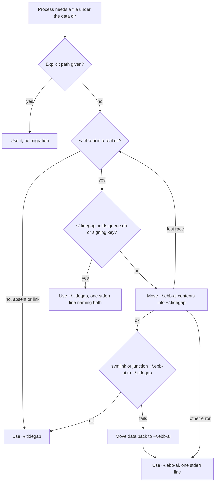
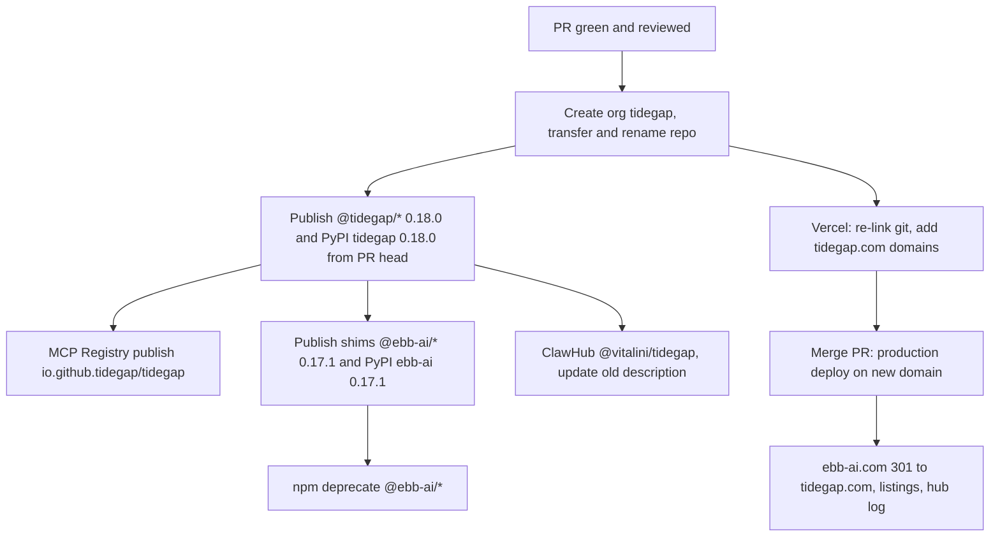

# Rebrand Ebb AI to Tidegap - Plan

## Goal Capsule

- **Objective:** Every public name of the product is Tidegap, so the project no longer conflicts with the EBB trademark (Headspace, class 9). A user on 0.17 who upgrades keeps the queue, the receipts, the signing key, the daemon and the MCP config working, and is told once what to change.
- **Means:** One PR `feat: rebrand to Tidegap` on branch `feat/rebrand-tidegap`, seven commits in the order of KTD1. Compatibility comes from a one-release `ebb` bin alias, `EBB_*` fallback, a `~/.ebb-ai` to `~/.tidegap` move with a back-link (KTD3, KTD4), and 0.17.1 shim packages under the old names (KTD8). Publishing, the repo transfer and the domain switch follow the Release and Deprecation Runbook; they are not code.
- **Authority:** Vitalii's brief for this rebrand, then this plan, then `docs/claims.md`, then `docs/solutions/`. Where the brief and the repo disagree, the plan says which wins in "Brief vs repo" and Open Questions. Where this plan and the repo disagree, stop and report.
- **Stop conditions:** the branch would be pushed before runbook step 0 confirms the npm, PyPI and ClawHub names are owned; a step would publish to npm, PyPI, ClawHub or the MCP Registry, tag, transfer the repo, change a Vercel domain, push to `main` or merge; a historical record (past CHANGELOG sections, `docs/solutions/`, `docs/plans/`, `docs/archive/`, `docs/release/v0.7.1/`) would be rewritten; a receipt or ledger format would change; a gate fails the same way twice.
- **Execution profile:** one worktree at `.worktrees/feat-rebrand-tidegap`, sequential commits U1-U7. No fan-out: U1 touches every manifest and most imports, so every later unit depends on it.
- **Who finishes:** the pipeline stops at an open PR with green gates and one `ce-code-review` pass. Vitalii runs the runbook (publish, transfer, domain, listings) and merges. A merge to `main` is a Vercel production deploy of `apps/web`.

---

## Product Contract

### Summary

Rename the product from Ebb AI to Tidegap across packages, binaries, paths, environment variables, plugin and MCP identities, the website, the images and the docs. Keep every 0.17 install working for one release through aliases, fallbacks, an automatic data-directory move and shim packages under the old names. Prepare release 0.18.0 dated 2026-10-16 as the last commit.

### Problem Frame

"Ebb" conflicts with the EBB trademark held by Headspace in class 9 (software). Continuing under the name risks a takedown of the npm scope, the PyPI project, the listings and the domain after adoption grows. The names are spread over 255 tracked files and about 2,700 occurrences, and they reach outside the repo: npm, PyPI, ClawHub, the MCP Registry, the Claude Code plugin marketplace, GitHub, Vercel and six directory listings. Users have state on disk under the old names (the SQLite ledger, the signing key, config, daemon unit files) and host configs that call `npx -y @ebb-ai/mcp`.

### Brand and identifier map

| Kind | Old | New |
|---|---|---|
| Brand in prose | Ebb AI | Tidegap |
| Identifier | `ebb-ai`, `ebb_ai`, `ebb` | `tidegap` |
| npm | `@ebb-ai/core`, `@ebb-ai/cli`, `@ebb-ai/mcp`, `@ebb-ai/web` (private) | `@tidegap/core`, `@tidegap/cli`, `@tidegap/mcp`, `@tidegap/web` (private) |
| PyPI dist / import | `ebb-ai` / `ebb_ai` | `tidegap` / `tidegap` |
| CLI bin | `ebb` | `tidegap`, plus `ebb` alias for 0.18 |
| MCP bin / serverInfo name | `ebb-mcp` | `tidegap-mcp`, plus `ebb-mcp` alias for 0.18 / `tidegap` |
| Data dir | `~/.ebb-ai/` | `~/.tidegap/` |
| Secrets file | `~/.config/ebb/env` | `~/.config/tidegap/env` |
| Daemon log and wake helper | `~/.ebb/tick.log`, `~/.ebb/laptop-wake.sh` | `~/.tidegap/logs/tick.log`, `~/.tidegap/laptop-wake.sh` |
| launchd / systemd / schtasks | `com.ebb-ai.tick`, `ebb-tick.{service,timer}`, `/TN ebb-tick` | `com.tidegap.tick`, `tidegap-tick.{service,timer}`, `/TN tidegap-tick` |
| Env vars and config-file keys | `EBB_*` | `TIDEGAP_*`, `EBB_*` read as fallback for 0.18 |
| MCP Registry | `io.github.Vitalini/ebb-ai` | `io.github.tidegap/tidegap` |
| Host MCP config key | `"ebb-ai"` (tools `mcp__ebb-ai__*`) | `"tidegap"` (tools `mcp__tidegap__*`) |
| Claude Code marketplace / plugin / commands | `ebb-ai` / `ebb-ai` / `/ebb-ai:*` | `tidegap` / `tidegap` / `/tidegap:*` |
| OpenClaw package / plugin id / config block | `@vitalini/ebb` / `ebb` / `plugins.entries.ebb` | `@vitalini/tidegap` / `tidegap` / `plugins.entries.tidegap` |
| GitHub | `Vitalini/ebb-ai` | `tidegap/tidegap` |
| Site | `https://www.ebb-ai.com` | `https://www.tidegap.com` (see OQ2) |

### Requirements

**Names**

- R1. Every user-facing name in the map above uses the new value in shipped code, manifests, the site, the images and the live docs.
- R2. Internal identifiers that no user sees keep their names where a rename adds risk without user value (KTD6).
- R3. Historical records keep the old names: past CHANGELOG sections, `docs/solutions/`, `docs/plans/`, `docs/archive/`, `docs/release/v0.7.1/`, and quoted raw output in `docs/examples/2026-09-30-GB-tick/`.

**Compatibility for 0.17 users (one release)**

- R4. `ebb <command>` keeps working after installing `@tidegap/cli`, and prints one deprecation line to stderr naming `tidegap`.
- R5. An `EBB_*` variable or config-file key is honored when its `TIDEGAP_*` twin is unset; the twin wins when both are set; each process prints one deprecation line to stderr naming the variables it fell back on.
- R6. The first 0.18 process on a machine moves `~/.ebb-ai/` to `~/.tidegap/` with all contents, and a 0.17 process that still runs afterwards keeps reading and writing the same ledger.
- R7. `tidegap install` writes the new daemon unit, and when an old unit exists it prints the exact commands that unload and remove it.
- R8. `npx -y @ebb-ai/mcp`, `npm i @ebb-ai/core`, `npm i -g @ebb-ai/cli` and `pip install ebb-ai` resolve to shims (0.17.1) that run the new package and print one deprecation line on stderr (KTD8).

**Release**

- R9. All lockstep manifests carry 0.18.0, the CHANGELOG has a dated `0.18.0 — 2026-10-16` section with a "Renamed to Tidegap" upgrade note, and `pnpm preflight` passes.
- R10. The images show the Tidegap wordmark and `npx -y @tidegap/mcp`, re-rendered from the same forecast, with the lock file updated.
- R11. `docs/claims.md` rows that cite renamed paths, renamed commands, the images or the test count match the repo after the change.

### Brief vs repo

The brief and the repo disagree in these places. The plan follows the column "Plan".

| Brief says | Repo has | Plan |
|---|---|---|
| Config dir `~/.ebb-ai` only | Also `~/.config/ebb/env` (secrets, read by `ebb tick` and systemd `EnvironmentFile`), `~/.ebb/` (tick log, laptop wake helper, pre-0.7.1 `queue.sqlite`) | Move `~/.ebb-ai` (KTD3); read the old secrets file as fallback (KTD4); new log and helper paths under `~/.tidegap`; keep the pre-0.7.1 `~/.ebb/queue.sqlite` read fallback as is |
| Env vars `EBB_*` | `EBB_*` are also keys inside the `~/.ebb-ai/config` file (`EBB_CARBON_BUDGET_*`, `EBB_QUOTA_RESET_*`, `EBB_QUOTA_MARGIN_H_*`, `EBB_NOTIFY`) and field names of the exported type `CarbonBudgetEnv` | Fallback covers file keys too; `CarbonBudgetEnv` gains `TIDEGAP_*` fields and keeps `EBB_*` fields as deprecated (KTD5) |
| ClawHub `@vitalini/ebb` to `@vitalini/tidegap` | Also the OpenClaw runtime plugin id `ebb` (`PLUGIN_ID`, `openclaw.plugin.json`), and ClawHub locks the runtime id at first publish (`docs/internal/hub-submission-log.md`, rows for 2026-05-19) | New id `tidegap`, set before the first ClawHub publish; users move their config block (OQ1) |
| CLI alias only | MCP bin `ebb-mcp` (Dockerfile `ENTRYPOINT`, docs) and MCP `serverInfo.name: "ebb-mcp"` | Bin `tidegap-mcp` plus `ebb-mcp` alias for 0.18; serverInfo `tidegap` |
| PyPI `tidegap` | Import package `ebb_ai`, and `__version__` reads the dist name `ebb-ai` | Import package `tidegap`; the `ebb_ai` alias lives only in the PyPI `ebb-ai` 0.17.1 shim (KTD8, OQ3) |
| Plugin namespace `/tidegap:*` | Marketplace name, plugin name, skill dir `skills/ebb-ai/` and SessionStart hook calling `ebb` | All renamed; hook calls `tidegap`, falls back to `ebb` |
| Site `tidegap.com` | Canonical is `https://www.ebb-ai.com` (www) | Canonical `https://www.tidegap.com`, apex redirects to www, as today (OQ2) |
| Six commit groups | Shim packages need code and review | One extra commit U6 for the shims, before release prep (OQ4) |

### Scope Boundaries

- No change to the receipt format, the signing scheme, the ledger schema or the tool names (`schedule_task` and the rest). Receipts signed by 0.17 verify under 0.18 (no brand string is in the signed payload; verified in `packages/core-ts/src/sign.ts`).
- No rewrite of history: the files in R3 stay as they are.
- Removing the `ebb` alias, the `EBB_*` fallback and the `~/.ebb-ai` back-link is 0.19 work.
- Non-goal, considered: an in-place migration of a user's OpenClaw config from `plugins.entries.ebb` to `plugins.entries.tidegap`. OpenClaw hands a plugin only its own block, so the plugin cannot read the old one. The README and the CHANGELOG upgrade note tell the user to move it. Would change if OpenClaw exposes the whole gateway config to plugins.
- Non-goal, considered: auto-unloading the old launchd or systemd unit. `install` today prints `launchctl` and `systemctl` commands and never runs them; R7 keeps that contract. A double tick on one ledger is safe because task claims are compare-and-set (`docs/solutions/logic-errors/compare-and-set-task-transitions.md`), so the only cost is wasted wake-ups until the user runs the printed commands.

### Deferred to Follow-Up Work

- 0.19: remove the `ebb` and `ebb-mcp` bins, the `EBB_*` fallback, the `~/.ebb-ai` back-link and the `CarbonBudgetEnv` `EBB_*` fields.
- After the PR is open: `ce-compound` updates the brand rule in `docs/solutions/tooling-decisions/rendered-repo-images-and-brand-name.md` and the `io.github.Vitalini/ebb-ai` example in `docs/solutions/tooling-decisions/mcp-registry-metadata-and-package-readmes.md` (live guidance, not history).
- The InfoQ article draft outside the repo (OQ5).

### Sources

- `docs/solutions/tooling-decisions/version-lockstep-check.md`: publish from the reviewed PR head, then merge.
- `docs/solutions/tooling-decisions/mcp-registry-metadata-and-package-readmes.md`: `mcpName` must equal `server.json` `name`; npm before registry.
- `docs/solutions/tooling-decisions/rendered-repo-images-and-brand-name.md`: render on the Mac, commit PNGs with the lock, the lock hashes the render script itself.
- `docs/solutions/best-practices/shared-sqlite-ledger-migrations.md`: the ledger is opened by several processes and two cores at once; migration logic is written twice.
- `docs/internal/hub-submission-log.md`: ClawHub locks the runtime id at first publish.
- npm `libnpmexec/lib/get-bin-from-manifest.js` (local npm): `npx <pkg>` picks a bin when all bin entries point at the same file, else the bin named after the package, else fails.
- MCP Registry aggregator guide (modelcontextprotocol.io/registry/registry-aggregators): server metadata is immutable except `status`, which can be set to `deprecated`.

---

## Planning Contract

### Inventory (main @ a0821ac, 2026-10-16)

Search: `git ls-files`, minus binary images, minus `CHANGELOG.md`, `docs/solutions/`, `docs/plans/`; case-insensitive `ebb` or `io.github.vitalini`. Result: 255 files, 2,684 hits. The excluded history holds 20 files, 629 hits, and stays.

| Group | Files | Hits | Unit |
|---|---|---|---|
| Package manifests and lockfile (`package.json` x6, `pyproject.toml`, `pnpm-lock.yaml`) | 8 | 42 | U1 |
| Source: TS cores, CLI (incl. `ui/`), MCP server, Python core, package scripts | 63 | 535 | U1, U2, U3 |
| MCP `server.json`, `Dockerfile` | 2 | 15 | U3 |
| Claude Code plugin (manifest, marketplace, `.mcp.json`, hooks, 8 commands, SKILL) | 13 | 128 | U3 |
| OpenClaw plugin src and manifest | 8 | 128 | U3 |
| Website `apps/web` | 29 | 483 | U4 |
| Images: templates, render and check scripts | 4 | 9 | U4 |
| Other scripts (`check-versions`, `gen-data`, `ui-seed`) | 3 | 19 | U1 |
| Tests (TS and Python, incl. the tool-surface snapshot) | 64 | 484 | the unit that changes the code under test |
| CI and `.github` (workflow filters, templates, dependabot) | 5 | 22 | U1 (workflow), U5 (templates) |
| README, QUICKSTART, CONTRIBUTING, SECURITY, CoC, package READMEs | 11 | 364 | U5 |
| Examples (host configs, `openclaw-skill`, `pi`) | 21 | 186 | U5 |
| `docs/claims.md` | 1 | 9 | U5, U7 |
| `docs/internal` (hub log, SEO, marketing, AI discoverability) | 4 | 47 | U5 |
| Other docs (papers, spec, examples README, article notes, VERCEL-DEPLOY) | 11 | 127 | U5 |
| Historical, kept: `docs/archive/`, `docs/release/v0.7.1/` | 7 | 85 | none |
| `.gitignore` (`ebb-queue.db`) | 1 | 1 | U1 (add `tidegap-queue.db`, keep old line) |

Token kinds (same scope): `EBB_` 355, `@ebb-ai/` 317, `.ebb-ai` 180, `/ebb-ai:` 152, `ebb_ai` 110, `Vitalini/ebb-ai` 78, `ebb-ai.com` 66, `@vitalini/ebb` 40, `Ebb AI` 31, `.ebb/` 28, `ebb-mcp` 27, `ebb-tick` 20, `config/ebb` 15, `com.ebb-ai` 5, `mcp__ebb-ai` 4, `io.github.Vitalini` 2.

Path call sites that must route through one resolver (KTD3): `packages/core-ts/src/sign.ts` (signing key), `packages/core-ts/src/budget.ts` and `quota.ts` (config), `packages/cli/src/commands/tick.ts` (`defaultDbPath`), `packages/cli/src/ui/dispatcher.ts` (logs), `packages/mcp-server/src/server.ts` (queue), `packages/openclaw-plugin/src/index.ts` (queue) and `delivery.ts` (delivery.db), `packages/core-py/src/ebb_ai/sign.py` and `budget.py`.

Environment reads (hosts only; `@ebb-ai/core` is environment-pure, guarded by `packages/core-ts/test/environment-purity.test.ts`): `packages/cli/src/env.ts`, `packages/cli/src/commands/install.ts` (`EBB_BINARY`), `packages/mcp-server/src/env.ts` and `server.ts` (`EBB_DB_PATH`, `EBB_DEFAULT_REGION`, `EBB_DEFAULT_MODEL`), `apps/web/src/lib/grid.ts`, `packages/core-py/src/ebb_ai/grid.py`, `scripts/render-images.mjs` (`EBB_CHROME_PATH`). The OpenClaw plugin reads no environment.

### Key Technical Decisions

- KTD1. **Commit order: packages and identifiers, then paths and migration, then plugin/MCP/OpenClaw, then site and images, then docs, then shims, then release prep.** Each commit leaves `pnpm build && pnpm typecheck && pnpm test` green, so U1 must carry the import and test renames that the package rename forces. Shims (U6) come after docs so their READMEs can link the final docs, and before release prep so check-versions sees the final tree.
- KTD2. **Aliases are extra bin entries pointing at the same file.** `@tidegap/cli` bins `{tidegap, ebb}` both map to `./dist/index.js`; `@tidegap/mcp` bins `{tidegap-mcp, ebb-mcp}` both map to `./dist/server.js`. npm's `npx` accepts several bins when all point at one file, so `npx -y @tidegap/mcp` and `npx -y @tidegap/cli` keep working. The program detects the alias from the basename of `process.argv[1]` and prints the deprecation line. On Windows the npm cmd shim passes the real path, so no line prints there; accepted.
- KTD3. **One home resolver per core moves `~/.ebb-ai` once, then leaves a back-link.** Migration is decided by the state of `~/.ebb-ai`, not by whether `~/.tidegap` exists, because 0.18 code (the daemon log dir, the wake helper) may create `~/.tidegap` first. Rules, directional only:
  - `~/.ebb-ai` is absent or already a link: use `~/.tidegap`.
  - `~/.ebb-ai` is a real directory and `~/.tidegap` is absent: `rename` it to `~/.tidegap`, then create the symlink `~/.ebb-ai` to `~/.tidegap` (Windows: a directory junction).
  - `~/.ebb-ai` is a real directory and `~/.tidegap` exists without `queue.db` and `signing.key`: move each `~/.ebb-ai` entry into `~/.tidegap`, remove the empty `~/.ebb-ai`, then create the back-link.
  - Both hold a `queue.db` or a `signing.key`: change nothing, use `~/.tidegap`, print one stderr line naming both paths.
  - The back-link cannot be created after a successful move: move the data back to `~/.ebb-ai` and continue on the in-place branch. The rename and the link succeed or fail together, because SQLite refuses writes when the opened path no longer resolves to the same file (`SQLITE_READONLY_DBMOVED`), and 0.17 daemon units pin `--db ~/.ebb-ai/queue.db`.
  - The rename loses a race (source gone, or target appeared): re-check the rules above.
  - The rename fails for any other reason (Windows sharing violation, `EXDEV`, permissions): use `~/.ebb-ai` in place for this process and print one stderr line.
  - An explicit path (`--db`, `TIDEGAP_DB_PATH`/`EBB_DB_PATH`, OpenClaw `dbPath`) bypasses the resolver for that file.
  The TS resolver lives in `@tidegap/core` (new `paths` module, exported) and every TS path under the data dir goes through it, including the daemon log and the wake helper; Python gets the same rules in `tidegap/paths.py`. Rejected: read-through with no move (two homes forever, and 0.19 cannot drop the old path); copy instead of move (two ledgers diverge as soon as a 0.17 process writes).
- KTD4. **The secrets file is read, not moved.** `tick` loads `~/.config/tidegap/env`, and `~/.config/ebb/env` when the new file is absent. `tidegap install` creates the new file by copying the old one (mode 0600) when only the old one exists. The old systemd unit references the old path, so it must stay in place.
- KTD5. **`EBB_*` fallback is one helper per host plus one parser rule in core.** Each host env boundary (`cli/src/env.ts`, `mcp-server/src/env.ts`, `apps/web/src/lib/grid.ts`, Python `grid.py`) reads `TIDEGAP_<NAME>` then `EBB_<NAME>` and collects the fallen-back names for one stderr line per process. The core config-file parsers (`budget.ts`, `quota.ts`, the `EBB_NOTIFY` read in `tick.ts`, Python `budget.py`) accept both prefixes, `TIDEGAP_` wins per key. `CarbonBudgetEnv` gains `TIDEGAP_CARBON_BUDGET_G` and `TIDEGAP_CARBON_BUDGET_WINDOW`; the `EBB_` fields stay, marked deprecated. On the MCP server the line goes to stderr only; stdout is the protocol channel.
- KTD6. **Keep internal identifiers that no user sees.** Kept: SVG and CSS ids in `apps/web/src/components/how-it-works-viz.tsx` (`ebbGlow`, `.ebb-card-*`), the exported test seams `createEbbServer` and `EbbServerDeps` in `packages/mcp-server/src/server.ts`, the option `ebbBinaryPath` and locals such as `ebbHome`, `ebbPlugin`, test temp-dir prefixes (`ebb-sign-`, `ebb-mcp-budget-`), and the pre-0.7.1 `~/.ebb/queue.sqlite` fallback. Renamed although internal: log prefixes (`[ebb-ai/scheduler]`, `[ebb-ai/grid]`, `[ebb-mcp]`, `[ebb-ai/cli]`) and the Windows toast app id, because users read them.
- KTD7. **Old daemon units are detected, not removed.** `daemonStatus` reports `installed` when either the new or the old unit file exists. `tidegap install` writes the new unit and, when an old one exists, appends the unload and remove commands to its "Next steps". A 0.17 unit pins `[node, realpath of @ebb-ai/cli/dist/index.js]` and `--db ~/.ebb-ai/queue.db` (`resolveLauncher` in `packages/cli/src/commands/install.ts`), not the `ebb` bin. It keeps working while `@ebb-ai/cli` 0.17.0 or the 0.17.1 shim stays installed (the shim keeps an entry at `dist/index.js`, KTD8) and the `~/.ebb-ai` back-link exists (KTD3). It fails on every tick after `npm uninstall -g @ebb-ai/cli` until the user runs the printed unload commands, so the upgrade note orders unload before uninstall.
- KTD8. **Shims live in the repo under `compat/`, outside the pnpm workspace and outside check-versions.** `compat/npm/core`, `compat/npm/cli`, `compat/npm/mcp` are `@ebb-ai/*@0.17.1`; `compat/pypi/ebb-ai` is `ebb-ai==0.17.1`. Each depends on the matching new package at `^0.18.0` / `>=0.18,<0.19`.
  - `@ebb-ai/core`: re-exports `@tidegap/core` and its `grid`, `energy`, `types` subpaths; its entry module writes the deprecation line to stderr once at import.
  - `@ebb-ai/cli`: entry at `dist/index.js` (the path 0.17 daemon units pin, KTD7), bin `ebb` points at it; it prints the deprecation line and runs the `@tidegap/cli` program.
  - `@ebb-ai/mcp`: bin `ebb-mcp`, keeps `mcpName: io.github.Vitalini/ebb-ai`, prints the line to stderr and calls the exported `main` of `@tidegap/mcp`.
  - `ebb-ai` (PyPI): ships an `ebb_ai` package that re-exports `tidegap`, aliases its submodules, writes the deprecation line to `sys.stderr` once at import, and carries the classifier `Development Status :: 7 - Inactive`. `pip install ebb-ai` itself prints nothing; the install-time pointer is the project description and the classifier.
  The workspace globs (`packages/*`, `apps/*`, `examples/*`) do not match `compat/`, so build and test never touch the shims. U2 must export `main` from `@tidegap/mcp` and make `@tidegap/cli` runnable when imported (its `isDirect` check matches `/cli/dist/index.js`, which still holds under `@tidegap/cli`; U6 adds a test).
- KTD9. **Version 0.18.0 for all new packages; 0.17.1 for the shims.** A rename is a minor bump under 0.x. The shims are a patch on the old line so `^0.17.0` ranges in users' manifests pick them up.

### High-Level Technical Design

Home resolution (KTD3), same rules in TS and Python:



Release order (runbook), the order that keeps every public link working:



### Assumptions

- The `tidegap` npm scope, the PyPI name `tidegap`, the GitHub org `tidegap`, the domain `tidegap.com` and the ClawHub slug `@vitalini/tidegap` are owned by Vitalii before the branch is pushed (runbook step 0). The code in the PR does not depend on them.
- Claude Code treats a marketplace whose `name` changed as a new marketplace; existing `ebb-ai@ebb-ai` installs do not update in place. Users reinstall (Breaking changes table).
- No user relies on `import "@ebb-ai/core/package.json"` returning the core's version; the shim's own `package.json` answers that path with 0.17.1.
- The MCP Registry lets the owner of `io.github.Vitalini/ebb-ai` set a version's `status` to `deprecated`; the exact `mcp-publisher` command is verified during the runbook.

### Sequencing

U1 to U7 in order, one commit each, on one branch. U4 renders images on the Mac with the installed Chrome (the lock records `darwin` and the Chrome build). U7 is last and dates the CHANGELOG 2026-10-16.

---

## Implementation Units

### U1. refactor: rename packages and identifiers to tidegap

- **Goal:** R1, R2 for packages, imports, bins, Python module and build wiring.
- **Requirements:** R1, R2, R4 (bin alias part).
- **Dependencies:** none.
- **Files:** `package.json` (name, repository, homepage, bugs, `release:npm` filters, `gen:data:check` path), `packages/core-ts/package.json`, `packages/cli/package.json` (bins `tidegap` and `ebb`), `packages/mcp-server/package.json` (bins `tidegap-mcp` and `ebb-mcp`), `packages/openclaw-plugin/package.json` (name `@vitalini/tidegap`), `apps/web/package.json`, `apps/web/vercel.json` (`--filter` names), `apps/web/src/lib/version.ts`, `packages/core-py/pyproject.toml` (name, urls, wheel `packages`), rename `packages/core-py/src/ebb_ai/` to `packages/core-py/src/tidegap/` (incl. `__version__` reading dist `tidegap`), every `@ebb-ai/*` import in `packages/*/src`, `packages/*/test`, `apps/web/src`, `scripts/*.mjs`, every `ebb_ai` import in `packages/core-py/src` and `tests`, `scripts/gen-data.mjs` (Python output path), `.github/workflows/ci.yml` (filters, Python step names, generated-file path), `.github/dependabot.yml` comment, `.gitignore`, `pnpm-lock.yaml` (regenerated), `packages/cli/src/index.ts` (alias deprecation line), log-prefix strings per KTD6 in `packages/core-ts/src/*.ts`, `packages/cli/src/**/*.ts`, `packages/mcp-server/src/server.ts`, `packages/core-py/src/tidegap/*.py`, `packages/core-ts/src/notify.ts` (toast app id and titles), `packages/cli/ui/*` (visible brand strings), test files asserting those strings, new `packages/cli/test/bin-alias.test.ts`.
- **Approach:**
  1. Rename package names and bins; regenerate the lockfile with `pnpm install`.
  2. Rename imports mechanically, then review each hit against KTD6 (no global replace; `docs/solutions/tooling-decisions/rendered-repo-images-and-brand-name.md`).
  3. Rename the Python package directory with `git mv`, then imports.
  4. Brand strings users read in program output: `Tidegap` in prose, `tidegap` in commands.
- **Patterns to follow:** `scripts/check-versions.mjs` keeps its lookup shape; CLI `isDirect` in `packages/cli/src/index.ts`.
- **Test scenarios:**
  - Running the built CLI through a symlink named `ebb` prints exactly one stderr line containing `tidegap` and the command's normal stdout.
  - Running it through a symlink named `tidegap` prints no deprecation line.
  - `packages/cli/package.json` bins `tidegap` and `ebb` point at the same file (guards KTD2 against a future edit).
  - Same check for `packages/mcp-server/package.json` bins.
  - Python: `import tidegap` exposes `__version__` equal to the pyproject version in an editable install.
  - Existing suites pass with renamed imports and updated expected log prefixes.
- **Verification:** build, typecheck and both test suites pass; `git grep -n "@ebb-ai/\|ebb_ai" -- packages apps scripts .github` returns only KTD6 keeps; `pnpm check:versions` passes.

### U2. feat: tidegap home dir, EBB_* fallback and daemon unit migration

- **Goal:** R5, R6, R7 and the secrets-file rule.
- **Requirements:** R5, R6, R7; KTD3, KTD4, KTD5, KTD7.
- **Dependencies:** U1.
- **Files:** new `packages/core-ts/src/paths.ts` (exported from `packages/core-ts/src/index.ts`), `packages/core-ts/src/sign.ts`, `budget.ts`, `quota.ts`, `types.ts` (`CarbonBudgetEnv`), `packages/cli/src/env.ts`, `packages/cli/src/commands/tick.ts`, `install.ts`, `env-file.ts`, `packages/cli/src/platform/{index,macos,linux,windows}.ts`, `packages/cli/src/ui/dispatcher.ts`, `packages/mcp-server/src/env.ts`, `packages/mcp-server/src/server.ts` (paths, env names, export `main`), `packages/openclaw-plugin/src/index.ts`, `delivery.ts`, `apps/web/src/lib/grid.ts`, `packages/core-py/src/tidegap/paths.py` (new), `sign.py`, `budget.py`, `grid.py`; tests: new `packages/core-ts/test/paths.test.ts`, `packages/core-py/tests/test_paths.py`, updated `packages/cli/test/{env,env-file,install,tick,platform-macos,platform-linux,platform-windows}.test.ts`, `packages/mcp-server/test/env.test.ts`, `packages/core-ts/test/{budget,quota,sign}.test.ts`, `packages/core-py/tests/test_budget.py`, `packages/openclaw-plugin/test/config.test.ts`.
- **Approach:**
  1. `paths` module per KTD3, taking an injectable home dir and fs seam for tests (pattern: `daemonStatus` options in `packages/cli/src/platform/index.ts`).
  2. Replace every hardcoded `.ebb-ai` call site listed in the Inventory with the resolver, and build every new `~/.tidegap` path (daemon log, wake helper, logs dir) from it too.
  3. Env helper per host and dual-prefix parsing per KTD5; MCP deprecation output to stderr only.
  4. Daemon: new label, unit names, log path `~/.tidegap/logs/tick.log`, helper `~/.tidegap/laptop-wake.sh`; `install` (not dry-run) creates `dirname(logPath)` before writing the unit, because launchd `StandardOutPath` and systemd `StandardOutput=append:` do not create parent dirs; old-unit detection and printed cleanup per KTD7; `TIDEGAP_BINARY` with `EBB_BINARY` fallback; launcher resolution prefers `tidegap`.
  5. Python mirrors the resolver and the fallback (`docs/solutions/best-practices/shared-sqlite-ledger-migrations.md`: same rules in both cores).
- **Execution note:** write the resolver tests first; they pin the race and failure branches that a real run cannot hit reliably.
- **Test scenarios:**
  - Only `~/.ebb-ai` with `queue.db`, `signing.key`, `config`: first resolve moves all three, `~/.ebb-ai` becomes a link to `~/.tidegap`, the queue opens with its rows.
  - `~/.tidegap` holds only `logs/` (created by `install`) and `~/.ebb-ai` is a real dir with a ledger: the ledger and key move into `~/.tidegap`, `~/.ebb-ai` becomes a link.
  - Both dirs hold a `queue.db`: nothing moves, resolver uses `~/.tidegap`, one warning names both paths.
  - Neither exists: resolver returns `~/.tidegap` and creates nothing until a write.
  - Rename fails with `EEXIST` because another process won: resolver re-checks and returns `~/.tidegap`, no error line.
  - Rename fails with `EPERM`: resolver returns `~/.ebb-ai` and emits one warning.
  - Back-link creation fails after the move: data is moved back to `~/.ebb-ai`, resolver returns `~/.ebb-ai`, one warning.
  - A 0.17-style path open on `~/.ebb-ai/queue.db` after migration reads the migrated ledger (through the link).
  - Python resolver passes the same resolver cases above against a TS-migrated tree.
  - `install` on macOS and on Linux with an empty home creates `~/.tidegap/logs` before writing the unit.
  - Env: only `EBB_EIA_API_KEY` set gives the key and one deprecation line naming it; both set gives the `TIDEGAP_` value and no line; neither gives undefined.
  - Config file with `EBB_CARBON_BUDGET_G=500` and `TIDEGAP_CARBON_BUDGET_G=300` yields 300; only the `EBB_` key yields 500. Same for `EBB_QUOTA_RESET_CLAUDE` and `EBB_NOTIFY`.
  - Secrets: only `~/.config/ebb/env` present, `tick` loads it; `install` (not dry-run) creates `~/.config/tidegap/env` with the same content and mode 0600.
  - `install` on macOS with an old `com.ebb-ai.tick.plist` present writes `com.tidegap.tick.plist` and its next steps contain `launchctl unload` and `rm` for the old plist; without the old plist, no cleanup lines.
  - Linux: same with `ebb-tick.timer` and `systemctl --user disable --now ebb-tick.timer`.
  - `daemonStatus` reports `installed` for the new file, for the old file, and `not_installed` for neither.
  - MCP server started with only `EBB_DB_PATH` uses that path and writes nothing to stdout before the protocol handshake.
  - `environment-purity.test.ts` still passes: the core resolver reads no environment.
- **Verification:** suites green; a manual smoke on a copy of a real `~/.ebb-ai` (with `HOME` pointed at a temp dir) runs `tidegap queue list` and `ebb queue list` and both show the same tasks.

### U3. feat: plugin, MCP and OpenClaw identities to tidegap

- **Goal:** R1 for every host-facing identity.
- **Requirements:** R1, R4 (hook fallback).
- **Dependencies:** U1, U2.
- **Files:** `packages/mcp-server/server.json` (name, title, websiteUrl, repository, package identifier, env var names with `TIDEGAP_`), `packages/mcp-server/package.json` (`mcpName: io.github.tidegap/tidegap`), `packages/mcp-server/src/server.ts` (`serverInfo.name: "tidegap"`), `packages/mcp-server/scripts/smoke-stdio.mjs`, `Dockerfile` (`@tidegap/mcp`, `tidegap-mcp`, Glama URL), `glama.json` (unchanged unless the org must be listed, see runbook), `packages/core-ts/src/tool-surface.ts` (descriptions: `Tidegap`, `~/.tidegap/config`, `TIDEGAP_QUOTA_RESET_<LABEL>`), `packages/core-ts/test/__snapshots__/tool-surface.test.ts.snap`, `.claude-plugin/marketplace.json`, `scripts/check-versions.mjs` (marketplace lookup by `tidegap`, in the same commit as the marketplace rename), `packages/claude-code-plugin/.claude-plugin/plugin.json`, `packages/claude-code-plugin/.mcp.json` (key `tidegap`, `@tidegap/mcp`), `packages/claude-code-plugin/hooks/hooks.json` (`tidegap`, else `ebb`), `packages/claude-code-plugin/commands/*.md` (8 files), `git mv packages/claude-code-plugin/skills/ebb-ai packages/claude-code-plugin/skills/tidegap` and its `SKILL.md` (`name: tidegap`, `/tidegap:defer`, `mcp__tidegap__schedule_task`), delete stray `packages/claude-code-plugin/skills/.DS_Store`, `packages/openclaw-plugin/openclaw.plugin.json` (id `tidegap`, name, descriptions), `packages/openclaw-plugin/src/config.ts` (`PLUGIN_ID`), `index.ts` (`id`), `delivery.ts` (extension path `~/.openclaw/extensions/tidegap`), `packages/openclaw-plugin/src/tool-schemas.ts`, `packages/openclaw-plugin/scripts/smoke.mjs`, `packages/openclaw-plugin/test/*.ts`, `packages/mcp-server/test/*.ts`.
- **Approach:** identities change together so no host sees a half-renamed set. The OpenClaw config schema descriptions name `TIDEGAP_*` and say the `EBB_*` names were the 0.17 spelling.
- **Test scenarios:**
  - MCP `initialize` over stdio returns `serverInfo.name` `tidegap` and the nine tools with unchanged names.
  - Tool-surface snapshot updates only in description text (diff shows no name or schema change).
  - `server.json` `name` equals `package.json` `mcpName` (extend the existing check or add one in `packages/mcp-server/test/`).
  - OpenClaw plugin registers with id `tidegap` and its tools derive from the canonical surface (`tool-surface-derivation.test.ts`).
  - Hook command exits 0 and prints nothing when neither binary exists.
- **Verification:** suites green; `claude plugin validate packages/claude-code-plugin` (if available) passes; `openclaw plugins validate` per `packages/openclaw-plugin/README.md` passes when the CLI is installed, else noted as skipped.

### U4. feat(web): Tidegap site, metadata and images

- **Goal:** R1 for the site and R10.
- **Requirements:** R1, R10.
- **Dependencies:** U1 to U3 (install commands and package names shown on the site must exist).
- **Files:** `apps/web/src/app/layout.tsx` (title template, metadataBase, canonical, OG, Twitter, JSON-LD `name`, `url`, `codeRepository`, `@id`s), `apps/web/src/app/{robots,sitemap,manifest}.ts`, `apps/web/src/app/{page,about,docs,queue,stats,plan,map,forecast}/page.tsx` as they hit, `apps/web/src/components/{nav,install-picker,agent-prompt,best-window,how-it-works-viz}.tsx` (visible text only, KTD6), `apps/web/src/lib/{grid,types,geo}.ts`, `apps/web/src/app/api/grid/[region]/route.ts`, `apps/web/next.config.ts` comment, `apps/web/public/{llms.txt,install.md,architecture.html}`, `apps/web/.env.example` (`TIDEGAP_*`, note on `EBB_*` fallback), `apps/web/README.md`, `assets/templates/{og-image,social-preview,readme-hero}.html` (wordmark `Tidegap`, command `npx -y @tidegap/mcp`), `scripts/render-images.mjs` (rename `EBB_CHROME_PATH` to `TIDEGAP_CHROME_PATH`, no fallback: maintainer-only script, outside R5) and `scripts/check-images.mjs` comments, `assets/social-preview.png`, `assets/readme-hero.png`, `apps/web/public/og-image.png`, `assets/images.lock.json`, `packages/cli/test/docs-lockstep.test.ts` (match `tidegap <subcommand>`).
- **Approach:**
  1. Text and metadata edits; the OG image keeps the URL `/og-image.png`.
  2. Re-render with `pnpm gen:images` on the Mac, commit the three PNGs and the lock together. The numbers are unchanged (claims row 31).
- **Test scenarios:**
  - `docs-lockstep.test.ts`: every `tidegap <word>` on the queue page, the stats page and `install.md` is a registered CLI command.
  - Test expectation for the rest: none, covered by the web build and the served-metadata checks below.
- **Verification:** web typecheck, lint and build pass; `next start` locally serves `<link rel="canonical" href="https://www.tidegap.com">`, JSON-LD `name` `Tidegap`, `og:image` absolute on `www.tidegap.com`; `pnpm gen:images:check` passes; `social-preview.png` stays under 1 MB.

### U5. docs: rename to Tidegap across READMEs, examples and live docs

- **Goal:** R1 for docs, R3 kept, R11 for path and command rows.
- **Requirements:** R1, R3, R11.
- **Dependencies:** U1 to U4.
- **Files:** `README.md` (H1, first sentence, badges, install block, `/tidegap:*`, config paths, env table with `TIDEGAP_*`, migration section), `QUICKSTART.md`, `CONTRIBUTING.md`, `SECURITY.md`, `CODE_OF_CONDUCT.md`, `packages/*/README.md` (6), `examples/**` (host configs to key `tidegap` and `@tidegap/mcp`, `examples/openclaw-skill/SKILL.md` and `scripts/install.sh`, rename `examples/pi/ebb-ai.md` to `examples/pi/tidegap.md`), `.github/ISSUE_TEMPLATE/*.md`, `.github/PULL_REQUEST_TEMPLATE.md`, `docs/claims.md` (rows 1, 25, 27 and the summary bullets: paths `packages/claude-code-plugin/skills/tidegap/SKILL.md` and `/tidegap:defer`; row 31: images re-rendered 2026-10-16 with the new wordmark, numbers unchanged), `docs/internal/hub-submission-log.md` (title, new rows per the runbook with status `not started`), `docs/internal/{AI-discoverability,SEO-playbook,marketing-channels}.md`, `docs/VERCEL-DEPLOY.md`, `docs/papers/carbon-aware-mcp-scheduling.md`, `docs/spec/**`, `docs/impact-proposal.md`, `docs/article-notes.md`, `docs/examples/2026-09-30-GB-tick/README.md` (prose and reproducer commands; raw `output.txt` stays as captured, with a one-line note that it was recorded under the old name).
- **Approach:** brand "Tidegap" in prose, `tidegap` in code spans. Every link to `github.com/Vitalini/ebb-ai` becomes `github.com/tidegap/tidegap`. README gets a short "Renamed from Ebb AI" section with the Breaking changes table below. No edit to R3 files.
- **Test scenarios:** Test expectation: none -- docs only; `docs-lockstep.test.ts` already guards CLI commands on the site.
- **Verification:** `git grep -n '@ebb-ai/' -- pnpm-lock.yaml` is empty, and `git grep -niE "ebb" -- ':!CHANGELOG.md' ':!docs/solutions' ':!docs/plans' ':!docs/archive' ':!docs/release' ':!compat' ':!pnpm-lock.yaml'` lists only KTD6 keeps, the compatibility notes, the hub-log history rows and `docs/examples/2026-09-30-GB-tick/output.txt`; every README link resolves (no file removed that a README points at).

### U6. feat(compat): @ebb-ai/* and ebb-ai 0.17.1 deprecation shims

- **Goal:** R8.
- **Requirements:** R8; KTD8, KTD9.
- **Dependencies:** U1 to U5.
- **Files:** `compat/npm/core/{package.json,index.js,index.d.ts,grid.js,grid.d.ts,energy.js,energy.d.ts,types.js,types.d.ts,README.md}`, `compat/npm/cli/{package.json,dist/index.js,README.md}`, `compat/npm/mcp/{package.json,bin.js,README.md}`, `compat/pypi/ebb-ai/{pyproject.toml,README.md,src/ebb_ai/__init__.py}`, `compat/README.md` (what each shim does, publish order pointer to the runbook), `compat/test/shims.test.mjs` (node:test, no workspace dependency).
- **Approach:** no build step; plain ESM JavaScript plus hand-written `.d.ts` re-exports. Deprecation text, one line: `<old name> is now <new name>; install <new name> (this package stops receiving updates).` The MCP shim writes it to stderr before starting the server. The PyPI shim aliases each `tidegap` submodule under `ebb_ai.*` so `from ebb_ai.grid import ...` keeps working.
- **Test scenarios:**
  - With the workspace `@tidegap/*` linked into a temp dir, `import("@ebb-ai/core")` exposes the same export names as `@tidegap/core`.
  - `@ebb-ai/mcp` bin answers an MCP `initialize` on stdio with `serverInfo.name` `tidegap`; the deprecation line is on stderr, stdout has only JSON-RPC.
  - `@ebb-ai/cli` bin `ebb queue list --help` exits 0 and prints the deprecation line once.
  - `node compat/npm/cli/dist/index.js tick --help` (the path a 0.17 daemon unit pins) exits 0 and prints the deprecation line once.
  - `import("@ebb-ai/core")` writes the deprecation line to stderr once.
  - Python: `import ebb_ai.grid` succeeds against an editable `tidegap` and writes one deprecation line to stderr.
- **Verification:** `node --test compat/test` passes; `npm pack --dry-run` in each npm shim lists only the intended files; `python -m build` in the PyPI shim produces a wheel whose metadata lists `Requires-Dist: tidegap>=0.18,<0.19` and the Inactive classifier.

### U7. chore(release): prepare 0.18.0

- **Goal:** R9, R11 for test counts.
- **Requirements:** R9, R11.
- **Dependencies:** U1 to U6.
- **Files:** `packages/core-ts/package.json`, `packages/cli/package.json`, `packages/mcp-server/package.json`, `packages/mcp-server/server.json` (both versions), `packages/openclaw-plugin/package.json`, `packages/openclaw-plugin/openclaw.plugin.json`, `packages/claude-code-plugin/.claude-plugin/plugin.json`, `.claude-plugin/marketplace.json`, `packages/core-py/pyproject.toml`, `README.md` (status line `v0.18.0 (this release) · 2026-10-16`, test count and badge), `apps/web/src/app/layout.tsx` and `apps/web/src/app/about/page.tsx` (test count), `docs/article-notes.md` and `docs/spec/proposal/UPSTREAM-PR.md` (test count), `docs/claims.md` rows 13, 15, 32 (new count, rerun date), `CHANGELOG.md`.
- **Approach:**
  1. CHANGELOG: move `## [Unreleased]` into `## [0.18.0] — 2026-10-16` with sections Changed ("Renamed to Tidegap"), Added (`paths` resolver, `TIDEGAP_*` variables, shims), Deprecated (`ebb`, `ebb-mcp`, `EBB_*`, `~/.ebb-ai` link, removed in 0.19), and an "Upgrade notes" list that is the Breaking changes table in short form.
  2. Link refs: `[Unreleased]` and `[0.18.0]` compare URLs on `github.com/tidegap/tidegap`; older refs stay (GitHub redirects them).
  3. Test count from the U7 full gate run (TS + Python), written in every place row 13 lists.
- **Test scenarios:** none beyond the gates.
- **Verification:** `pnpm check:versions` prints `check-versions: 0.18.0 everywhere (12 files)`; `git grep -n "0\.17\.0" -- ':!CHANGELOG.md' ':!docs' ':!compat' ':!pnpm-lock.yaml' ':!scripts/ui-seed.mjs'` is empty (the lockfile holds third-party `@eslint/core@0.17.0`; the seed script holds sample text); full gate below.

---

## Breaking changes for existing users and what covers them

| What a 0.17 user has | What happens on 0.18 | Covered by | User action |
|---|---|---|---|
| Ledger, key, config in `~/.ebb-ai/` | Moved to `~/.tidegap/` on first run; `~/.ebb-ai` links to it | KTD3 | none |
| `EBB_*` in shell, MCP host config or Vercel | Still read, one stderr line | KTD5 | rename to `TIDEGAP_*` before 0.19 |
| `EBB_*` keys in the config file | Still read | KTD5 | rename keys before 0.19 |
| Secrets in `~/.config/ebb/env` | Still read; `tidegap install` copies to the new path | KTD4 | none |
| Daemon `com.ebb-ai.tick` / `ebb-tick.timer` pinning node plus `@ebb-ai/cli/dist/index.js` | Keeps running while `@ebb-ai/cli` (0.17.0 or the 0.17.1 shim) is installed; fails on every tick after it is uninstalled | KTD7, KTD8 | `npm i -g @tidegap/cli` (after uninstalling `@ebb-ai/cli` if npm reports `EEXIST`), `tidegap install`, run the printed unload commands, then `npm uninstall -g @ebb-ai/cli` |
| `npm i -g @ebb-ai/cli` and later `npm i -g @tidegap/cli` | npm refuses with `EEXIST` on the `ebb` bin (two packages own it) | shim README and deprecation line give the uninstall-first command | uninstall the old package first |
| `npx -y @ebb-ai/mcp` in a host config | Runs the shim, which runs `@tidegap/mcp` | KTD8 | switch to `npx -y @tidegap/mcp`, key `tidegap` |
| Claude Code plugin `ebb-ai@ebb-ai` | No update path; marketplace and plugin names changed | none possible | `claude plugin uninstall ebb-ai`, `claude plugin marketplace remove ebb-ai`, `claude plugin marketplace add tidegap/tidegap`, `claude plugin install tidegap` |
| Habit `/ebb-ai:defer`, tools `mcp__ebb-ai__*` | Gone after reinstall | none | use `/tidegap:*` |
| OpenClaw `clawhub:@vitalini/ebb`, config `plugins.entries.ebb` | Old plugin stays on 0.17; new plugin has id `tidegap` | none possible (Scope Boundaries) | `openclaw plugins install clawhub:@vitalini/tidegap`, move the config block to `plugins.entries.tidegap`, remove the old plugin |
| `pip install ebb-ai`, `import ebb_ai` | Shim installs `tidegap`, import works with a warning | KTD8 | `pip install tidegap`, `import tidegap` |
| Links to `github.com/Vitalini/ebb-ai` and `www.ebb-ai.com` | GitHub redirect; 301 to `www.tidegap.com` | runbook | none |

---

## Release and Deprecation Runbook

Not code. Vitalii runs it after the PR is green and reviewed, except step 0. Each step names its check.

0. **Claim the names before the branch is pushed.** The repo is public, so the PR announces `tidegap` on PyPI and `@tidegap/*` on npm (both unclaimed on 2026-10-16). Confirm Vitalii owns the npm org `tidegap`, the PyPI project `tidegap` (register it with a minimal owner release if needed) and the ClawHub slug `@vitalini/tidegap`. The `ebb-ai` PyPI shim depends on `tidegap`, so a squatted name would reach every shim user. `ce-work` must not push until this is confirmed.
1. **GitHub org and transfer.** Create org `tidegap` (in progress). Transfer `Vitalini/ebb-ai` to `tidegap`, then rename the repo to `tidegap`. GitHub redirects git, web and API URLs from the old path; do not create a new `Vitalini/ebb-ai` repo, it would break the redirect. Make Vitalii's org membership public (the MCP Registry checks it for `io.github.tidegap/*`). Re-upload `assets/social-preview.png` in repo settings. Re-add the 20 topics if they did not carry. Check: `git ls-remote https://github.com/Vitalini/ebb-ai` answers; the open PR shows under `tidegap/tidegap`.
2. **npm 0.18.0 from the reviewed PR head, before merge** (`docs/solutions/tooling-decisions/version-lockstep-check.md`). `pnpm release:npm` (now filtering `@tidegap/*`). Check: `npm view @tidegap/mcp version` is 0.18.0; `npx -y @tidegap/mcp` answers `initialize`.
3. **PyPI tidegap 0.18.0** from `packages/core-py`. Check: `pip install tidegap==0.18.0` in a clean venv, `python -c "import tidegap"`.
4. **MCP Registry, new id.** `mcp-publisher login github` as an org member, `mcp-publisher publish` from `packages/mcp-server` (npm must already have 0.18.0 with the matching `mcpName`). Check: the registry API lists `io.github.tidegap/tidegap` 0.18.0.
5. **npm shims 0.17.1.** Publish `compat/npm/{core,cli,mcp}`. Then `npm deprecate "@ebb-ai/core@*" "Renamed to @tidegap/core. Install @tidegap/core."`, same for `@ebb-ai/cli` and `@ebb-ai/mcp`. Deprecating `@*` includes 0.17.1, which is intended: the warning shows on install and the shim still runs. Check: `npm view @ebb-ai/mcp deprecated` prints the pointer; `npx -y @ebb-ai/mcp` still starts.
6. **PyPI shim ebb-ai 0.17.1** from `compat/pypi/ebb-ai`. Optionally yank nothing; the Inactive classifier and the project description carry the pointer. Check: `pip install ebb-ai` in a clean venv pulls `tidegap` 0.18.0.
7. **MCP Registry, old id.** Publish a final `io.github.Vitalini/ebb-ai` 0.17.1 whose description reads "Renamed to io.github.tidegap/tidegap" and which points at `@ebb-ai/mcp` 0.17.1 (its `mcpName` is still the old id). Then set the old versions' `status` to `deprecated` with `mcp-publisher` (command to confirm against the current `mcp-publisher --help`; the registry allows changing only `status` on published versions). If the CLI has no status command, open an issue on `modelcontextprotocol/registry` asking for deprecation.
8. **ClawHub.** Publish `packages/openclaw-plugin` as `@vitalini/tidegap` 0.18.0; the runtime id `tidegap` is locked on this first publish, so check `openclaw.plugin.json` id before publishing. Update `@vitalini/ebb`'s description to "Renamed: install clawhub:@vitalini/tidegap". Do not delete it (installed users would lose the source). Check: `openclaw plugins install clawhub:@vitalini/tidegap` on a test gateway.
9. **Vercel.** Project settings, Git: reconnect to `tidegap/tidegap` (grant the Vercel GitHub app access to the `tidegap` org first). Domains: add `tidegap.com` and `www.tidegap.com`, set `www.tidegap.com` primary and the apex to redirect to it. Add `TIDEGAP_EIA_API_KEY`, `TIDEGAP_ENTSOE_SECURITY_TOKEN`, `TIDEGAP_ELECTRICITY_MAPS_API_KEY` (the `EBB_*` ones keep working until removed). Rename the Vercel project to `tidegap` if desired.
10. **Merge the PR** (Vitalii only). This deploys the site with the new canonical URL. Check: `curl -sI https://www.tidegap.com` is 200; canonical and `og:image` point at `www.tidegap.com`.
11. **Old domain.** In Vercel, set `ebb-ai.com` and `www.ebb-ai.com` to redirect to `https://www.tidegap.com` with status 301, path preserved. Keep the `ebb-ai.com` registration for at least 12 months. Check: `curl -sI https://www.ebb-ai.com/docs` gives `301` and `location: https://www.tidegap.com/docs`. Resubmit the sitemap in Google Search Console and Bing Webmaster Tools and use the change-of-address tool for the old property.
12. **Tag** `v0.18.0` on the merge commit; GitHub release notes from the CHANGELOG section.
13. **Listings.**
    - mcp.so: edit the server entry (name, URL, config JSON with `@tidegap/mcp`); the entry is already stale (v0.7).
    - punkpeye/awesome-mcp-servers PR #16076: push an update to the entry line: name `tidegap/tidegap`, link `https://github.com/tidegap/tidegap`, Glama badge URL on the new path.
    - Green-Software-Foundation/awesome-green-software (PR #215 merged to `dev`): open a one-line PR renaming the entry and link.
    - Glama: re-check the server page after the transfer; claim `tidegap/tidegap` if Glama created a new entry; the README badge moves to the new path in U5.
    - ComposioHQ/awesome-claude-skills PR #877: push the renamed entry, keep the alphabetical position rule (now between entries around "T").
    - ClawHub and the MCP Registry are steps 7 and 8.
14. **Hub log.** Update `docs/internal/hub-submission-log.md` rows added in U5 from `not started` to their results, in a follow-up docs commit.

---

## Verification Contract

Worktree setup, once (`docs/solutions/developer-experience/worktree-environment-setup.md`):

```bash
git worktree add .worktrees/feat-rebrand-tidegap -b feat/rebrand-tidegap main
cd .worktrees/feat-rebrand-tidegap
pnpm install --frozen-lockfile && pnpm build
cd packages/core-py && python3.11 -m venv .venv && .venv/bin/pip install -e '.[dev]' && cd ../..
```

After U1 renames the Python package, re-run the editable install.

| Gate | Command | Runs after |
|---|---|---|
| Version lockstep | `pnpm check:versions` | every commit |
| TS build, typecheck, tests | `pnpm build && pnpm typecheck && pnpm test` | U1, U2, U3, U7 |
| Python | `pnpm lint:py` (ruff + pytest) | U1, U2, U7 |
| Generated data | `pnpm gen:data:check` | U1, U7 |
| Images drift | `pnpm gen:images:check` | U4, U7 |
| Web | `pnpm --filter @tidegap/web typecheck && pnpm --filter @tidegap/web lint && pnpm --filter @tidegap/web build` | U1, U4, U7 |
| Shims | `node --test compat/test`, `npm pack --dry-run` per shim | U6 |
| Leftover names | the `git grep` in U5 Verification | U5, U7 |
| Full | `pnpm preflight` then the web gate | U7 |

Read a failing log with `grep -nE "✘|Error|expected|FAILED" <log> | head -40`; one re-run, then report.

---

## Definition of Done

- Seven commits on `feat/rebrand-tidegap` in order U1-U7; the last is `chore(release): prepare 0.18.0` with the CHANGELOG dated 2026-10-16.
- Every gate passes at U7 head.
- `~/.ebb-ai` migration, `EBB_*` fallback, `ebb` alias and old-unit detection each have the tests listed in U2 and U1.
- No history file in R3 changed; no receipt, ledger or tool-name change.
- Three PNGs re-rendered with the Tidegap wordmark, lock updated, `social-preview.png` under 1 MB.
- `docs/claims.md` rows 1, 13, 15, 25, 27, 31, 32 match the repo.
- No publish, tag, transfer, domain change, push to `main` or merge. The PR body lists the runbook and the Breaking changes table.
- One `ce-code-review` pass; findings fixed and folded into their owning commits (`docs/solutions/developer-experience/folding-review-fixes-into-commits.md`).
- No abandoned-attempt code in the diff.

---

## Open Questions

- OQ1 (changes U3). OpenClaw plugin id: rename to `tidegap` (plan default; ClawHub locks the id on first publish, so the new slug needs a decision now) or keep `ebb` so user config blocks keep working. Keeping `ebb` leaves the trademark term in every user's gateway config.
- OQ2 (changes U4, runbook 9-11). Canonical host: `www.tidegap.com` (plan default, matches today's www setup) or apex `tidegap.com` as the brief writes it.
- OQ3 (changes U1, U6). Should `tidegap` 0.18 also ship an `ebb_ai` alias module, so `pip install tidegap` alone keeps old imports working? Plan default: no; the alias lives only in the `ebb-ai` shim, to avoid two distributions owning `ebb_ai`.
- OQ4 (changes commit list). Keep the shims in this PR as U6 (plan default) or author them in a separate PR after the rename merges.
- OQ5 (outside the repo). The InfoQ article draft (`docs/article-notes.md`) names Ebb AI and `@ebb-ai/*`; it must switch before publication.
- OQ6 (changes U3). The MCP host config key in docs and the plugin `.mcp.json`: `tidegap` (plan default) changes tool names to `mcp__tidegap__*`, so prompts or allowlists that name `mcp__ebb-ai__*` stop matching after users switch.
