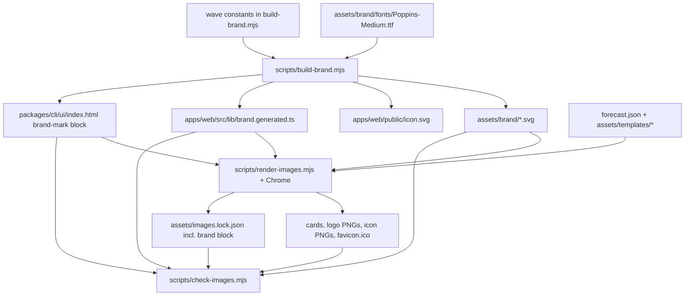

# Tidegap Logo Everywhere - Plan

## Goal Capsule

- **Objective:** Everywhere a person meets Tidegap — the GitHub README, the website tab and header, link cards in Slack and X, the `tidegap ui` page, and (from the next release) the npm, PyPI and MCP Registry pages — they see the same logo: the wave with the teal trough above the "Tidegap" wordmark.
- **Means:** One generator turns hand-written wave geometry and a vendored Poppins Medium font into committed SVGs and code snippets; the existing Chrome render pipeline turns those SVGs into every raster; the existing hash drift check covers both (KTD1, KTD7, KTD8).
- **Authority:** Vitalii's product decisions (logo variant, "apply everywhere", out-of-scope list; see Key Decisions), then this plan, then the reference raster `tidegap-logo-original-no-tick.png` for geometry and colour, then `docs/solutions/tooling-decisions/rendered-repo-images-and-brand-name.md`. The orchestrator brief's how-level suggestions (round caps, approximate colours, sine fit) are superseded by KTD3 and KTD5. Where this plan and the repo disagree, stop and report.
- **Stop conditions:** the compare sheet shows a wordmark or wave mismatch that parameter tuning cannot close; `pnpm gen:images:check` fails the same way twice; `assets/social-preview.png` reaches 1 MB; any step would publish to npm, PyPI, ClawHub or the MCP Registry, cut a release, tag, push to `main` or merge.
- **Execution profile:** one worktree `.worktrees/feat-brand-logo` on branch `feat/brand-logo`, units in order U1 → U6, no fan-out (U1, U2 and U3 all touch `scripts/check-images.mjs`; U1 and U3 also share `package.json` and the generated outputs). The worktree needs `pnpm install` and `pnpm build` before tests (`docs/solutions/developer-experience/worktree-environment-setup.md`). Git commands use `git -c core.editor=true -c sequence.editor=true`.
- **Who finishes:** the pipeline stops at an open PR with green gates and one `ce-code-review` pass. Vitalii merges. A merge to `main` is a Vercel production deploy of `apps/web`. External listings (GitHub org avatar, social-preview upload, mcp.so, ClawHub) are browser jobs after the merge.

---

## Product Contract

### Summary

Add a vector logo source under `assets/brand/`, generated by `scripts/build-brand.mjs` from wave geometry and an outlined Poppins Medium wordmark. Re-render the three existing cards and a new icon set from those SVGs. Put the logo in the README, the package READMEs, the site header and favicon metadata, the `tidegap ui` header, `server.json` and a new `docs/brand.md`. One PR, CHANGELOG Unreleased entry only.

### Problem Frame

The project was renamed to Tidegap on 2026-10-16 and has no logo. The site favicon and nav show a "~" glyph on a teal tile, the `tidegap ui` page shows a CSS circle, and the cards show "Tidegap" in the system font. Vitalii picked the final logo from generated candidates; it now exists only as a 1254×1254 raster, which cannot scale to a 16 px favicon or a 1600 px banner without a vector source.

### Key Decisions

- **The logo is the "Original, no clock" variant.** (session-settled: user-directed — chosen over the variants with a clock, dot or tagline: Vitalii picked it on 2026-10-16.) Governs R3, R14.
- **Apply it everywhere in the repo; the Mac app and external listings wait.** (session-settled: user-directed — chosen over doing the listings in the same PR: those are browser jobs after merge.) Governs R9–R13.

### Requirements

**Vector source**

- R1. `assets/brand/` holds `tidegap-logo-dark.svg`, `tidegap-logo-light.svg`, `tidegap-mark.svg` and `tidegap-icon.svg`; every file has outlined paths and no `<text>` or font reference.
- R2. The wordmark is "Tidegap" in Poppins Medium, converted to paths from `assets/brand/fonts/Poppins-Medium.ttf`; the font's `OFL.txt` sits next to it.
- R3. The wave matches the reference: two crests, one trough, ends cut flat, the stroke below the midline between the crests is teal, nothing else (no clock, dot or tagline).
- R4. `scripts/build-brand.mjs` regenerates every brand output; two runs give identical bytes.

**Rasters**

- R5. `assets/social-preview.png`, `assets/readme-hero.png` and `apps/web/public/og-image.png` show the logo lockup in place of the text wordmark, keeping the value prop, the install command, the chart and the caption they carry today.
- R6. The site ships `favicon.ico` (16, 32, 48), `icon.svg`, `apple-touch-icon.png` (180), `icon-192.png` and `icon-512.png` in `apps/web/public/`.
- R7. `assets/brand/tidegap-logo-dark.png` and `tidegap-logo-light.png` are 2× renders of the lockup SVGs with a transparent background.

**Drift**

- R8. `pnpm gen:images:check` fails when any brand output, raster or generated snippet differs from what the generator and renderer last recorded, and it still runs with Node built-ins only.

**Application**

- R9. `README.md` opens with the logo, switching dark/light with the reader's GitHub theme.
- R10. Each package README (`packages/*/README.md`) opens with a small logo line that renders on GitHub, npm and PyPI.
- R11. The site header shows the mark and the outlined wordmark, and the site declares favicon, SVG icon, Apple touch icon and manifest icons.
- R12. The `tidegap ui` header shows the inline mark; the page stays dependency-free and passes its existing asset tests.
- R13. `packages/mcp-server/server.json` lists the icon URLs, used at the next registry publish.
- R14. `docs/brand.md` is one page: files, colours, clear space, minimum sizes, do not recolour, do not add the clock.
- R15. `CHANGELOG.md` gets an Unreleased entry; no version bump, no tag, no release.

### Success Criteria

- The compare sheet (reference vs rendered SVG, dark and light) shows the same wave shape, cut, teal span and letterforms at a glance.
- The 16 px favicon still reads as a wave with a teal trough.

### Scope Boundaries

- Not touched: the Mac app, the GitHub org avatar, the GitHub social-preview upload, mcp.so, ClawHub, Glama.
- Not touched: `packages/claude-code-plugin/.claude-plugin/plugin.json`, `.claude-plugin/marketplace.json`, `glama.json`, `packages/openclaw-plugin/openclaw.plugin.json` — none of their schemas has an icon field.
- Not touched: the `tidegap ui` favicon (`data:,`); the asset test pins it, and the brief asks only for the header.
- Not touched: the site's colour tokens, `manifest.ts` colours and the MCP runtime `serverInfo.icons`.
- Considered and not built: a guard in `render-images.mjs` that refuses to render from stale brand SVGs. `gen:images` runs the generator first and the check catches a stale lock; evidence that someone renders without `gen:images` would change this.
- Considered and not built: CI re-running `build-brand.mjs` and diffing. It needs `opentype.js`, and the `data-ssot` job runs without `pnpm install`; the hash check gives the same signal.
- Considered and not built: a second lock file and a `node --test` suite for the check script. One lock with one writer covers R8; the tamper checks in U2 prove the check fails. A later bug report of a silent false green would change this.
- Considered and not built: a render-time layout assertion on the cards. A clipped card is visible on the compare sheet, which shows all three cards.

### Deferred to Follow-Up Work

- Browser jobs after merge: GitHub social-preview upload, org avatar, mcp.so and ClawHub icons.
- `ce-compound` updates `docs/solutions/tooling-decisions/rendered-repo-images-and-brand-name.md` with the brand pipeline.

### Open Questions

- Q1 (non-blocking, default taken). Where does the README hero go once the logo opens the README? Default: the `<picture>` logo replaces the hero at line 1, and the hero moves to just above `## Why defer non-urgent AI work?`. Two lockups on the first screen would repeat the logo. The README still shows the lockup twice (top and inside the hero) because the brief asks the hero to carry it; dropping it from the hero only is the alternative.

---

## Planning Contract

### Key Technical Decisions

- KTD1. **One generator, `scripts/build-brand.mjs`, owns every brand vector and snippet.** It writes the four `assets/brand/*.svg` files, `apps/web/public/icon.svg` (a copy of `tidegap-icon.svg`), `apps/web/src/lib/brand.generated.ts` and the marked block in `packages/cli/ui/index.html`. This follows the `gen-data.mjs` → `tables.generated.ts` pattern and keeps the site and the UI page from hand-copying path data.
- KTD2. **Wordmark font: Poppins Medium from `google/fonts` (`ofl/poppins`), vendored with `OFL.txt`; text-to-paths through `opentype.js` pinned exactly at `1.3.4` as a root devDependency.** The site and the rendered images use system font stacks only (`apps/web/src/app/globals.css`, `assets/templates/base.css`), so no vendored font exists. Poppins has the single-storey "a" and round "g" of the reference. The script lays glyphs one by one (advance width + GPOS/kern pair value + a tracking constant in em), so it does not depend on `getPath` layout options. Path data is rounded to 2 decimals.
- KTD3. **Wave geometry: 1.5 periods of an arc-and-tangent wave, ends and colour split on the midline.** Measured on the reference dark half (px): outer bbox 106–521 × 503–626, stroke 20, crest centres at x ≈ 185 and 442, trough centre x ≈ 313.5, midline y ≈ 565, teal y 565–626. So period ≈ 257, amplitude ≈ 51.75, stroke/period ≈ 0.078. The midline cut replaces the brief's "round caps": the reference ends are flat horizontal cuts at the midline, the same line where the teal begins.
  - Shape: each half-period is a crest arc, a straight tangent segment and a trough arc. A pure sine fit was rejected: the reference slopes are steeper (about 56° at the midline against the sine's 52°), the crests flatter, and slope centres sit up to 6 px off a sine. The arc radius and the slope angle are constants at the top of the script, starting at 56°, tuned in the U3 compare loop.
  - The ink path runs trough-to-trough over 2 periods and is clipped to y < midline. This removes the trough and cuts both outer arms flat at the midline.
  - The teal path is a second copy of the same full path with the same stroke, clipped to the rectangle between the two crest centres with y ≥ midline − 0.5. This paints every stroke pixel below the midline between the crests, including the wedges next to the midline crossings, and leaves no anti-aliasing seam.
  - Clip-path ids carry a per-file prefix so two inline copies on one page cannot collide.
- KTD4. **Two stroke weights.** Lockups use the reference ratio (stroke/P ≈ 0.078). `tidegap-mark.svg` and `tidegap-icon.svg` use a heavy ratio (start at stroke/P ≈ 0.16) so the 16 px favicon still reads. Both are constants at the top of the script; `docs/brand.md` names the mark as the small-size form.
- KTD5. **Palette sampled from the reference** (mode of each region): navy `#0C1017` (dark background and light-version ink), white `#FFFFFF` (dark-version ink), off-white `#FAFAFA` (light background), teal `#5FC6C4` (between the dark-half `#61C8C7` and light-half `#5CC2C2` samples). These replace the brief's approximate values, as the brief asked for sampling. The site keeps its own UI tokens; only logo surfaces use this palette.
- KTD6. **Lockup layout and files.** The lockup is stacked: wave centred over the wordmark, wordmark width 1.02 × wave outer width, gap from wave bottom to cap top 0.077 × wave outer width (reference: 32 px on 415 px). Lockup SVGs have a tight viewBox (content bbox rounded out to integers); clear space is a rule in `docs/brand.md`, not baked padding, so templates can place the lockup without offsets. The site header uses a horizontal form: heavy-stroke mark left, wordmark right, mark height 1.3 × wordmark cap height, gap 0.5 × cap height, mark vertically centred on the cap height; its minimum height is 20 px. `tidegap-mark.svg` is a 64×64 viewBox, wave about 52 units wide, transparent, ink navy by default and white under an embedded `prefers-color-scheme: dark` style. `tidegap-icon.svg` is a full-bleed 64×64 navy square with a white-and-teal wave about 44 units wide; this keeps the wave inside the maskable safe zone and suits iOS, which rounds the corners itself.
- KTD7. **Rasters stay in `scripts/render-images.mjs`.** New output kinds:
  - `svg`: render one brand SVG inline on a bare page at a given size; the lockup PNGs use `omitBackground` for transparency and 2× the SVG viewBox.
  - `ico`: render `tidegap-icon.svg` at 16, 32 and 48 px and pack the three PNGs into a PNG-in-ICO container (6-byte header, 16-byte entries) with Node built-ins.
  - The three card templates get a `{{logo}}` placeholder filled with the contents of `tidegap-logo-dark.svg`; the `.wordmark` text block and its CSS go.
- KTD8. **One check script, one lock file, one writer.** `render-images.mjs` stays the only writer of `assets/images.lock.json`. The lock gains a `brand` block: inputs hash over `scripts/build-brand.mjs` and the font, sha256 of each generated SVG and of `brand.generated.ts`, and sha256 of the text between the `brand-mark` markers in `packages/cli/ui/index.html`. The render inputs list adds the brand SVGs it reads. `scripts/check-images.mjs` keeps its name (CI calls it) and checks the brand block, the rasters, the ICO entry sizes (a few-line header read) and the lockup PNG sizes derived from the SVG viewBox. Shared constants live in `check-images.mjs` and are imported by both scripts, as `render-images.mjs` does today. `pnpm gen:brand` alone therefore leaves the lock stale until `pnpm gen:images` runs, which runs the generator first.
- KTD9. **Site icons move to `apps/web/public/` with explicit `metadata.icons`; `src/app/icon.svg` is deleted.** The brief names `public/` paths, and keeping the app-dir `icon.svg` route next to a `public/icon.svg` would make Next.js report a path conflict. Stable URLs also let `server.json` link `https://www.tidegap.com/icon-512.png` and the package READMEs link `https://www.tidegap.com/icon-192.png`.
- KTD11. **The Open Graph and Twitter image URL becomes `/og-image.png?v=logo`; the file path stays.** X, Slack and LinkedIn cache cards by image URL (`docs/solutions/tooling-decisions/rendered-repo-images-and-brand-name.md`), so the old text-wordmark card would otherwise persist on links already shared.
- KTD10. **Package READMEs link the icon tile PNG by absolute URL.** The navy tile has its own background, so one image reads on light npm and PyPI pages and on dark GitHub. `<picture>` is not used there because npm's sanitizer can drop `<source>`. The root README uses `<picture>` with the two lockup SVGs by relative path (R9).

### High-Level Technical Design



`pnpm gen:images` runs `build-brand.mjs` then `render-images.mjs`; `pnpm gen:brand` runs the generator alone; `pnpm gen:images:check` runs the check (CI `data-ssot` job and `pnpm preflight`, unchanged wiring).

### Output Structure

```text
assets/brand/
  fonts/Poppins-Medium.ttf
  fonts/OFL.txt
  tidegap-logo-dark.svg     tidegap-logo-dark.png
  tidegap-logo-light.svg    tidegap-logo-light.png
  tidegap-mark.svg
  tidegap-icon.svg
apps/web/public/
  icon.svg  favicon.ico  apple-touch-icon.png  icon-192.png  icon-512.png  og-image.png
```

### Raster Export List

| Output | Size | Source | Background |
|---|---|---|---|
| `assets/social-preview.png` | 1280×640 | `social-preview.html` + lockup | navy card |
| `assets/readme-hero.png` | 1600×500 | `readme-hero.html` + lockup | navy card |
| `apps/web/public/og-image.png` | 1200×630 | `og-image.html` + lockup | navy card |
| `assets/brand/tidegap-logo-dark.png` | 2× viewBox | `tidegap-logo-dark.svg` | transparent |
| `assets/brand/tidegap-logo-light.png` | 2× viewBox | `tidegap-logo-light.svg` | transparent |
| `apps/web/public/apple-touch-icon.png` | 180×180 | `tidegap-icon.svg` | navy |
| `apps/web/public/icon-192.png` | 192×192 | `tidegap-icon.svg` | navy |
| `apps/web/public/icon-512.png` | 512×512 | `tidegap-icon.svg` | navy |
| `apps/web/public/favicon.ico` | 16, 32, 48 | `tidegap-icon.svg` | navy |

The card templates keep `base.css` colours; their background `#0d1218` stays, and the lockup is the dark variant.

### Assumptions

- `icon-192.png` is added beyond the brief's list because Chrome's install criteria for a `display: standalone` manifest ask for 192 and 512.
- The `tidegap ui` header keeps the HTML text "Tidegap" next to the inline mark; the site header uses the outlined wordmark. The brief asks for the mark only on the UI page.
- `npm test` in the brief means the root `test` script, run with pnpm (`packageManager: pnpm@9.15.0`).
- The MCP Registry `server.json` schema (2025-12-11) accepts a top-level `icons` array of `{src, mimeType, sizes, theme}` with HTTPS `src`; checked against the published schema.

### Risks & Dependencies

- Poppins letterforms may differ from the AI-drawn reference in details (terminal angles, "g" tail). The compare sheet decides; a visible mismatch is a stop condition, not a reason to switch fonts silently.
- Rasters are maintainer-machine renders; CI only hashes (existing trade-off in the solution doc).
- `server.json` and package README icon URLs resolve only after the site deploys from `main`. The registry reads `server.json` only at the next release.

---

## Implementation Units

### U1. Brand generator, vendored font, brand SVGs and snippets

- **Goal:** `pnpm gen:brand` writes every brand vector and snippet from the font and the wave constants.
- **Requirements:** R1, R2, R3, R4; KTD1–KTD6.
- **Dependencies:** none.
- **Files:**
  - create `scripts/build-brand.mjs`
  - create `assets/brand/fonts/Poppins-Medium.ttf`, `assets/brand/fonts/OFL.txt`
  - create (generated) `assets/brand/tidegap-logo-dark.svg`, `assets/brand/tidegap-logo-light.svg`, `assets/brand/tidegap-mark.svg`, `assets/brand/tidegap-icon.svg`, `apps/web/public/icon.svg`, `apps/web/src/lib/brand.generated.ts`
  - modify `packages/cli/ui/index.html` (add `<!-- brand-mark:start -->` / `<!-- brand-mark:end -->` around the current `.brand-mark` span; the generator fills the block)
  - modify `scripts/check-images.mjs` (export brand constants: output paths, markers, font path)
  - modify `package.json` (`opentype.js` exact `1.3.4` devDependency, `gen:brand`, `gen:images` = generator then renderer), `pnpm-lock.yaml`
- **Approach:**
  1. Download `Poppins-Medium.ttf` and `OFL.txt` from `google/fonts` `ofl/poppins`; record the source URL in `docs/brand.md` (U6).
  2. Wave builder: one pure function from (period, amplitude, stroke, origin) to the ink path, teal path and midline clip rects (KTD3).
  3. Wordmark builder: per-glyph layout with kerning and a tracking constant (KTD2), centred under the wave (KTD6). Tracking starts at 0 and is tuned in U3's compare loop.
  4. Emit SVGs with fixed attribute order, LF endings, a trailing newline, and a header comment naming the generator.
  5. The inline UI block has no `xmlns` and no `style` attribute: the UI test bans `http://` in `index.html`, and the UI CSP has no `style-src`. Ink uses `currentColor`, teal a fixed fill.
  6. `brand.generated.ts` exports the palette, the mark (viewBox, stroke, both paths, clip rects) and the wordmark (viewBox, path data), with a "generated, do not edit" header.
  7. The generator exits non-zero when the markers are missing from `index.html`.
- **Patterns to follow:** `scripts/gen-data.mjs` (generated module + header), `scripts/render-images.mjs` (imports constants from `check-images.mjs`).
- **Test scenarios:** `Test expectation: none -- generator output is pinned by the U2 hash check and judged on the U3 compare sheet; determinism is checked by a second run.`
- **Verification:** the four SVGs open in a browser and match the reference by eye; `grep -L '<text' assets/brand/*.svg` lists all four; a rerun produces no diff.

### U2. Drift check covers brand outputs, ICO and derived sizes

- **Goal:** `pnpm gen:images:check` fails on any stale or edited brand or raster output.
- **Requirements:** R8; KTD8.
- **Dependencies:** U1.
- **Files:**
  - modify `scripts/check-images.mjs`
- **Approach:**
  1. Read the `brand` block of `assets/images.lock.json`; compare its inputs hash and each output sha256; extract the `brand-mark` block from `index.html` and hash it.
  2. Read the ICO header (entry count, width/height with 0 meaning 256) and check the sizes 16, 32, 48.
  3. Derive the lockup PNG sizes from the SVG `viewBox` × 2.
  4. Keep one problem list and one exit path, as today.
- **Patterns to follow:** existing `pngSize`, `inputPaths`, the `realpathSync` entry guard.
- **Test scenarios:** run as tamper checks against the committed tree after U3, each restored afterwards:
  - Unchanged tree: the check prints success.
  - One byte deleted from `assets/brand/tidegap-mark.svg`: the check fails and names that path.
  - One character changed inside the `brand-mark` block of `packages/cli/ui/index.html`: the check fails and names the block.
  - The markers removed from `index.html`: the check reports the block as missing.
  - `apps/web/public/favicon.ico` replaced by a PNG: the check reports it is not an ICO.
  - One byte appended to `scripts/build-brand.mjs`: the check reports the brand inputs hash.
- **Verification:** every tamper check above fails as described and the restored tree passes; `node scripts/check-images.mjs` runs without `node_modules`.

### U3. Raster pipeline: logo cards, icon set, logo PNGs

- **Goal:** `pnpm gen:images` produces every raster in the export list and records it in `assets/images.lock.json`.
- **Requirements:** R5, R6, R7; KTD7.
- **Dependencies:** U1, U2.
- **Files:**
  - modify `scripts/render-images.mjs`, `scripts/check-images.mjs` (`OUTPUTS` gains the new entries and kinds; `inputPaths` gains the brand SVGs)
  - modify `assets/templates/og-image.html`, `assets/templates/social-preview.html`, `assets/templates/readme-hero.html`, `assets/templates/base.css`
  - regenerate `assets/social-preview.png`, `assets/readme-hero.png`, `apps/web/public/og-image.png`, `assets/images.lock.json` (now with the `brand` block, KTD8)
  - create (rendered) `assets/brand/tidegap-logo-dark.png`, `assets/brand/tidegap-logo-light.png`, `apps/web/public/apple-touch-icon.png`, `apps/web/public/icon-192.png`, `apps/web/public/icon-512.png`, `apps/web/public/favicon.ico`
- **Approach:**
  1. Templates: replace the `.wordmark` div with `{{logo}}`, left-aligned to the text column; size the lockup by width (og/social about 300 px, hero about 340 px) and keep the tagline, command, chart and caption. If a column does not fit, shrink the lockup (down to about 260 px), not the tagline.
  2. Remove the `.wordmark` rule from `base.css` once unused.
  3. Add the `svg` and `ico` output kinds (KTD7); the chart assertions stay untouched.
  4. Tune the U1 constants (tracking, gap, heavy stroke) against the compare sheet in the Verification Contract, then re-run `pnpm gen:images` once from clean.
- **Execution note:** smoke-first. Render, look at the compare sheet and the 16/32 px favicon crops, then commit.
- **Patterns to follow:** existing `OUTPUTS`, `CHARTS` and the per-image size assertion in `render-images.mjs`.
- **Test scenarios:** `Test expectation: none -- rendered output is checked by hash in U2 and by eye on the compare sheet.`
- **Verification:** `pnpm gen:images:check` passes; `assets/social-preview.png` is under 1 MB; a second `pnpm gen:images` leaves `git status` clean.

### U4. Site header and icon metadata

- **Goal:** the site shows the mark and wordmark in the header and serves the new favicon and icons.
- **Requirements:** R11; KTD9.
- **Dependencies:** U1, U3.
- **Files:**
  - create `apps/web/src/components/logo.tsx`
  - modify `apps/web/src/components/nav.tsx` (replace the "~" tile and text with `Logo`)
  - modify `apps/web/src/app/layout.tsx` (`metadata.icons`: `/favicon.ico`, `/icon.svg`, Apple `/apple-touch-icon.png`; Open Graph and Twitter image URL per KTD11)
  - modify `apps/web/src/app/manifest.ts` (icons: `icon.svg` with purpose "any", then `icon-192.png` and `icon-512.png` each listed twice, purpose "any" and purpose "maskable"; the Next 16 `Manifest` type rejects "any maskable")
  - modify `apps/web/src/app/about/page.tsx` (OG image URL, KTD11)
  - delete `apps/web/src/app/icon.svg`
- **Approach:**
  1. `Logo` renders one inline SVG from `brand.generated.ts` in the horizontal header form (KTD6), white ink and teal (KTD5), about 22 px tall. It sets no `style` prop.
  2. The link keeps an accessible name ("Tidegap"); the SVG is `aria-hidden`.
- **Patterns to follow:** existing server components in `apps/web/src/components/`.
- **Test scenarios:** `Test expectation: none -- apps/web has no test runner; build, lint, typecheck and a header screenshot verify it.`
- **Verification:** `pnpm -C apps/web build`, `lint` and `typecheck` pass; the built page `<head>` has the icon links; a header screenshot at 375 px and 1280 px shows the logo without overflow.

### U5. `tidegap ui` header mark

- **Goal:** the `tidegap ui` header shows the brand mark in light and dark themes.
- **Requirements:** R12.
- **Dependencies:** U1.
- **Files:**
  - modify `packages/cli/ui/app.css` (`.brand-mark` sizes the inline SVG and sets `color: var(--brand-ink)`; the circle styles go)
  - modify `packages/cli/ui/tokens.css` (`--brand-ink`: navy in light, white in dark)
  - modify `packages/cli/test/ui-server.test.ts`
- **Approach:** the block itself comes from U1; this unit only styles it and pins it in the test.
- **Test scenarios:**
  - `index.html` contains the `brand-mark` markers with an `<svg` element between them, marked `aria-hidden="true"`.
  - The block contains no `style=` attribute and no `http` URL (the existing relative-asset test still passes).
- **Verification:** `pnpm --filter @tidegap/cli test` passes; `tidegap ui` opened in light and dark shows the mark next to "Tidegap".

### U6. README, package READMEs, server.json, brand page, CHANGELOG

- **Goal:** the logo appears on every repo-rendered page, and the rules for using it are written down.
- **Requirements:** R9, R10, R13, R14, R15; KTD10.
- **Dependencies:** U3 (PNG paths exist).
- **Files:**
  - modify `README.md`
  - modify `packages/core-ts/README.md`, `packages/core-py/README.md`, `packages/cli/README.md`, `packages/mcp-server/README.md`, `packages/openclaw-plugin/README.md`, `packages/claude-code-plugin/README.md`
  - modify `packages/mcp-server/server.json`
  - create `docs/brand.md`
  - modify `docs/claims.md`, `CHANGELOG.md`
- **Approach:**
  1. `README.md`: a `<picture>` with `tidegap-logo-dark.svg` for `prefers-color-scheme: dark` and `tidegap-logo-light.svg` as the ``, about 280 px wide, alt "Tidegap", at line 1 above `# Tidegap`. The hero image moves per Q1's default.
  2. Package READMEs: one line above the H1, `` of `https://www.tidegap.com/icon-192.png`, 48 px, alt "Tidegap" (KTD10).
  3. `server.json`: top-level `icons` with `https://www.tidegap.com/icon-512.png` (`image/png`, `512x512`) and `https://www.tidegap.com/icon.svg` (`image/svg+xml`, `any`). Versions untouched.
  4. `docs/brand.md`: file table, palette (KTD5), clear space = the wave's outer height on every side, minimum sizes (stacked lockup ≥ 120 px wide, horizontal header form ≥ 20 px tall, mark alone below that, icon tile ≤ 32 px), font source and licence, how to regenerate, and the don'ts (recolour, add the clock, dot or tagline, stretch, set the wordmark as live text in logo artwork). One allowance: in-app chrome such as the `tidegap ui` header may pair the inline mark with the product name in the app font.
  5. `docs/claims.md` row 31: the last column notes the 2026-10-16 logo re-render; numbers unchanged.
  6. `CHANGELOG.md`: one bullet under `## [Unreleased]`.
- **Patterns to follow:** `docs/solutions/tooling-decisions/mcp-registry-metadata-and-package-readmes.md` (absolute links in package READMEs, no dead links); the brand-name rule in `rendered-repo-images-and-brand-name.md`.
- **Test scenarios:** `Test expectation: none -- docs and metadata; check-versions and the README render are the checks.`
- **Verification:** `pnpm check:versions` passes; the README renders with the logo in GitHub light and dark (PR preview); no relative link in a package README.

---

## Verification Contract

| Gate | Command or artifact | Applies to |
|---|---|---|
| Brand determinism | `pnpm gen:brand` twice, `git status` clean | U1 |
| Tamper checks | U2 test scenarios, each restored | U2 |
| Drift check | `pnpm gen:images:check` | U2, U3 |
| Render determinism | `pnpm gen:images` twice, `git status` clean | U3 |
| Packages | `pnpm build && pnpm test` | U5, all |
| Site | `pnpm -C apps/web build`, `pnpm -C apps/web lint`, `pnpm -C apps/web typecheck` | U4 |
| Versions | `pnpm check:versions` | U6 |
| Visual proof | compare sheet in the session scratchpad `logo-final/compare.png` | U1, U3 |

The compare sheet is made by a one-off scratch script (not committed): the reference dark and light halves, the rendered `tidegap-logo-dark.svg` and `-light.svg` at the same scale on `#0C1017` and `#FAFAFA`, a 50 % overlay of each pair, the favicon at 16 and 32 px enlarged, the site header crop at 1× and 2×, and the three rendered cards. Logs are read with `grep`, not whole.

## Definition of Done

- Every gate in the Verification Contract passes in the worktree, and the compare sheet exists.
- `git status` is clean after `pnpm gen:images`.
- No `<text>` element or font reference in any `assets/brand/*.svg`.
- No "~" glyph tile remains in `apps/web/src`; `apps/web/src/app/icon.svg` is gone.
- `CHANGELOG.md` has an Unreleased entry; versions, tags and `package.json` versions are unchanged.
- No abandoned experiment code (old wave attempts, debug renders) remains in the diff.
- One PR is open with the compare sheet attached and one `ce-code-review` pass done; nothing is merged.
