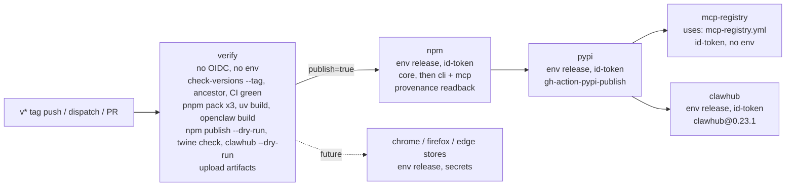

# Trusted Publishing for Releases - Plan

## Goal Capsule

- **Objective:** A Tidegap release reaches npm, PyPI, the MCP Registry and ClawHub from one human action (a `v*` tag push, then one approval), with npm provenance, and no long-lived registry token exists on a laptop or in GitHub secrets.
- **Means:** One workflow `.github/workflows/release.yml` whose publish jobs run in the GitHub environment `release` and authenticate by GitHub Actions OIDC trusted publishing (KTD1–KTD6).
- **Authority:** the orchestrator brief (fixed names `release.yml` and `release`, trigger rules, out-of-scope list), then this plan, then the registry docs cited in Sources. Where this plan and the repo disagree, stop and report.
- **Stop conditions:** any step would publish to npm, PyPI, ClawHub or the MCP Registry, change a registry setting, change a package version, cut a tag or release, push to `main` or merge; `actionlint` fails the same way twice; the PR dry-run job fails the same way twice.
- **Execution profile:** one worktree `.worktrees/chore-trusted-publishing` on branch `chore/trusted-publishing`, units in order U1 → U4, no fan-out (U2 and U3 share the job contract; U4 documents both). U5 edits gitignored local files in the main checkout and is not part of the PR. Git commands use `git -c core.editor=true -c sequence.editor=true`. The worktree needs `pnpm install` before U1's checks.
- **Who finishes:** the pipeline stops at an open PR with a green CI run, a green `release.yml` dry-run job on the PR, and one `ce-code-review` pass. Vitalii merges. The one-time web settings (Planning Contract, "One-time settings") and the first real release are Vitalii's steps after the merge.

---

## Product Contract

### Summary

Releases move from a laptop token (npm) and per-release browser tokens (PyPI) to GitHub Actions OIDC trusted publishing in one tag-triggered workflow. The workflow verifies version lockstep, builds once, publishes npm with provenance, then PyPI, then hands off to the existing MCP Registry workflow and publishes the OpenClaw plugin to ClawHub. A dry-run path proves the build and package metadata on every relevant PR.

### Problem Frame

npm `@tidegap/{core,cli,mcp}` publish from Vitalii's laptop with a granular bypass-2FA token (`tidegap-publish-2026-10b`, expires 2027-01-14). PyPI `tidegap` needs a token made by hand in the browser for each release. ClawHub `@vitalini/tidegap` publishes from a CLI login. Only the MCP Registry already uses OIDC (`.github/workflows/mcp-registry.yml`). Each manual step is a chance to publish an unreviewed tree, to skip a registry, or to leak a token; the npm token also expires in three months. Version drift across registries has happened before (`docs/solutions/tooling-decisions/version-lockstep-check.md`).

### Requirements

**Trigger and gating**

- R1. Publishing starts only from a `v*` tag push or a `workflow_dispatch` with `dry_run=false` on a `v*` tag ref. A merge to `main` never publishes.
- R2. Every publish job runs in the GitHub environment `release` and holds `id-token: write`; no job reads a registry token secret.
- R3. Before any publish, the workflow fails if `pnpm check:versions` fails, if the tag is not `v<version>`, if the tagged commit is not on `main`, or if CI did not pass on that commit.

**Publishing**

- R4. npm publishes `@tidegap/core` first, then `@tidegap/cli` and `@tidegap/mcp`, with provenance, and the published manifests contain no `workspace:` ranges.
- R5. PyPI `tidegap` publishes after npm, from the same run.
- R6. The MCP Registry publish runs after npm is live and reuses `.github/workflows/mcp-registry.yml`.
- R7. ClawHub `@vitalini/tidegap` publishes by OIDC as a terminal job.
- R8. A re-run of a failed run does not fail on versions that are already published.

**Dry run and docs**

- R9. A dry-run path builds every artifact and runs `npm publish --dry-run`, `twine check` and `clawhub package publish --dry-run` without OIDC and without the `release` environment. It runs on PRs that touch release inputs and on manual dispatch.
- R10. CONTRIBUTING, the hub-submission log, the CHANGELOG and the release-order learning describe the new order: merge, tag, approve, workflow.
- R11. Scope additions from the orchestrator: the gitignored `development/` docs are refreshed to the Tidegap state; one stale pin in a learning is fixed; `release.yml` leaves room for browser-extension store jobs.

### Scope Boundaries

- Compat shims (`compat/npm/*`, `compat/pypi/*`, `compat/clawhub/*`): unchanged, still manual.
- No package version changes, no tag, no release, no registry setting change in this PR.
- Token retirement happens after the first successful OIDC release (Planning Contract, "Post-release steps").
- Browser-extension store publishing: a comment-level placeholder only (KTD9).
- GitHub Release notes: stay a manual step from the CHANGELOG section.

### Deferred to Follow-Up Work

- Remove the root `release:npm` script after the token is revoked. Until then it is the emergency fallback (with `--otp` once 2FA-only is set).
- A tag ruleset that limits who may create `v*` tags (Open Questions, Q2).

### Open Questions

- Q1 (deferred, for the orchestrator). Required reviewer on `release`: this plan recommends Vitalii as the one required reviewer with self-review allowed. A tag push is already a human action; the reviewer gate adds a second click and blocks a stray tag from any collaborator. Drop it if one click is preferred.
- Q2 (deferred). Add a repository tag ruleset for `v*` (create restricted to admins)? Not needed while Vitalii is the only writer.
- Q3 (deferred). Who runs the `gh api` environment setup: Vitalii or the orchestrator. ce-work does not run it (one writer per shared external state). It must exist before the first tag push, because a job that names a missing environment makes GitHub create it unprotected.
- Q4 (blocking for U5 only). `development/` is gitignored (`.gitignore` line 60) and exists only in the main checkout. U5 therefore cannot ship in the PR. Plan: ce-work edits the files in place in the main checkout and reports them; confirm, or say if they should become tracked.

### Sources

- npm trusted publishing: https://docs.npmjs.com/trusted-publishers (npm CLI ≥ 11.5.1, Node ≥ 22.14.0, `id-token: write`, GitHub-hosted runners only, `repository.url` must match the repo, automatic provenance for public repo + public package, "Require two-factor authentication and disallow tokens" keeps trusted publishers working).
- pnpm publish: https://pnpm.io/cli/publish ("Since v11, `pnpm publish` is implemented natively and no longer delegates to the `npm` CLI"; workaround `pnpm pack && npm publish *.tgz`). pnpm workspaces: https://pnpm.io/workspaces (`pnpm pack` and `pnpm publish` replace `workspace:` ranges).
- PyPI: https://docs.pypi.org/trusted-publishers/adding-a-publisher/ and https://docs.pypi.org/trusted-publishers/using-a-publisher/ (owner, repository, workflow filename, environment; `id-token: write` at job level; use `pypa/gh-action-pypi-publish`). The action README says trusted publishing does not work from a reusable workflow, so the PyPI job lives in `release.yml`.
- ClawHub CLI 0.23.1 source (`/opt/homebrew/lib/node_modules/clawhub/dist/cli/commands/packages.js`): `resolvePackagePublishToken` requests a GitHub OIDC token with audience `clawhub` when `ACTIONS_ID_TOKEN_REQUEST_URL` is set, and mints a short-lived publish token; config is `clawhub package trusted-publisher set <name> --repository --workflow-filename [--environment]`. On a 400/403/404 it falls back to a stored login, which fails in CI. With a trusted publisher configured, a manual publish needs `--manual-override-reason`. `--dry-run` returns before any token use.
- Repo: `package.json` (`release:npm`, `packageManager: pnpm@9.15.0`), `scripts/check-versions.mjs`, `.github/workflows/{ci,mcp-registry}.yml`, `packages/{core-ts,cli,mcp-server,openclaw-plugin}/package.json`, `packages/core-py/pyproject.toml`, `docs/internal/hub-submission-log.md`, `docs/solutions/tooling-decisions/{version-lockstep-check,mcp-registry-metadata-and-package-readmes}.md`, `docs/solutions/workflow-issues/renaming-a-published-multi-package-project.md`.

---

## Planning Contract

### Key Technical Decisions

- KTD1. **Publish tool: `pnpm pack`, then `npm publish <tarball>`.** `pnpm pack` (repo pin pnpm 9.15.0) rewrites `workspace:*` in `cli` and `mcp` to the exact core version. `npm publish ./x.tgz --provenance --access public` then does the OIDC exchange itself. Version floors: npm CLI ≥ 11.5.1 (pin an exact 11.x via `npm install -g npm@<exact>`; Node 24's bundled npm is not relied on), Node 24 on the runner (floor 22.14.0), `id-token: write`, GitHub-hosted `ubuntu-latest`. Chosen over `pnpm publish`: pnpm 9 delegates to the npm on PATH but documents no OIDC behaviour; native OIDC arrives in pnpm 11, and a pnpm major bump is out of scope. The pnpm docs name pack + npm publish as the supported workaround. Do not set `registry-url` on `actions/setup-node` in publish jobs: it writes an `.npmrc` with a `NODE_AUTH_TOKEN` placeholder that can shadow OIDC.
- KTD2. **Build once, publish from artifacts.** The `verify` job (no `id-token`, no environment) builds the npm tarballs, the Python sdist and wheel, and the OpenClaw plugin folder, runs every dry-run check, and uploads them with `actions/upload-artifact`. Publish jobs only download and publish. This is the layout PyPI recommends and keeps OIDC out of the job that runs build scripts.
- KTD3. **Release order changes to merge → tag → approve → workflow.** The old rule "publish from the reviewed PR head before merge" (`version-lockstep-check.md`) ends. The release-prep PR still bumps every lockstep file and dates the CHANGELOG heading `## [X.Y.Z] — YYYY-MM-DD` plus the README status line; it is reviewed and merged as before. Vitalii then tags the merge commit `vX.Y.Z` on `main` and pushes the tag. `main` quotes the new version for the minutes between merge and publish; accepted, because the tag must point at a reviewed commit on `main` (R3), and a tag on an unmerged PR head would bypass that.
- KTD4. **Lockstep gate in `scripts/check-versions.mjs --tag <tag>`.** One new optional argument fails when the tag is not `v<version>`. Local and CI use the same check. The ancestor check (`git merge-base --is-ancestor "$GITHUB_SHA" origin/main`, needs `fetch-depth: 0`) and the CI-conclusion check (`gh api` on `ci.yml` runs for `head_sha`, needs `actions: read`) stay inline in the workflow: they need the GitHub context.
- KTD5. **MCP Registry: `mcp-registry.yml` becomes a reusable workflow.** Add `on: workflow_call` with input `version`; keep `workflow_dispatch` (input `version`) for manual retry; drop `on: release`. A GitHub Release created later by hand would otherwise re-run it, and a release made with `GITHUB_TOKEN` never triggers it anyway. The caller job grants `id-token: write`. It runs without the `release` environment: the registry checks only the `io.github.tidegap` owner claim, and a caller job using `uses:` cannot set `environment`. Add a bounded retry (about 2 minutes) on the "npm package exists" step, because `npm view` can lag a fresh publish.
- KTD6. **ClawHub joins by OIDC.** ClawHub CLI 0.23.1 supports GitHub Actions OIDC (Sources). The job pins `clawhub@0.23.1`, needs `id-token: write` and environment `release`, and publishes the built `packages/openclaw-plugin` folder with `--source-repo tidegap/tidegap --source-commit $GITHUB_SHA --source-ref $GITHUB_REF_NAME --source-path packages/openclaw-plugin --no-input`. Exact family and name flags are an execution detail, checked with `--dry-run` in `verify`. It depends on `pypi`, runs beside `mcp-registry`, and nothing depends on it: a registry hiccup on one hub does not block the other.
- KTD7. **Idempotent re-run.** Each npm package is skipped with a notice when `npm view <pkg>@<version> version` already returns the version. PyPI uses `skip-existing: true`. "Re-run failed jobs" then finishes a partial release without manual cleanup.
- KTD8. **Trigger matrix and the `publish` flag.** Triggers: `push: tags: ['v*']`; `workflow_dispatch` with boolean input `dry_run` (default `true`); `pull_request` with paths on `.github/workflows/release.yml`, `.github/workflows/mcp-registry.yml`, `packages/*/package.json`, `packages/core-py/pyproject.toml`, `packages/mcp-server/server.json`, `packages/openclaw-plugin/openclaw.plugin.json`, `scripts/check-versions.mjs`, `pnpm-lock.yaml`. `verify` outputs `publish=true` only for a tag push, or for a dispatch with `dry_run=false` on a `v*` tag ref; a dispatch with `dry_run=false` on a branch fails. Top-level `permissions: {}`; each job grants its own. `concurrency: release-${{ github.ref }}` without cancel-in-progress.
- KTD9. **Room for browser-extension store jobs.** A comment block at the end of `release.yml` names the future jobs `chrome-web-store`, `firefox-amo` and `edge-addons`: each `needs: verify`, runs in environment `release`, and reads its store API credentials from `release` environment secrets, because these stores have no OIDC trusted publishing. Nothing in the job graph depends on a terminal job, so these jobs append without reshaping it. Not implemented.
- KTD10. **Third-party actions in publish jobs are pinned by commit SHA** (with a version comment): `pypa/gh-action-pypi-publish`, `astral-sh/setup-uv`. First-party `actions/*` and `pnpm/action-setup` follow the repo convention of major tags (`@v7`, `@v6`).

### High-Level Technical Design

Directional job graph, not a spec:

`verify` checks per npm tarball: the packed `package.json` contains no `workspace:`; `repository.url` is `https://github.com/tidegap/tidegap.git` (all three match today); `npm publish --dry-run <tgz>` passes. Python: dist file names carry the version, `twine check --strict dist/*` passes. The `npm` job reads back `npm view <pkg>@<version> dist.attestations` and fails when it is empty.

### One-time Settings

Vitalii's steps, after merge and before the first tag. Values are fixed by the brief.

| Registry / package | Where | Publisher | Owner | Repository | Workflow | Environment |
|---|---|---|---|---|---|---|
| npm `@tidegap/core` | npmjs.com/package/@tidegap/core/access → Trusted Publisher | GitHub Actions | `tidegap` | `tidegap` | `release.yml` | `release` |
| npm `@tidegap/cli` | npmjs.com/package/@tidegap/cli/access → Trusted Publisher | GitHub Actions | `tidegap` | `tidegap` | `release.yml` | `release` |
| npm `@tidegap/mcp` | npmjs.com/package/@tidegap/mcp/access → Trusted Publisher | GitHub Actions | `tidegap` | `tidegap` | `release.yml` | `release` |
| PyPI `tidegap` | pypi.org/manage/project/tidegap/settings/publishing/ → GitHub | GitHub | `tidegap` | `tidegap` | `release.yml` | `release` |
| ClawHub `@vitalini/tidegap` | CLI: `clawhub package trusted-publisher set @vitalini/tidegap --repository tidegap/tidegap --workflow-filename release.yml --environment release` | GitHub Actions | `tidegap` (in `--repository`) | `tidegap` | `release.yml` | `release` |
| MCP Registry | none: OIDC grants `io.github.tidegap/*`; org membership stays public | - | - | - | - | - |

npm "Allowed actions" stays empty. GitHub environment `release` (Q1, Q3), created with `gh api`:

- `PUT repos/tidegap/tidegap/environments/release` with `wait_timer: 0`, `prevent_self_review: false`, `reviewers: [{type: User, id: 1262526}]` (`Vitalini`), `deployment_branch_policy: {protected_branches: false, custom_branch_policies: true}`.
- `POST repos/tidegap/tidegap/environments/release/deployment-branch-policies` with `name: v*`, `type: tag`. No branch policy: real publishes run only on tag refs (KTD8).
- No environment secrets today. Browser-store keys land here later (KTD9).

### Post-release Steps

After the first release where all four jobs pass:

1. npm, each of the three packages: Settings → Publishing access → "Require two-factor authentication and disallow tokens".
2. npm: revoke granular token `tidegap-publish-2026-10b`; delete its line from `~/.npmrc`.
3. PyPI: delete every API token scoped to `tidegap` (pypi.org/manage/account/token/).
4. ClawHub: from now on a manual publish needs `--manual-override-reason`.
5. Hub log: set the rows added in U4 to `done`; the orchestrator updates its npm-token memory note.

### Assumptions

- `npm publish <tarball>` performs the OIDC exchange the same way as a folder publish; the first real release proves it (Risks).
- CI on `main` is the test gate; `release.yml` does not re-run test suites, it checks that `ci.yml` concluded `success` for the tagged commit.
- The packages already exist on npm, PyPI and ClawHub, so trusted publishers can be configured (npm cannot create a package by OIDC).
- `mcp-publisher` v1.8.1 has no offline validate step that runs without login; if one exists, the dry-run calls it, otherwise the MCP Registry has no dry-run.

### Risks & Dependencies

- OIDC cannot be proven before the first real release: a dry-run has no OIDC token. Mitigation: the reviewer gate, idempotent re-runs (KTD7), and the laptop token stays valid until the post-release steps.
- An environment named in a job but missing in the repo is auto-created without protection. Mitigation: create `release` first (Q3); the Definition of Done for the first release checks it.
- ClawHub OIDC is new in the CLI and its server side is not documented publicly. On failure the job errors ("not logged in"); fallback is a manual publish with `--manual-override-reason`.

### Release Order (for CONTRIBUTING)

1. Release-prep PR: bump every file `pnpm check:versions` lists, date the CHANGELOG heading, update the README status line. Review; CI green; Vitalii merges.
2. `git pull` on `main`; `git tag -a vX.Y.Z -m vX.Y.Z <merge sha>`; `git push origin vX.Y.Z`.
3. Approve the `release` deployment in the Actions run.
4. The workflow publishes npm → PyPI → MCP Registry + ClawHub. Check the run summary.
5. Optional: GitHub Release notes from the CHANGELOG section, by hand.

Rehearsal: `gh workflow run release.yml --ref main` (dry run is the default). MCP retry: `gh workflow run mcp-registry.yml -f version=X.Y.Z`.

---

## Implementation Units

### U1. `--tag` option in the lockstep check

- **Goal:** one command proves the tag matches the lockstep version (KTD4).
- **Requirements:** R3.
- **Files:** `scripts/check-versions.mjs`.
- **Approach:** parse an optional `--tag <value>`; after the existing comparison, fail with a named line when the value is not `v<expected>`. No new dependency; output format unchanged when the flag is absent.
- **Test scenarios:** `node scripts/check-versions.mjs` prints the existing success line; `--tag v0.18.0` passes; `--tag v0.18.1` exits 1 naming the tag and the expected version; `--tag 0.18.0` (no `v`) exits 1; `--tag` with no value exits 1.
- **Verification:** the five commands above, run in the worktree.

### U2. Reusable MCP Registry workflow

- **Goal:** `release.yml` can hand off to the MCP Registry publish after npm is live (KTD5).
- **Requirements:** R6.
- **Files:** `.github/workflows/mcp-registry.yml`.
- **Approach:** triggers become `workflow_call` (input `version`, required, string) and `workflow_dispatch` (input `version`); remove `release`. The version step compares `server.json` against the input instead of the release tag. The npm-exists step retries for about 2 minutes. Login, publish and read-back steps stay as they are.
- **Test scenarios:** `actionlint` clean; the dry-run PR run does not call this workflow (it is gated on `publish`).
- **Verification:** `actionlint .github/workflows/mcp-registry.yml`.

### U3. `release.yml`

- **Goal:** the job graph in High-Level Technical Design (KTD1, KTD2, KTD6–KTD10).
- **Requirements:** R1–R9, R11 (browser-store note).
- **Files:** `.github/workflows/release.yml`.
- **Approach:** jobs `verify` → `npm` → `pypi` → (`mcp-registry`, `clawhub`). `verify` sets up pnpm (from `packageManager`) and Node 24, `pnpm install --frozen-lockfile`, `pnpm check:versions` (plus `--tag` on tag refs), the ancestor and CI checks on publish runs, `pnpm --filter @tidegap/core --filter @tidegap/cli --filter @tidegap/mcp build`, `pnpm pack` per package into a temp dir, the tarball checks, `uv build` in `packages/core-py` plus `uvx twine check --strict`, `pnpm --filter @vitalini/tidegap build` plus `clawhub package publish --dry-run`, then uploads three artifacts and writes a step summary. Publish jobs: `if: needs.verify.outputs.publish == 'true'`, `environment: release`, `permissions: {id-token: write, contents: read}`. The `mcp-registry` job is `uses: ./.github/workflows/mcp-registry.yml` with `version` from `verify`. End the file with the KTD9 comment block.
- **Execution note:** on the PR, the dry-run job is the proof; publish jobs must show as skipped.
- **Test scenarios:**
  - PR run: `verify` passes; `npm`, `pypi`, `mcp-registry`, `clawhub` are skipped; no job requested an OIDC token or the `release` environment.
  - The `verify` summary lists three tarballs with `@tidegap/core` pinned to the exact version in the `cli` and `mcp` manifests, two Python dists, and the ClawHub dry-run output.
  - Negative, local only: temporarily set `@tidegap/cli` to `0.18.1` → `pnpm check:versions` fails before any build; restore.
  - Negative, reasoned in review: dispatch with `dry_run=false` on `main` fails in `verify` with a message naming the tag-ref rule.
- **Verification:** `actionlint .github/workflows/release.yml`; the PR's `release.yml` run is green with publish jobs skipped.

### U4. Repo docs

- **Goal:** the docs describe the new release path (R10) and the stale pin is fixed (R11).
- **Requirements:** R10, R11.
- **Files:** `CONTRIBUTING.md` (Releases section), `docs/internal/hub-submission-log.md`, `CHANGELOG.md`, `docs/solutions/tooling-decisions/version-lockstep-check.md`, `docs/solutions/tooling-decisions/mcp-registry-metadata-and-package-readmes.md`, `docs/solutions/tooling-decisions/rendered-repo-images-and-brand-name.md`.
- **Approach:**
  - CONTRIBUTING: replace the "local-only" paragraph with the Release Order above, the dry-run and retry commands, and a one-line pointer to `release.yml`.
  - Hub log: a new section "Release automation (trusted publishing)" with rows dated `-`, status `not started`: npm trusted publisher ×3, PyPI trusted publisher, ClawHub trusted publisher, GitHub environment `release`, and the post-release rows (npm 2FA-only, revoke `tidegap-publish-2026-10b`, delete PyPI tokens). Existing rows unchanged.
  - CHANGELOG `[Unreleased]` → `### Changed`: one line, "Releases publish from GitHub Actions (`release.yml`) by OIDC trusted publishing, with npm provenance; no long-lived registry tokens."
  - `version-lockstep-check.md`: mark the "publish from the reviewed PR head before merge" guidance as superseded by merge → tag → workflow, with the date and a link to this plan; keep the history.
  - `mcp-registry-metadata-and-package-readmes.md`: one line that `release.yml` calls `mcp-registry.yml` after npm.
  - `rendered-repo-images-and-brand-name.md` line 26: `exact pin 1.63.0` → `exact pin 1.64.0`.
- **Test expectation:** none, docs only.
- **Verification:** `pnpm check:versions` still passes (the CHANGELOG `[Unreleased]` heading is undated); `git grep -n "1.63.0" docs/solutions` returns nothing.

### U5. Local `development/` docs (not in the PR)

- **Goal:** the private planning docs match the Tidegap state (R11).
- **Requirements:** R11; see Q4.
- **Files:** `development/ROADMAP.md`, `development/STATUS.md`, `development/VISION.md` in the main checkout `Documents/projects/tidegap` (gitignored; absent from the worktree).
- **Approach:**
  - ROADMAP and STATUS: name Tidegap; current version 0.18.0; what shipped in 0.16.0, 0.16.1, 0.17.0 and 0.18.0, from `CHANGELOG.md`; open items from the hub log. Backlog order: 1 trusted publishing (this PR); 2 Integrations settings page in `tidegap ui` (channel registry: OS toast, Telegram, webhook, app push; config in the ledger; a Test button per channel); 3 morning digest; 4 agent-session task kind; 5 Mac app on the `tidegap ui` API; 6 browser extensions (one Manifest V3 WebExtension for Chrome, Edge and Firefox; the Safari build ships inside the Mac app's Xcode project; a client of the local `tidegap ui` API; badge, popup with queue and quick add, notifications as a channel in the Integrations registry); 7 homepage cleanup. Keep the v1.0 gaps section, marked "later".
  - STATUS operator notes: `@ebb-ai/*` → `@tidegap/*`; "Releasing (lockstep)" points at the CONTRIBUTING Release Order.
  - VISION: replace `ebb-ai` with Tidegap (3 places); content otherwise unchanged.
- **Test expectation:** none, local docs.
- **Verification:** `grep -n -i "ebb" development/VISION.md` is empty; ROADMAP backlog lists the seven items in order; ce-work reports the three paths in its checklist.

---

## Verification Contract

| Gate | Command or artifact | Units |
|---|---|---|
| Workflow lint | `actionlint` (`brew install actionlint` if missing) on `release.yml` and `mcp-registry.yml` | U2, U3 |
| Lockstep | `pnpm check:versions`; the U1 `--tag` scenarios | U1, U4 |
| PR dry run | `release.yml` run on the PR: `verify` green, publish jobs skipped | U3 |
| CI | `ci.yml` green on the PR | all |
| Docs | `git grep -n "1.63.0" docs/solutions` empty | U4 |

First real release (Vitalii, after merge and the One-time Settings):

- The run shows the `release` approval, then `npm`, `pypi`, `mcp-registry` and `clawhub` green.
- `npm view @tidegap/core@X.Y.Z dist.attestations` is non-empty, and the npm package page shows "Provenance"; same for `cli` and `mcp`.
- `npm view @tidegap/cli@X.Y.Z dependencies` shows `@tidegap/core: X.Y.Z`, not `workspace:*`.
- pypi.org/project/tidegap/X.Y.Z lists the release with "Trusted publisher" provenance.
- The MCP Registry search returns `io.github.tidegap/tidegap` at X.Y.Z; ClawHub shows `@vitalini/tidegap` X.Y.Z.
- Then run the Post-release Steps.

---

## Definition of Done

- U1–U4 committed on `chore/trusted-publishing`; U5 edited in the main checkout and listed in the report.
- Every gate in the Verification Contract passes.
- No package version, tag, release, registry setting or GitHub environment changed; `compat/` untouched.
- No `secrets.*` reference in `release.yml` except the KTD9 comment.
- No abandoned attempt code remains in the diff.
- One PR is open with one `ce-code-review` pass; its body lists the One-time Settings table, the Release Order and the Post-release Steps as Vitalii's steps. Nothing is merged.
