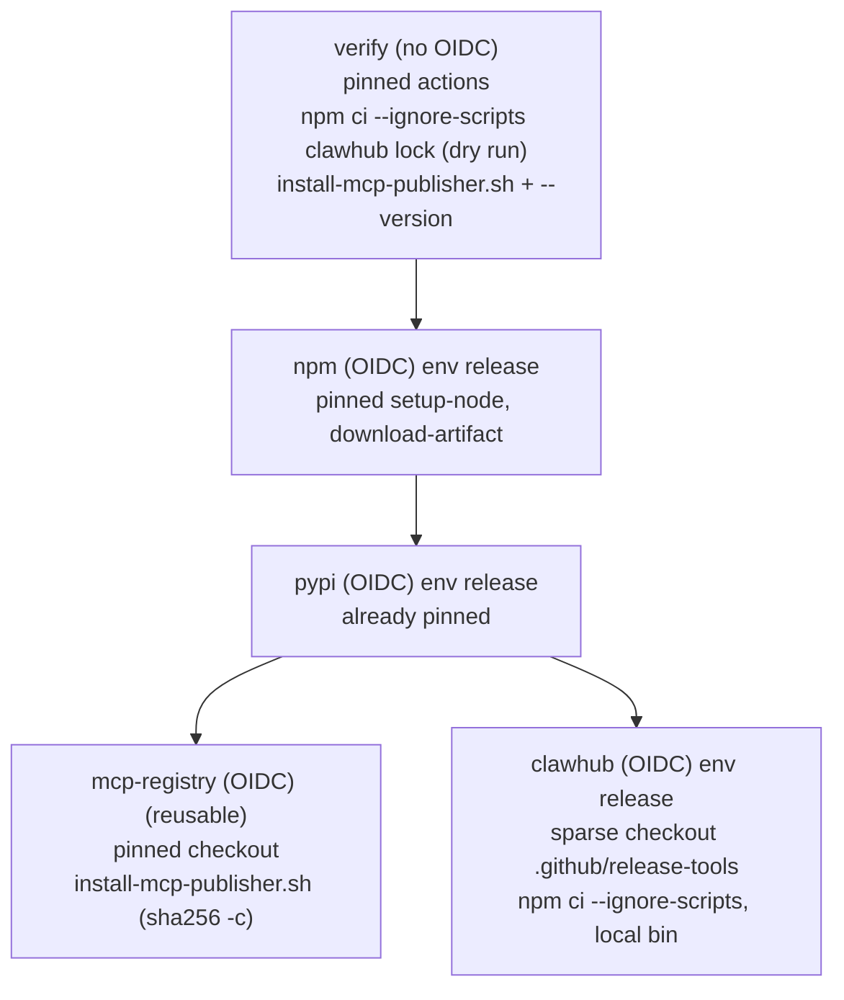

# Pre-0.19 Release Hardening and Compat-Name Removal - Plan

## Goal Capsule

- **Objective:** Tidegap 0.19.0 can ship from a release workflow in which no unpinned code runs next to an OIDC publish token, with zero open CodeQL alerts, and with the 0.18 compatibility names gone as the 0.18 CHANGELOG promised, while a 0.17 install that upgrades straight to 0.19 still finds its ledger.
- **Means:** two PRs in order. PR 1 pins every release-time tool and action and fixes the alerts in code (KTD1–KTD7). PR 2 removes the `ebb` / `ebb-mcp` bins and the `EBB_*` env and config-key fallbacks in TypeScript and Python (KTD8–KTD10).
- **Authority:** the orchestrator brief (fixed names `release.yml` and environment `release`, the apps/web exception, no `compat/` changes, no version bump, no dated CHANGELOG heading), then this plan, then `docs/solutions/tooling-decisions/trusted-publishing-release-workflow.md` and `docs/solutions/workflow-issues/renaming-a-published-multi-package-project.md`. Where this plan and the repo disagree, stop and report.
- **Stop conditions (for the implementing agent):** any implementation step would publish to a registry, change a repo or registry setting (rulesets included), bump a version, date the CHANGELOG heading, cut a tag, push to `main` or merge. `actionlint`, `pnpm preflight` or the PR dry-run job fails the same way twice. A trusted-publishing identity (workflow file name, environment name, a job name) would change.
- **Execution profile:** sequential, no fan-out. PR 1 (U1 → U4) on branch `chore/pre-0.19-hardening`, worktree `.worktrees/chore/pre-0.19-hardening`. PR 2 (U5 → U8) on a new branch `feat/remove-0.18-compat-names` cut from `main` after PR 1 merges (both PRs touch `CHANGELOG.md` and `pnpm-lock.yaml` may move). The worktree needs `pnpm install` and the `packages/core-py/.venv` dev install (CONTRIBUTING "Development setup") before `pnpm preflight`. Git commands use `git -c core.editor=true -c sequence.editor=true`.
- **Who finishes:** each PR stops at green CI, a green `release.yml` dry-run job on the PR, and one `ce-code-review` pass. Vitalii merges. The orchestrator applies the optional tag ruleset (KTD6) after PR 1 merges, outside both PRs, as the brief directs. The 0.19.0 release is a separate step Vitalii asks for.

---

## Product Contract

### Summary

PR 1 closes the supply-chain gap in `release.yml`: the ClawHub CLI installs from a committed lockfile with `--ignore-scripts`, `mcp-publisher` is checked against a pinned SHA-256, and every action is pinned to a commit. It also rewrites the ENTSO-E block extraction so CodeQL alerts #1–#4 close, and bumps the locked dependencies Dependabot flags. PR 2 removes the compatibility names 0.18 deprecated, updates the docs that promised the removal, and keeps the two migration paths that protect 0.17 data.

### Problem Frame

The `clawhub` and `npm` publish jobs hold `id-token: write`. The `clawhub` job runs `npx --yes clawhub@0.23.1`, which pins only the top package: its 38-package tree resolves fresh on every run, and any package in it can mint OIDC tokens trusted by ClawHub (and by any registry whose trust is not bound to the job). `mcp-registry.yml` pipes an unverified download into `tar`. Actions are referenced by moving tags. CodeQL reports polynomial ReDoS in the ENTSO-E parser, which reads text from an external feed. Dependabot reports 9 alerts in the lockfile. The 0.18 CHANGELOG, README and package READMEs promise that the `ebb` names stop in 0.19, so 0.19 must deliver that.

### Requirements

**Release supply chain (PR 1)**

- R1. No package resolved at run time executes in a job that has `id-token: write`. The ClawHub CLI and its whole tree install from a committed lockfile with lifecycle scripts disabled. The `npm` job's `npm install -g npm@11.19.1` is excluded (Scope Boundaries).
- R2. The `mcp-publisher` binary runs only after its SHA-256 matches a value committed in the repo.
- R3. Every `uses:` in `release.yml` and `mcp-registry.yml` names a full commit SHA with a `# vX.Y.Z` comment.
- R4. The trusted-publishing identity is unchanged: file `.github/workflows/release.yml`, environment `release`, and job ids `verify`, `npm`, `pypi`, `mcp-registry`, `clawhub`.
- R5. A pull request that changes a release input proves the new install paths in the `verify` dry run, so the first real use of a changed install step is not the release.

**Code scanning and dependencies (PR 1)**

- R6. CodeQL alerts #1, #2, #3 (`js/polynomial-redos`, `packages/core-ts/src/grid.ts`) and #4 (`js/incomplete-url-substring-sanitization`, `packages/core-ts/test/environment-purity.test.ts`) close by code change, with no dismissal.
- R7. `parseEntsoeXml` (TS) and `parse_entsoe_xml` (Python) return the same result as today on every existing fixture, and finish in linear time on adversarial input.
- R8. Every open Dependabot alert that a version bump fixes is fixed in PR 1.

**Compat-name removal (PR 2)**

- R9. `@tidegap/cli` ships only the `tidegap` bin and `@tidegap/mcp` only the `tidegap-mcp` bin.
- R10. CLI, MCP server and the Python package no longer read any `EBB_*` environment variable as a value.
- R11. `@tidegap/core` (TS) and `tidegap` (Python) no longer read `EBB_*` keys from `~/.tidegap/config`. `CarbonBudgetEnv` loses its `EBB_*` fields, and `withTidegapKeys` and `LEGACY_KEY_PREFIX` leave the public API.
- R12. A left-over `EBB_*` name is reported, never used: an `EBB_<NAME>` variable set while `TIDEGAP_<NAME>` is not, or an `EBB_*` key in `~/.tidegap/config`. CLI and MCP print one stderr line per process naming every such name and its new name; the Python package prints one line per name (KTD8). stdout stays clean for the MCP protocol.
- R13. apps/web keeps its `EBB_*` fallback, and its messages stop promising a 0.19 cut-off (KTD10).
- R14. The `~/.ebb-ai` migration and back-link, the `~/.config/ebb/env` fallback and the legacy daemon-unit detection stay (KTD9).
- R15. README, package READMEs, CHANGELOG Unreleased and code comments describe 0.19 behaviour. Nothing under `compat/` changes.

### Key Decisions

- **Keep the home-dir migration and the secrets-file fallback in 0.19,** although the 0.18 CHANGELOG listed both under "Removed in 0.19". A 0.17 user who skips 0.18 would otherwise get an empty ledger and lose the unprefixed provider keys (`OPENAI_API_KEY` and the like) a running 0.17 daemon reads. `EBB_*` keys inside that file (the 0.17 template wrote the grid keys as `EBB_*`) stop working like any other `EBB_*` variable and are named by the R12 notice. The brief names only bins, env fallbacks and config keys. Governs R14. Vitalii can overrule (Open Questions).
- **apps/web keeps `EBB_*`.** Its Vercel env vars are still `EBB_EIA_API_KEY` and `EBB_ELECTRICITY_MAPS_API_KEY`; renaming them is external state, out of scope. Governs R13.

### Scope Boundaries

- Not in scope: `ci.yml` and `codeql.yml` action pins (no OIDC there; Dependabot keeps them current). Listed under Deferred.
- Not in scope: `npm install -g npm@11.19.1` in the `npm` job. npm publishes its own package with every dependency bundled, and a published version is immutable, so nothing resolves at run time (KTD1 rationale).
- Not in scope: `uvx --from twine==7.0.0` in `verify`. `verify` has no `id-token` and no environment.
- Not built: translating `EBB_*` keys found in the secrets file or `~/.tidegap/config` to `TIDEGAP_*` at load time. That is the fallback the brief removes; R12 names them instead.
- Not built: removal of the openclaw-plugin config descriptions that say "(EBB_* before 0.18)". They are history text about field names; the plugin reads no env.
- Not touched: `compat/` (pointer packages pin `@tidegap/*@^0.18.0` / `tidegap>=0.18,<0.19`, so 0.19 does not reach them).

### Deferred to Follow-Up Work

- SHA-pin actions in `.github/workflows/ci.yml` and `.github/workflows/codeql.yml`.
- Dependabot alert #8 (`braces <= 3.0.3`, GHSA-vfj7-8cjw-p6xm) has no patched version. It stays open after PR 1; the orchestrator decides whether to wait for upstream or dismiss it. Path: `micromatch@4.0.8` under `fast-glob@3.3.1`, apps/web lint tooling only.
- Removal of the `~/.ebb-ai` back-link and `~/.config/ebb/env` fallback in a later release, if Vitalii wants it (KTD9).
- Rename of the Vercel env vars, then removal of the apps/web fallback.

---

## Planning Contract

### Key Technical Decisions

- KTD1. **ClawHub CLI from a committed npm lockfile.** New directory `.github/release-tools/clawhub/` holds a private `package.json` with the exact dependency `clawhub: 0.23.1` and its `package-lock.json` (lockfile v3, a `sha512` integrity per package). Both the `verify` dry run and the `clawhub` publish job run `npm ci --ignore-scripts` in that directory and call its `node_modules/.bin/clawhub`. `npm ci` fails on any integrity mismatch or lock drift. The tree has 38 packages and none declares an install script (checked with a scratch lock on 2026-10-17), so `--ignore-scripts` removes nothing the CLI needs. Chosen over a pnpm workspace devDependency: the `clawhub` job has no workspace install, and a separate directory keeps release tools out of the product lockfile. `CLAWHUB_VERSION` leaves `release.yml`; the version lives in that `package.json` only.
- KTD2. **The `clawhub` job checks out only the tools directory.** It gains `actions/checkout` (pinned) with `persist-credentials: false` and `sparse-checkout: .github/release-tools` as its first step, because today it has no checkout and the lockfile must reach it. It must run before `actions/download-artifact`: checkout empties a workspace that is not a matching repo, which would delete `openclaw-plugin/`. The plugin still comes from the `openclaw-plugin` artifact built in `verify`.
- KTD3. **One script owns the `mcp-publisher` pin.** New `scripts/install-mcp-publisher.sh` holds the version (`v1.8.1`) and the SHA-256 of `mcp-publisher_linux_amd64.tar.gz` (`a06c9096dcb9727c13555b6be26c7effa707b01f06a4c561ba7a3635443cf2cc`, the GitHub release asset digest and the release's `registry_1.8.1_checksums.txt` agree). It downloads to a file, checks with `sha256sum -c`, extracts, and exits non-zero on any other OS or arch. `mcp-registry.yml` calls it in place of the `curl | tar` step and drops `MCP_PUBLISHER_VERSION`. `verify` also calls it and runs `mcp-publisher --version`, which proves the pin on every PR (R5). A script and not two env blocks, so the hash has one owner.
- KTD4. **Action pins.** Resolved on 2026-10-17 from each repo's release tag:

  | Action | SHA | Comment |
  |---|---|---|
  | `actions/checkout` | `3d3c42e5aac5ba805825da76410c181273ba90b1` | `# v7.0.1` |
  | `pnpm/action-setup` | `ea17c68df8912ef543352723c149a84f56e3d413` | `# v6.1.0` |
  | `actions/setup-node` | `949feb2413d6458794dcd2491c4babbbce0c15c1` | `# v7.1.0` |
  | `actions/upload-artifact` | `cf430e030ddbb5b0abf93d22962f4752f3646cd9` | `# v7.0.2` |
  | `actions/download-artifact` | `9000827ccba6bdab643e8b6fd33ac0654aef8333` | `# v8.0.2` |

  `astral-sh/setup-uv` and `pypa/gh-action-pypi-publish` are already pinned and stay. `pnpm/action-setup`'s moving `v6` tag lags `v6.1.0` by one commit, so the pin is a one-commit upgrade; the dry run covers it. The implementer re-resolves any tag that moved before the PR, with the same `gh api repos/<owner>/<repo>/git/ref/tags/<tag>` lookup (annotated tags dereferenced to the commit). Dependabot's existing `github-actions` entry updates SHA pins with their comments.
- KTD5. **Linear block scan for ENTSO-E.** Replace the three lazy `[\s\S]*?` block regexes (`<text>`, `<TimeSeries>`, `<Period>`) with one small helper that walks the string with `indexOf`: find `<tag>`, find the next `</tag>` after it, yield the inner text, continue after the close, stop when either is missing. This matches the lazy regex exactly: the regex also takes the nearest close and, when one open has no close, no later open has one either. The anchored inner regexes (`psrType`, `start`, `resolution`, `Point`) have no unbounded lazy span and stay. Mirror the helper in `packages/core-py/src/tidegap/grid.py`, which has the same three patterns and the same quadratic behaviour in `re`, although CodeQL Python did not flag it; the two cores are kept in parity. Chosen over an XML parser dependency (the existing doc comment rejects a 30 KB dep for one adapter) and over a tempered-greedy regex (CodeQL may still flag it, and it is harder to read).
- KTD6. **Optional `v*` tag ruleset, applied by the orchestrator after PR 1 merges.** Two rulesets, because a bypass list applies to every rule in a ruleset. "release tags locked" blocks update and deletion of `v*` tags for everyone. "release tag creation" lets only repo admins create `v*` tags. Today the repo has no rulesets; the `release` environment already allows `v*` tags only. The creation rule still matters: `mcp-registry.yml` names no environment, so a dispatch on any `v<version>` tag publishes to the MCP Registry without approval. Moving or deleting a tag later needs the first ruleset disabled for that one action.

  ```bash
  gh api -X POST repos/tidegap/tidegap/rulesets --input - <<'JSON'
  {
    "name": "release tags locked",
    "target": "tag",
    "enforcement": "active",
    "conditions": { "ref_name": { "include": ["refs/tags/v*"], "exclude": [] } },
    "rules": [ { "type": "update" }, { "type": "deletion" } ],
    "bypass_actors": []
  }
  JSON
  gh api -X POST repos/tidegap/tidegap/rulesets --input - <<'JSON'
  {
    "name": "release tag creation",
    "target": "tag",
    "enforcement": "active",
    "conditions": { "ref_name": { "include": ["refs/tags/v*"], "exclude": [] } },
    "rules": [ { "type": "creation" } ],
    "bypass_actors": [ { "actor_id": 5, "actor_type": "RepositoryRole", "bypass_mode": "always" } ]
  }
  JSON
  ```

  Readback: `gh api repos/tidegap/tidegap/rulesets --jq '.[] | {name, target, enforcement}'` lists both as `active`. `actor_id` 5 is the built-in admin repository role.
- KTD7. **Dependency fixes by `pnpm.overrides`.** Add `brace-expansion@<1.1.21` → `^1.1.21` (alerts #1, #2, #5, #6, #7), `js-yaml@<4.3.2` → `^4.3.2` (#3, #4), `source-map-js@<1.2.2` → `^1.2.2` (#9) to the existing `pnpm.overrides` block in `package.json`, then regenerate `pnpm-lock.yaml`. The `brace-expansion` selector leaves the `5.0.12` copy alone. Only `js-yaml@4.3.0` is in the lock, so no 3.x consumer gets a major jump. All of these come from eslint and tailwind tooling (`minimatch@3.1.5`, `@eslint/eslintrc`, `@tailwindcss/node`), not from a published package. Overrides follow the repo's existing pattern; direct parent bumps are not available for all three.
- KTD8. **`EBB_*` env becomes a notice, not a value.** In `packages/cli/src/env.ts` and `packages/mcp-server/src/env.ts`, the `Fallbacks` class gives way to a check over the same name lists: for each name with `EBB_<NAME>` set and `TIDEGAP_<NAME>` unset, record it; at the end, write one stderr line, for example `tidegap: EBB_EIA_API_KEY is no longer read (removed in 0.19); rename it to TIDEGAP_EIA_API_KEY`. The value is never used. The same check also parses `~/.tidegap/config` (`carbonBudgetConfigPath` and `parseKeyValues` from `@tidegap/core`) and adds any `EBB_*` key it finds to the line. In the CLI, the check runs after `loadEnvFileIntoProcess`, so `EBB_*` keys from the secrets file are named too. Python `_env.py` `env_value` keeps the same once-per-name rule with the new wording and returns only the `TIDEGAP_*` value; Python `budget.py` names an `EBB_*` key in the config file once per key. This passes the 3.8 test: an MCP host config with `EBB_DB_PATH` would open a different, empty ledger, a 0.17 secrets file would silently switch the daemon to mock grid data, and a 0.17 config would silently drop budget and quota settings. The notice reads env only in hosts, so the core stays environment-pure.
- KTD9. **What stays from the 0.18 compat layer.** `resolveTidegapHome` / `tidegap.paths` (move and back-link), `legacyEnvFilePath` in `packages/cli/src/commands/env-file.ts`, and the legacy-label detection in `packages/cli/src/platform/index.ts` stay unchanged in behaviour; only their "until 0.19" comments change. Governs R14.
- KTD10. **apps/web text-only change.** `apps/web/src/lib/grid.ts` keeps `pick()` and its fallback. Its warning and the `apps/web/.env.example` comment drop "stop working in 0.19" and say the site reads `EBB_*` until the Vercel variables are renamed.

### High-Level Technical Design

Where each PR 1 control sits in the release job graph. Jobs marked OIDC hold `id-token: write`.



PR 2 env resolution per name, at every host boundary (CLI, MCP, Python):

| `TIDEGAP_<NAME>` | `EBB_<NAME>` | 0.18 result | 0.19 result |
|---|---|---|---|
| set | any | TIDEGAP value | TIDEGAP value, no line |
| unset | set | EBB value + deprecation line | unset + "no longer read" line (KTD8) |
| unset | unset | unset | unset, no line |

### Assumptions

- Headless run: the scoping confirmation was skipped. Inferred bets: the Python parser fix ships with the TS one (KTD5), the env and config-key notice ships (KTD8), the home-dir and secrets fallbacks stay (KTD9).
- `.github/release-tools/` is outside the pnpm workspace globs (`packages/*`, `apps/*`, `examples/*`) and `node_modules/` is already gitignored at every depth.
- ClawHub's trusted publisher binds to repo, workflow and environment, not to job steps, so adding a checkout step does not affect it. npm and PyPI bind to `release.yml` plus `release` (trusted-publishing doc).
- The PR dry run triggers for both PRs: PR 1 touches `.github/workflows/release.yml` and `pnpm-lock.yaml`; PR 2 touches `packages/cli/package.json` and `packages/mcp-server/package.json`, which match `packages/*/package.json`.

---

## Implementation Units

### U1. Lockfile-pinned ClawHub CLI and checksummed mcp-publisher

- **Goal:** No run-time-resolved code or unverified binary runs in an OIDC job.
- **Requirements:** R1, R2, R4, R5.
- **Dependencies:** none.
- **Files:**
  - `.github/release-tools/clawhub/package.json` (new)
  - `.github/release-tools/clawhub/package-lock.json` (new)
  - `scripts/install-mcp-publisher.sh` (new)
  - `.github/workflows/release.yml`
  - `.github/workflows/mcp-registry.yml`
  - `.github/dependabot.yml`
- **Approach:**
  1. Create the tools directory per KTD1. Generate the lock with `npm install --package-lock-only --ignore-scripts` and commit both files.
  2. In `release.yml` `verify`, replace `npx --yes "clawhub@..."` in "ClawHub dry run" with the `npm ci --ignore-scripts` install plus the local bin. Keep `set -o pipefail` and the step's arguments.
  3. Add a `verify` step that runs with `working-directory: packages/mcp-server`, calls the script by the same relative path `mcp-registry.yml` will use, and runs `./mcp-publisher --version` (KTD3), so the PR exercises the publish job's exact invocation.
  4. In the `clawhub` job, use this step order: sparse checkout (KTD2), setup-node, download-artifact, the install with text identical to the `verify` step, then `inspect` and `publish` through the local bin. Remove `CLAWHUB_VERSION` from `env`.
  5. In `mcp-registry.yml`, replace the `curl | tar` step with the script and remove `MCP_PUBLISHER_VERSION`. The later steps already run from `packages/mcp-server`; the script must place the binary where `./mcp-publisher` resolves.
  6. Add `.github/release-tools/**` and `scripts/install-mcp-publisher.sh` to `release.yml` `pull_request.paths`.
  7. Add an `npm` entry for `/.github/release-tools/clawhub` to `dependabot.yml`: same weekly Tuesday shape and semver-major `ignore` as the root entry, plus `cooldown: { default-days: 7 }`, so a just-published transitive release cannot reach the OIDC job before the usual detection window.
- **Execution note:** packaging and CI config; prove it by the PR dry run and a local `npm ci --ignore-scripts` plus `clawhub --version`, not by unit tests.
- **Patterns to follow:** the existing "Each artifact is uploaded right after it is built, before a tool fetched at run time runs here" ordering in `verify`; keep it.
- **Test scenarios:**
  - `npm ci --ignore-scripts` in `.github/release-tools/clawhub` on a clean checkout installs and `node_modules/.bin/clawhub --version` prints `0.23.1`.
  - A one-byte change to any `integrity` value in the lock makes `npm ci` fail (manual check, not committed).
  - `scripts/install-mcp-publisher.sh` with a wrong hash in a local copy exits non-zero before extraction (manual check on Linux or in CI logs).
  - The PR's "verify (build + dry run)" job shows the ClawHub dry-run output and the `mcp-publisher` version line.
- **Verification:** `actionlint` passes; the PR dry run is green; `git grep -n "npx --yes" .github/workflows` is empty; `git grep -n "curl.*| *tar" .github/workflows` is empty.

### U2. SHA-pin actions in release.yml and mcp-registry.yml

- **Goal:** Every action in the two release workflows is immutable.
- **Requirements:** R3, R4.
- **Dependencies:** U1 (same files; pin after U1's new `checkout` steps exist).
- **Files:** `.github/workflows/release.yml`, `.github/workflows/mcp-registry.yml`.
- **Approach:** replace each moving tag with the SHA and comment from KTD4. Leave job ids, `environment: release`, `permissions` and the reusable-workflow path unchanged.
- **Test expectation:** none -- config only; the dry run and `actionlint` prove it.
- **Verification:** `git grep -nE "uses: [^.][^@]*@v[0-9]+$" .github/workflows/release.yml .github/workflows/mcp-registry.yml` is empty; each `uses:` line ends with `# vX.Y.Z`; the dry run is green.

### U3. Linear-time ENTSO-E extraction and the URL-host test fix

- **Goal:** CodeQL alerts #1–#4 close and the parser stays linear on hostile feed text.
- **Requirements:** R6, R7.
- **Dependencies:** none.
- **Files:**
  - `packages/core-ts/src/grid.ts`
  - `packages/core-ts/test/grid-feeds-fixtures.test.ts`
  - `packages/core-ts/test/environment-purity.test.ts`
  - `packages/core-py/src/tidegap/grid.py`
  - `packages/core-py/tests/test_grid_feeds_fixtures.py`
- **Approach:**
  1. Add the block-scan helper in `grid.ts` (KTD5), unexported, and use it for the Acknowledgement `<text>` (first block only), `<TimeSeries>` and `<Period>`.
  2. Mirror it in `grid.py` and drop `_ENTSOE_TEXT_RE`, `_ENTSOE_TS_RE`, `_ENTSOE_PERIOD_RE`.
  3. In `environment-purity.test.ts` line 178, compare `new URL(u).hostname` to `api.electricitymap.org` instead of a substring check.
- **Execution note:** write the adversarial tests first and confirm they are slow on the current regexes at a moderate size, then fix.
- **Test scenarios:**
  - Existing fixtures `entsoe-a75-de.xml` and `entsoe-acknowledgement.xml` give identical results (all current `parseEntsoeXml` / `parse_entsoe_*` tests pass unchanged).
  - `"<Acknowledgement_MarketDocument>" + "<text>".repeat(100_000)` throws the Acknowledgement error with "no reason text in document" in under 1 s.
  - `"<TimeSeries>".repeat(100_000)` returns `[]` in under 1 s.
  - `"<TimeSeries><psrType>B01</psrType>" + "<Period>".repeat(100_000) + "</TimeSeries>"` returns `[]` in under 1 s.
  - Two TimeSeries blocks with a stray unclosed `<Period>` in the first: the first yields only its closed periods, the second parses normally (same as the regex).
  - Python: the same three adversarial inputs finish in under 1 s.
  - The URL test still passes and fails if the Electricity Maps URL is changed to another host.
- **Verification:** `pnpm --filter @tidegap/core test` and `pytest -q` pass; the PR's CodeQL check reports #1–#4 as fixed.

### U4. Dependency overrides and PR 1 CHANGELOG

- **Goal:** fixable Dependabot alerts close and PR 1 is recorded.
- **Requirements:** R8.
- **Dependencies:** U1–U3.
- **Files:** `package.json`, `pnpm-lock.yaml`, `CHANGELOG.md`, `CONTRIBUTING.md`.
- **Approach:**
  1. Add the three overrides from KTD7 and regenerate the lock with pnpm 9.15.0 (`packageManager`).
  2. Under `## [Unreleased]`, add a `### Security` section: release tools install from a lockfile without scripts, `mcp-publisher` is checksum-verified, release actions are SHA-pinned, the ENTSO-E parser runs in linear time on hostile input, and the dependency overrides.
  3. In CONTRIBUTING "Releases", add one line on how to bump a release tool: edit `.github/release-tools/clawhub/package.json` and regenerate its lock, or change the version and hash in `scripts/install-mcp-publisher.sh` from the release's checksums file. A change under `.github/release-tools/` gets a human read of the lockfile diff before merge.
- **Test expectation:** none -- lockfile and docs; `pnpm preflight` and the dry run prove nothing broke.
- **Verification:** `pnpm install --frozen-lockfile` passes; the lock has no `brace-expansion@1.1.16`, `js-yaml@4.3.0` or `source-map-js@1.2.1`; `pnpm preflight` passes.

### U5. Remove the bin aliases

- **Goal:** `ebb` and `ebb-mcp` are gone from both packages.
- **Requirements:** R9.
- **Dependencies:** PR 1 merged; new branch from `main`.
- **Files:**
  - `packages/cli/package.json`
  - `packages/cli/src/index.ts`
  - `packages/mcp-server/package.json`
  - `packages/mcp-server/src/server.ts`
  - `packages/cli/test/bin-alias.test.ts`
- **Approach:** drop the `ebb` and `ebb-mcp` `bin` entries. Remove `binAliasDeprecation` and its call in both entry files. Rewrite `bin-alias.test.ts` to assert each package has exactly one bin.
- **Test scenarios:**
  - `@tidegap/cli` `bin` keys equal `["tidegap"]`.
  - `@tidegap/mcp` `bin` keys equal `["tidegap-mcp"]`.
  - Running the CLI entry through a symlink named `ebb` prints no deprecation line (the alias text is gone).
- **Verification:** `pnpm --filter @tidegap/cli test` passes; the `verify` dry-run tarball check passes.

### U6. Replace env fallbacks with the ignored-name notice (TS hosts)

- **Goal:** CLI and MCP read only `TIDEGAP_*` and name any left-over `EBB_*` once.
- **Requirements:** R10, R12.
- **Dependencies:** U5.
- **Files:**
  - `packages/cli/src/env.ts`
  - `packages/cli/src/commands/install.ts` (comments)
  - `packages/cli/test/legacy-names.test.ts`
  - `packages/cli/test/tick.test.ts`
  - `packages/mcp-server/src/env.ts`
  - `packages/mcp-server/test/legacy-names.test.ts`
- **Approach:** apply KTD8 in both `env.ts` files, keeping their current name lists and stderr-only writer seam. Keep the `secrets file`, `tidegap install with a 0.17 home` and `daemonStatus` blocks in the CLI legacy test (KTD9).
- **Test scenarios:**
  - Only `EBB_EIA_API_KEY` set: `eiaApiKey` is undefined and one stderr line names `EBB_EIA_API_KEY` and `TIDEGAP_EIA_API_KEY`.
  - Both set: the `TIDEGAP_` value, no line.
  - Neither set: undefined, no line.
  - `EBB_EIA_API_KEY`, `EBB_CARBON_BUDGET_G`, `EBB_BINARY` set: one line naming all three.
  - `EBB_NO_NOTIFY=1` alone no longer turns notifications off; `TIDEGAP_NO_NOTIFY=1` still does (`tick.test.ts`).
  - Secrets file `~/.config/tidegap/env` holding only `EBB_EIA_API_KEY=k`: `tick` gets no EIA key and the line names `EBB_EIA_API_KEY`.
  - `~/.tidegap/config` holding `EBB_CARBON_BUDGET_G=500`: the line names `EBB_CARBON_BUDGET_G`; with only `TIDEGAP_*` keys, no line.
  - MCP stdio server started with only `EBB_DB_PATH`: it opens the default `~/.tidegap/queue.db` under the hermetic home, stdout carries only protocol frames, stderr names `EBB_DB_PATH`.
- **Verification:** `pnpm --filter @tidegap/cli test` and `pnpm --filter @tidegap/mcp test` pass.

### U7. Remove EBB_* config keys and env fallback in the cores (TS and Python)

- **Goal:** both cores read only `TIDEGAP_*` keys and names.
- **Requirements:** R10, R11, R12.
- **Dependencies:** U6 (`tick.ts` stops importing `withTidegapKeys` here).
- **Files:**
  - `packages/core-ts/src/budget.ts`
  - `packages/core-ts/src/quota.ts`
  - `packages/core-ts/src/index.ts`
  - `packages/core-ts/src/paths.ts` (comment)
  - `packages/cli/src/commands/tick.ts`
  - `packages/cli/src/commands/env-file.ts` (comment)
  - `packages/core-ts/test/budget.test.ts`
  - `packages/core-ts/test/quota.test.ts`
  - `packages/core-py/src/tidegap/_env.py`
  - `packages/core-py/src/tidegap/budget.py`
  - `packages/core-py/tests/test_budget.py`
  - `packages/core-py/tests/test_env.py` (new)
- **Approach:**
  1. Remove `LEGACY_KEY_PREFIX`, `withTidegapKeys` and the `EBB_*` fields of `CarbonBudgetEnv`; keep `KEY_PREFIX`. `budget.ts`, `quota.ts` and `tick.ts` read parsed keys directly.
  2. Python: remove `with_tidegap_keys`; `env_value` follows KTD8.
  3. Leave the `EBB_*` names in the `environment-purity.test.ts` leaked-variable list; they still prove the core ignores ambient env.
- **Test scenarios:**
  - Config file with only `EBB_CARBON_BUDGET_G=500`: `loadCarbonBudgetConfig` returns undefined (TS and Python).
  - Config file with `EBB_CARBON_BUDGET_G=500` and `TIDEGAP_CARBON_BUDGET_G=300`: threshold 300.
  - `opts.env` with only `EBB_CARBON_BUDGET_G`: undefined (TS).
  - Quota config with only `EBB_QUOTA_RESET_CLAUDE`: no reset for `claude`; with the `TIDEGAP_` key: the reset applies.
  - Python `env_value("EIA_API_KEY")` with only `EBB_EIA_API_KEY` set: returns None and prints one stderr line; a second call prints nothing.
  - Python config file with only `EBB_CARBON_BUDGET_G=500`: one stderr line names it, once.
- **Verification:** `pnpm typecheck`, `pnpm --filter @tidegap/core test`, `pytest -q` and `ruff check` pass; `node --test compat/test/shims.test.mjs` still passes against the 0.19-shaped workspace.

### U8. Docs, apps/web text and PR 2 CHANGELOG

- **Goal:** every place that promised the removal now describes 0.19.
- **Requirements:** R13, R14, R15.
- **Dependencies:** U5–U7.
- **Files:**
  - `README.md` ("Renamed from Ebb AI" section and table)
  - `packages/cli/README.md`
  - `packages/mcp-server/README.md`
  - `CHANGELOG.md`
  - `apps/web/src/lib/grid.ts`
  - `apps/web/.env.example`
- **Approach:**
  1. README table: the `EBB_*` rows (variables, and keys in `~/.tidegap/config`) say "Not read since 0.19; one stderr line names each one", action "Rename to `TIDEGAP_*`". The `ebb <command>` row says removed in 0.19. The secrets row says the file is still read and copied, and `EBB_*` keys inside it must be renamed to `TIDEGAP_*`. The `~/.ebb-ai` row stays. The intro line drops "stop in 0.19" in favour of "were removed in 0.19".
  2. Package README line 5 in both: the alias and `EBB_*` names were removed in 0.19.
  3. CHANGELOG `## [Unreleased]`: `### Removed` lists the two bins, `EBB_*` env and config keys, `CarbonBudgetEnv` `EBB_*` fields, `withTidegapKeys` and `LEGACY_KEY_PREFIX`. `### Changed` says a left-over `EBB_*` variable now prints one "no longer read" line. A note says the `~/.ebb-ai` migration and back-link and the `~/.config/ebb/env` fallback stay so a 0.17 install can upgrade directly, and that tidegap.com still reads its `EBB_*` Vercel variables. Upgrade notes: rename `EBB_*` in shell, MCP host config, `~/.tidegap/config` and the secrets file `~/.config/tidegap/env` (or `~/.config/ebb/env`); use `tidegap` / `tidegap-mcp`.
  4. apps/web text per KTD10.
- **Test expectation:** none -- docs and log text.
- **Verification:** the leftover-name grep below returns only allowlisted hits; `node scripts/check-versions.mjs` passes (no version or heading change).

---

## Verification Contract

| Check | PR 1 | PR 2 | Pass signal |
|---|---|---|---|
| `pnpm install --frozen-lockfile` | yes | yes | exit 0 |
| `pnpm preflight` (repo gate: versions, data, typecheck, tests, ruff + pytest, images, brand, build, compat and check-versions tests) | yes | yes | exit 0 |
| `node scripts/check-versions.mjs` | yes | yes | exit 0, no mismatch |
| `actionlint .github/workflows/*.yml` (installed at `/opt/homebrew/bin/actionlint`) | yes | yes | no output |
| `release.yml` "verify (build + dry run)" on the PR | yes (release.yml, lock) | yes (`packages/*/package.json`) | green; summary shows ClawHub dry run and, for PR 1, the `mcp-publisher` version |
| `ci.yml` and `codeql.yml` on the PR | yes | yes | green; PR 1 CodeQL shows #1–#4 fixed |
| `pnpm --filter ./apps/web build` and `pnpm --filter ./apps/web lint` (overrides reach apps/web tooling; preflight builds packages only) | yes | no | exit 0 |
| Local `npm ci --ignore-scripts` in `.github/release-tools/clawhub`, then `clawhub --version` | yes | no | prints `0.23.1` |
| Leftover-name grep | no | yes | see below |

Leftover-name grep for PR 2: `git grep -nE "EBB_|ebb-mcp|\bebb\b" -- ':!CHANGELOG.md' ':!docs/solutions' ':!docs/plans' ':!docs/archive' ':!docs/release' ':!docs/internal' ':!compat' ':!pnpm-lock.yaml'`. Allowed hits: apps/web fallback and its comment (KTD10), the env notice code and its tests (KTD8), the KTD9 paths, secrets and daemon-label code and tests, the README rename table, the `environment-purity.test.ts` leaked list, openclaw-plugin history text, `queue.test.ts` hook-name arguments, `scripts/ui-seed.mjs` env filter. Any other hit is a miss.

After merge (orchestrator, not the PR): `gh api 'repos/tidegap/tidegap/code-scanning/alerts?state=open'` is empty; `gh api 'repos/tidegap/tidegap/dependabot/alerts?state=open'` lists only #8.

---

## Definition of Done

- PR 1 "chore: release hardening + CodeQL alerts" is open with U1–U4, every row marked PR 1 above is green, and one `ce-code-review` pass has run with its blockers fixed.
- PR 2 "feat!: remove the 0.18 compatibility names (0.19)" is open from `main` after PR 1 merged, with U5–U8, every row marked PR 2 is green, and one `ce-code-review` pass has run.
- No version field changed, the CHANGELOG has no new dated heading, and nothing under `compat/` changed.
- Workflow file name, environment name and job ids are byte-identical to `main` (`git diff main -- .github/workflows/release.yml` shows no change to `name:` of the file, `environment:` lines or job keys).
- No abandoned-attempt code, scratch lockfiles or debug output remain in either diff.
- The KTD6 ruleset JSON is in this plan for the orchestrator; it is not applied by either PR.

---

## Open Questions

- (Deferred, non-blocking) Keep the `~/.ebb-ai` back-link and `~/.config/ebb/env` fallback through 0.19 (this plan) or remove them as the 0.18 CHANGELOG said? Removing them strands any 0.17 user who skipped 0.18. Vitalii decides before the release PR; the plan builds "keep".
- (Deferred, non-blocking) Dismiss Dependabot #8 (`braces`) or wait for an upstream fix? Orchestrator's call after PR 1.

---

## Risks & Dependencies

| Risk | Mitigation |
|---|---|
| The `clawhub` and `mcp-registry` publish jobs first run their new steps at the 0.19.0 release | `verify` runs the same install text and the same script invocation from the same directory on every PR (R5, U1 steps 3–4). A transient failure is fixed by "Re-run failed jobs"; a deterministic bug in a step is fixed by a patch release, because a re-run uses the workflow file at the tag. |
| A job id or environment change breaks trusted publishing | R4 and the Definition of Done diff check; no job is renamed or split. |
| `pnpm/action-setup` pin is one commit newer than the moving `v6` tag CI uses | the dry run exercises it; Dependabot keeps both in step. |
| The ENTSO-E rewrite changes parse results | all existing fixture tests stay unchanged and must pass; KTD5's equivalence argument plus the unclosed-`<Period>` scenario. |
| Overrides pull a lint-tool version that breaks eslint or the tailwind build | `pnpm preflight` builds packages only, so PR 1 also runs the apps/web build and lint (Verification Contract); revert the single override that fails. |
| A user with `EBB_DB_PATH` in an MCP host config opens an empty ledger after upgrade | KTD8 stderr line, CHANGELOG upgrade note, README table. |
| PR 2 conflicts with PR 1 in `CHANGELOG.md` | PR 2 starts from `main` after PR 1 merges (Goal Capsule). |

---

## Sources

- `.github/workflows/release.yml` (`verify` "ClawHub dry run", `clawhub` job), `.github/workflows/mcp-registry.yml` ("Install mcp-publisher").
- `packages/core-ts/src/grid.ts` `parseEntsoeXml`; `packages/core-py/src/tidegap/grid.py` `parse_entsoe_xml` and the `_ENTSOE_*_RE` constants.
- `packages/cli/src/env.ts` and `packages/mcp-server/src/env.ts` (`Fallbacks`), `packages/core-ts/src/budget.ts` (`withTidegapKeys`), `packages/core-py/src/tidegap/_env.py`.
- `docs/solutions/tooling-decisions/trusted-publishing-release-workflow.md` (trust bindings, re-run behaviour, `pipefail`).
- `docs/solutions/workflow-issues/renaming-a-published-multi-package-project.md` (rules 3–9 and 11: aliases, fallbacks, home migration, leftover grep).
- GitHub API on 2026-10-17: code-scanning alerts #1–#4, Dependabot alerts #1–#9, action release tags, `modelcontextprotocol/registry` v1.8.1 asset digests and `registry_1.8.1_checksums.txt`.
- npm registry: `clawhub@0.23.1` (exact direct deps, 38-package tree, no install scripts), `brace-expansion@1.1.21`, `js-yaml@4.3.2`, `source-map-js@1.2.2`; `braces` has no release after 3.0.3.
