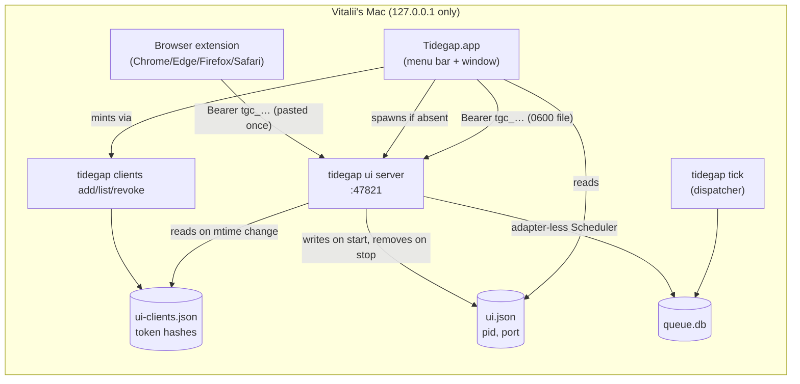
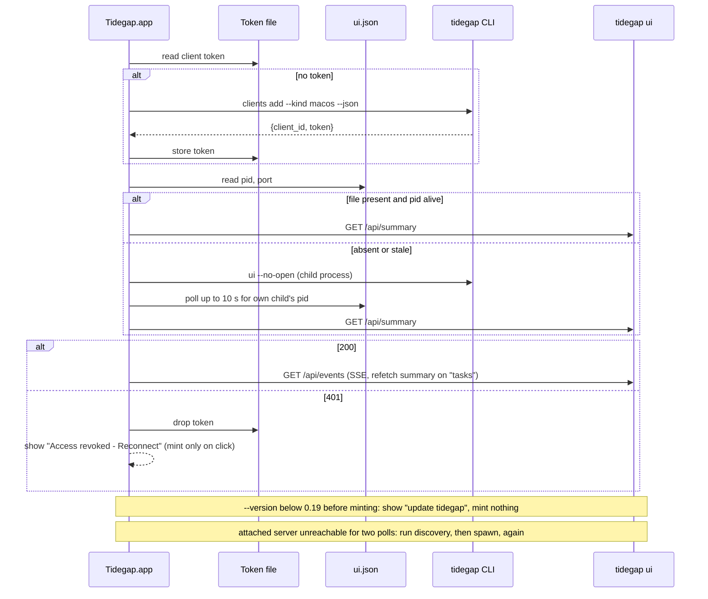
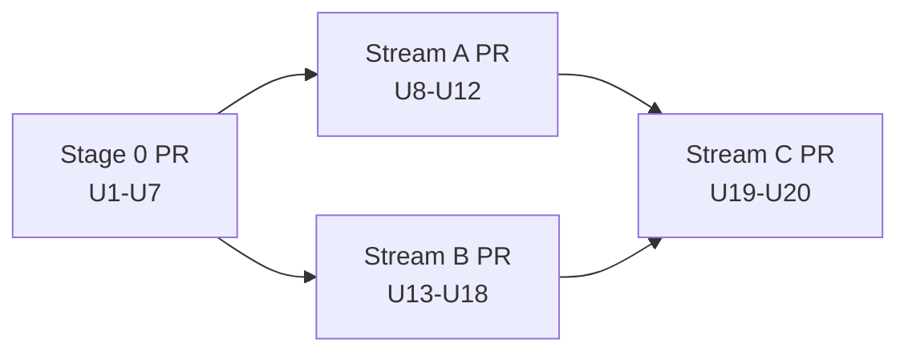

# Native Clients (Browser Extension, macOS App, Safari) - Plan

## Goal Capsule

- **Objective:** Vitalii sees his Tidegap queue and the next clean grid window without opening a terminal while the Mac app runs (the app starts the server; without it, the extension asks him to run `tidegap ui`). He can queue a task in one step and gets a notification when a task finishes or a clean window starts. This works from Chrome (and Edge and Firefox from the same build), from the macOS menu bar, and from Safari (Stream C; it moves to a follow-up if its stop condition fires). He builds and installs both clients on his own Mac today.
- **Means:** two clients of the local `tidegap ui` API, with no second data path (KTD1). Long-lived client tokens let them in (KTD2).
- **Authority:** this plan's Product Contract wins on behavior. KTDs win on mechanism. `docs/solutions/best-practices/loopback-web-ui-hardening.md` is a hard constraint: no stage weakens its Host, Origin, CSRF or bearer rules (R4), except the extension-origin rule in KTD3.
- **Execution profile:** four PRs. Stage 0 "foundation" (U1-U7) lands first. Stream A "extension" (U8-U12) and stream B "mac app" (U13-U18) run in parallel on top of main after Stage 0 merges. Stream C "safari" (U19-U20) starts after B merges. A and B share only `CHANGELOG.md`.
- **Stop conditions:**
  - A stage needs a relaxed Host, Origin, content-type or bearer check beyond KTD3: stop and report.
  - A stage needs a listener beyond 127.0.0.1, telemetry, or a store account: stop and report.
  - Stream C hits a Safari limit that needs a server change (see Risks): stop, report, and move C to a follow-up. A and B stay valid without C.
- **Who finishes:** each stage ends at a green PR with `ce-code-review` done. Nobody merges except Vitalii or the orchestrator under the project's merge rule. No release is cut by this work.

---

## Product Contract

### Summary

Stage 0 adds a client-token registry, a summary endpoint, a quick-add endpoint, a discovery file and a fixed default port to `tidegap ui`. Stream A ships one Manifest V3 extension with a toolbar badge, a popup with the queue and quick add, and local browser notifications. Stream B ships a SwiftUI menu bar app that starts or finds the server, shows the queue and the next clean window, sends native notifications, and opens the full `tidegap ui` page in a window. Stream C packages the extension as a Safari Web Extension inside the Mac app.

### Problem Frame

`tidegap ui` (PR #45, ui v2) is a page in a browser tab that lives only while a terminal runs `tidegap ui`. Its token is random per run, so nothing outside that tab can call the API. Vitalii asked for a Mac app ("когда сделаешь приложение для Mac, установи мне её") and for browser extensions ("заложи в план так же сделать екстеншены для браузеров"). Both need a persistent way in, a compact status, and push-style notices. The current server allows none of this by design.

### Requirements

**Foundation (Stage 0)**

- R1. A client authenticates with a long-lived client token that the user creates once and can revoke. Creating one needs either the CLI or the already-authenticated page.
- R2. One request returns what a compact client shows: active queue count per status, unread count, the next run, the next clean window, and the tasks finished since a cursor.
- R3. A client can queue a task from a prompt and an optional deadline.
- R4. The hardening rules in `docs/solutions/best-practices/loopback-web-ui-hardening.md` stay in force. The only change is the extension-origin rule in KTD3. The server still binds 127.0.0.1 only, sends no CORS headers and no telemetry.
- R5. A local app can find a running server (port, pid) without the user typing anything.

**Browser extension (Stream A)**

- R6. One MV3 code base builds for Chrome and Edge (one zip) and for Firefox (one zip).
- R7. The toolbar badge shows the active queue count, or the next clean window when the queue is empty (KTD6).
- R8. The popup lists the active queue and has a quick-add form (R3).
- R9. The extension notifies when a task finishes or a clean window starts. v1 notifications are local to the extension behind a channel seam (KTD8).

**macOS app (Stream B)**

- R10. A menu bar item shows the next clean window and the queue, with quick add.
- R11. The app sends native notifications for the same two events as R9.
- R12. A window shows the full `tidegap ui` page.
- R13. The app connects to a running `tidegap ui`, or starts one and stops it on quit.
- R14. The app builds ad-hoc signed and installs to `~/Applications` on Vitalii's Mac.

**Safari (Stream C)**

- R15. The Safari Web Extension build of the extension ships inside the Mac app's Xcode project, with the badge and popup working. Safari has no `notifications` API, so the Mac app's notifications cover Safari users.

**Distribution**

- R16. Each client produces a build artifact (extension zips, a zipped `.app`). No store upload. `release.yml`'s reserved block gets a note.

### Acceptance Examples

- AE1. **Covers R1, R4.** Given a client token, when a request comes from `chrome-extension://abc` with that token, the API answers 200. When the same origin sends the page's run token, the answer is 403. When `https://evil.example` sends the client token, the answer is 403.
- AE2. **Covers R1.** Given a client token that `tidegap clients revoke <id>` removed, the next request with it gets 401. No server restart is needed.
- AE3. **Covers R2, R9, R11.** Given a first summary call without `since`, no finished tasks are listed and a cursor is returned. Given a task that completes after that cursor, the next call with `since=<cursor>` lists it exactly once.
- AE4. **Covers R7.** Queue has 3 active tasks: badge "3". Queue is empty and a clean window runs now: badge "now". Queue is empty and the window starts in 5 h: badge "5h". Server unreachable: badge "off". No token: badge "?".
- AE5. **Covers R13.** Given `ui.json` names a live pid and the token answers 200, the app connects and starts nothing. Given no `ui.json`, the app starts `tidegap ui --no-open`, connects, and on quit stops only that child.

### Open Questions

Neither blocks Stage 0, A or B. Both are Vitalii's call; the plan proceeds on the recommendation unless he says otherwise.

- **Port squatting (affects U1, U2, U9, U14).** Recommendation: accept the risk for a single-user Mac and document it in `docs/spec/ui-client-api.md`. The alternative is signed requests: the client sends a timestamped HMAC keyed by the token's SHA-256, which the server already stores, so no reusable secret goes on the wire. It costs a replay window and changes four units.
- **Page "Connected apps" panel (U5).** Recommendation: keep it. It lets Vitalii pair the extension from the page without a terminal command. Dropping it removes three routes and the `/api/clients*` gate rule, and pairing then uses `tidegap clients add` only.

### Scope Boundaries

- No store publishing: Chrome Web Store, AMO, Edge Add-ons, Mac App Store, notarization (R16).
- No Integrations channel registry. Clients keep notifications local behind a seam (KTD8).
- No release cut. Daily use from the published CLI needs 0.19.0, which Vitalii asks for separately.
- No web-page quick add. The page only gains the "Connected apps" panel (U5).

Considered and not built:

- **One-time link codes so the extension never puts its token in a URL.** The extension opens the page with `#token=<client token>`, which can land in browser history and sync. The token works only against 127.0.0.1 on this Mac and from a loopback or extension origin. A same-user, unsandboxed process can already read `queue.db` directly. Other macOS accounts and sandboxed apps cannot, and the port-squatting risk (Risks) covers them. Revisit if a remote surface ever accepts client tokens.
- **Per-client `last_used_at` tracking.** It writes the registry file on every request, and nobody asked for it. Revisit if the "Connected apps" panel needs a stale-client hint.
- **An approve-in-page pairing handshake (code shown in popup, approved in page).** It adds an unauthenticated route and pending state to save one paste (KTD2).

### Deferred to Follow-Up Work

- Register the extension and the Mac app as channels in the Integrations registry (TODO item 2), replacing the local seam (KTD8).
- Store jobs in `release.yml` (`chrome-web-store`, `firefox-amo`, `edge-addons`) once accounts exist.
- Notarized Developer ID build of the Mac app (it also keeps the Safari extension enabled across Safari launches); "Open at login" toggle.
- Notification click opening a specific task (needs a `#task=` fragment in the page).

---

## Planning Contract

### Key Technical Decisions

- KTD1. **The clients use only the `tidegap ui` HTTP API.** No client reads `queue.db`. This keeps one write path (the adapter-less Scheduler) and one security model. It matches the memory note "no second data path".
- KTD2. **Auth: long-lived client tokens in a registry, minted by an already-trusted party.**
  - `tidegap clients add --name <n> --kind extension|macos [--json]` or the page's "Connect an app" button (run-token scope only) mints a token `tgc_<32 random bytes, base64url>` and shows it once.
  - The server stores only the SHA-256 of each token, in `<tidegap home>/ui-clients.json` (mode 0600, atomic write, entries `{id, name, kind, token_sha256, created_at}`). It re-reads the file when its mtime changes, so add and revoke apply without a restart (AE2).
  - Verification hashes the bearer and compares with each stored hash through `timingSafeEqual`, the same pattern as the run token.
  - The extension gets its token by one paste into its options page. The Mac app mints its own token through the CLI on first launch and keeps it in `~/Library/Application Support/Tidegap/client-token` (mode 0600, atomic write). The Keychain is not used: with ad-hoc signing every rebuild changes the cdhash, so each reinstall would show a Keychain access prompt that an agent-run install cannot answer. Launching the app is the user's approval. The page lists the client so it can be revoked, and a revoke sticks: after a 401 the app mints again only when the user clicks Reconnect (U14).
  - **Why this over an origin allowlist keyed to the extension ID:** Firefox (`moz-extension://<uuid>`) and Safari (`safari-web-extension://<uuid>`) use a random per-install UUID, and unpacked Chrome IDs change with the folder path. An allowlist would need per-install configuration anyway. Also, `Origin` is a browser-enforced header, not authentication: any local process can send `Origin: chrome-extension://x`. The token stays the authentication; the origin rule only blocks web pages.
  - **Why this over a code-approval handshake:** that needs an unauthenticated `/api/pair` route plus pending state and an SSE event. A paste needs no unauthenticated route at all.
- KTD3. **Origin and scope matrix.** Two token scopes: `page` (the per-run token) and `client` (a registry token).

  | Origin header | `page` token | `client` token | no or bad token |
  |---|---|---|---|
  | absent | all routes | all routes except `/api/clients*` (403) | 401 |
  | `http://<loopback>:<this port>` | all routes | all routes except `/api/clients*` (403) | 401 |
  | `chrome-extension://`, `moz-extension://`, `safari-web-extension://` + `[a-z0-9-]+` | 403 | `/api/*` except `/api/clients*` | 401 |
  | anything else, including `null` | 403 | 403 | 403 |

  Static files with an extension origin get 403. Host checks, content-type rules, body caps and POST-only writes do not change. The server still sends no CORS headers. MV3 extensions with `host_permissions` for `http://127.0.0.1/*` fetch without CORS in Chrome and Firefox.
- KTD4. **Fixed default port 47821 and a discovery file.** `tidegap ui` without `--port` tries 47821. On `EADDRINUSE` it falls back to a free port and prints a warning that clients configured for 47821 will not find it. While it runs, it writes `<tidegap home>/ui.json` (mode 0600): `{version: 1, pid, port, url, started_at, cli_version}`, with no token. On close it removes the file only if the pid matches. The server function keeps port 0 as its own default, so tests stay unchanged. The extension cannot read files, so it uses the fixed port with an options override. The Mac app reads `ui.json`.
- KTD5. **`GET /api/summary[?since=<iso>]` is computed on the server.** Both clients render the same numbers, and the clean-window rule lives once, in Node, tested with fake time. Shape: `{generated_at, region, counts: {queued, scheduled, running, submitted}, active, unread, next_run: {task_id, title, scheduled_for} | null, clean_window: {start, end, band, g, now, fallback} | null, forecast_ok, finished?: [{task_id, title, status, completed_at}], cursor}`. `finished` is present only when `since` is given.
  - `clean_window` comes from the cached forecast (`forecastCache` in `packages/cli/src/ui/api.ts`, 24 h, default region). It is the first run of consecutive hours with band `very_clean` or `clean` that ends after now. If no hour qualifies, it is the single cleanest hour, flagged `fallback: true`. A fallback window feeds the badge and the menu header but never a "clean window" notification. A forecast failure gives `clean_window: null` and `forecast_ok: false`, never a 5xx.
  - `finished` lists tasks with `completed_at > since` (completed or failed), newest first, at most 20. It is present only when `since` is given. `cursor` is the newest `completed_at` returned, else `generated_at`. Clients store the server cursor, which avoids client clock skew (AE3).
- KTD6. **One badge rule for both clients.** Priority order: no token "?"; server unreachable "off"; `active > 0` the count (cap "99+"); `clean_window.now` "now"; window later: time to start ("45m", "5h"); no forecast: empty. The Mac menu bar label follows the same order but shows the start clock time ("14:00") instead of hours left. The tooltip or menu header carries the full line, for example "3 queued · clean 14:00-17:00 FR".
- KTD7. **Quick add: `POST /api/tasks`.** It takes a JSON body with the strict keys `prompt` (1-32 000 chars, same cap as reply), `deadline` (ISO, future; default now + 24 h), `title` (optional, at most 200 chars), `provider` and `model` (optional). The defaults are `anthropic` and `TIDEGAP_DEFAULT_MODEL` or `DEFAULT_MODEL_BY_PROVIDER`, the same resolution as `packages/mcp-server/src/server.ts`. It runs through the existing adapter-less `actionScheduler` (`enqueueProviderCall`). The answer is 201 with the list summary of the new task, and the change is pushed to the SSE stream. It never dispatches.
- KTD8. **Notification seam.** Each client turns summary changes into events `{kind: "task_finished", task} | {kind: "clean_window", window}` in one module. It hands them to a list of channels. v1 has one channel per client: `chrome.notifications` in the extension, `UNUserNotificationCenter` in the app. The Integrations registry later replaces the channel list or the event source without touching event derivation. Notification text is untrusted (task titles come from prompts), so it goes only through plain-text APIs and is truncated (`docs/solutions/best-practices/safe-os-notifications-from-a-daemon.md`).
- KTD9. **Extension: plain ES modules, no bundler, per-target manifests.** `apps/extension/scripts/build.mjs` copies `src/` to `dist/<target>/` and writes a manifest per target:
  - `chrome` (also Edge) uses `background.service_worker`.
  - `firefox` uses `background.scripts`, `browser_specific_settings.gecko.id = extension@tidegap.com` and `strict_min_version 121`.
  - `safari` is added in U19.

  The version comes from `packages/core-ts/package.json`, so the extension follows the lockstep version without editing `scripts/check-versions.mjs`. The background polls with `chrome.alarms` every minute, because MV3 service workers stop when idle and cannot hold an SSE stream. Rendering is text-only (`docs/solutions/best-practices/dependency-free-task-ui-patterns.md`). Firefox MV3 does not grant host permissions at install, so the options page requests them on a user gesture.
- KTD10. **Firefox check = `addons-linter`, pinned as a devDependency of `apps/extension`.** `web-ext lint` wraps the same linter, and pinning it in the lockfile avoids an unlocked `npx` in CI. Chrome has no official linter, so a unit test validates the Chrome manifest's shape (MV3 keys, permissions, icon paths exist).
- KTD11. **Mac app: Xcode project with synchronized folders plus a local Swift package.**
  - `apps/macos/Tidegap.xcodeproj` is hand-written with `PBXFileSystemSynchronizedRootGroup` (objectVersion 77, Xcode 16+). Files in a folder join the target with no per-file entries, which keeps the project small and stream C's target addition simple.
  - All logic that can be tested lives in `apps/macos/TidegapKit` (SwiftPM, Swift Testing, `swift test`): discovery, launcher, Keychain token, API client, SSE, event derivation. The app target is thin SwiftUI: `MenuBarExtra` (window style), a `Window` with `WKWebView`, Settings.
  - macOS 14 minimum (for `@Observable`). Not sandboxed, because it spawns `tidegap` and reads `~/.tidegap`. `LSUIElement` is set. ATS `NSAllowsLocalNetworking` allows http to 127.0.0.1. Ad-hoc signing (`CODE_SIGN_IDENTITY = -`).
  - XcodeGen and Tuist are not installed. A generator would add a tool to every checkout and CI run.
- KTD12. **Mac app launcher.** It resolves the `tidegap` command from a Settings override first, then from the login shell (`/bin/zsh -lc 'command -v tidegap'`), then from known paths. It runs `tidegap` with the login shell's `PATH` in the child environment, because `tidegap` is a `#!/usr/bin/env node` script and GUI apps get `PATH=/usr/bin:/bin:/usr/sbin:/sbin`. The Settings override takes an argv array, so it can point at a repo build (`node <repo>/packages/cli/dist/index.js`). That is required for testing before 0.19.0 is published, because the published 0.18.0 CLI has no `clients` command or `/api/summary`. Before minting, the launcher runs `<tidegap command> --version`. Below 0.19.0, or when `clients add` fails with an unknown-command error, the app shows "Update tidegap to 0.19 or later" and mints nothing. A 404 cannot signal this: the server checks the bearer before routing, so a 0.18 server answers 401 to any client token. The app spawns with `Process` and argv only, never a shell string with user input.
- KTD13. **Icons come from the brand source once, in Stage 0.** `scripts/render-app-icons.mjs` renders `assets/brand/tidegap-icon.svg` and `assets/brand/tidegap-mark.svg` with `playwright-core` (`channel: "chrome"`, the same approach as `scripts/render-images.mjs`). It writes into both client folders. The PNGs are committed, and CI does not render them. A and B then share no icon work.
- KTD14. **CI: two path-filtered workflows; Mac on a free runner.** The repo is public, so GitHub-hosted macOS runners cost nothing.
  - `.github/workflows/extension.yml` (ubuntu): build, test and lint the extension, upload the zips as artifacts. Triggers: `apps/extension/**`, `packages/cli/src/ui/**`, `workflow_dispatch`.
  - `.github/workflows/macos.yml` (`macos-latest`): `swift test` and an `xcodebuild` Release build, upload the zipped `.app` as an artifact. Triggers: `apps/macos/**`, `apps/extension/**` (for C), `workflow_dispatch`.

  `ci.yml` is not touched, so the three-leg Node matrix pays nothing.

### High-Level Technical Design

Component view:



Mac app connect sequence (R13, AE5):



Request gate order in the server (KTD3), shown as directional pseudo-code:

```text
host not loopback/port            -> 403
origin present:
  loopback same port              -> continue
  extension scheme                -> mark ext_origin, continue
  else                            -> 403
path not /api/*: ext_origin ? 403 : static map
bearer -> scope (page | client | none)
  none                            -> 401
  ext_origin and scope == page    -> 403
  /api/clients* and scope != page -> 403
existing method/content-type/body checks, then route
```

### Assumptions

- The default port 47821 is free on Vitalii's Mac. It is configurable in both clients.
- Edge uses the Chrome zip unchanged. No separate Edge build.
- Bundle ids: `com.tidegap.mac`, `com.tidegap.mac.safari-extension`. Gecko id `extension@tidegap.com`.
- Quick add from both clients sends only `prompt` and `deadline`. Presets: 6 h, 24 h (default), 3 days.
- The Chrome smoke check uses the Chromium build that `playwright-core` installs. Branded Chrome 137+ ignores `--load-extension`, so loading into Vitalii's real Chrome is a manual step (U12 QA script).

### Sequencing



Inside Stage 0, U1 comes before U2. U5 needs U1 and U2. U6 comes after U1-U4. U3, U4 and U7 are independent of each other. Inside each stream, the units run in order.

### File ownership and disjointness proof

| Path | Stage 0 | A | B | C |
|---|---|---|---|---|
| `packages/cli/**` | owns | - | - | - |
| `docs/solutions/best-practices/loopback-web-ui-hardening.md`, `docs/spec/ui-client-api.md` | owns | - | - | - |
| `.github/workflows/release.yml` (reserved block only) | owns | - | - | - |
| `scripts/render-app-icons.mjs` | owns | - | - | - |
| `apps/extension/icons/*.png` | creates | reads | - | - |
| `apps/macos/Tidegap/Assets.xcassets/AppIcon.appiconset/*`, `.../MenuBarIcon.imageset/*` | creates | - | reads | - |
| `apps/extension/**` (rest) | - | owns | - | edits `scripts/build.mjs`, `src/manifest.base.json`, `src/lib/notify.js`, tests |
| `.github/workflows/extension.yml` | - | owns | - | - |
| `pnpm-lock.yaml` | - | owns | - | - |
| `apps/macos/**` (rest) | - | - | owns | edits project, `scripts/build.sh`, `README.md`; adds `SafariExtension/`, `scripts/sync-safari-extension.sh` |
| `.github/workflows/macos.yml` | - | - | owns | edits |
| `scripts/check-versions.mjs`, `scripts/check-versions.test.mjs` | - | - | owns | - |
| `.gitignore` | - | - | owns | edits |
| `CHANGELOG.md` | edits | edits | edits | edits |

A's paths are `apps/extension/**` (minus the Stage 0 icons), `.github/workflows/extension.yml`, `pnpm-lock.yaml` and `CHANGELOG.md`. B's paths are `apps/macos/**` (minus the Stage 0 icons), `.github/workflows/macos.yml`, `scripts/check-versions*.mjs`, `.gitignore` and `CHANGELOG.md`. The two sets overlap only in `CHANGELOG.md`. B adds no npm dependency, so it never changes `pnpm-lock.yaml`. A needs no ignore rule, because `dist/` is already ignored. C runs after both, so its edits to A and B files are sequential, not shared.

### Output Structure

```text
apps/extension/
  package.json                 @tidegap/extension (private)
  README.md
  icons/icon-{16,32,48,128}.png        (Stage 0)
  scripts/build.mjs  scripts/lint.mjs  scripts/smoke-chrome.mjs
  src/manifest.base.json
  src/background.js
  src/lib/{browser,api,settings,summary,notify,dom}.js
  src/popup/{popup.html,popup.js,popup.css}
  src/options/{options.html,options.js,options.css}
  test/{summary,notify,api,build,popup}.test.js
apps/macos/
  README.md
  Config/Base.xcconfig
  Tidegap.xcodeproj/project.pbxproj
  Tidegap.xcodeproj/xcshareddata/xcschemes/Tidegap.xcscheme
  Tidegap/{TidegapApp,AppModel,MenuBarView,QuickAddView,WebPageWindow,SettingsView,LocalNotificationChannel}.swift
  Tidegap/{Info.plist,Tidegap.entitlements}
  Tidegap/Assets.xcassets/{Contents.json,AccentColor.colorset,AppIcon.appiconset,MenuBarIcon.imageset}
  TidegapKit/Package.swift
  TidegapKit/Sources/TidegapKit/{Models,APIClient,EventStream,Discovery,ServerLauncher,ClientToken,Events,Format}.swift
  TidegapKit/Tests/TidegapKitTests/*.swift
  scripts/{build.sh,install.sh}
  SafariExtension/             (stream C)
```

---

## Implementation Units

| U-ID | Title | Key files | Depends on |
|---|---|---|---|
| U1 | Client token registry and `tidegap clients` | `packages/cli/src/ui/clients.ts`, `packages/cli/src/commands/clients.ts` | - |
| U2 | Scopes, extension origins, port, discovery | `packages/cli/src/ui/server.ts`, `packages/cli/src/ui/discovery.ts` | U1 |
| U3 | Summary endpoint and clean window | `packages/cli/src/ui/summary.ts`, `api.ts` | - |
| U4 | Quick-add endpoint | `packages/cli/src/ui/api.ts` | - |
| U5 | "Connected apps" page panel | `packages/cli/ui/clients.js` | U1, U2 |
| U6 | Contract docs and release note | `docs/spec/ui-client-api.md`, hardening doc, `release.yml` | U1-U4 |
| U7 | App icon renders | `scripts/render-app-icons.mjs` | - |
| U8 | Extension scaffold, build, lint | `apps/extension/scripts/build.mjs` | Stage 0 |
| U9 | API client, settings, options page | `apps/extension/src/lib/api.js`, `src/options/*` | U8 |
| U10 | Background badge and notifications | `apps/extension/src/background.js`, `src/lib/notify.js` | U9 |
| U11 | Popup queue and quick add | `apps/extension/src/popup/*` | U9 |
| U12 | Extension CI, README, Chrome smoke | `.github/workflows/extension.yml`, `scripts/smoke-chrome.mjs` | U10, U11 |
| U13 | Xcode project, TidegapKit, Mac CI | `apps/macos/Tidegap.xcodeproj`, `TidegapKit/Package.swift` | Stage 0 |
| U14 | Kit: discovery, launcher, token, API, SSE | `TidegapKit/Sources/TidegapKit/*` | U13 |
| U15 | Menu bar UI and quick add | `Tidegap/MenuBarView.swift`, `QuickAddView.swift` | U14 |
| U16 | Native notifications | `TidegapKit/.../Events.swift`, `Tidegap/LocalNotificationChannel.swift` | U14 |
| U17 | Web page window and Settings | `Tidegap/WebPageWindow.swift`, `SettingsView.swift` | U14 |
| U18 | Build, install, version lockstep | `apps/macos/scripts/*`, `scripts/check-versions.mjs` | U15-U17 |
| U19 | Extension Safari target | `apps/extension/scripts/build.mjs` | A, B merged |
| U20 | Safari appex in the Xcode project | `apps/macos/SafariExtension/*`, project | U19 |

### Stage 0 - foundation (one PR)

### U1. Client token registry and `tidegap clients`

- **Goal:** mint, list, verify and revoke client tokens (KTD2).
- **Requirements:** R1, R4.
- **Dependencies:** none.
- **Files:**
  - create `packages/cli/src/ui/clients.ts`
  - create `packages/cli/src/commands/clients.ts`
  - modify `packages/cli/src/index.ts` (register `clients add|list|revoke`)
  - modify `packages/cli/README.md`
  - test `packages/cli/test/ui-clients.test.ts`
- **Approach:**
  1. The registry module takes a state directory (default `resolveTidegapHome()`). It owns the file format `{version: 1, clients: [...]}`, the 0600 mode, write-to-temp-then-rename, and an mtime-keyed in-memory cache.
  2. `verify(bearer)` returns the client entry or `undefined`. It hashes the bearer once and compares with every stored hash in constant time. It does not stop at the first match.
  3. `tidegap clients add` prints the token once with a "store it now" line. `--json` prints `{client_id, token}` for the Mac app. `list` never prints hashes. `revoke` on an unknown id exits 1.
  4. A malformed registry file is a loud CLI error. On the server it means "no clients", and the server stays up.
- **Patterns to follow:** `newToken()` and the `digest` plus `timingSafeEqual` pair in `packages/cli/src/commands/ui.ts` and `packages/cli/src/ui/server.ts`. `packages/cli/test/hermetic-home.ts` for the temp home.
- **Test scenarios:**
  - `add` writes one entry with a SHA-256 hash and no plaintext. The file mode is 0600.
  - The token from `add` verifies. A token with one changed character does not.
  - `revoke` removes the entry. A cached registry sees the removal after the mtime changes, without a restart.
  - Two `add` calls give distinct ids and tokens. Both verify.
  - A missing file means zero clients, not an error. A corrupt file makes `list` exit 1 with a message, and `verify` returns `undefined`.
  - `add --json` prints parseable JSON with `client_id` and a `tgc_` token.
- **Verification:** the scenarios pass. The README documents `tidegap clients`.

### U2. Token scopes, extension origins, default port, discovery file

- **Goal:** let client tokens in under the KTD3 matrix. Write `ui.json` and default to port 47821 (KTD4).
- **Requirements:** R1, R4, R5.
- **Dependencies:** U1.
- **Files:**
  - modify `packages/cli/src/ui/server.ts`
  - create `packages/cli/src/ui/discovery.ts`
  - modify `packages/cli/src/commands/ui.ts` and `packages/cli/src/index.ts` (port default and help text)
  - test `packages/cli/test/ui-server.test.ts` (extend), `packages/cli/test/ui-discovery.test.ts`
- **Approach:**
  1. `UiServerOptions` gains `stateDir` and builds the registry from it.
  2. `hostAllowed` becomes an origin classifier (`none | loopback | extension | foreign`). The gate follows the pseudo-code in the High-Level Technical Design.
  3. `authorized` returns a scope. `handleApi` receives the scope so `/api/clients*` can refuse a client token.
  4. The CLI command tries 47821, catches `EADDRINUSE`, retries with 0 and warns. Discovery is written after listen and removed in `close()` when the pid matches.
  5. Update the security comment block at the top of `server.ts`.
- **Patterns to follow:** existing `isLoopbackHost` and the 403 or 401 helpers. Existing tests "refuses a foreign Origin header" and "sends JSON with nosniff and no CORS headers".
- **Test scenarios:**
  - Covers AE1. Client token with Origin `chrome-extension://abcdef`, `moz-extension://0f2c-…`, `safari-web-extension://…` on `GET /api/tasks`: 200.
  - Covers AE1. Run token with an extension Origin: 403.
  - Covers AE1. Client token with Origin `https://evil.example` or `null`: 403.
  - Client token with no Origin and with the loopback Origin: 200. On `GET /api/clients`: 403.
  - Extension Origin on `/` and `/app.js`: 403.
  - Malformed extension origin (`chrome-extension://` with an empty id, or one with a path): 403.
  - Covers AE2. Client token revoked through the registry while the server runs: the next request gets 401.
  - Extension-origin POST without `application/json` on a JSON route: still 415. No `access-control-*` header on any response.
  - Discovery: after start, `ui.json` holds the pid and port with mode 0600. After close it is gone. A `ui.json` with another pid is left in place.
  - Port: with 47821 taken (a test listener), the CLI start falls back to a free port and prints the warning. Test through `startUi` with an injected preferred port so the test does not depend on 47821 being free.
- **Verification:** the existing server tests pass unchanged except for intended new cases. The matrix in KTD3 has one test per cell.

### U3. Summary endpoint and next clean window

- **Goal:** `GET /api/summary` per KTD5.
- **Requirements:** R2.
- **Dependencies:** none (U2 only adds the scope).
- **Files:**
  - create `packages/cli/src/ui/summary.ts` (pure `nextCleanWindow(entries, now)` and the summary assembler)
  - modify `packages/cli/src/ui/api.ts` (route; reuse the forecast cache)
  - test `packages/cli/test/ui-summary.test.ts`
- **Approach:** factor the cached forecast fetch out of `forecast()` so `forecast` and `summary` share one cache entry per region and hour count. Counts come from the store, not from paging the list endpoint. `since` must parse as an ISO instant, otherwise 400.
- **Patterns to follow:** `forecast()` and `status()` in `packages/cli/src/ui/api.ts`. Fake-time rules in `docs/solutions/logic-errors/time-of-day-bugs-and-fake-time-sweeps.md`.
- **Test scenarios:**
  - Forecast with clean hours at 14-16 and now 10:00: window 14:00-17:00, `now: false`.
  - Now 15:30 inside the run: same window, `now: true`.
  - Run ending exactly at now: skipped. The next run, if any, is chosen.
  - No clean or very_clean hour: the cleanest hour, `fallback: true`.
  - Feed throws: `clean_window: null`, `forecast_ok: false`, status 200.
  - Sweep `now` across 24 hours in one-hour steps against a fixed forecast. Each answer starts at or after the hour that contains `now`.
  - Counts for a seeded ledger (2 queued, 1 scheduled, 1 running, 1 submitted, 2 completed of which 1 unread): `active` 5, `unread` 1.
  - Covers AE3. No `since`: no `finished` key, `cursor` = `generated_at`. Then a task completes, and `since=<cursor>` lists it once. A second call with the new cursor lists nothing.
  - More than 20 finished since the cursor: 20 newest. The cursor is the newest `completed_at`.
  - `since=yesterday`: 400.
  - Two summary calls within `FORECAST_CACHE_MS` call the feed once.
- **Verification:** the scenarios pass. The response shape matches `docs/spec/ui-client-api.md`.

### U4. Quick-add endpoint

- **Goal:** `POST /api/tasks` per KTD7.
- **Requirements:** R3.
- **Dependencies:** none.
- **Files:**
  - modify `packages/cli/src/ui/api.ts` (route, `postBodyKind` entry `json`)
  - modify `packages/cli/src/commands/ui.ts` (pass the default-model resolution into the context)
  - test `packages/cli/test/ui-actions.test.ts` (extend)
- **Approach:** validate with `onlyKeys` and `instant` like `replyAction`. Build a `provider_call` spec and call `enqueueProviderCall` through the context scheduler. Return 201 with `listSummary`. Put the new task id in `changedIds`. A missing scheduler (read-only context) gives 404, like `startDispatcher`.
- **Patterns to follow:** `replyAction`, `act`, `onlyKeys` in `packages/cli/src/ui/api.ts`. Model default resolution in `packages/mcp-server/src/server.ts`.
- **Test scenarios:**
  - `{prompt: "summarize X"}`: 201. The task is queued or scheduled with a deadline 24 h ahead (fake time). Provider `anthropic`, default model.
  - With `deadline` 6 h ahead: that deadline is stored.
  - With `TIDEGAP_DEFAULT_MODEL` set: that model is used.
  - Empty prompt, a prompt over 32 000 chars, a past deadline, an unknown key, an unsupported provider: 400 with a one-line error.
  - `text/plain` body: 415. A body over 64 KiB: 413. A GET-only path stays GET-only, and POST still lists nothing.
  - The response's `task_id` shows up in the SSE `tasks` event.
  - No adapter is called: the task is not dispatched.
- **Verification:** the scenarios pass. `tidegap queue list` shows a task created through the endpoint.

### U5. "Connected apps" panel in the page

- **Goal:** the page lists clients, mints a token for an extension, and revokes clients.
- **Requirements:** R1.
- **Dependencies:** U1, U2.
- **Files:**
  - create `packages/cli/ui/clients.js`
  - modify `packages/cli/ui/app.js` (mount; hide the panel when `/api/clients` answers 403)
  - modify `packages/cli/ui/app.css`, `packages/cli/ui/index.html` (container, outside the brand-mark markers)
  - modify `packages/cli/src/ui/server.ts` (`UI_MODULES` entry)
  - modify `packages/cli/src/ui/api.ts` (`GET /api/clients`, `POST /api/clients`, `POST /api/clients/<id>/revoke`)
  - test `packages/cli/test/ui-server.test.ts`, `packages/cli/test/ui-actions.test.ts`
- **Approach:** "Connect an app" asks for a name, POSTs, and shows the token once with a copy button and the line "Paste it into the extension's options. It is shown only now." Revoke uses the existing dialog pattern. Rendering is text only.
- **Patterns to follow:** `dialog.js`, `dom.js` `h()`, `toast.js`. Fixed static map rule.
- **Test scenarios:**
  - `POST /api/clients {name, kind}` with the run token: 201 with a token. `GET /api/clients` lists it without hash or token.
  - The same routes with a client token: 403.
  - Revoke an unknown id: 404. Revoke a known id: 200, and that client's next request gets 401.
  - `/clients.js` is served from the static map with the JS type.
  - Test expectation for DOM rendering: none. The page has no DOM test harness; U12's smoke run exercises minting through the CLI instead.
- **Verification:** the scenarios pass. A manual check of the page shows the panel with the run token and hides it with a client token.

### U6. Client API contract, hardening doc, release note

- **Goal:** one written contract that streams A and B code against, and the security doc stays true.
- **Requirements:** R4, R16.
- **Dependencies:** U1-U4.
- **Files:**
  - create `docs/spec/ui-client-api.md` (auth, origin matrix, `ui.json`, summary, quick add, error codes, badge rule KTD6)
  - modify `docs/solutions/best-practices/loopback-web-ui-hardening.md` (client tokens, extension origins, scopes)
  - modify `.github/workflows/release.yml` (reserved block comment only)
  - modify `CHANGELOG.md` (Unreleased, Added)
- **Approach:** the release note in the reserved block says that the extension zips and `Tidegap.app` come from `extension.yml` and `macos.yml` as workflow artifacts, that the `.app` is ad-hoc signed and not notarized, and that store jobs wait for accounts.
- **Test expectation:** none. Docs and a YAML comment only.
- **Verification:** every endpoint and code in the spec has a test in U1-U5.

### U7. App icon renders

- **Goal:** committed icons for both clients from the brand source (KTD13).
- **Requirements:** R6, R14.
- **Dependencies:** none.
- **Files:**
  - create `scripts/render-app-icons.mjs`
  - create `apps/extension/icons/icon-16.png`, `icon-32.png`, `icon-48.png`, `icon-128.png`
  - create `apps/macos/Tidegap/Assets.xcassets/AppIcon.appiconset/` (Contents.json and the 10 macOS sizes, 16-1024)
  - create `apps/macos/Tidegap/Assets.xcassets/MenuBarIcon.imageset/` (Contents.json with template rendering, 18 pt @1x and @2x from the mark)
- **Approach:** render with `playwright-core` and Chrome, with a `TIDEGAP_CHROME_PATH` fallback, like `scripts/render-images.mjs`. Do not add to `assets/images.lock.json`.
- **Test expectation:** none. These are generated assets. The proof is that the files exist at the expected pixel sizes (`sips -g pixelWidth`).
- **Verification:** each PNG has its declared size. The `Contents.json` files list every file.

### Stream A - extension (one PR, after Stage 0 merges)

### U8. Extension scaffold, per-target build, lint

- **Goal:** `apps/extension` builds `dist/chrome` and `dist/firefox` plus a zip each (KTD9, KTD10).
- **Requirements:** R6, R16.
- **Dependencies:** Stage 0 merged.
- **Files:**
  - create `apps/extension/package.json` (`@tidegap/extension`, private; scripts `build`, `test`, `lint`; devDependency `addons-linter` pinned)
  - create `apps/extension/src/manifest.base.json`
  - create `apps/extension/scripts/build.mjs`, `apps/extension/scripts/lint.mjs`
  - create `apps/extension/src/lib/browser.js`
  - modify `pnpm-lock.yaml`
  - test `apps/extension/test/build.test.js`
- **Approach:**
  1. Base manifest: MV3, name "Tidegap", permissions `alarms`, `storage`, `notifications`, host permission `http://127.0.0.1/*`, action with popup, options page.
  2. The build merges the target deltas, stamps the version from `packages/core-ts/package.json`, copies `src/` and `icons/`, and zips with the system `zip`.
  3. `lint.mjs` runs `addons-linter` on `dist/firefox` and fails on errors.
- **Execution note:** packaging work; prove it with the build and lint run, plus the manifest tests.
- **Test scenarios:**
  - The Chrome manifest has `background.service_worker` and no `background.scripts`.
  - The Firefox manifest has `background.scripts`, `gecko.id` `extension@tidegap.com` and `strict_min_version` 121.
  - Both have version = the core package version. Every icon path in each manifest exists in its `dist` folder.
  - Neither manifest asks for `<all_urls>`, `tabs` or `cookies`.
  - The zip name is `tidegap-extension-<target>-<version>.zip` and contains `manifest.json` at its root.
- **Verification:** `build` produces both zips. `lint` reports 0 errors.

### U9. API client, settings and options page

- **Goal:** the extension stores port and token, and the options page tests the connection.
- **Requirements:** R1, R6.
- **Dependencies:** U8.
- **Files:**
  - create `apps/extension/src/lib/api.js`, `apps/extension/src/lib/settings.js`, `apps/extension/src/lib/dom.js`
  - create `apps/extension/src/options/options.html`, `options.js`, `options.css`
  - test `apps/extension/test/api.test.js`
- **Approach:**
  1. `api.js` wraps `fetch` to `http://127.0.0.1:<port>`. It maps results to `ok | offline | unpaired (401) | error`. The 401 message reads "Token not accepted (revoked, or tidegap is older than 0.19)", because a 0.18 server answers 401, not 404.
  2. Settings live in `storage.local`: `port` (default 47821), `token`, `notify.finished`, `notify.cleanWindow`, `cursor`.
  3. The options page has the port, a token field (password type), Save, and "Test connection", which shows the status in words.
  4. On Firefox, Save calls `permissions.request` for the host permission before testing.
- **Patterns to follow:** `packages/cli/ui/api.js` (error mapping, bearer header). `dependency-free-task-ui-patterns.md` (text nodes only).
- **Test scenarios:**
  - 200 gives `ok` with the parsed body. A refused connection (fetch rejects) gives `offline`. 401 gives `unpaired` with the "revoked, or older than 0.19" message. 500 gives `error`, with no body text shown.
  - Every request carries `Authorization: Bearer <token>` and goes to the configured port.
  - No token configured: no request is made, and the result is `unpaired`.
  - A JSON POST sets `content-type: application/json`.
- **Verification:** the scenarios pass with a fetch stub.

### U10. Background: badge and notifications

- **Goal:** the badge follows KTD6. Notifications fire per KTD8.
- **Requirements:** R7, R9.
- **Dependencies:** U9.
- **Files:**
  - create `apps/extension/src/background.js`
  - create `apps/extension/src/lib/summary.js` (pure badge text, color and title)
  - create `apps/extension/src/lib/notify.js` (event derivation plus the channel list; v1 channel `browserNotifications`)
  - test `apps/extension/test/summary.test.js`, `apps/extension/test/notify.test.js`
- **Approach:**
  1. On install and startup, create a one-minute alarm. Each tick fetches `/api/summary?since=<cursor>`, sets the badge and title, derives events, sends them to the channels, and stores the new cursor.
  2. For the clean window, an alarm `clean-<start>` is set for the window start. When it fires, one notification goes out, deduplicated by start time in storage. A `fallback` window sets no alarm (KTD5).
  3. The first run after pairing stores the cursor without notifying.
  4. Notification titles and bodies are plain text, at most 100 and 200 chars.
- **Test scenarios:**
  - Covers AE4. Badge cases: `?`, `off`, `3`, `99+` for 120, `now`, `5h`, `45m`, empty when the forecast is unavailable.
  - The title string includes the count and the window range with the region.
  - `finished` with 2 tasks gives 2 `task_finished` events. The same tasks in a repeated call (same ids) give none.
  - The first summary without a cursor gives no events.
  - A window start in 3 h schedules one alarm. A new window replaces the old alarm. A fired alarm for an already-notified start sends nothing.
  - A `fallback: true` window schedules no alarm.
  - `notify.finished = false` drops `task_finished` events but keeps the badge.
  - The channel list with zero channels does not throw. This is the seam for KTD8.
  - A task title holding `<b>x</b>` is passed through as literal text.
- **Verification:** the scenarios pass. The U12 smoke run shows the badge and one notification.

### U11. Popup: queue and quick add

- **Goal:** the popup lists active tasks and queues a new one.
- **Requirements:** R8, R3.
- **Dependencies:** U9.
- **Files:**
  - create `apps/extension/src/popup/popup.html`, `popup.js`, `popup.css`
  - test `apps/extension/test/popup.test.js` (the pure view-model parts only)
- **Approach:**
  1. On open, fetch the summary and `GET /api/tasks?status=queued,scheduled,running,submitted&limit=20`.
  2. The header line shows the clean window. Each row shows title, status and the run time.
  3. The quick-add form has a prompt textarea, a deadline preset (6 h / 24 h / 3 days), and Add. Add disables while the request runs, then shows the new row or the server's one-line error.
  4. "Open tidegap ui" opens `http://127.0.0.1:<port>/#token=<token>` in a tab.
  5. Status states: not paired or token not accepted (link to options; the message names revocation or a tidegap older than 0.19), not running (says "run `tidegap ui`").
- **Patterns to follow:** `packages/cli/ui/row.js` (row fields), `dependency-free-task-ui-patterns.md`.
- **Test scenarios:**
  - The view model maps a list response to rows in `scheduled_for` order, with titles as text.
  - Preset "24 h" at a fixed now gives a deadline exactly 24 h later in ISO form.
  - An empty prompt gives no request. A 400 shows the server's message.
  - Each status (`unpaired`, `offline`) maps to its message.
- **Verification:** the scenarios pass. U12 smoke step 7 adds a task.

### U12. Extension CI, README, Chrome smoke script

- **Goal:** CI builds and tests the extension. A scripted smoke check proves it loads in Chromium.
- **Requirements:** R6, R16.
- **Dependencies:** U10, U11.
- **Files:**
  - create `.github/workflows/extension.yml`
  - create `apps/extension/scripts/smoke-chrome.mjs`
  - create `apps/extension/README.md` (load unpacked in Chrome or Edge, temporary add-on in Firefox, pairing, port)
  - modify `CHANGELOG.md`
- **Approach:**
  1. The workflow runs on ubuntu with Node 22: install, extension `test`, `build`, `lint`, upload both zips. It uses the `paths` filter from KTD14.
  2. The smoke script takes a temp `HOME` and an output folder. It seeds a temp ledger with `scripts/ui-seed.mjs` and starts `node packages/cli/dist/index.js ui --no-open` on the temp ledger. It mints a token with `clients add --json`.
  3. It launches the `playwright-core` Chromium with `--load-extension=apps/extension/dist/chrome` and drives the QA steps below. It writes screenshots and prints `PASS` or the failed step names.
- **Execution note:** smoke-first; the script is the proof. It runs once, not inside a parallel batch.
- **Test expectation:** none for the workflow file. The smoke script is itself the test.
- **QA script (the browser agent runs it; expected results):**

  | # | Step | Expected |
  |---|---|---|
  | 1 | Build the CLI and the extension | `dist/chrome/manifest.json` and `tidegap-extension-chrome-<ver>.zip` exist |
  | 2 | Install Chromium once if absent: `node node_modules/playwright-core/cli.js install chromium` | exit 0 |
  | 3 | `node apps/extension/scripts/smoke-chrome.mjs --out <scratchpad>/ext-smoke` | prints `PASS` |
  | 3a | (inside) The extension service worker registers | the extension id is read from the worker URL |
  | 3b | Options: set port and token, Save, Test connection | status text "Connected"; screenshot `options.png` |
  | 3c | Run the poll once (evaluate in the worker) | `getBadgeText` = the seeded active count |
  | 3d | Open `popup/popup.html` in a tab | rows = the seeded active tasks with titles; the clean-window line is present; screenshot `popup.png` |
  | 3e | Quick add "smoke quick add", preset 24 h | the new row appears; `tidegap queue list` on the temp ledger shows it |
  | 3f | Mark a seeded task completed in the temp ledger, poll again | `notifications.getAll()` holds one entry whose title contains that task's title |
  | 3g | `clients revoke <id>`, poll again | badge `?`; the popup says "not paired" |
  | 3h | Stop the server, poll again | badge `off`; the popup says tidegap ui is not running; screenshot `offline.png` |
  | 4 | The agent opens the three screenshots | each matches its expected text |
  | 5 | Manual, for Vitalii in his real Chrome: `chrome://extensions`, Developer mode, Load unpacked `apps/extension/dist/chrome`, pin the icon, paste a token from the page's "Connect an app" | the badge shows his queue count within a minute |

- **Verification:** the workflow is green on the PR. The smoke run prints `PASS` and the three screenshots exist.

### Stream B - mac app (one PR, after Stage 0 merges)

### U13. Xcode project, TidegapKit package, Mac CI

- **Goal:** an empty menu bar app builds with `xcodebuild`, and the Kit tests run with `swift test` (KTD11, KTD14).
- **Requirements:** R14, R16.
- **Dependencies:** Stage 0 merged (the icons from U7).
- **Files:**
  - create `apps/macos/Tidegap.xcodeproj/project.pbxproj`
  - create `apps/macos/Tidegap.xcodeproj/xcshareddata/xcschemes/Tidegap.xcscheme`
  - create `apps/macos/Config/Base.xcconfig` (`MARKETING_VERSION`, bundle id, `CODE_SIGN_IDENTITY = -`, `MACOSX_DEPLOYMENT_TARGET = 14.0`)
  - create `apps/macos/Tidegap/TidegapApp.swift`, `Info.plist`, `Tidegap.entitlements`
  - create `apps/macos/Tidegap/Assets.xcassets/Contents.json` and `AccentColor.colorset/Contents.json`
  - create `apps/macos/TidegapKit/Package.swift`, `apps/macos/TidegapKit/Sources/TidegapKit/Models.swift`
  - create `apps/macos/TidegapKit/Tests/TidegapKitTests/ModelsTests.swift`
  - create `.github/workflows/macos.yml`
  - modify `.gitignore` (`DerivedData/`, `.swiftpm/`, `xcuserdata/`, `*.xcuserstate`)
- **Approach:**
  1. One app target with a synchronized root group `Tidegap/` and a local package reference to `TidegapKit`.
  2. `Info.plist` sets `LSUIElement`, `NSAppTransportSecurity.NSAllowsLocalNetworking` and `CFBundleDisplayName` "Tidegap". No sandbox entitlement.
  3. `Models.swift` holds the Codable types for the `docs/spec/ui-client-api.md` shapes.
  4. The workflow runs `swift test` and the Release `xcodebuild`, then uploads `Tidegap.app` zipped with `ditto`.
- **Execution note:** after writing the pbxproj, `xcodebuild -list` must show the scheme before any Swift work goes on.
- **Test scenarios:**
  - Decode a summary JSON fixture copied from the spec, with and without `finished`, `clean_window: null` and `next_run: null`.
  - Decode a task-list fixture. An unknown status string decodes to `.other`, not a failure.
- **Verification:** `xcodebuild -list` shows the `Tidegap` scheme. The Release build succeeds. `swift test` passes.

### U14. Kit: discovery, launcher, token, API client, SSE

- **Goal:** the connect sequence in the High-Level Technical Design (R13, KTD12).
- **Requirements:** R1, R5, R13.
- **Dependencies:** U13.
- **Files:**
  - create `apps/macos/TidegapKit/Sources/TidegapKit/Discovery.swift`, `ServerLauncher.swift`, `ClientToken.swift` (0600 file store), `APIClient.swift`, `EventStream.swift`
  - test `apps/macos/TidegapKit/Tests/TidegapKitTests/DiscoveryTests.swift`, `ServerLauncherTests.swift`, `APIClientTests.swift`, `EventStreamTests.swift`
- **Approach:**
  1. Discovery reads `~/.tidegap/ui.json` (the home is injectable) and checks the pid with `kill(pid, 0)`.
  2. The launcher resolves the command as KTD12 says, captures the login-shell `PATH` once, and spawns `ui --no-open`. It waits up to 10 s for a `ui.json` with its child's pid. It terminates only its own child.
  3. The token store is the 0600 file from KTD2. Before minting, it checks `--version` (KTD12). It mints through `clients add --name "Tidegap for Mac" --kind macos --json` on first launch, or when the user clicks Reconnect. On 401 it drops the token, shows "Access revoked - Reconnect", and mints nothing until that click.
  4. The API client uses `URLSession` with the bearer and maps responses like U9 (`ok`, `offline`, `unpaired`, `error`).
  5. `EventStream` reads SSE over `URLSession.bytes`, refetches the summary on `hello` after a reconnect and on `tasks`, backs off on drops, and polls every 60 s as a fallback. When an attached server is unreachable for two polls in a row, or a live-pid `ui.json` refuses the connection, the app runs discovery and then the spawn branch again.
- **Patterns to follow:** the SSE reconnect rules in `dependency-free-task-ui-patterns.md` (re-render on `hello` after a reconnect).
- **Test scenarios:**
  - Discovery: a valid file with a live pid (the test's own pid) gives a server. A dead pid gives none. A missing or corrupt file gives none and no crash.
  - Launcher command resolution: the override wins. Otherwise the login-shell lookup (injected) is used. Otherwise known paths are tried. If nothing is found, the result is "tidegap not found".
  - The launcher passes the captured `PATH` in the child environment and argv without a shell.
  - Covers AE5. The launcher with an injected process runner terminates only a child it started.
  - API: 200, connection refused, 401 and 500 map to `ok`, `offline`, `unpaired` and `error` (URLProtocol stub).
  - A 401 drops the token, makes no mint call, and shows the revoked state. Reconnect mints exactly once.
  - A stubbed `--version` of 0.18.0 gives the "update tidegap" state, and no mint runs.
  - An attached external server stops: after two failed polls, the launcher spawns its own child once and reconnects.
  - SSE parser: `event: tasks` with a data line gives the ids. Comment keep-alives are ignored. A split chunk across reads parses correctly.
- **Verification:** `swift test` passes.

### U15. Menu bar UI and quick add

- **Goal:** a `MenuBarExtra` with the label from KTD6, the queue, and quick add.
- **Requirements:** R10, R3.
- **Dependencies:** U14.
- **Files:**
  - create `apps/macos/Tidegap/AppModel.swift`, `MenuBarView.swift`, `QuickAddView.swift`
  - create `apps/macos/TidegapKit/Sources/TidegapKit/Format.swift`
  - modify `apps/macos/Tidegap/TidegapApp.swift`
  - test `apps/macos/TidegapKit/Tests/TidegapKitTests/FormatTests.swift`
- **Approach:**
  1. `AppModel` (`@Observable`) holds the connection state, summary and active tasks, and drives the Kit.
  2. The menu window shows a header with the clean window and region, up to 10 active rows (title, status, run time), quick add (text field, deadline preset, Add), "Open Tidegap window", Settings and Quit.
  3. The label is the mark template image plus the KTD6 text.
- **Test scenarios:**
  - The label text follows KTD6 order: "?", "off", "3", "99+", "now", "14:00" (fixed locale and time zone in the test).
  - Header for a `fallback` window: "Cleanest 14:00 · FR" (not "Clean").
  - The header string: "Clean 14:00-17:00 · FR", "Clean now until 17:00 · FR", "Forecast unavailable".
  - Preset deadlines at a fixed now give +6 h, +24 h and +3 days.
  - Covers R3. The quick-add request body has only `prompt` and `deadline`.
- **Verification:** `swift test` passes. The U18 screenshot shows the label and the menu.

### U16. Native notifications

- **Goal:** `UNUserNotificationCenter` notifications for both events (KTD8).
- **Requirements:** R11.
- **Dependencies:** U14.
- **Files:**
  - create `apps/macos/TidegapKit/Sources/TidegapKit/Events.swift` (event derivation, the `NotificationChannel` protocol, cursor and dedupe state)
  - create `apps/macos/Tidegap/LocalNotificationChannel.swift`
  - test `apps/macos/TidegapKit/Tests/TidegapKitTests/EventsTests.swift`
- **Approach:**
  1. Ask for authorization on first connect.
  2. A `task_finished` event fires now.
  3. A clean window becomes one pending request with a calendar trigger at its start, id `clean-<start>`. A new window replaces the pending request. A `fallback` window schedules nothing (KTD5).
  4. The cursor persists in `UserDefaults`.
  5. Clicking a notification opens the main window.
- **Test scenarios:** the same cases as U10's notify tests, run against the Swift derivation: first call silent, two finished give two events, repeats give none, window replacement, no request for a `fallback` window, toggles, plain-text titles truncated at 100 characters.
- **Verification:** `swift test` passes. On Vitalii's Mac, completing a task in a test ledger shows a banner (manual line in U18).

### U17. Web page window and Settings

- **Goal:** a window with the full `tidegap ui` page, and Settings (R12, KTD12).
- **Requirements:** R12, R13.
- **Dependencies:** U14.
- **Files:**
  - create `apps/macos/Tidegap/WebPageWindow.swift` (`NSViewRepresentable` around `WKWebView`)
  - create `apps/macos/Tidegap/SettingsView.swift`
  - modify `apps/macos/Tidegap/TidegapApp.swift` (`Window` scene and `Settings` scene)
- **Approach:**
  1. Load `http://127.0.0.1:<port>/#token=<client token>`. Use a non-persistent `WKWebsiteDataStore`. Open external links in the default browser.
  2. Settings holds the `tidegap` command override (argv as text, split on spaces with quotes respected), a port override, the connection status, "Reconnect" (the only path that mints after a 401), and "Forget token".
- **Test expectation:** none in the Kit. These are view wrappers with no logic beyond what U14 tests. Proof is the U18 screenshot of the window.
- **Verification:** the window shows the timeline. The "Connected apps" panel is hidden because the token has client scope (U5).

### U18. Build and install scripts, version lockstep

- **Goal:** one command builds the ad-hoc signed `.app`. One command installs it to `~/Applications`. The app version follows the lockstep (R14, R16).
- **Requirements:** R14, R16.
- **Dependencies:** U15, U16, U17.
- **Files:**
  - create `apps/macos/scripts/build.sh`, `apps/macos/scripts/install.sh`
  - create `apps/macos/README.md` (build, install, pointing at a repo CLI, uninstall)
  - modify `scripts/check-versions.mjs`, `scripts/check-versions.test.mjs` (`MARKETING_VERSION` in `apps/macos/Config/Base.xcconfig`)
  - modify `CHANGELOG.md`
- **Approach:**
  1. `build.sh` runs a Release `xcodebuild` into `apps/macos/build/` and checks the signature with `codesign -dv`.
  2. `install.sh` quits a running copy, replaces `~/Applications/Tidegap.app`, and `open`s it.
- **Execution note:** smoke-first; the install on Vitalii's Mac is the proof.
- **Test scenarios:**
  - `check-versions` fails when `MARKETING_VERSION` differs from the core version and passes when it matches.
- **Verification (returned as proof):**
  - `xcodebuild` exit 0 and the path of the built `.app`.
  - `codesign -dv` output showing `Signature=adhoc`.
  - The app is installed at `~/Applications/Tidegap.app` and the process is running (`pgrep -x Tidegap`).
  - With the Settings override pointing at `node <repo>/packages/cli/dist/index.js`, `~/.tidegap/ui.json` exists and names the app's child pid, or a server that already ran.
  - Screenshots in the session scratchpad: the menu bar label, the open menu, and the main window with the page. The app accepts a `--show-window` launch argument so the window can be captured without UI scripting. The menu needs a click, so it is captured manually by Vitalii or by an agent with Accessibility permission.
  - Manual line for Vitalii: one notification banner after a test task completes.

### Stream C - safari (one PR, after A and B merge)

### U19. Extension Safari target

- **Goal:** `build.mjs safari` produces `dist/safari` with a Safari-compatible manifest (R15).
- **Requirements:** R15.
- **Dependencies:** streams A and B merged.
- **Files:**
  - modify `apps/extension/scripts/build.mjs`, `apps/extension/src/manifest.base.json` (target deltas)
  - modify `apps/extension/src/lib/notify.js` (no channel when `notifications` is absent)
  - test `apps/extension/test/build.test.js`, `apps/extension/test/notify.test.js`
- **Approach:** the Safari manifest drops the `notifications` permission. The channel list is empty when the API is missing (KTD8 seam). Badge and popup are unchanged.
- **Test scenarios:**
  - The Safari manifest has no `notifications` permission and keeps `alarms`, `storage` and the host permission.
  - With `browser.notifications` undefined, notify derivation runs and sends to zero channels without throwing.
- **Verification:** `build safari` produces `dist/safari`. The scenarios pass.

### U20. Safari Web Extension target in the Xcode project

- **Goal:** `Tidegap.app` embeds "Tidegap Safari Extension", and Safari lists it (R15).
- **Requirements:** R15.
- **Dependencies:** U19.
- **Files:**
  - modify `apps/macos/Tidegap.xcodeproj/project.pbxproj` (appex target, embed phase)
  - create `apps/macos/SafariExtension/SafariWebExtensionHandler.swift`, `Info.plist`, `SafariExtension.entitlements` (sandbox, network client)
  - create `apps/macos/scripts/sync-safari-extension.sh` (builds `dist/safari` and copies it to `apps/macos/SafariExtension/Resources/`)
  - modify `apps/macos/scripts/build.sh`, `.github/workflows/macos.yml` (Node setup plus the sync step), `.gitignore` (`apps/macos/SafariExtension/Resources/`)
  - modify `CHANGELOG.md`, `apps/macos/README.md`
- **Approach:**
  1. Run `xcrun safari-web-extension-converter apps/extension/dist/safari --macos-only --no-open --no-prompt` into the scratchpad as a reference only. Copy its handler, Info.plist keys and entitlements.
  2. Add the target to the existing project by hand. The `Resources/` folder is a synchronized group filled by the sync script.
  3. The containing app stays unsandboxed. The appex is sandboxed.
- **Execution note:** if the converter output shows that Safari needs CORS headers or blocks http fetches to 127.0.0.1 from the extension, stop at the stop condition. Report the evidence; do not change the server in this stream.
- **Test expectation:** none beyond U19. This is packaging. Proof is build and registration.
- **Verification (returned as proof):**
  - `xcodebuild` exit 0.
  - `Tidegap.app/Contents/PlugIns/Tidegap Safari Extension.appex` exists.
  - After launching the app, `pluginkit -m -i com.tidegap.mac.safari-extension` lists it.
  - Manual line for Vitalii: Safari, Develop, "Allow Unsigned Extensions", then Settings, Extensions, enable Tidegap. The badge shows the queue count. Safari turns "Allow Unsigned Extensions" off each time it quits, so the extension needs this step after every Safari launch until a Developer ID build exists. `apps/macos/README.md` says so.

---

## Verification Contract

| Stage | Command (from the worktree root) | Proof the implementer returns |
|---|---|---|
| all | `pnpm install --frozen-lockfile` then `pnpm build` (fresh worktree; see `docs/solutions/developer-experience/worktree-environment-setup.md`) | exit 0 |
| all | `pnpm typecheck && pnpm test` (root: every `packages/*` test) | `PASS`, or the failed test names with a log path |
| Stage 0 | `pnpm --filter @tidegap/cli test` covering `ui-clients`, `ui-discovery`, `ui-summary`, `ui-server`, `ui-actions` | the counts of the new test files |
| Stage 0 | `node scripts/render-app-icons.mjs` then `sips -g pixelWidth` on each output | the size list |
| A | `pnpm --filter @tidegap/extension test`, `build`, `lint` | test pass, two zip paths, the lint summary with 0 errors |
| A | the U12 QA script | `PASS` line and the three screenshot paths |
| B | `swift test --package-path apps/macos/TidegapKit` | pass count |
| B | `xcodebuild -project apps/macos/Tidegap.xcodeproj -scheme Tidegap -configuration Release build` | exit 0 and the `.app` path |
| B | `node --test scripts/check-versions.test.mjs` and `pnpm check:versions` | pass |
| B | `apps/macos/scripts/install.sh` | `pgrep -x Tidegap` pid, `ui.json` content, screenshot paths in the session scratchpad |
| C | `pnpm --filter @tidegap/extension test` and `build safari`, the B `xcodebuild` line, `pluginkit -m -i com.tidegap.mac.safari-extension` | exit codes and the pluginkit line |
| each PR | CI: `ci.yml` (unchanged), plus `extension.yml` (A, C) or `macos.yml` (B, C) | green run links |

Read logs with `grep -nE "✘|Error|expected|FAIL" <log> | head -40`, not whole. Browser smoke runs once, outside any parallel batch.

---

## Definition of Done

- Stage 0: U1-U7 done, every KTD3 matrix cell has a test, the hardening doc and `docs/spec/ui-client-api.md` match the code, and the PR is green with review done.
- Stream A: U8-U12 done, both zips build, lint shows 0 errors, the smoke run prints `PASS`, `extension.yml` is green, and the PR is green with review done.
- Stream B: U13-U18 done. `Tidegap.app` is installed at `~/Applications/Tidegap.app` on Vitalii's Mac and runs, the screenshots are in the session scratchpad, `macos.yml` is green, and the PR is green with review done.
- Stream C: U19-U20 done and the appex is registered, or the stop condition fired and a follow-up note records the evidence.
- No PR touches files outside its row in the ownership table, except `CHANGELOG.md`.
- No stage adds a listener beyond 127.0.0.1, a CORS header, telemetry, or a store upload.
- Abandoned-attempt code and scratch files are not in any diff. Converter output and screenshots stay in the scratchpad.

---

## Risks & Dependencies

| Risk | Effect | Mitigation |
|---|---|---|
| The published CLI is 0.18.0, which has no `clients` command or `/api/summary` | Both clients fail against the global `tidegap` | The Mac Settings override and the extension smoke use the repo build. The Mac app checks `--version` and shows "update tidegap"; the extension shows "token not accepted (revoked, or older than 0.19)". Daily use needs the 0.19.0 release, which is Vitalii's call. |
| Firefox's `Origin` value for extension fetches is not verified (Firefox is not installed) | Firefox could send `null` and get 403 | The KTD3 matrix accepts `moz-extension://`. Firefox is lint-only here. A live run is a follow-up check. |
| Safari enforces CORS for extension fetches, or blocks http to loopback | Stream C cannot reach the server without a server change | The U20 stop condition fires and C moves to a follow-up. A and B are unaffected. |
| Chrome Local Network Access prompts for loopback requests | The badge stays "off" until the user allows access | Extensions with host permissions are expected to be exempt. The smoke run shows it. If a prompt appears, document it in the README. |
| Branded Chrome 137+ ignores `--load-extension` | The scripted smoke cannot use Vitalii's Chrome | The smoke uses the `playwright-core` Chromium. The real-Chrome load is the manual step 5. |
| A hand-written `project.pbxproj` breaks | `xcodebuild` fails with unclear errors | Synchronized folders keep the file small. `xcodebuild -list` runs first (U13 execution note). |
| An ad-hoc signed app does not get notification permission | No banners | Install to `~/Applications` and launch with `open`. If authorization is denied, report the system log line; the menu bar keeps working. |
| The GitHub `macos-latest` image ships an older Xcode | objectVersion 77 is not readable | Pin a runner image whose Xcode is 16 or newer. `macos.yml` prints `xcodebuild -version`. |
| `addons-linter` adds many transitive packages and audit alerts | A noisy lockfile change and Dependabot load | Pin an exact version. Follow `docs/solutions/tooling-decisions/pnpm-dependency-refresh-workflow.md` for overrides when an audit hits. |
| Port squatting on the fixed port 47821 | While `tidegap ui` is down, any process that binds 47821 first receives the extension's bearer token every minute. That includes another macOS account or a sandboxed app, neither of which can read `queue.db`. The token stays valid until revoked. | Open decision for Vitalii (Open Questions). Web pages stay blocked by the Host, Origin and token checks. |
| Safari resets "Allow Unsigned Extensions" on every quit | The ad-hoc signed Safari extension vanishes after each Safari restart | Documented in U20 and the README. A persistent install waits for the Developer ID build (Deferred). |

---

## Sources & Research

- `packages/cli/src/ui/server.ts`: the security gate (`hostAllowed`, `authorized`, `isLoopbackHost`), the static map, and SSE.
- `packages/cli/src/ui/api.ts`: routes, `postBodyKind`, `forecastCache`, `replyAction`, `status`.
- `packages/cli/src/commands/ui.ts`: token creation, the `actionScheduler` without adapters, launcher.
- `packages/cli/ui/api.js`: the page reads `#token=` and keeps it in memory.
- `packages/core-ts/src/scheduler.ts` `enqueueProviderCall`: validation for quick add.
- `packages/core-ts/src/providers/defaults.ts`, `packages/mcp-server/src/server.ts`: default model resolution.
- `docs/solutions/best-practices/loopback-web-ui-hardening.md`, `dependency-free-task-ui-patterns.md`, `safe-os-notifications-from-a-daemon.md`.
- `docs/solutions/logic-errors/time-of-day-bugs-and-fake-time-sweeps.md`: fake-time sweeps for the clean window.
- `docs/solutions/developer-experience/worktree-environment-setup.md`: fresh worktree build before tests.
- `.github/workflows/release.yml` lines 315-321: the reserved store block.
- `scripts/render-images.mjs`: the `playwright-core` plus Chrome rendering pattern.
