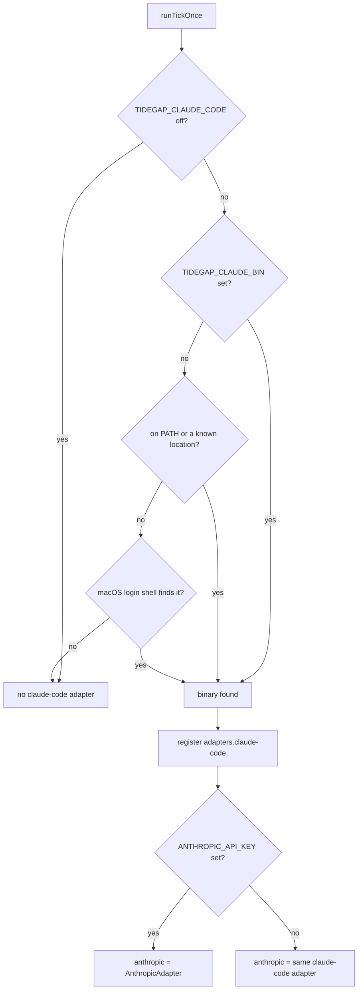
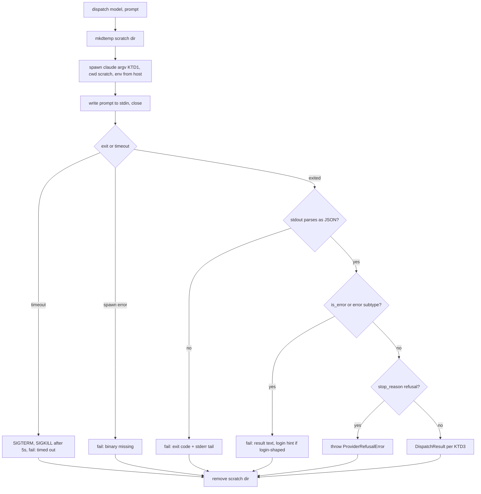

# Claude Code Execution Adapter - Plan

## Goal Capsule

- **Objective:** A user who has a Claude Code subscription and no Anthropic API key can queue a task and have `tidegap tick` (including the launchd daemon) run it and record a receipt, with no API key anywhere.
- **Means:** a `claude-code` provider adapter in the `tidegap` CLI host that runs the local `claude` CLI headless with no tools (KTD1, KTD2, KTD10), wired into `tidegap tick` with binary discovery and an Anthropic fallback rule (KTD4, KTD5).
- **Authority:** this plan's R-IDs win on behavior, KTDs on mechanism. `docs/solutions/` learnings and the repo's existing adapter contract (`packages/core-ts/src/providers/base.ts`) are binding constraints.
- **Execution profile:** one PR on `feat/claude-code-adapter`, based on `origin/main` after the 0.19.0 release (PR #69 is already merged). TypeScript only (KTD9).
- **Stop conditions:** stop and report if `claude -p --output-format json` stops returning the JSON shape recorded in KTD3, or if `--tools ""` no longer removes all built-in tools in the installed CLI.
- **Who finishes:** the implementer opens the PR. Vitalii merges.

---

## Product Contract

### Summary

Add a `claude-code` provider. Its adapter spawns `claude -p` with the prompt on stdin, no tools, a budget cap and a timeout, in a throwaway working directory, then maps the JSON result onto the existing `DispatchResult`. `tidegap tick` registers it when it finds the `claude` binary. It also serves `anthropic` tasks when `ANTHROPIC_API_KEY` is not set.

### Problem Frame

Every provider adapter today calls a vendor API with a key (`packages/cli/src/commands/tick.ts` `buildAdapters`). Without a key, `tidegap tick` prints "no adapters configured" and nothing runs. Vitalii has no API key. He has a Claude Code subscription, and the `claude` CLI on his Mac carries that login. Paperclip already runs work this way by spawning the local binary. The default provider for new tasks is `anthropic` on every surface (MCP `schedule_task`, `tidegap ui` quick add), so a subscription-only user cannot run any task today.

### Requirements

**Dispatch**

- R1. A task with `provider: "claude-code"` dispatches through the local `claude` CLI and completes with the model's reply as its result text.
- R2. The run has no file, shell, web or MCP tool access, and never runs in the user's repository (KTD2).
- R3. The prompt never appears in the process argument list (KTD2).
- R4. A run that exceeds the budget cap or the timeout ends, and the task fails with that reason.

**Receipt and ledger**

- R5. A completed task carries a carbon receipt with provider `claude-code`, the model Claude Code reports, the duration and the total tokens from KTD3's usage mapping, built by the scheduler's unchanged receipt path.
- R6. The ledger keeps the Claude Code `session_id` and `total_cost_usd` in the stored result (`result.raw`), visible through `tidegap queue show --raw`.

**Selection**

- R7. `tidegap tick` registers the `claude-code` adapter when it finds the `claude` binary, including under launchd's minimal PATH (KTD4).
- R8. When `ANTHROPIC_API_KEY` is not set and the `claude-code` adapter is registered, `anthropic` tasks dispatch through it. When the key is set, they use the API adapter as today (KTD5).
- R9. The task's `model` reaches `claude --model` when Claude Code accepts it. Otherwise Claude Code picks its own default (KTD6).

**Failure**

- R10. A missing binary, a "not logged in" result, a usage-limit result, a non-zero exit without JSON, and a timeout each fail the task once with a message that names the cause. No path retries automatically (KTD7).

**Surfaces and docs**

- R11. MCP `schedule_task` and `POST /api/tasks` accept `provider: "claude-code"`. OpenClaw does not.
- R12. The README has a section "Run through your Claude Code subscription", and the CHANGELOG has an Unreleased entry.

### Key Decisions

- **Fallback is tied to the Anthropic key, not to "no API adapter at all".** A user who later adds `OPENAI_API_KEY` keeps running `anthropic` tasks on the subscription instead of seeing them fail. Governs R8.
- **No new UI.** The receipt already carries `provider`, so `tidegap ui`, the extension and the Mac app show `claude-code` with no change. Governs R11.

### Scope Boundaries

- No Python adapter (KTD9).
- No OpenClaw support. The plugin runs inside the OpenClaw gateway, which has its own model runtime.
- No routing candidates for `claude-code`. Routing scores cost from `data/prices.json`, and a subscription has no per-call price. `KNOWN_PROVIDERS` in `packages/core-ts/src/routing.ts` stays unchanged.
- No batch path. The adapter has no `dispatchBatch`, so the scheduler keeps its tasks on the sync path by feature detection.
- `maxTokens` and `temperature` are ignored for `claude-code` tasks, because the CLI has no flags for them. The README says so.
- Considered and not built: a per-tick "not logged in" circuit breaker. Tick dispatches sequentially, and each extra failed spawn costs about one second and shows the same message. Build it if users queue tens of tasks per tick.
- Considered and not built: a stdout size cap. The output is bounded by the model's own output limit with no tools.
- Considered and not built: configurable timeout. A fixed 10 minutes covers a single no-tool turn. Add `TIDEGAP_CLAUDE_CODE_TIMEOUT_S` if a real prompt hits it.

### Deferred to Follow-Up Work

- MCP `expedite_task` / `retry_task` dispatch in the MCP server process, whose `buildAdapters` (`packages/mcp-server/src/server.ts`) has no `claude-code` adapter. With an API key set, expediting a `claude-code` task fails it with "no adapter configured for provider claude-code". Without a key, the existing gate rejects the expedite and leaves the task alone. Follow-up: share the host adapter builder, or reject `claude-code` expedites with "runs on the next tick".
- `apps/web` docs page provider list.
- Run a task in the session that queued it (Vitalii, 2026-10-17): when the task has `originSessionId` (already stored; MCP `schedule_task` sets it from `origin_session_id`, with `originCwd`), run `claude -p --resume <id>` instead of a fresh session. Not built here, because it reverses settled parts of this plan and needs decisions first:
  - Claude Code finds a session by its project directory, so the run must use `originCwd` as cwd. That breaks R2 / KTD2 ("never runs in the user's repository"); with `--tools ""` the model still cannot touch files.
  - The reply must land in that session, so `--no-session-persistence` must go (KTD1).
  - If the user still has that session open, the tick and the interactive session write the same session file at the same time. `--fork-session` avoids this, but then the reply is in a new session.
  - A resumed run sends the whole session as input. On a long session each task costs far more quota, and the carbon receipt counts those tokens (cache-creation tokens count, KTD3).
  - Plumbing: `DispatchOptions` gains the session id and cwd, and `dispatchProviderCall` in `scheduler.ts` passes them (core change).
- Requeue instead of fail on a "not logged in" or usage-limit result: a scheduler-level "environment unavailable" outcome that the due sweep treats as a skip (decided 2026-10-17: this PR fails the task with the reason, KTD7).

---

## Planning Contract

### Key Technical Decisions

- KTD1. **Invocation.** The adapter runs the binary with this argv and the prompt on stdin:
  `-p --output-format json --tools "" --permission-mode dontAsk --max-budget-usd <cap> --safe-mode --strict-mcp-config --no-session-persistence [--model <m>] [--system-prompt-file <f>]`.
  - Not `--bare`: `--bare` reads only `ANTHROPIC_API_KEY` or `apiKeyHelper` and never the OAuth login or keychain (`claude --help`, Claude Code 2.1.302).
  - `--tools ""` and not `--allowedTools ""`: `--allowedTools` only pre-approves tools and leaves the rest available. `--tools ""` removes every built-in tool, including WebSearch and WebFetch. Under `dontAsk` without it, reads in the working directory and read-only shell commands still run (headless docs, "dontAsk").
  - `--safe-mode` turns off the user's CLAUDE.md, skills, plugins, hooks and MCP servers, while auth, model selection and permissions still work. Without it, a tick would load the user's global CLAUDE.md and run their hooks on every task. `--strict-mcp-config` with no `--mcp-config` is a second guard against MCP servers.
  - `--no-session-persistence` keeps tick runs out of the user's `~/.claude` session history. `session_id` is still reported.
  - `--max-budget-usd` defaults to `1.00`. The host overrides it with `TIDEGAP_CLAUDE_CODE_MAX_BUDGET_USD`. The cap uses Claude Code's client-side list-price estimate; the subscription is not billed per call. With no tools there is one model turn, so the cap does not stop work midway: a probe with `--max-budget-usd 0.0001` finished the turn, then returned exit 1, `is_error: true`, `subtype: "error_max_budget_usd"`, `terminal_reason: "budget_exhausted"` and `result: null`. The task fails under KTD7, and the answer is lost. The $1 default sits far above a normal single-turn cost (the probe turn cost $0.0001-0.0005 on Haiku), so it only catches runaway output.
  - `spec.systemPrompt` goes through `--system-prompt-file` in the scratch directory, which keeps it out of `ps`. Without one, Claude Code's default system prompt applies.
  - Prior turns (`options.messages`) are flattened into the stdin text as a labeled transcript before the current prompt, because `claude -p` takes one user turn.
- KTD2. **Isolation.** Each dispatch creates a fresh `mkdtemp` directory (`tidegap-claude-*` under the OS temp dir), uses it as `cwd`, and removes it after the run. A prompt over 10 MB fails before spawn, which is Claude Code's stdin cap. The adapter takes an `env` from the host. The host passes a copy of its environment without `ANTHROPIC_API_KEY`, `CLAUDECODE` and `CLAUDE_CODE_ENTRYPOINT`. That way `claude-code` always means the subscription login, and a tick started from inside a Claude Code session does not look nested. The adapter takes `env` as an option even though it lives in the host (KTD10), so tests control it without touching `process.env`.
- KTD3. **Result mapping.** These fields were checked against a real run of Claude Code 2.1.302 and a logged-out run. The adapter parses stdout as one JSON object:
  - `text` = `result`. `stopReason` = `stop_reason`. `provider` = `"claude-code"`. `raw` = the whole parsed object (carries `session_id`, `total_cost_usd`, `modelUsage`).
  - `model` = the `modelUsage` key with the most `outputTokens`, for example `claude-haiku-5-5` for `--model haiku`. If `modelUsage` is empty, the requested model, or `"claude-code"` when none was given.
  - `usage.inputTokens` = `input_tokens + cache_creation_input_tokens`. `usage.outputTokens` = `output_tokens`. `totalTokens` = their sum. Cache-creation tokens count because the model prefilled them on this call. Cache-read tokens skip that compute, so they stay out of the estimate and remain visible in `raw`. This matches the Anthropic adapter, which counts `input_tokens` on calls that use no cache.
  - Failure is `is_error === true` or a `subtype` starting with `error`. A logged-out run exits 1 with `is_error: true`, `subtype: "success"`, `result: "Not logged in · Please run /login"` and empty stderr, so the adapter checks `is_error` and does not rely on stderr or `subtype` alone. `result` can be `null` on a failure (the budget probe in KTD1), so the message falls back to `subtype` and `terminal_reason`.
  - `stop_reason === "refusal"` throws `ProviderRefusalError("claude-code", model, null)`, like the Anthropic adapter.
  - The scheduler builds the receipt from `DispatchResult` unchanged (`dispatchProviderCall` in `packages/core-ts/src/scheduler.ts`). No receipt field is added. Cost stays in `result.raw`, as for every other adapter (R6).
- KTD4. **Binary discovery (CLI host).** In order, first hit wins, cached per process:
  1. `TIDEGAP_CLAUDE_BIN` when set (an explicit path, used as-is).
  2. Each directory on `PATH`.
  3. `~/.local/bin/claude`, `~/.claude/local/claude`, `/opt/homebrew/bin/claude`, `/usr/local/bin/claude`.
  4. On macOS only: `/bin/zsh -ilc 'command -v claude'` with a 5 s timeout, the same lookup as `ServerLauncher.queryLoginShell` in the Mac app. It runs only when steps 1-3 miss and the ledger holds a pending `claude-code` task, or a pending `anthropic` task while `ANTHROPIC_API_KEY` is unset. launchd starts a new `tidegap tick --once` process every `StartInterval` (`packages/cli/src/platform/macos.ts`), so the per-process cache never carries over. Without this gate, every Mac user without Claude Code would source their interactive zsh config on every tick. The ledger read is the one `missingProviderKeysForPending` already does.
  - `TIDEGAP_CLAUDE_CODE=0` (or `false` / `off` / `no`) turns discovery off.
  - Under a test runner (`VITEST` / `NODE_ENV=test`, the `underTest()` guard in `tick.ts`), steps 2-4 are skipped unless the test injects the lookup inputs. Without that, the existing "no adapters configured" tests would find the developer's real `claude` and spawn it.
  - On this Mac, `zsh -ilc 'which claude'` gives `~/.local/bin/claude`, a symlink to `~/.local/share/claude/versions/2.1.302`. launchd's PATH lacks `~/.local/bin`, so step 3 finds it.
- KTD5. **Selection rule.** `buildAdapters` registers `claude-code` whenever discovery finds a binary. If `ANTHROPIC_API_KEY` is absent, the same adapter instance is also registered under `anthropic`. The receipt records `provider: "claude-code"` (from `DispatchResult.provider`), so the ledger shows what actually ran. `openai`, `gemini` and `ollama` are never redirected. Once `claude-code` registers, the adapter map is no longer empty, so `runTickOnce` no longer returns early with "nothing to dispatch". A keyless user's due `openai`, `gemini` or `ollama` tasks then fail with "no adapter configured", as they already do today for a user with only some keys. The missing-key warning still names the key. The brief proposed "default when no API key adapter is configured". This plan narrows the condition to the Anthropic key (see Key Decisions). Routing needs no change: a routing decision that names `anthropic` finds a ready adapter.
- KTD6. **Model pass-through.** `DEFAULT_MODEL_BY_PROVIDER["claude-code"] = "default"`. The adapter passes `--model <m>` when `m` is a `claude-*` id or one of the aliases `opus`, `sonnet`, `haiku`, `fable`, `opusplan`, optionally with a `[1m]` suffix. For `"default"`, an empty value or any other id, it omits `--model`. At schedule time, `"default"` resolves to the fallback energy coefficients. The receipt uses the real model from KTD3.
- KTD7. **Failures do not retry.** Every adapter error is a plain `Error` with no `status` or `code`, so `retryWithBackoff` (`isRetryable` in `scheduler.ts`) rethrows it at once and the task fails a single time. Claude Code already retries API errors itself (the `api_retry` events in the headless docs), and a subscription usage limit lasts hours, so a 1/4/16 s backoff would only repeat the failure. Messages are prefixed `claude-code:` and include:
  - Spawn `ENOENT` / `EACCES`: the binary path and "install Claude Code or set TIDEGAP_CLAUDE_BIN".
  - `is_error` with a login-shaped `result` (`/not logged in|\/login/i`): the `result` text plus "run `claude` once as this user and complete /login".
  - Any other `is_error`: the `result` text, plus `api_error_status` when present. Claude Code's own usage-limit text carries the reset time.
  - Non-zero exit with unparseable stdout: the exit code and the last 500 characters of stderr.
  - Timeout: after 10 minutes the adapter sends SIGTERM, then SIGKILL 5 s later, and reports "timed out after 600s". SIGTERM makes Claude Code exit 143 without a result (headless docs, "Stop a run with SIGTERM").
- KTD8. **Tool surface.** `providerParam` in `packages/core-ts/src/tool-surface.ts` splits into an MCP entry (adds `claude-code`, with a description saying it runs through the local Claude Code login and is sync-only) and an OpenClaw entry (unchanged). This follows `docs/solutions/tooling-decisions/tool-surface-shared-descriptions.md`.
- KTD9. **TypeScript only.** `core-py` has `Scheduler.tick(adapters)` as a library call, but no daemon or CLI that builds adapters. Only a Python host could use a subprocess adapter, and none exists. The `Provider` literal in `packages/core-py/src/tidegap/types.py` is not checked at runtime. A Python tick over a shared ledger fails a `claude-code` row with "no adapter configured", the same as any provider it lacks. A Python adapter waits for a Python host.
- KTD10. **The adapter lives in the CLI package, not in `@tidegap/core`.** `packages/core-ts/src/notify.ts` states that core stays free of `child_process` and the hosts own the side effect. The OpenClaw plugin bundles core, and ClawScan flags process-spawning and env-reading code in that bundle. `tidegap tick` is the only host that uses this adapter, so the file goes in `packages/cli/src/providers/claude-code.ts` and implements core's `ProviderAdapter` interface. Core gets only the provider name, the default model and the tool-surface enum.

### High-Level Technical Design

Adapter selection in `tidegap tick`:

One dispatch:

### Assumptions

- `--safe-mode` exists in the user's Claude Code. It is present in 2.1.302. On an older CLI, the run fails with an "unknown option" message under KTD7, and the README says to update Claude Code.
- On macOS the subscription login lives in the keychain under the default config directory. It works under a minimal launchd-like environment with the real `HOME`. Tested: `env -i PATH=/usr/bin:/bin HOME=$HOME USER=$USER claude -p ...` succeeded. With an isolated `HOME`, even with `CLAUDE_CONFIG_DIR` pointing at the real `~/.claude`, the CLI reports "Not logged in". The manual QA check below therefore keeps the real `HOME` and isolates Tidegap state with flags.

---

## Implementation Units

### U1. The `claude-code` provider name and the adapter

- **Goal:** a `claude-code` task can be queued, and the CLI has an adapter that dispatches it through a `claude` binary path it is given.
- **Requirements:** R1-R6, R9, R10.
- **Dependencies:** none.
- **Files:**
  - modify `packages/core-ts/src/types.ts` (`ProviderName` adds `"claude-code"`, doc comment notes it is sync-only)
  - modify `packages/core-ts/src/scheduler.ts` (`SUPPORTED_PROVIDERS` only)
  - modify `packages/core-ts/src/providers/defaults.ts` (KTD6)
  - modify `packages/core-ts/test/scheduler.test.ts` (or the nearest provider-call tick test) for the integration scenario
  - create `packages/cli/src/providers/claude-code.ts` (KTD10)
  - create `packages/cli/test/claude-code-adapter.test.ts`
  - create `packages/cli/test/fixtures/fake-claude/` (one `/bin/sh` script plus canned JSON files)
- **Approach:**
  1. `ClaudeCodeAdapter` implements core's `ProviderAdapter` with `provider = "claude-code"`. `ready` is true when a binary path was given. Options: `binaryPath`, `env`, `maxBudgetUsd` (default 1), `timeoutMs` (default 600 000), `scratchRoot` (default OS temp dir).
  2. `dispatch` follows KTD1, KTD2, KTD3, KTD6 and KTD7. Use `spawn` with an argv array and no shell (`docs/solutions/best-practices/safe-os-notifications-from-a-daemon.md`).
  3. No `dispatchBatch` / `retrieveBatch`.
  4. Nothing under `packages/core-ts/src` imports `node:child_process` (KTD10).
- **Patterns to follow:** `packages/core-ts/src/providers/ollama.ts` (sync-only, keyless adapter), `anthropic.ts` (`ProviderRefusalError`, usage mapping).
- **Execution note:** the fake script records its argv, cwd and stdin to files in a test temp dir, so tests can assert on what the adapter sent.
- **Test scenarios:**
  - Happy path: the fake prints the success JSON (shape from KTD3) and exits 0. The result has `text`, `provider: "claude-code"`, the `modelUsage` model, input tokens equal to `input_tokens + cache_creation_input_tokens` (cache reads excluded), output tokens, total, and `raw.session_id` / `raw.total_cost_usd`.
  - The prompt arrives on stdin and is absent from argv. Argv contains `-p`, `--output-format json`, `--tools` followed by an empty string, `--permission-mode dontAsk`, `--max-budget-usd 1`, `--safe-mode`, `--strict-mcp-config`, `--no-session-persistence`, and never `--bare`.
  - cwd is a fresh `tidegap-claude-` directory, and the directory is gone after the call, on success and on failure.
  - `model: "claude-sonnet-5"` and `"haiku"` pass `--model`. `"default"`, `""` and `"gpt-6-sol"` omit it.
  - A system prompt goes through `--system-prompt-file`, and the file holds the text. Prior `messages` appear in stdin before the current prompt.
  - Not logged in: the fake prints the logged-out JSON and exits 1. The error contains "Not logged in" and the /login hint, and has no `status` property.
  - Usage limit: `is_error: true` with a limit message and `api_error_status: 429`. The error carries the text and the status number in the message, and has no `status` property.
  - Budget exhausted: the probe shape from KTD1 (`is_error: true`, `subtype: "error_max_budget_usd"`, `result: null`, exit 1) fails with a message naming the subtype.
  - Exit 2 with garbage stdout and stderr "boom" fails with "exit 2" and "boom".
  - Missing binary path fails with the install / `TIDEGAP_CLAUDE_BIN` hint.
  - Timeout: a fake that sleeps, with `timeoutMs: 200`, fails with "timed out" and leaves no child process.
  - `stop_reason: "refusal"` throws `ProviderRefusalError`.
  - Empty `modelUsage` gives the requested model, or `"claude-code"` for `"default"`.
  - Prompt larger than 10 MB fails before spawn (the fake records no call).
  - Scheduler integration (core test, stub adapter returning `provider: "claude-code"`): `enqueueProviderCall` accepts `provider: "claude-code"`, and `tick({ "claude-code": stub })` completes the task with a receipt whose `provider` is `claude-code` and `totalTokens` is set.
- **Verification:** the new and changed test files pass. `environment-purity.test.ts` still passes. `git grep -n child_process packages/core-ts/src` lists only the comment in `notify.ts`.

### U2. CLI host: discovery, selection and messages

- **Goal:** `tidegap tick` finds `claude`, builds the adapter, and applies the KTD5 rule.
- **Requirements:** R7, R8, R10.
- **Dependencies:** U1.
- **Files:**
  - create `packages/cli/src/claude-code.ts` (discovery and env filtering)
  - modify `packages/cli/src/env.ts` (`readEnvCredentials` reads the three `TIDEGAP_CLAUDE_*` variables)
  - modify `packages/cli/src/commands/tick.ts` (`buildAdapters`, `missingProviderKeysForPending`, the "no adapters configured" message)
  - modify `packages/core-ts/test/environment-purity.test.ts` (add `TIDEGAP_CLAUDE_BIN`, `TIDEGAP_CLAUDE_CODE`, `TIDEGAP_CLAUDE_CODE_MAX_BUDGET_USD` to `HOST_ENV_VARS`)
  - create `packages/cli/test/claude-code.test.ts`
  - create `packages/cli/test/tick-claude-code.test.ts`
- **Approach:**
  1. Read the new variables in `readEnvCredentials` (`packages/cli/src/env.ts`), where the CLI host reads all its environment.
  2. Discovery follows KTD4. Inputs (env, home, platform, executable check, login-shell runner, the "a pending task needs claude" flag) are injectable for tests.
  3. `buildAdapters` takes an optional second argument with the discovered adapter (or `null`) and applies KTD5. `runTickOnce` builds it after `loadEnvFileIntoProcess`, so `TIDEGAP_CLAUDE_*` values from `~/.config/tidegap/env` apply.
  4. `missingProviderKeysForPending` does not report `ANTHROPIC_API_KEY` when `anthropic` has an adapter, and never reports a key for `claude-code`.
  5. The "no adapters configured" message adds "or install Claude Code (`claude` on PATH, or TIDEGAP_CLAUDE_BIN)".
  6. A non-numeric or non-positive `TIDEGAP_CLAUDE_CODE_MAX_BUDGET_USD` falls back to 1 with a one-line warning in the tick message.
- **Patterns to follow:** `underTest()` and `defaultSpawnNotify` in `tick.ts`. The login-shell marker parsing in `apps/macos/TidegapKit/Sources/TidegapKit/ServerLauncher.swift`.
- **Test scenarios:**
  - Discovery: `TIDEGAP_CLAUDE_BIN` wins over a PATH hit.
  - Discovery: a fake `claude` in a temp dir on the injected PATH is found.
  - Discovery: an empty PATH plus a fake at `<home>/.local/bin/claude` is found.
  - Discovery: nothing found, a pending task needs claude, and the login-shell runner returns a path. On darwin it is used. On linux the runner is not called.
  - Discovery: nothing found and no pending task needs claude. The login-shell runner is not called.
  - Discovery: `TIDEGAP_CLAUDE_CODE=off` returns nothing, even with a fake on PATH.
  - Discovery: under the test guard with no injected inputs, it returns nothing.
  - Env filter: `ANTHROPIC_API_KEY`, `CLAUDECODE` and `CLAUDE_CODE_ENTRYPOINT` are removed. `HOME` and `PATH` stay.
  - Selection: no key plus a binary means `anthropic` and `claude-code` are the same instance.
  - Selection: a key plus a binary means `anthropic` is an `AnthropicAdapter`.
  - Selection: no binary and no key gives the existing "no adapters configured" result, and the message mentions Claude Code.
  - End to end (fake `claude` on the injected PATH, hermetic HOME, temp db): queue a `claude-code` task, run it now, `runTickOnce` reports 1 dispatched, and the row is `completed` with a receipt whose `provider` is `claude-code`.
  - End to end: an `anthropic` task with no key dispatches through the fake. The fake's argv shows `--model claude-sonnet-5`.
  - End to end: the logged-out fake gives a `failed` row whose `error` contains "Not logged in", and the exit code is 1. A second tick does not re-dispatch it.
  - End to end: one due `openai` task, no `OPENAI_API_KEY` and the fake `claude`. The row fails with "no adapter configured", and the tick message carries the `OPENAI_API_KEY` warning (KTD5).
  - Missing-key warning: with the claude adapter present, a pending `anthropic` task does not produce the `ANTHROPIC_API_KEY` warning.
- **Verification:** both new test files pass. The existing `packages/cli/test/tick.test.ts` passes unchanged.

### U3. Provider accepted on MCP and `tidegap ui`

- **Goal:** users can queue `claude-code` tasks from the MCP tools and quick add.
- **Requirements:** R11.
- **Dependencies:** U1.
- **Files:**
  - modify `packages/core-ts/src/tool-surface.ts`
  - update `packages/core-ts/test/__snapshots__/tool-surface.test.ts.snap`
  - modify `packages/mcp-server/src/server.ts` (the inline provider union in the `schedule_task` handler becomes `ProviderName`)
  - modify `packages/mcp-server/test/tool-surface-derivation.test.ts` (the `schedule_task` provider enum now ends with `"claude-code"`)
  - modify `packages/cli/src/ui/api.ts` (`QUICK_ADD_PROVIDERS`)
  - modify `packages/cli/test/ui-actions.test.ts`
- **Approach:** KTD8 for the tool surface. Quick add uses `DEFAULT_MODEL_BY_PROVIDER["claude-code"]` when no model is given.
- **Test scenarios:**
  - The snapshot diff shows `claude-code` only in the MCP `provider` enum and description. The OpenClaw entries are unchanged.
  - `POST /api/tasks` with `provider: "claude-code"` and no model returns 201, and the stored spec has model `"default"`.
  - `POST /api/tasks` with `provider: "bogus"` still returns 400, and the message lists `claude-code`.
- **Verification:** core and cli test suites pass with the regenerated snapshot. The snapshot diff has been read.

### U4. README and CHANGELOG

- **Goal:** a subscription user can set this up from the README alone.
- **Requirements:** R12.
- **Dependencies:** U1, U2.
- **Files:** modify `README.md`, `CHANGELOG.md`.
- **Approach:**
  1. README: add the section "Run through your Claude Code subscription" after "With a provider adapter and the Batch API (v0.2)". It covers: requirements (`claude` installed and logged in as the user who runs the daemon), the selection rule (KTD5), `provider: "claude-code"`, the exact flags and why there are no tools (KTD1, KTD2), the three `TIDEGAP_CLAUDE_*` variables, that `maxTokens` / `temperature` are ignored, that cost shows in `tidegap queue show --raw` as Claude Code's list-price estimate, and the failure messages. It also states:
     - tasks share the user's interactive Claude Code quota;
     - once Claude Code is found, keyless `openai` / `gemini` / `ollama` tasks fail instead of waiting (KTD5);
     - `claude-code` receipts include Claude Code's own system prompt as input (KTD3);
     - an "unknown option" failure means Claude Code needs an update.
  2. CHANGELOG: one `### Added` bullet under `## [Unreleased]`.
  3. Write both through `ce-noslop`.
- **Test expectation:** none -- docs only. `packages/cli/test/docs-lockstep.test.ts` does not read `README.md`.
- **Verification:** the section renders. Every flag and variable name matches the code.

---

## Verification Contract

| Check | Pass signal |
|---|---|
| `pnpm --filter @tidegap/core test` | exit 0, including the scheduler integration scenario and `environment-purity.test.ts` |
| `pnpm --filter @tidegap/cli test` | exit 0, including `claude-code-adapter.test.ts`, `claude-code.test.ts` and `tick-claude-code.test.ts` |
| `pnpm --filter @tidegap/mcp test` | exit 0, including `tool-surface-derivation.test.ts` |
| `pnpm typecheck` | exit 0 |
| `pnpm preflight`, once, at the end | exit 0 |
| Manual QA on Vitalii's Mac (below) | both cases match |
| Post-release launchd check (below) | row `completed` |

No test spawns the real `claude` or reaches the network.

Manual QA (orchestrator's QA agent). This check uses the real `HOME`, because the subscription login is tied to it (see Assumptions). It isolates Tidegap state with `--db` and a temp dir instead.

1. `pnpm build`. Make a temp dir `$T`.
2. Enqueue one task into `$T/queue.db` with a short Node script that imports the built `@tidegap/core` `Scheduler`: `provider: "claude-code"`, `model: "haiku"`, prompt "Reply with the single word OK.", deadline in 2 hours. Then run `tidegap queue run-now <id> --db $T/queue.db`.
3. Run `tidegap tick --once --db $T/queue.db --no-notify` under `env -i HOME=$HOME USER=$USER PATH=/usr/bin:/bin` and an absolute `node` path, which reproduces launchd's PATH.
4. Expected: the tick prints `1 dispatched, 0 failed`. `tidegap queue show <id> --db $T/queue.db --json` shows status `completed`, result text `OK`, and a receipt with `provider: "claude-code"`, a `claude-haiku-*` model, `totalTokens` > 0 and `durationMs` > 0. `--raw` shows `session_id` and `total_cost_usd`.
5. Negative: repeat steps 2-3 with a second task, `HOME=$T/home` (empty) and `TIDEGAP_CLAUDE_BIN=<real claude path>`. Expected: `0 dispatched, 1 failed`, exit code 1, and the row's error contains "Not logged in".

Post-release launchd check. The `env -i` run reproduces launchd's PATH, but not the LaunchAgent's keychain context. The installed agent `com.tidegap.tick` runs the globally installed `tidegap`, so this check runs once the release that carries this change is installed. Queue one `claude-code` task into the default ledger, `tidegap queue run-now <id>`, then `launchctl kickstart -k gui/$UID/com.tidegap.tick`. Expected: the row is `completed` and `~/.tidegap/logs/tick.log` shows `1 dispatched`.

## Definition of Done

- U1-U4 landed. Every Verification Contract row passes.
- `git grep -n "allowedTools\|--bare" packages/cli/src/providers/claude-code.ts` finds nothing.
- New env names follow the `TIDEGAP_*` convention, and no `EBB_*` name was added.
- No dead or experimental code from abandoned attempts is left in the diff.
- One PR opened from `feat/claude-code-adapter`, not merged.

---

## Open Questions

- Resolved 2026-10-17: fail with the reason in this PR; requeue is a follow-up (Deferred to Follow-Up Work). Original question: should a usage-limit or "not logged in" result requeue the task instead of failing it? The plan follows the brief: fail once, with the reason (KTD7). The cost is that once the subscription limit runs out, every task that comes due before the reset fails for good and needs `retry_task`. A requeue would need a new scheduler-level "environment unavailable" outcome that the due sweep treats as a skip. That change touches `scheduler.ts` and would grow this PR. If wanted, it fits a follow-up PR.

## Risks & Dependencies

- **CLI flag drift.** Claude Code changes fast. `--safe-mode` is recent, and `--bare` is documented to become the default for `-p` in a future release. If that happens, `-p` without `--bare` may stop reading the OAuth login. The adapter's fake-binary tests cannot catch this. The QA run catches it once, and the "not logged in" message makes it visible in production.
- **Subscription limits.** Tasks share the user's interactive Claude Code quota. A night of queued tasks can spend the limit the user expects in the morning. The README states this.
- **Carbon comparability.** Claude Code adds about 3k input tokens of system prompt per task. When they are a cache read they stay out of the estimate (KTD3). When they are written to the cache, the receipt reads higher than an API call with the same prompt, and the README discloses it.
- **Keychain under launchd.** Claude Code auto-updates replace the versioned binary under `~/.local/share/claude/versions`. If macOS then asks for keychain access, nobody can answer under a LaunchAgent, and the run hangs until the 10-minute timeout. The post-release launchd check covers the first run only.

## Sources

- Headless docs: https://code.claude.com/docs/en/headless (stdin, JSON output with `total_cost_usd`, `dontAsk` semantics, SIGTERM exit 143, `--bare` auth limits).
- `claude --help`, Claude Code 2.1.302: `--tools ""`, `--safe-mode`, `--bare`, `--max-budget-usd`, `--no-session-persistence`.
- Probe runs on 2026-10-17 (success JSON, logged-out JSON, isolated-HOME login failure, over-budget JSON) shaped KTD1, KTD3 and the QA recipe.
- `packages/core-ts/src/notify.ts` (core stays free of `child_process`) shaped KTD10.
- `packages/core-ts/src/scheduler.ts` `dispatchProviderCall`, `retryWithBackoff`, `isRetryable`, `isBatchCandidate`.
- `docs/solutions/tooling-decisions/tool-surface-shared-descriptions.md`, `docs/solutions/best-practices/safe-os-notifications-from-a-daemon.md`.
