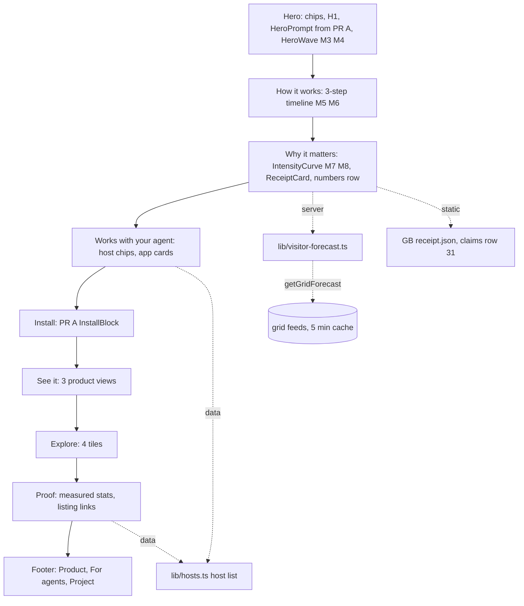
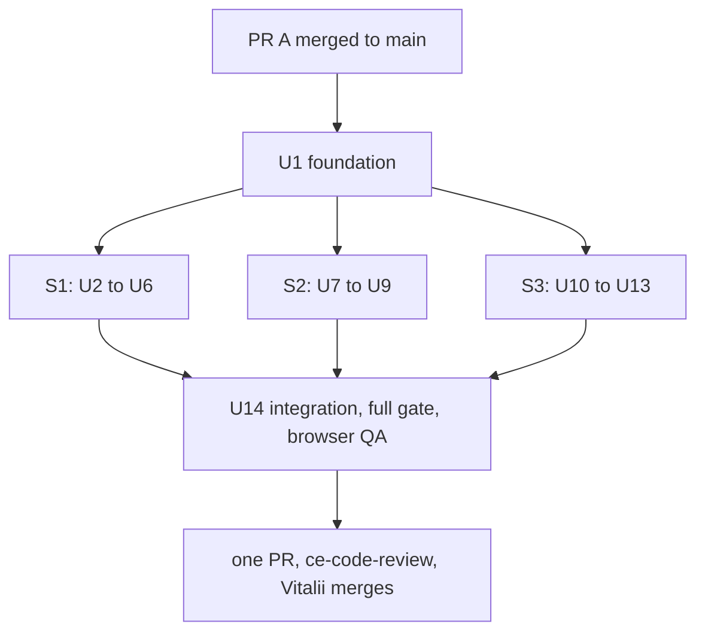

# Site Redesign v3 - Plan

## Goal Capsule

- **Objective:** A first-time visitor to www.tidegap.com understands in one scroll what Tidegap does, why it is good for the planet, and how to start. A developer, a non-technical reader and an eco-minded reader each find a promise written for them. The site looks like a serious, maintained project: consistent components, calm motion, and only numbers backed by `docs/claims.md`. An agent that lands on the site can install, configure and verify Tidegap from the published text files alone.
- **Means:** Build a homepage v3 on top of PR A, with scannable sections and a small CSS-and-SVG motion system (KTD1, KTD2). Rebuild `/docs` as one page with a sticky category nav, generated from markdown at build time (KTD4, KTD5). Move the explanatory text to `/about`. Close the remaining agent-path gaps, and add a check script that proves them (KTD8, KTD9).
- **Authority:** Vitalii's owner brief of 2026-10-17 (Problem Frame), then this plan, then PR A's plan (`docs/plans/2026-10-17-1519-feat-homepage-visible-prompt-plan.md` on `feat/homepage-visible-prompt`), then the current `apps/web` code. Copy says "Tidegap", never "Ebb". Every number on the site must have a row in `docs/claims.md`. Where the plan and the repo disagree, stop and report.
- **Stop conditions:** PR A is not merged to `main` when F0 starts, or PR A shipped something different from its plan in a file this plan owns. A gate fails the same way twice. A section cannot meet the CLS budget in R40. A number on a page has no `docs/claims.md` row. Any step would merge a PR, push to `main`, publish or cut a release. Merging the stream branches into `feat/site-redesign` in U14 is allowed.
- **Execution profile:** the integration branch is `feat/site-redesign`, rebased on `main` after PR A merges. U1 (foundation) runs alone first. Then three streams run in parallel, each on its own branch and worktree under `.worktrees/`: S1 homepage (U2–U6), S2 docs (U7–U9), S3 about and agent files (U10–U13). The file sets in KTD10 do not overlap. Integration (U14) merges the streams, reruns the generators, and runs the full gate and the browser QA once. Git commands use `git -c core.editor=true -c sequence.editor=true`.
- **Who finishes:** the work ends at one open PR from `feat/site-redesign` with green gates, the QA report and one `ce-code-review` pass. Vitalii merges. A merge to `main` deploys www.tidegap.com to production on Vercel.

---

## Product Contract

### Summary

Rebuild the homepage as a presentation for three audiences. It has a hero with a large animated tide wave, a three-step animated "How it works" timeline, and a "Why it matters" section with a live carbon-intensity curve for the visitor's grid and a real signed receipt. Then come the supported hosts and apps, real product views, and a proof strip with measured numbers only.

Rebuild `/docs` as one page with a sticky left category nav and scroll-spy. Its content comes from markdown files that a build script compiles. Move the long explanations to `/about`, which also tells the rename story.

Finish the agent path: `install.md` covers the tick daemon and configuration, plus a generated `llms-full.txt`, richer JSON-LD, a `Link` header, and a check script that fetches every agent URL.

### Problem Frame

Vitalii's brief, 2026-10-17: the site must be a presentation. It must be very clear and very beautiful, with animations. A visitor must see at once that this is a professional, serious project. Non-technical people must understand it visually, and eco-activists must see that it is good for the planet. Dull explanatory text goes to About, Docs or Plan, and the homepage is for scanning. Docs is one long page today. It should stay one page, with a sticky left panel of categories that scrolls to each section. Agents that find the site must be able to install and configure Tidegap by themselves.

The live site at this plan's base (`main` at `37363f7`) has a homepage of 4 H2 sections. Its first screen is one "Copy the prompt" button. Below that sit a dense "what it is" paragraph, an install card, the four-wins infographic, a tile grid and a stats strip. The copy is written for MCP developers. Nothing addresses a reader who does not know what an MCP host is. The page also never shows the carbon idea visually as "this hour is cleaner than that one". `/docs` is 643 lines of hand-written JSX: 9 sections, no navigation, and a tools list kept by hand next to the canonical `TOOL_SURFACE` in `@tidegap/core`.

The agent path has a gap that PR A does not close. `install.md` registers the MCP server but never mentions the tick daemon. `QUICKSTART.md` step 3 says the MCP server "queues tasks but doesn't run a clock". So an agent that follows `install.md` today leaves tasks that never run. `/llms-full.txt` returns 404.

PR A (branch `feat/homepage-visible-prompt`, shipping tonight) already delivers these, and this plan does not redo them:

- the visible prompt card (`HeroPrompt`)
- "How it works" moved up, with `id="how"`
- the "what it is" block moved to `/about`, and the version pill there
- the animated header wave and the one-time tagline underline
- `install.md` sections for Codex, the libraries and client pairing (`tidegap clients add`)
- the `llms.txt` "For agents" heading and the tool-count fix
- `<link rel="alternate" type="text/markdown">`, the footer "For agents" line, and sitemap entries for `install.md` and `llms.txt`

### Design Direction

**Audiences and their one-sentence promise.**

| Audience | What they need first | Promise (homepage copy) |
|---|---|---|
| Agent power users (Claude Code, Codex, Cursor users) | the install prompt, the host list, the tools | "Your agent hands Tidegap the tasks that can wait, and Tidegap runs them at the cleanest grid hour before your deadline." |
| Non-technical readers | one picture of the idea, no jargon | "Electricity is cleaner at some hours than others. Tidegap makes AI work wait for the clean hours." |
| Eco readers | proof that it helps, honest numbers | "Same task, same answer, run when the grid is cleanest, with a signed receipt for every run." |

**Visual language.**

- Palette: the existing `@theme` tokens in `apps/web/src/app/globals.css`, unchanged. The site accent `--color-accent` (#5eead4) is for UI. The brand teal (#5FC6C4) is for the wave motif only, and only in troughs, per `docs/brand.md`. The carbon band colours (`--color-band-*`) are the only greens, ambers and reds, and they always mean grid intensity.
- Type scale (system font stack, no web font added): display 36→56 px, extrabold, tight tracking, line height 1.05. H2 28→36 px, semibold. H3 18 px, semibold. Body 15–16 px. Eyebrow 11 px monospace, uppercase, 0.18em tracking, in the accent colour. Caption 12 px in `fg-dim`.
- Spacing: homepage sections use `py-20 sm:py-28`. Content width is `max-w-6xl`, text width `max-w-2xl`. Cards use a 12–16 px radius, a `rule` border and a `bg-elev` fill. Every homepage section has the same shell: eyebrow, H2, at most one lead sentence, then the visual.
- Imagery: no stock photos, no leaves, no globes. The two metaphors are the tide wave (the brand) and the 24-hour intensity curve (the data). All visuals are inline SVG or real product captures.

**Motion principles.** Motion is slow and purposeful. Each animation explains something: the tide moves, the curve draws, the steps follow one another. Nothing loops fast or blinks. Every animation has a still fallback under `prefers-reduced-motion: reduce`. Only `transform`, `opacity`, `stroke-dashoffset`, `background-size`, `border-color` and `background-color` animate, so no animation shifts layout. The full inventory is in KTD2.

**What "professional" means here, concretely.**

- One component per pattern (section shell, card, chip, stat). No one-off styles per section.
- Every number on a page has a row in `docs/claims.md` and carries its class label (measured, simulated or projected) when the claims file asks for one.
- No vague claims ("save the planet", "massive savings", "blazing fast"). Copy says what the product does and links to the proof.
- No fabricated social proof (R31).
- Real product views, or illustrations clearly marked as such (Q2).
- Status is honest: the Mac app and the extensions are "Preview" builds that are not in a store.

### Requirements

**Homepage v3: structure**

- R1. The homepage sections, top to bottom, are: Hero, How it works (`#how`), Why it matters (`#why`), Works with your agent (`#hosts`), Install (`#install`), See it (`#see`), Explore, Proof, then the site footer. The section table in "Homepage v3 sections" below is the contract for each section's purpose, copy draft, visual and data.
- R2. Every section uses the shared section shell from U1 (eyebrow, H2, at most one lead sentence). A reader who reads only the H2s understands the product.
- R3. PR A's first-screen contract stays intact. The H1 text, `HeroPrompt`, the helper line, the "Other ways to install" link and the fold rule (PR A R1–R6) are unchanged. S1 adds the hero wave and the eyebrow chips without moving the button below the fold at 390×844.
- R4. The four-wins infographic (`HowItWorksViz`) leaves the homepage and moves to `/about` (R24).

**Homepage v3: sections**

| Section | Purpose | Copy draft (English, final wording in U2–U6) | Visual | Data |
|---|---|---|---|---|
| Hero | Say what it is and let a developer act in 5 s | Eyebrow chips: "Open source", "Apache-2.0", "v{VERSION}". H1 and prompt card from PR A. | Animated: a large brand wave behind the hero drifts one period every ~18 s, with teal troughs. Static under reduced motion. | `VERSION` from `apps/web/src/lib/version.ts` |
| How it works | Explain the mechanism in three steps anyone can follow | H2 "Tasks that can wait, wait for clean power." 1 Ask: "Tell your agent: summarize this by tomorrow 6 pm." 2 Wait: "Tidegap reads the grid forecast and picks the cleanest hour before your deadline." 3 Run: "The task runs then, through the cheaper Batch API when the deadline allows, and gets a signed receipt." PR A's lead sentence and "More about the project" link stay. | Animated timeline: the steps reveal in order as they scroll into view, and a connector line draws between them. Step 2 holds a mini curve with a dot on the chosen hour. | none (illustrative curve, no numbers) |
| Why it matters | Show the eco case with real data | H2 "The same electricity is cleaner at some hours." Lead: "Grid carbon intensity rises and falls through the day as sun, wind and demand change." Curve caption: "Your nearest grid, next 24 hours." Receipt caption: "A real receipt from one run on the GB grid, 2026-09-30." | Animated: the visitor's 24 h intensity curve draws in on view, then the "now" and "cleanest" markers appear. A receipt card sits next to it. Below them, a numbers row. | `getGridForecast(zone, 24)` through `resolveVisitorRegion`. The receipt comes from `docs/examples/2026-09-30-GB-tick/receipt.json` (claims row 31). The numbers come from claims rows 6, 10, 11 and 24. |
| Works with your agent | Show it fits the reader's tools | H2 "Works with the agent you already use." Host chips: Claude Code, Codex, Cursor, Claude Desktop, OpenClaw, Windsurf, Zed, Goose, Cline, Continue, "any MCP host". Apps: "Tidegap for Mac: your queue in the menu bar." "Browser extension: Chrome, Edge, Firefox, and Safari through the Mac app." | Static chips (text, no third-party logos, Q4). Two app cards with a "Preview" chip and a "How to install" link to `/docs#apps`. | Host list from `apps/web/src/lib/hosts.ts` (KTD13). App status from `apps/macos/README.md` and `apps/extension/README.md`. |
| Install | Keep PR A's install block | PR A copy, unchanged. | Static | `PROMPT`, `InstallPicker` |
| See it | Prove the product exists | H2 "See what is waiting, and when it will run." Captions: "The queue in your browser (`tidegap ui`)", "The Mac menu bar", "The extension popup". | Three framed views, with a hover lift. | Captures in `apps/web/public/screens/` (KTD7, Q2) |
| Explore | Route to the live tools | H2 "Explore the live grid." The four tiles from PR A (map, plan, stats, docs), restyled as cards. | Static, hover lift | none |
| Proof | Show it is maintained and tested | H2 "Open source, tested, documented." Stats: 1,423 tests (measured 2026-10-16), 10 MCP tools, N hosts, Apache-2.0. Links: GitHub, npm, PyPI, MCP Registry, ClawHub. | Static stat tiles | Claims rows 13, 16 and 18. N is `HOST_COUNT` (KTD13). |
| Footer | Wayfinding, plus the agent hint | Columns: Product (Map, Plan, Docs, About), For agents (`/install.md`, `/llms.txt`, `/llms-full.txt`), Project (GitHub, Changelog, Claims, License). PR A's "For agents: read /install.md" line stays. Data credit stays. | Static | none |

- R5. Hero: the hero wave sits behind the content (`aria-hidden`, absolutely positioned, `pointer-events: none`). It is drawn from `BRAND_HEADER.wave` geometry scaled up, never as live text or a recoloured logo. Teal appears only in the trough segments.
- R6. How it works: three steps in a horizontal row at `lg` and above, and a vertical list with a vertical connector below `lg`. The steps are an `<ol>`, so screen readers hear the order.
- R7. Why it matters, curve: the curve shows the next 24 hourly points for the visitor's region, coloured by band. It marks "now" (the first point) and "cleanest" (the minimum point), each with its gCO₂/kWh value and local hour. The caption names the region and the feed.
- R8. Why it matters, labels: when the forecast is live, the caption says "Live forecast" with the provider name and the region shown. When the visitor's region has no live feed, the curve shows the live GB forecast and the caption names GB. Only when GB is not live either does the caption say "Simulated curve (live feed unavailable)", and then the markers carry no gCO₂/kWh values. The live rule is in KTD11.
- R9. Why it matters, receipt: the receipt card shows the real fields of the GB receipt: region, time, model, tokens, intensity at dispatch (158 gCO₂/kWh, measured), grid source, and the signature truncated with "Ed25519-signed". The card links to the example folder on GitHub. No other receipt values are invented.
- R10. Why it matters, numbers row: "6.7–12 % of US grid load by 2028 (DOE 2024, projected)" with the DOE link, "31 grid regions", "5 live carbon feeds", "72 h forecast". A footnote links to `docs/claims.md`. No general carbon-saving percentage appears anywhere.
- R11. Works with your agent: a chip that names a host appears only when `install.md` has an install path for that host. "Any MCP host" links to `#install`.
- R12. App cards: each shows a "Preview" chip and one honest line on how to get it ("Build from source" for the Mac app, "Load unpacked" for the extension). Neither card carries a store badge.
- R13. See it: every view has explicit width and height and lazy loading below the fold. Each has alt text that describes what it shows. A view that is an illustration and not a capture says "Illustration" in its caption.
- R14. Proof: the host count is computed from the shared host data (KTD13) and is not typed by hand. The tests figure keeps its "measured" date.

**Docs page**

- R15. `/docs` stays one route and one page. The left nav lists these categories in order: Install, Hosts, CLI, MCP tools, UI & apps, Receipts & carbon, Config, FAQ.
- R16. At `lg` and above, the category nav is sticky in a left column below the site header. Clicking a category scrolls to its section, and the section heading is not hidden under the sticky header.
- R17. Scroll-spy: the category whose section is in view is highlighted and carries `aria-current="location"`. With JavaScript off, the nav still works as plain anchor links.
- R18. Below `lg`, the nav is a collapsible bar at the top of the content ("On this page: <current category>"). It is sticky under the site header. It closes after a category is chosen.
- R19. Anchors are stable and cover the old ones. Category ids: `install`, `hosts`, `cli`, `tools`, `apps`, `receipts`, `config`, `faq`. The old ids `#commands`, `#energy`, `#paths` and `#env` stay as sub-section ids inside CLI, Receipts & carbon and Config. A deep link to any of these ids lands on the right heading.
- R20. Docs copy is minimal: each category opens with at most two sentences, then commands, tables and examples. Docs text states no counts that could drift ("every MCP host", not "13 hosts"). The tools list comes from `toolsForHost("mcp")` in `@tidegap/core`, never from a hand list.
- R21. The FAQ holds 6–8 short questions with sourced answers. They cover: is it safe for my agent to install, does it send data anywhere, does it need an account, do tasks run while my computer sleeps, how much carbon does it save, which providers it uses, and what happens when the deadline is too close. Each answer cites the file it rests on, in the markdown source comment.

**About page**

- R22. `/about` receives the explanatory text, in this order: mission (one paragraph), why this exists, how it works in depth, who it is for, the numbers we stand behind, status, name history, maintainer.
- R23. "The numbers we stand behind" lists every number used on the homepage. Each shows its class (measured, simulated or projected) and links to `docs/claims.md`.
- R24. The four-wins infographic (`HowItWorksViz`) renders on `/about` under "Why this exists", with its existing labels ("projected", "simulated").
- R25. Name history: Tidegap was called Ebb AI until 0.17. It was renamed on 2026-10-16 because "Ebb" conflicts with an existing software trademark. Old package names and URLs redirect or print a notice (per `CHANGELOG.md` 0.18.0 and 0.19.0).
- R26. Authorship: "Built by Vitalii Borovyk, independent and open source", with GitHub links. No company or team is implied.

**Motion and performance**

- R27. Every animation in KTD2 has its trigger, duration, easing and reduced-motion fallback as listed. No other animation ships.
- R28. Under `prefers-reduced-motion: reduce`, every element ends in its final visible state with no movement. This includes the existing `animate-pulse` dots, which change to `motion-safe:` variants.
- R29. The H1, the LCP element, is visible at first paint. No entrance animation starts it at opacity 0.
- R30. The motion system uses no animation library. New client JavaScript is limited to the docs scroll-spy and the mobile nav toggle.

**Honesty and social proof**

- R31. No testimonials, user counts, star counts, download counts, company logos or "trusted by" rows unless a live source backs them and the page shows the date. Only verifiable listings appear, as links: MCP Registry, ClawHub, npm, PyPI, GitHub.
- R32. Every number added or changed by this plan has a `docs/claims.md` row, updated in the same stream. When the picker gains Codex, row 18 ("13 hosts") is re-counted, along with the README badge and the `/about` copy it lists.

**Agent readability**

- R33. `apps/web/public/install.md` is complete for 0.19. It covers every host in the install picker, the tick daemon (`npm install -g @tidegap/cli`, `tidegap install --laptop` or `--server`, then the load command it prints), configuration (`TIDEGAP_DEFAULT_REGION`, optional grid-feed keys, provider keys in `~/.config/tidegap/env`), client pairing (from PR A), and a verify step that the agent can run. The checklist in U11 is the contract.
- R34. `/llms-full.txt` exists. It holds `install.md` followed by the full docs content as plain markdown, and it is generated from the same sources as `/docs`, so it cannot drift.
- R35. JSON-LD: `SoftwareApplication` gains `installUrl` (`/install.md`), `softwareHelp` (`/docs`), `downloadUrl` (npm), and `sameAs` (GitHub, npm, PyPI, MCP Registry, ClawHub). `/docs` emits a `FAQPage` whose questions and answers equal the FAQ section text.
- R36. HTML pages send an HTTP `Link` header: `</install.md>; rel="alternate"; type="text/markdown"`. `/docs` also carries `<link rel="alternate" type="text/markdown" href="/llms-full.txt">`.
- R37. `robots.txt` keeps allowing everything except `/api/`. The sitemap lists `/llms-full.txt`.
- R38. A check script fetches every agent URL against a base URL (a local `next start` or production) and fails on the first wrong value (U13).

**Quality bar**

- R39. Lint, typecheck and build pass for `apps/web`. The generator drift checks pass (`gen:docs:check`, `gen:brand:check`, `gen:images:check`).
- R40. CLS is below 0.01 on `/` and `/docs` at 1440×900 and 390×844, measured with a `layout-shift` observer for 5 s after load while scrolling to the bottom.
- R41. No horizontal page scroll at 390 px. Tap targets are at least 40 px. Text contrast passes WCAG AA on the dark palette.
- R42. New visible copy says "Tidegap". No "Ebb" except in the R25 name history.

### Scope Boundaries

- Not redoing PR A units: the visible prompt card, the header wave, the tagline underline, the `install.md` Codex, libraries and pairing sections, the `llms.txt` fixes, the head alternate link, and the footer agent line. This plan extends their files only where named.
- Not changing `/map`, `/plan`, `/forecast`, `/stats` or `/queue`, beyond picking up the shared tokens. Their explanatory copy can move to `/about` in a later pass.
- No light theme in v3 (Q1). The site stays dark-only.
- No new web font. The display type uses the system stack, and Poppins stays inside the outlined logo.
- Considered and not built: a `/.well-known/` discovery file. No standard is settled: the MCP server-card proposal (SEP-2127, successor of SEP-1649) is still open, its path has changed more than once, and it describes remote servers, while Tidegap is a local stdio server. `llms.txt`, the `Link` header and the alternate link cover discovery. What would change this: a merged MCP spec for local-server cards, or a registry that reads one.
- Considered and not built: `Accept: text/markdown` content negotiation on HTML routes. It needs `Vary: Accept` handling on Vercel's edge cache, and the `Link` header plus `/install.md` already serve the same agents. What would change this: a major agent host that sends that header and ignores `Link`.
- Considered and not built: MDX. It adds a loader, a Turbopack config and a runtime component layer, while a build script plus a committed generated module (KTD4) follows the repo's existing generator pattern.
- Considered and not built: a test runner for `apps/web`. The behaviour is layout, a build script and static files. The script gets `node --test` coverage, the agent path gets U13, and the UI gets the browser QA script.

### Deferred to Follow-Up Work

- A short demo video (Q3).
- Store listings for the extension and a signed Mac build, and then store badges on the app cards.
- Moving `/plan` and `/map` explanatory copy to `/about` or `/docs`.
- A light theme (Q1).
- `apps/web/public/architecture.html` links to `./index.html#install` (pre-existing, carried from PR #61 and PR A).

### Open Questions

Each question has a default. If Vitalii does not answer before U2 starts, the work proceeds with the default.

- Q1. **Light theme?** Recommendation: no, not in v3. The brand and the "instrument panel" look are built for navy, and a second theme doubles the QA matrix. The tokens in `globals.css` already allow one later.
- Q2. **Real screenshots or rendered mockups for "See it"?** Recommendation: real. U5 captures `tidegap ui` from a seeded demo queue with a script. For the Mac menu bar and the extension popup, Vitalii takes two screenshots on his Mac (1 minute, exact sizes in U5). Until they arrive, U5 ships HTML illustrations captioned "Illustration".
- Q3. **A short demo video?** Recommendation: not now. The hero wave and the timeline carry the idea. A 20–30 s real screen recording of Claude Code deferring a task fits once the Mac app is signed.
- Q4. **Host names as text chips or vendor logos?** Recommendation: text chips in the site font. Vendor logos need each vendor's brand permission, and the logos clash in style.
- Q5. **Show the Mac app and the extension on the homepage while they are preview builds?** Recommendation: yes, with a "Preview" chip and the honest install line (R12). They are the most visual proof that the product is real.

---

## Planning Contract

### Key Technical Decisions

- KTD1. **CSS and inline SVG only, no animation library.** All keyframes live in `globals.css` as named utilities that U1 defines. Scroll-linked reveals use CSS scroll-driven animations (`animation-timeline: view()`) inside `@supports (animation-timeline: view())`. Browsers without support show the final state, so they lose nothing but motion. This needs zero JavaScript and no IntersectionObserver on the homepage. Framer Motion (~50 KB gz) and GSAP (~25 KB gz) were rejected: nothing here needs physics, sequencing or gestures.
- KTD2. **Motion inventory.** These are the only animations. Durations are tokens in `globals.css`: `--dur-fast` 150 ms, `--dur-base` 600 ms, `--dur-slow` 1400 ms, `--dur-tide` 18 s. Easing is `--ease-out: cubic-bezier(.2,.7,.2,1)`, and linear for loops.

  | ID | Element | Trigger | Duration and easing | What moves | Reduced-motion fallback | Owner |
  |---|---|---|---|---|---|---|
  | M1 | Header wave | page load, loop | ~7 s linear, infinite | `translateX` inside fixed clips | still | PR A |
  | M2 | H1 accent underline | load, once, 0.3 s delay | 0.9 s ease-out | `background-size` | full width | PR A |
  | M3 | Hero tide wave | load, loop | `--dur-tide` linear, infinite | `translateX` of a 3-period path, one period per loop | still | U2 |
  | M4 | Hero tide trough glow | load, once, 0.6 s delay | `--dur-slow` ease-out | `opacity` 0.35 → 1 on the teal segments | full opacity | U2 |
  | M5 | How-it-works steps | scroll into view (`view()`, entry 0–40 %) | scroll-linked; each step offset by 8 % of the range | `opacity` 0 → 1, `translateY` 12 px → 0 | visible, no offset | U3 |
  | M6 | Timeline connector | scroll into view | scroll-linked | `scaleX` (`scaleY` on mobile) 0 → 1 | full line | U3 |
  | M7 | Intensity curve draw | scroll into view (entry 10 % to cover 40 %) | scroll-linked | `stroke-dashoffset` length → 0 | full curve | U4 |
  | M8 | Now and cleanest markers | after M7 (range cover 40–50 %) | scroll-linked | `opacity`, `scale` 0.8 → 1 | visible | U4 |
  | M9 | Receipt and app cards | scroll into view | scroll-linked | same as M5 (shared `reveal` utility) | visible | U4, U5 |
  | M10 | Card hover | hover or focus-visible | `--dur-fast` ease-out | `translateY(-2px)`, border colour | border colour only | U1 |
  | M11 | Live dot | while live | existing pulse | `opacity` | static dot (`motion-safe:`) | U4 |
  | M12 | Docs nav highlight | scroll-spy change | `--dur-fast` ease-out | background colour | instant | U8 |
  | M13 | Anchor scroll | nav click | browser smooth scroll | scroll position | instant jump (`scroll-behavior: smooth` only under `no-preference`) | U1 |

  The budget: CLS below 0.01 (R40). New motion CSS stays under 4 KB unminified, measured over the `globals.css` diff. No new homepage client JavaScript. On `/docs`, client JavaScript for the nav stays under 3 KB gz. No element that holds text starts with `opacity: 0` before the CSS loads, because the reveal applies only inside `@supports`.
- KTD3. **The hero wave reuses the brand geometry.** `HeroWave` builds its path from `BRAND_HEADER.wave` with an SVG `<use>` or `transform` scale, repeated for three periods. It colours the trough sub-paths with the brand teal through the same clip approach as `logo.tsx`. If the generated module does not export the wave period (PR A KTD3 may add `wavePeriod`), U2 reads it from PR A's export. U2 does not edit `scripts/build-brand.mjs` again unless that export is missing, and if it is missing U2 stops and reports.
- KTD4. **Docs content is markdown, compiled to a committed module.** `scripts/build-docs.mjs` reads `apps/web/content/docs/NN-<id>.md` (frontmatter: `id`, `label`) and the host sections of `apps/web/public/install.md`. It writes `apps/web/src/lib/docs.generated.ts` (sections, headings, HTML blocks, embed markers and FAQ pairs) and `apps/web/public/llms-full.txt`. `gen:docs:check` regenerates both and fails on any diff, the same pattern as `gen:brand:check`, and it runs in CI next to `gen:brand:check` (`.github/workflows/ci.yml`, after the core build). The `install.md` host range is fixed by headings that already exist: it starts at the H2 `## Pick the install path for the host you're in` and ends before the next H2. No new markers are added, so S2 can build against PR A's `install.md` while S3 edits it. `marked` is a root devDependency, like `opentype.js`, so it never ships to the browser or the server bundle. Runtime file reads were rejected: every page renders dynamically (the CSP nonce in `proxy.ts`), and Vercel file tracing of `content/` is fragile.
- KTD5. **Embeds by directive.** A line `<!-- embed:<name> -->` in a docs markdown file becomes an embed block. The page maps each name to a component:
  - `install-picker` → `InstallPicker`
  - `install-hosts` → the host sections of `install.md`, rendered as docs HTML (KTD8)
  - `tools` → a table built from tool rows that the generator writes into `docs.generated.ts` from `toolsForHost("mcp")`. No `apps/web` file imports the root `@tidegap/core` entry, which pulls in the SQLite store and provider SDKs. `apps/web` keeps importing only the `grid`, `energy` and `types` subpaths.
  - `commands` → the slash-command grid
  - `energy` → the coefficient table using `estimateEnergyKwh`
  - `env` → the environment table

  For `llms-full.txt`, the script renders the same embeds to markdown. It reads tools and energy from the built `@tidegap/core` dist, and it replaces the picker and `install-hosts` with a link to `install.md`, because `llms-full.txt` already starts with the full `install.md`. An unknown embed name fails the build.
- KTD6. **Stable heading ids.** A category id comes from frontmatter. A sub-heading id comes from an explicit `{#id}` suffix when present (used for `commands`, `energy`, `paths`, `env`), else from a slug of the heading text. Duplicate ids fail the build. The page sets `scroll-margin-top` to clear the sticky header.
- KTD7. **Product views are real captures where possible.** `scripts/capture-screens.mjs` uses `playwright-core` with the installed Chrome, the pattern of `scripts/render-images.mjs`. It runs `node scripts/ui-seed.mjs --serve --port <free port>`. That existing script seeds a throwaway ledger with every task state and serves `tidegap ui` with HOME redirected and provider and grid secrets removed. The capture script reads the printed link, captures the page at a fixed viewport, and writes WebP files to `apps/web/public/screens/`. Captures run locally and are committed, and CI does not capture. The seeded tasks are example prompts, and the capture shows no real user data. Mac menu bar and popup views follow Q2.
- KTD8. **`install.md` stays the single agent contract.** `/docs` "Hosts" renders from it (KTD4), `llms-full.txt` starts with it, and the homepage prompt points to it. Every host the picker offers must have a section in it. U13 checks the heading list against the picker ids.
- KTD9. **The `Link` header lives in `next.config.ts`.** It is added to the `headers()` block for page routes only, not for `/api/*` or files with an extension. Static headers there already apply to every response, and the proxy only adds the CSP.
- KTD10. **Streams and file ownership.** No file appears in two rows. A stream that needs a change in another stream's file reports it and does not edit the file.

  | Stream | Units | Owns (create or modify) |
  |---|---|---|
  | F0 foundation | U1 | `apps/web/src/app/globals.css`, `apps/web/src/components/ui/section.tsx`, `apps/web/src/components/ui/card.tsx` (Card, Chip, Stat), `apps/web/src/lib/hosts.ts` (new), `apps/web/src/components/install-picker.tsx` (imports `lib/hosts.ts`, no other change) |
  | S1 homepage | U2–U6 | `apps/web/src/app/page.tsx`, `apps/web/src/components/home/*`, `apps/web/src/lib/visitor-forecast.ts`, `apps/web/src/components/grid-greeting.tsx` (delete or reduce to the extracted helper), `apps/web/public/screens/*`, `scripts/capture-screens.mjs` |
  | S2 docs | U7–U9 | `apps/web/src/app/docs/page.tsx`, `apps/web/src/components/docs/*`, `apps/web/content/docs/*`, `scripts/build-docs.mjs`, `scripts/build-docs.test.mjs`, `apps/web/src/lib/docs.generated.ts`, `apps/web/public/llms-full.txt`, root `package.json`, `pnpm-lock.yaml`, `.github/workflows/ci.yml` |
  | S3 about and agent | U10–U13 | `apps/web/src/app/about/page.tsx`, `apps/web/src/components/how-it-works-viz.tsx`, `apps/web/public/install.md`, `apps/web/public/llms.txt`, `apps/web/src/app/layout.tsx`, `apps/web/next.config.ts`, `apps/web/src/app/sitemap.ts`, `apps/web/package.json`, `scripts/check-agent-files.mjs`, `docs/claims.md`, `README.md` |
  | Integration | U14 | `CHANGELOG.md`, regenerated outputs only (`docs.generated.ts`, `llms-full.txt`) |

  Cross-stream reads are imports only. S1 and S3 read the host data from `lib/hosts.ts` (F0). S2 reads `install.md` (S3) at generation time, so U14 reruns `pnpm gen:docs` after the merge. `robots.ts` is checked, not changed. PR A adds `apps/web/src/lib/site-meta.ts` (`MARKDOWN_ALTERNATE`). S2 and S3 import it and do not edit it.
- KTD11. **The visitor forecast helper is extracted, not duplicated.** `lib/visitor-forecast.ts` returns `{ region, source, live, entries, now, cleanest }` from `resolveVisitorRegion` and `getGridForecast`, A forecast counts as live only when `source !== "mock"`, it has entries, and every shown value is above 0. When the visitor's zone is not live, the helper returns the live GB forecast with `fallback: "GB"`. When GB is not live either, it returns the mock entries with `live: false`, and the curve then shows no values (R8). The Why-it-matters curve uses the helper. If nothing else uses `GridGreeting` after S1, it is deleted.
- KTD12. **The curve is server-rendered SVG, not recharts.** The 24 points become one `<path>` per band run, in a server component, so the homepage ships no chart JavaScript. Recharts stays on `/forecast` and `/plan`.
- KTD13. **Host data lives in a plain module.** `apps/web/src/components/install-picker.tsx` starts with `"use client"`, so a server component that imports its array gets a client reference, not the data. U1 moves the host array to `apps/web/src/lib/hosts.ts` and adds the `codex` entry with PR A's `config.toml` snippet. Each entry gets an `installHeading` field naming the `install.md` heading that covers it. Shared hosts name the combined heading, and the library entries name "Libraries". The module exports `HOST_COUNT`, the number of entries whose `group` is not `"lib"`. That one count feeds the Proof stat, the `/about` sentence, the README badge, claims row 18 and U13.

### High-Level Technical Design

Homepage v3 composition (data sources on the right):



Docs build pipeline:

```mermaid
flowchart TB
  MD[apps/web/content/docs/NN-id.md] --> B[scripts/build-docs.mjs]
  IM[apps/web/public/install.md host sections] --> B
  CORE[@tidegap/core dist: toolsForHost, estimateEnergyKwh] --> B
  B --> GEN[apps/web/src/lib/docs.generated.ts]
  B --> LF[apps/web/public/llms-full.txt]
  GEN --> PAGE[/docs page: DocsNav + sections + embeds/]
  GEN --> FAQ[FAQPage JSON-LD]
  CHK[gen:docs:check] -. diff must be empty .-> GEN
  CHK -. diff must be empty .-> LF
```

Stream order:



### Assumptions

- PR A merges as its plan states. In particular, `HeroPrompt` exists in `agent-prompt.tsx`, `#how` is on the how-it-works section, `install.md` has Codex, libraries and pairing sections, and the footer has the "For agents" line. U1 checks each of these against `main` before it starts.
- Codex CLI reads `[mcp_servers.<name>]` from `~/.codex/config.toml` (PR A's assumption). U12 adds the matching picker entry with the same snippet.
- Q1–Q5 resolve to their recommendations unless Vitalii answers otherwise.
- The integration branch ships as one PR. Three PRs were considered, but every stream changes visible pages that deploy together, and the token rules allow one review pass per PR.
- `marked` at a pinned current major is acceptable as a root devDependency. U7 pins the exact version.
- Safari 26 and Chromium 115+ support `animation-timeline: view()`. Firefox without the flag shows the static final state. This is the intended fallback, not a defect.

### Risks

| Risk | Mitigation |
|---|---|
| The hero wave pushes the button below the fold at 390×844 | The wave is absolutely positioned and takes no layout. The chips row is the only new in-flow element, and U2's QA step re-runs PR A's fold check. |
| A scroll-driven animation hides content in a browser that half-supports it | All reveal rules sit inside `@supports (animation-timeline: view())`. QA checks the final state with the feature disabled (QA Script step 9). |
| A live forecast shows a confusing number (feed glitch, 0 g) | The live rule in KTD11 treats values of 0 or below as not live. The caption always names the source and the region shown. |
| `install.md` edits in S3 make S2's generated docs stale | U14 reruns `pnpm gen:docs`, and `gen:docs:check` is in the full gate. |
| Captured screens leak local data | Captures use a temporary `TIDEGAP_HOME_DIR` with seeded example tasks only (KTD7). U5 checks each image by eye before the commit. |
| The host count changes and claims drift | R14 computes the count from data. U12 updates claims row 18, the README badge and the `/about` copy in the same stream. |

---

## Implementation Units

| U-ID | Title | Stream | Key files | Depends on |
|---|---|---|---|---|
| U1 | Foundation: tokens, motion utilities, section shell, cards, host data | F0 | `globals.css`, `components/ui/*`, `lib/hosts.ts`, `install-picker.tsx` | PR A merged |
| U2 | Hero: tide wave and chips | S1 | `components/home/hero-wave.tsx`, `page.tsx` | U1 |
| U3 | How it works: 3-step timeline | S1 | `components/home/how-steps.tsx` | U1 |
| U4 | Why it matters: curve, receipt, numbers | S1 | `components/home/why-it-matters.tsx`, `intensity-curve.tsx`, `receipt-card.tsx`, `lib/visitor-forecast.ts` | U1 |
| U5 | Hosts, apps and See it | S1 | `components/home/hosts.tsx`, `apps.tsx`, `screens.tsx`, `public/screens/*`, `scripts/capture-screens.mjs` | U1 |
| U6 | Homepage assembly, explore and proof | S1 | `page.tsx`, `components/home/proof.tsx` | U2–U5 |
| U7 | Docs generator | S2 | `scripts/build-docs.mjs`, `scripts/build-docs.test.mjs`, `content/docs/*`, `docs.generated.ts`, `llms-full.txt`, root `package.json`, `ci.yml` | U1 |
| U8 | Docs page: sticky nav and scroll-spy | S2 | `app/docs/page.tsx`, `components/docs/*` | U7 |
| U9 | Docs FAQPage and alternate link | S2 | `app/docs/page.tsx` | U8 |
| U10 | About page | S3 | `app/about/page.tsx`, `how-it-works-viz.tsx` | U1, U12 |
| U11 | install.md completeness | S3 | `public/install.md`, `public/llms.txt` | U1 |
| U12 | Head, headers, sitemap, footer, host count | S3 | `layout.tsx`, `next.config.ts`, `sitemap.ts`, `docs/claims.md`, `README.md` | U11 |
| U13 | Agent check script | S3 | `scripts/check-agent-files.mjs`, `apps/web/package.json` | U11, U12 |
| U14 | Integration, gate and QA | Integration | `CHANGELOG.md`, regenerated outputs | U6, U9, U10, U13 |

### U1. Foundation: tokens, motion utilities, section shell, cards, host data

- **Goal:** One set of tokens, components and host data that every stream uses, so the three streams look like one site and agree on one host list.
- **Requirements:** R2, R11, R14, R27, R28, R29, R30, R41; KTD1, KTD2, KTD13.
- **Dependencies:** PR A merged to `main`, with `feat/site-redesign` rebased on it.
- **Files:** `apps/web/src/app/globals.css`, `apps/web/src/components/ui/section.tsx`, `apps/web/src/components/ui/card.tsx`, `apps/web/src/lib/hosts.ts` (new), `apps/web/src/components/install-picker.tsx`.
- **Approach:**
  1. Check PR A's deliverables on `main` (Assumptions, first bullet). Stop on a mismatch.
  2. Add the motion tokens and easing to `@theme`, plus the type-scale utilities (display, h2, eyebrow, caption) as `@utility` rules.
  3. Add the keyframes and utilities: `tide` (M3), `glow-in` (M4), `reveal` and `reveal-line` (M5, M6, M9, all inside `@supports (animation-timeline: view())`), `draw` (M7), `pop` (M8), and `lift` (M10).
  4. Add one `@media (prefers-reduced-motion: reduce)` block that sets every utility above to its final state. Set `html { scroll-behavior: smooth }` only under `no-preference` (M13).
  5. Add `Section`, a server component with props `id`, `eyebrow`, `title` and optional `lead`. It renders the shell from Design Direction.
  6. Add `Card` (with an optional `lift`), `Chip` (variants: neutral, accent, preview) and `Stat` (value, label, optional class tag such as "measured").
  7. Do not touch PR A's M1 and M2 rules except to move them next to the new tokens, unchanged.
  8. Host data per KTD13: move the array to `lib/hosts.ts`, add `codex` and `installHeading`, export `HOST_COUNT`, and make `install-picker.tsx` import it. The picker renders the same as before, plus the Codex option.
- **Patterns to follow:** the existing `@theme` block, and the section header markup in `apps/web/src/app/page.tsx` (eyebrow `font-mono text-[11px] uppercase tracking-wider text-accent`).
- **Test scenarios:**
  - Styling and components: no test. U14 QA steps 8–9 prove the motion contract.
  - Host data: the picker dropdown lists the same options as before plus "OpenAI Codex CLI". `HOST_COUNT` equals the number of non-`lib` entries. A server component that imports `lib/hosts.ts` builds without a client-reference error.
- **Verification:** lint, typecheck and build pass. The `globals.css` diff for the motion rules is under 4 KB.

### U2. Hero: tide wave and chips

- **Goal:** The first screen reads as a crafted product page and keeps PR A's function.
- **Requirements:** R3, R5; KTD3; M3, M4.
- **Dependencies:** U1.
- **Files:** `apps/web/src/components/home/hero-wave.tsx` (new), `apps/web/src/app/page.tsx` (the `FirstScreen` wrapper only).
- **Approach:**
  1. `HeroWave`: an inline SVG, `aria-hidden`, absolutely positioned and centred behind the H1. Its width is 160 % of the viewport, clipped by the section with `overflow-hidden`. It uses three periods of the brand wave (KTD3), a white stroke at about 6 % opacity, and teal troughs at 35 % opacity rising to at most 60 % (M4). Place the wave so the troughs fall above and below the H1 and the prompt card, not across their text (R41). The group carries the `tide` utility (M3).
  2. Add a chips row above the H1: Open source, Apache-2.0, v{VERSION}.
  3. `FirstScreen` gets `relative isolate overflow-hidden`. Its children keep PR A's order.
- **Patterns to follow:** the clip approach in `apps/web/src/components/logo.tsx`, and PR A's `FirstScreen`.
- **Test scenarios:**
  - Covered by U14 QA steps 1–3 and 8–9. At 390×844 the "Copy prompt" button bottom stays at or above `innerHeight`. The wave transform changes between two reads 1 s apart, and stays the same under reduced motion. `scrollWidth <= innerWidth`.
- **Verification:** build passes, and the hero renders with no console errors on `next start`.

### U3. How it works: 3-step timeline

- **Goal:** Anyone understands the mechanism from three steps and one picture.
- **Requirements:** R1, R2, R6; M5, M6.
- **Dependencies:** U1.
- **Files:** `apps/web/src/components/home/how-steps.tsx` (new).
- **Approach:**
  1. A `Section` with `id="how"` and the copy from the section table. PR A's lead sentence and its `/about` link move into the `lead` prop.
  2. An `<ol>` of three step cards with a number badge, a title and one sentence. A connector line sits between them: horizontal at `lg`, vertical below. The reveal utilities stagger each step by 8 % of the range.
  3. Step 2 holds a small static SVG curve (illustrative shape, no axis values) with the chosen-hour dot in the clean band colour.
- **Patterns to follow:** U1 `Section` and `Card`.
- **Test scenarios:**
  - Covered by U14 QA step 7. Three `li` elements are in order, `#how` exists, and the computed final opacity of every step is 1 under reduced motion.
- **Verification:** build passes.

### U4. Why it matters: curve, receipt, numbers

- **Goal:** An eco reader sees, with real data, that timing changes carbon, and sees how Tidegap proves it.
- **Requirements:** R7, R8, R9, R10, R32; KTD11, KTD12; M7, M8, M9, M11.
- **Dependencies:** U1.
- **Files:**
  - `apps/web/src/lib/visitor-forecast.ts` (new)
  - `apps/web/src/components/home/why-it-matters.tsx` (new)
  - `apps/web/src/components/home/intensity-curve.tsx` (new)
  - `apps/web/src/components/home/receipt-card.tsx` (new)
  - `apps/web/src/components/grid-greeting.tsx` (delete, or reduce to the helper)
- **Approach:**
  1. Extract the region and forecast logic from `GridGreeting` into `visitor-forecast.ts` (KTD11).
  2. `IntensityCurve`, a server component: 24 points scaled to a fixed 600×200 viewBox, one stroke path per band run in the band colours, and the `draw` utility.
     - Axes: x ticks every 6 h in the shown region's local time, with the zone abbreviation in the caption. The y-axis starts at 0 gCO₂/kWh, with two labelled gridlines, and a domain of at least 0–300, so a flat grid looks flat.
     - Markers: now and cleanest carry their value and local hour. When the cleanest point is the first point, one marker reads "Now, and the cleanest hour". Labels sit above and below the point so they do not overlap at 390 px.
     - Text alternative: the SVG has `role="img"` and a `<title>` stating the region, the now value and hour, the cleanest value and hour, and the source.
     - The caption follows R8.
  3. The section renders inside `Suspense` with a fixed-height skeleton, so streaming in causes no shift (R40).
  4. `ReceiptCard`: the GB receipt values typed into the component as constants. Each constant carries a comment that names `docs/examples/2026-09-30-GB-tick/receipt.json` and claims row 31. A "View on GitHub" link points to the example folder.
  5. A numbers row of four `Stat`s per R10, with the DOE link and the claims footnote.
  6. Change the live dot to `motion-safe:animate-pulse` (R28).
- **Patterns to follow:** `apps/web/src/components/grid-greeting.tsx` (live rule, fallback copy), `apps/web/src/components/sparkline.tsx` (SVG path from points).
- **Test scenarios:**
  - Live feed (GB has no key, so it is live by default on `next start`): the caption says "Live forecast", the curve has 24 points, and the cleanest marker value equals the minimum of the forecast entries.
  - Visitor region without a live feed: `curl -H 'x-vercel-ip-country: DE'` on `next start` with no ENTSO-E or Electricity Maps key. The curve shows the live GB forecast, and the caption names GB.
  - GB not live either (helper input forced to mock entries): the caption says "Simulated curve", and the markers show no values.
  - A live forecast with a value of 0: treated as not live, per KTD11.
  - Cleanest equals now: one combined marker is shown.
  - Feed failure (`getGridForecast` rejects): the section still renders with the simulated caption, and the page returns 200.
  - The receipt card shows 158 gCO₂/kWh and the "measured" label, and its GitHub link returns 200.
  - Numbers row: each value matches its claims row (6, 10, 11, 24).
- **Verification:** build passes. `curl -s localhost:<port>/ | grep -c 'Live forecast\|Simulated curve'` returns at least 1.

### U5. Hosts, apps and See it

- **Goal:** The reader sees that Tidegap fits their tools, and sees the real product.
- **Requirements:** R11, R12, R13; KTD7; M9, M10.
- **Dependencies:** U1.
- **Files:**
  - `apps/web/src/components/home/hosts.tsx` (new)
  - `apps/web/src/components/home/apps.tsx` (new)
  - `apps/web/src/components/home/screens.tsx` (new)
  - `scripts/capture-screens.mjs` (new)
  - `apps/web/public/screens/tidegap-ui.webp` (new)
  - `apps/web/public/screens/macos-menu.webp` or the illustration fallback (new)
  - `apps/web/public/screens/extension-popup.webp` or the illustration fallback (new)
- **Approach:**
  1. `Hosts`: `Chip`s for the hosts in the table. The list is filtered against the ids in `lib/hosts.ts`, so a chip shows only for a host with a path (R11).
  2. `Apps`: two `Card`s with a "Preview" `Chip` and the R12 line, linking to `/docs#apps`. This replaces PR A's apps-slot comment.
  3. `capture-screens.mjs`: build the CLI, run `scripts/ui-seed.mjs --serve` on a free port (KTD7), capture 1280×800 at device scale 2 and encode WebP at quality 80. Also capture a 640×800 crop of the queue list for phones. Each run seeds a fresh ledger. The script prints the output paths and byte sizes, then stops the server.
  4. Mac menu bar and popup, per Q2. Vitalii's PNGs (menu bar open, about 640×480 points; popup at its natural size) are converted to WebP into `public/screens/`. Until they arrive, `screens.tsx` renders HTML illustrations that mirror the real layout (task rows, next clean window), captioned "Illustration".
  5. `Screens`: three framed `next/image` views with explicit sizes and `loading="lazy"`, plus alt text and captions per R13. Layout: the `tidegap ui` view is the large lead frame. At `lg` the menu-bar and popup frames sit beside it, and below `lg` they stack under it. Each frame is a fixed aspect-ratio box. Below `lg` the lead frame shows the queue-list crop, so its text stays readable.
- **Patterns to follow:** `scripts/render-images.mjs` (playwright-core with `channel: "chrome"`), `apps/web/src/components/install-picker.tsx` (host data).
- **Test scenarios:**
  - Hosts: each rendered chip id exists in `lib/hosts.ts`. "Any MCP host" links to `#install`.
  - Apps: both cards show "Preview" and no store badge, and `/docs#apps` resolves after integration.
  - Screens: every `img` has non-empty alt text and width and height attributes. The images total at most 250 KB.
  - Capture script: a run writes `tidegap-ui.webp` and the phone crop, and the images show only the `ui-seed.mjs` example prompts (checked by eye, then recorded in the stream report).
- **Verification:** build passes, and the image sizes are reported.

### U6. Homepage assembly, explore and proof

- **Goal:** The full v3 order, with nothing left over from v2.
- **Requirements:** R1, R4, R14, R31, R42.
- **Dependencies:** U2, U3, U4, U5.
- **Files:** `apps/web/src/app/page.tsx`, `apps/web/src/components/home/proof.tsx` (new).
- **Approach:**
  1. `HomePage` renders the sections in R1 order. PR A's `InstallBlock` stays in place under `#install`.
  2. Explore: PR A's four tiles inside a `Section` titled "Explore the live grid.", using `Card lift`.
  3. `Proof`: four `Stat`s per the section table. The host count is `HOST_COUNT` from `lib/hosts.ts` (KTD13, R14). The tests stat reads "1,423 tests, measured 2026-10-16". Listing links follow R31.
  4. Remove the `HowItWorksViz` import from the page (it moves in U10). Remove the dead code from the removed sections.
- **Patterns to follow:** PR A's `page.tsx`.
- **Test scenarios:**
  - Covered by U14 QA step 7. The section ids appear in R1 order. No v2 strings remain ("One scheduled task, four parallel wins.", "Live data + tools."). No "Ebb".
- **Verification:** lint, typecheck and build pass. A grep for each removed component name in `apps/web/src/app/page.tsx` finds nothing.

### U7. Docs generator

- **Goal:** Docs content lives in markdown, and one command turns it into the page data and `llms-full.txt`.
- **Requirements:** R15, R19, R20, R21, R34; KTD4, KTD5, KTD6, KTD8.
- **Dependencies:** U1.
- **Files:**
  - `scripts/build-docs.mjs` (new)
  - `scripts/build-docs.test.mjs` (new)
  - `apps/web/content/docs/` (new): `01-install.md`, `02-hosts.md`, `03-cli.md`, `04-tools.md`, `05-apps.md`, `06-receipts.md`, `07-config.md`, `08-faq.md`
  - `apps/web/src/lib/docs.generated.ts` (new)
  - `apps/web/public/llms-full.txt` (new)
  - root `package.json` (`gen:docs`, `gen:docs:check`, `marked` devDependency, and `preflight` gains `gen:docs:check` and the new test)
  - `pnpm-lock.yaml`
  - `.github/workflows/ci.yml` (a `pnpm gen:docs:check` step after the core build, next to `gen:brand:check`)
- **Approach:**
  1. Write the eight markdown files. The sources:
     - the current JSX in `apps/web/src/app/docs/page.tsx` (commands, energy, receipts, paths, env)
     - `QUICKSTART.md` (tick daemon, live grid keys)
     - `packages/cli/src/commands/*` (CLI, verified against `--help` output where needed)
     - `apps/extension/README.md`, `apps/macos/README.md` and `docs/spec/ui-client-api.md` (UI and apps)
     - `docs/claims.md` (the carbon caveats)

     Each category opens with at most two sentences (R20). `02-hosts.md` holds only an intro and the `<!-- embed:install-hosts -->` directive.
  2. The generator flow: parse frontmatter, split on embed directives, render markdown with `marked`, assign heading ids (KTD6), pull the `install.md` host range by the H2 boundaries in KTD4, and extract FAQ pairs (H3 question, then the paragraph or paragraphs that answer it). Then emit the TS module (typed, sorted, stable output) and `llms-full.txt` (`install.md`, then the categories in order, with embeds rendered to markdown).
  3. Fail with a clear message on an unknown embed, a duplicate id, a missing `{#id}` that R19 requires, or an empty category.
- **Execution note:** write `build-docs.test.mjs` first against small fixture strings. The parsing rules are where drift would hide.
- **Patterns to follow:**
  - `scripts/build-brand.mjs` with `gen:brand:check` (generated and committed output, drift check)
  - `scripts/check-versions.test.mjs` (`node --test` style)
  - `docs/solutions/tooling-decisions/tool-surface-shared-descriptions.md` (tools come from `TOOL_SURFACE`)
- **Test scenarios:**
  - A heading `## Slash commands {#commands}` yields id `commands` and text "Slash commands".
  - Two headings that slug to the same id fail with both line numbers.
  - `<!-- embed:tools -->` yields an embed block named `tools`, and `<!-- embed:nope -->` fails.
  - The FAQ file with 3 questions yields 3 pairs, with answer text and no HTML tags in the plain field.
  - The `install.md` host range extraction returns the sections from `## Pick the install path for the host you're in` to the next H2, and fails when that H2 is missing.
  - `llms-full.txt` contains the `install.md` host sections once, not twice.
  - The tools embed rendered to markdown lists exactly the names from `toolsForHost("mcp")`.
  - Running the generator twice gives byte-identical output.
- **Verification:** `node --test scripts/build-docs.test.mjs` passes. `pnpm gen:docs:check` passes after a fresh run.

### U8. Docs page: sticky nav and scroll-spy

- **Goal:** One minimal docs page where every category is one click away.
- **Requirements:** R15, R16, R17, R18, R19; KTD5, KTD6; M12, M13.
- **Dependencies:** U7.
- **Files:**
  - `apps/web/src/app/docs/page.tsx` (rewrite)
  - `apps/web/src/components/docs/docs-nav.tsx` (new, client)
  - `apps/web/src/components/docs/docs-embeds.tsx` (new)
  - `apps/web/src/components/docs/docs-prose.tsx` (new; styles for the rendered HTML)
- **Approach:**
  1. Layout: a two-column grid at `lg` (nav column about 220 px, `sticky top-[calc(header+16px)]`), one column below `lg`.
  2. `DocsNav` gets `[{id, label}]` from the generated module and renders anchor links. An IntersectionObserver on the section elements (top margin equal to the header height, bottom margin −60 %) sets the current id, which sets `aria-current` and the M12 highlight. Two extra rules:
     - When the page is scrolled to the bottom, the last category is current, so short tail sections (Config, FAQ) can be highlighted.
     - A nav click sets the current item at once and ignores observer updates until the scroll settles, so the highlight does not flicker.
  3. Below `lg`, the nav is a sticky bar with a button that toggles the list (`aria-expanded`). Choosing a link closes the list. Without JavaScript the list is visible and the links still work: it is a `<details>`, progressively enhanced.
  4. Sections render the generated HTML through `dangerouslySetInnerHTML`. The source is first-party, committed markdown, and the CSP is unaffected because no scripts are involved. Embeds render through `docs-embeds.tsx`.
  5. `docs-prose.tsx` styles headings, code, tables and links to match the site.
     - `scroll-margin-top` on headings is the header height at `lg` and above, and the header height plus the sticky bar height below `lg`.
     - `table` and `pre` scroll horizontally inside their own box (`display: block; overflow-x: auto`), with `tabindex="0"` and a focus ring, so the page never scrolls sideways at 390 px (R41).
  6. Remove the hand-kept `COMMANDS`, `TOOLS` and `ENV` arrays when their embeds replace them. Data that has no other source moves into the embed component.
- **Patterns to follow:** the current `/docs` card and table styles. `apps/web/src/components/auto-refresh.tsx` shows the client-component pattern under the CSP nonce.
- **Test scenarios:**
  - Covered by U14 QA steps 10–13. A click on "MCP tools" puts `#tools` at the top, below the header. Scrolling to Config highlights Config. A deep link `/docs#env` lands on the env heading. With JavaScript disabled, every nav link jumps correctly. At 390 wide, the bar opens, a pick closes it, and the bar shows the current category.
- **Verification:** lint, typecheck and build pass. The docs nav client chunk is under 3 KB gz (from the build output or `.next` chunk size).

### U9. Docs FAQPage and alternate link

- **Goal:** Agents and search engines read the FAQ and find the full docs as markdown.
- **Requirements:** R35 (FAQPage part), R36 (`/docs` alternate part).
- **Dependencies:** U8.
- **Files:** `apps/web/src/app/docs/page.tsx`.
- **Approach:**
  1. Emit a nonced `<script type="application/ld+json">` with `FAQPage` built from the generated FAQ pairs.
  2. Set the `/docs` `alternates.types["text/markdown"]` to two descriptors, `/install.md` (PR A's `MARKDOWN_ALTERNATE`) and `/llms-full.txt`, so the page keeps PR A's link and gains the full docs.
- **Patterns to follow:** the JSON-LD and nonce handling in `apps/web/src/app/layout.tsx`. PR A KTD6 covers `alternates.types`. PR A's `apps/web/src/lib/site-meta.ts` holds `MARKDOWN_ALTERNATE`.
- **Test scenarios:**
  - `curl /docs`: the JSON-LD parses, `@type` is `FAQPage`, and the question count equals the FAQ section's H3 count.
  - The `/docs` head has two `text/markdown` alternate links, one to `/install.md` and one to `/llms-full.txt`.
  - No CSP violation in the console (U14 QA step 14).
- **Verification:** build passes, and the U13 `docs` group passes at integration.

### U10. About page

- **Goal:** `/about` holds the full story, so the homepage can stay short.
- **Requirements:** R22, R23, R24, R25, R26, R32, R42.
- **Dependencies:** U1, U12 (the host count).
- **Files:** `apps/web/src/app/about/page.tsx`, `apps/web/src/components/how-it-works-viz.tsx` (header only, so it fits an about section).
- **Approach:**
  1. Restructure into the R22 sections with `Section` from U1, keeping PR A's version pill above the H1.
  2. Put `HowItWorksViz` under "Why this exists". Change its H2 to an H3-level heading and keep its labels. Remove the PR A homepage pieces from it: `id="how"`, `scroll-mt-20`, and the lead paragraph with the "More about the project" link, which U3 carries on the homepage.
  3. "The numbers we stand behind": a table with number, class, what it means and claims row, for every homepage number (R23). The table scrolls inside its own box below `lg`, as in U8.
  4. Name history per R25. Use dates and facts from `CHANGELOG.md` only.
  5. Update the "13 hosts" sentence to `HOST_COUNT` (KTD13). Change the mcp.so card label so the old listing name is called out as "listed under its former name".
- **Patterns to follow:** the existing `/about` sections. `docs/solutions/best-practices/claims-audit-method.md` covers the class labels.
- **Test scenarios:**
  - Every number in the numbers table matches its `docs/claims.md` row.
  - "Ebb" appears only inside the name-history section (`grep` the served HTML outside that section's id).
  - The four-wins SVG renders, and `/about` has no console errors.
- **Verification:** build passes.

### U11. install.md completeness

- **Goal:** An agent that reads only `install.md` ends with a working, configured, verified install that actually runs tasks.
- **Requirements:** R33; KTD8.
- **Dependencies:** U1 (it starts from PR A's `install.md`).
- **Files:** `apps/web/public/install.md`, `apps/web/public/llms.txt`.
- **Approach:**
  - The 0.19 completeness checklist, where each line is a heading or a block an agent can act on:
    1. Safety header (kept from today).
    2. What the install does (kept, with the tool names from `TOOL_SURFACE`).
    3. Host sections under the H2 `## Pick the install path for the host you're in`, kept unchanged with the next H2 after it (KTD4): Claude Code, OpenClaw, Codex (PR A), and the generic JSON block with the config-path table for Claude Desktop, Cursor, Windsurf, Continue, Cline, Zed and Goose, plus mcphost. Every `installHeading` in `lib/hosts.ts` (KTD13) must match a heading here.
    4. **Run tasks on time** (new): `npm install -g @tidegap/cli`, then `tidegap install --laptop` (wake events) or `tidegap install --server`, then run the `launchctl load` or `systemctl --user enable --now` line it prints. Say plainly that without this daemon tasks stay queued, and that `tidegap tick --once` dispatches by hand. The wording comes from `QUICKSTART.md` step 3, with two corrections: `install` requires `--laptop` or `--server` (`packages/cli/src/index.ts`), and `tidegap status` does not exist, so it is not used.
    5. **Configure** (new): `TIDEGAP_DEFAULT_REGION` with examples (the region list is on `/map`), the optional grid-feed keys (EIA, ENTSO-E, Electricity Maps, WattTime), the provider keys (Anthropic, OpenAI, Gemini, Ollama host) in `~/.config/tidegap/env`, and where the MCP host's `env` block goes. Names come from `packages/mcp-server/server.json` and the CLI's env-file command.
    6. Libraries (PR A).
    7. Connect the Mac app or the browser extension (PR A, with the `tidegap clients add | list | revoke` lines).
    8. Confirm the install worked (kept). Add a second check that the daemon is loaded: `launchctl list | grep tidegap` on macOS, `systemctl --user status` on the unit `tidegap install` names on Linux. Use the labels from `packages/cli/src/commands/install.ts`.
    9. Troubleshooting (new, at most 4 lines): no tools visible means restart the host. Tasks never run means the daemon. Mock data means no key for the region. Coming from 0.17 means follow the upgrade note link to the CHANGELOG.
    10. Then what, and the docs link (kept), plus a link to `/llms-full.txt`.
  - `llms.txt`: add `/llms-full.txt` under "For agents", and confirm every link resolves.
- **Patterns to follow:** PR A R13 sections, the `QUICKSTART.md` steps 3–4 wording, and `packages/mcp-server/server.json` env descriptions.
- **Test scenarios:**
  - Covered by U13 `install` group. Every `installHeading` in `lib/hosts.ts` matches an `install.md` heading. The headings "Run tasks on time", "Configure" and "Confirm the install worked" exist. Every command in a fenced block uses a published package name (`@tidegap/*`, `tidegap`), never a local path.
- **Verification:** the U13 `install` and `llms` groups pass on `next start`.

### U12. Head, headers, sitemap, footer, picker

- **Goal:** Machine-readable hints exist on every page, and the host list agrees with `install.md` everywhere.
- **Requirements:** R32, R35 (SoftwareApplication part), R36 (`Link` header), R37; KTD9, KTD13.
- **Dependencies:** U11.
- **Files:**
  - `apps/web/src/app/layout.tsx`
  - `apps/web/next.config.ts`
  - `apps/web/src/app/sitemap.ts`
  - `docs/claims.md`
  - `README.md` (the host-count badge only)
- **Approach:**
  1. JSON-LD per R35 in `layout.tsx`.
  2. Footer: the three columns from the section table. Keep PR A's agent line and the data credit.
  3. `next.config.ts`: add the R36 `Link` header for HTML routes. The source pattern excludes `api` and paths with an extension, mirroring the `proxy.ts` matcher.
  4. `sitemap.ts`: add `/llms-full.txt`.
  5. Re-count the hosts with `HOST_COUNT` (KTD13). Update claims row 18 with the new count, the counting rule (entries whose `group` is not `lib`) and its source `apps/web/src/lib/hosts.ts`. Update the README badge. The `/about` sentence is U10, in the same stream.
- **Patterns to follow:** existing `jsonLd` in `layout.tsx`, and the `headers()` block in `next.config.ts`.
- **Test scenarios:**
  - Covered by U13 `head` and `crawl` groups. `curl -sI /` shows the `Link` header, and `curl -sI /api/grid/GB` does not. The JSON-LD has `installUrl` ending in `/install.md`. The sitemap lists `/llms-full.txt`. The claims row 18 count equals `HOST_COUNT`.
- **Verification:** build passes.

### U13. Agent check script

- **Goal:** One command proves that an agent can find, read and follow the install path, locally or in production.
- **Requirements:** R38; covers R33–R37 at run time.
- **Dependencies:** U11, U12.
- **Files:** `scripts/check-agent-files.mjs` (new), `apps/web/package.json` (`check:agents` script).
- **Approach:**
  - Usage: `node scripts/check-agent-files.mjs --base http://localhost:3100 [--only install,llms,head,crawl,docs]`. Node 20 `fetch`, no dependencies. The output is one line per check plus `PASS`, or the first failure with the URL and the wrong value. The exit code is non-zero on failure.
  - Groups:
    - `install`: `/install.md` returns 200 with a `text/markdown` content type, has the required headings (U11), and has a heading matching each `installHeading` in `apps/web/src/lib/hosts.ts` (KTD13). The script reads that module's entries by parsing the source file for `id:` and `installHeading:` pairs, and names the host id when its heading is missing.
    - `llms`: `/llms.txt` returns 200. Every `https://www.tidegap.com/...` link in it, rewritten to `--base`, returns 200.
    - `head`: `/` has the markdown alternate link, the `Link` header, and the JSON-LD `SoftwareApplication` with `installUrl`.
    - `crawl`: `robots.txt` allows `/` and disallows only `/api/`. `sitemap.xml` lists `/install.md`, `/llms.txt` and `/llms-full.txt`.
    - `docs`: `/llms-full.txt` returns 200 and contains every docs category label. `/docs` has the FAQPage JSON-LD and both `text/markdown` alternate links (`/install.md` and `/llms-full.txt`).
  - S3 runs all groups except `docs` (S2 owns that output). U14 runs all groups.
- **Patterns to follow:** `scripts/check-images.mjs` (quiet output, exit code), and PR A's agent-path checks (the same assertions, turned into a script).
- **Test scenarios:**
  - On a `next start` of the S3 branch, `--only install,llms,head,crawl` prints `PASS`.
  - Point `--base` at a stub server that serves an `install.md` without the Codex heading: the `install` group fails and names `codex`.
  - `--base https://www.tidegap.com` before the deploy: the script reports the first missing item (expected, it proves the script runs against production).
- **Verification:** the script passes on the S3 branch for its groups.

### U14. Integration, gate and QA

- **Goal:** The three streams become one branch that passes every gate and the browser QA once.
- **Requirements:** R39, R40, R41, R42 and all the others through QA.
- **Dependencies:** U6, U9, U13.
- **Files:** `CHANGELOG.md` (an `[Unreleased]` → `### Changed` entry), regenerated `apps/web/src/lib/docs.generated.ts` and `apps/web/public/llms-full.txt`.
- **Approach:**
  1. Merge S1, S2 and S3 into `feat/site-redesign`. A conflict is resolved by Opus, keeping both sides' intent.
  2. Run `pnpm gen:docs`, then commit the regenerated outputs.
  3. CHANGELOG entry, written once: "**Site redesign.**", then one sentence each on the homepage, docs, about and agent files. No version bump, no date.
  4. Run the full gate (Verification Contract), then `next start` on port 3100, U13 with all groups, and the browser QA script below. Use one browser agent, one tab, and close it at the end.
  5. Report three buckets: pass, flake (passes alone) and real (with the step and first wrong value). Only real failures go to a fix brief.
- **Test scenarios:** the QA Script in the Verification Contract.
- **Verification:** every gate row passes, U13 prints `PASS`, and every QA step passes.

---

## Verification Contract

Run from the worktree root. `apps/web` needs `@tidegap/core` built first (`docs/solutions/developer-experience/worktree-environment-setup.md`). Browser QA never runs inside a parallel stream. Streams run the no-browser rows plus curl smoke checks, and U14 runs the browser script once.

| Step | Command | Pass | Who |
|---|---|---|---|
| Install | `pnpm install --frozen-lockfile` | exit 0 | every stream |
| Build core | `pnpm --filter @tidegap/core build` | exit 0 | every stream |
| Lint | `pnpm --filter @tidegap/web lint` | exit 0, no new warnings in changed files | every stream |
| Typecheck | `pnpm --filter @tidegap/web typecheck` | exit 0 | every stream |
| Build | `pnpm --filter @tidegap/web build` | exit 0 | every stream |
| Docs generator tests | `node --test scripts/build-docs.test.mjs` | all pass | S2, U14 |
| Docs drift | `pnpm gen:docs:check` (also in CI) | no diff | S2, U14 |
| Brand and image drift | `pnpm gen:brand:check && pnpm gen:images:check` | no diff | U14 |
| Agent files | `pnpm --filter @tidegap/web check:agents -- --base http://localhost:<port>` | `PASS` (S3: without `docs`) | S3, U14 |
| Naming | `git diff origin/main -- apps/web \| grep -in '^+.*ebb' \| grep -v 'ebb-'` | matches only inside the `/about` name-history block | U14 |
| Motion CSS size | `wc -c` over the added motion rules in `globals.css` | < 4096 | U1 |

Local server ports, one per worktree: S1 3101, S2 3102, S3 3103, integration 3100 (`pnpm --filter @tidegap/web start -p <port>`). QA runs on a local `next start`, because Vercel previews need a login.

### QA Script (browser agent, U14, `http://localhost:3100`)

Use one tab. Screenshots go to the session scratchpad, never the repo. Report pass or fail per step, with the first wrong value.

1. **1440×900** `/`: the hero shows the chips, H1, prompt card, button, helper and wave. Take a screenshot.
2. Fold and overflow: the button bottom is at or above `innerHeight`, the `#how` top is at or below `innerHeight - 1`, and `scrollWidth <= innerWidth`.
3. Copy: click "Copy prompt". The clipboard equals the card text (PR A's check, re-run after the hero change).
4. Section order: the ids `how`, `why`, `hosts`, `install`, `see` appear in DOM order, followed by Explore, Proof and the footer.
5. Why it matters: the caption says "Live forecast" or "Simulated curve", and the cleanest marker value is at or below the now marker value, or a single combined marker is shown. The receipt shows 158 and "measured".
6. Hosts and apps: the Codex chip is present, and both app cards show "Preview".
7. Text: no v2 section headings, and no "Ebb" on `/`. Every number on the page appears in the `/about` numbers table.
8. Motion: a `layout-shift` observer (buffered) during load, plus a scroll to the bottom over 5 s, sums below 0.01. Measure this on `/` and on `/docs`, and report both values. The hero wave transform differs between two reads 1 s apart. After scrolling past How it works, every step has computed opacity 1.
9. Reduced motion: emulate `prefers-reduced-motion: reduce` and reload. The wave transform is the same across two reads, every reveal target has opacity 1 before any scroll, and the curve `stroke-dashoffset` is 0. Then, with motion allowed, evaluate `CSS.supports('animation-timeline: view()')` and record it. If it is true, override it by injecting a style that sets `animation: none` on the reveal utilities, and confirm all content is visible.
10. **1440×900** `/docs`: the nav is sticky. Click each category in turn. The heading top is between the header bottom and header bottom + 40 px, and the nav item gets `aria-current="location"`.
11. Scroll-spy: scroll slowly from Install to FAQ. The current item changes in order and never skips back.
12. Deep links: open `/docs#commands`, `/docs#energy`, `/docs#paths` and `/docs#env`. Each lands on its heading.
13. With JavaScript disabled, `/docs`: the nav links still jump to their sections.
14. Console on `/`, `/docs` and `/about`: no errors, and no CSP violations.
15. **390×844**: repeat steps 1, 2, 4, 8 and 9 on `/`, and step 8 on `/docs`. On `/docs` the top bar shows the current category, opens, and closes after a pick. After a pick, and after opening `/docs#env`, the heading top is below the sticky bar's bottom. Wide tables scroll inside their box. There is no horizontal scroll on `/`, `/docs` or `/about`. Take screenshots.
16. `/about`: the R22 section order, the four-wins SVG, the numbers table and the name history are present.

Lighthouse is not installed in the repo. The CLS value from steps 8 and 15 is the reported metric. If the orchestrator allows a network install, also run one Lighthouse performance pass at a pinned version on `/` at 390×844, and record CLS, LCP and TBT in the PR description.

---

## Definition of Done

- U1–U14 are merged on `feat/site-redesign`. Each stream changed only the files KTD10 gives it, and U14 changed only its own.
- Every Verification Contract row passes, U13 prints `PASS` for all groups, and every QA step passes at both viewports.
- Every number on `/`, `/docs` and `/about` has a `docs/claims.md` row. Claims row 18 matches `HOST_COUNT`.
- No dead code from v2 remains: removed sections, unused `GridGreeting`, and hand-kept docs arrays that an embed replaced.
- `docs.generated.ts` and `llms-full.txt` match a fresh `pnpm gen:docs`.
- One open PR from `feat/site-redesign` with the QA report, the screenshot paths and the CLS numbers in its description. One `ce-code-review` pass is done and its blockers are fixed. Nobody merges except Vitalii.
