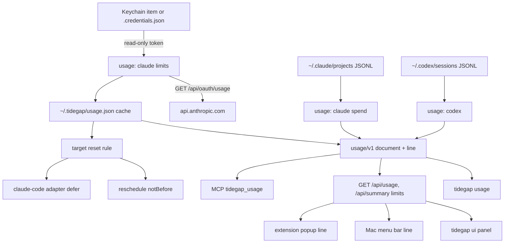
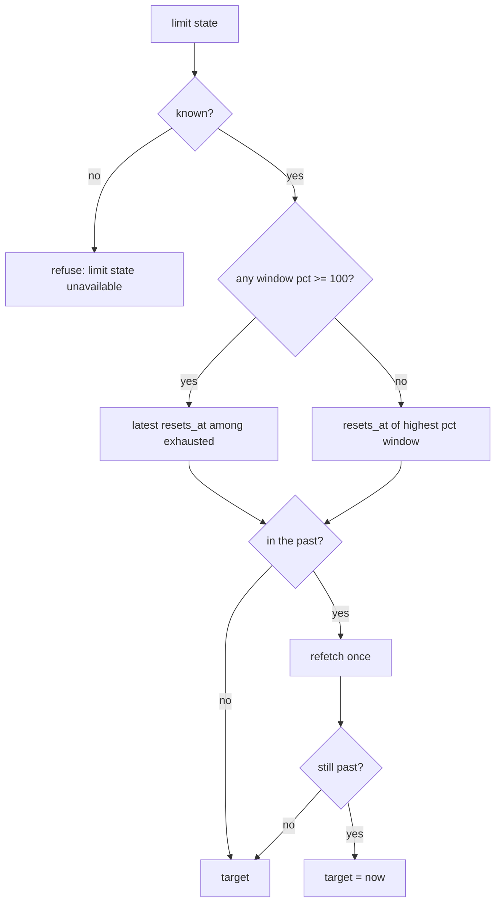

# Usage and Limits - Plan

## Goal Capsule

- **Objective:** A Tidegap user on a Claude Code subscription sees how much of the 5-hour and weekly limits is used and when they reset, on every Tidegap surface. A task that hits the limit waits for the reset instead of failing.
- **Means:** a read-only `usage` module in `packages/cli` that reads the active Claude Code login the way claude-swap does (KTD1-KTD4), local JSONL spend (KTD8), Codex session logs (KTD9), and a core "defer until" outcome for the scheduler (KTD6, KTD7).
- **Authority:** R-IDs win on behavior, KTDs on mechanism. Binding constraints: `docs/solutions/logic-errors/compare-and-set-task-transitions.md`, `docs/solutions/logic-errors/time-of-day-bugs-and-fake-time-sweeps.md`, `docs/solutions/tooling-decisions/tool-surface-shared-descriptions.md`, `docs/solutions/best-practices/loopback-web-ui-hardening.md`, and `docs/spec/ui-client-api.md`.
- **Execution profile:** branch `feat/usage-limits` on `origin/main` at `dd5d2e9`, which already contains PR #71 (the `claude-code` adapter, merge `afafaa2`). TypeScript, plus the extension (JS) and the Mac app (Swift). One PR.
- **Stop conditions:** stop and report if `GET https://api.anthropic.com/api/oauth/usage` no longer returns `five_hour` / `seven_day` with `utilization` and `resets_at`, or if Anthropic starts refusing the Claude Code OAuth token from a non-Claude-Code client (HTTP 401/403 with a "restricted to Claude Code" body).
- **Who finishes:** the implementer opens the PR. Vitalii merges.

---

## Product Contract

### Summary

Add a usage view of the Claude Code subscription limits (5-hour and weekly percent, reset time), spend in the current 5-hour window from local Claude Code logs, and the Codex equivalents from local Codex logs. Show it in `tidegap usage`, `GET /api/usage`, the `tidegap ui` page, the Mac menu bar, the extension popup and an MCP tool. Add "run after my limit resets" to MCP, CLI and the UI move menu. Make the `claude-code` adapter requeue a task that hits the limit, with its earliest start at the reset.

### Problem Frame

Tidegap runs queued tasks through the user's Claude Code subscription (PR #71). That subscription has a 5-hour and a weekly limit. Today the user cannot see either limit from Tidegap, an agent cannot check it before it queues heavy work, and a task that comes due while the limit is spent fails for good under PR #71's KTD7. The existing `quota_reset` deadline (`packages/core-ts/src/quota.ts`) depends on a weekly reset time that the user types into `~/.tidegap/config` by hand. It does not know the real reset time or the 5-hour window.

### Requirements

**Limit state**

- R1. Tidegap shows the Claude Code 5-hour and weekly utilization (percent) and reset time of the logged-in account, read from that login without changing it.
- R2. Per-model weekly windows (for example "Fable") appear when the usage API reports them.
- R3. Tidegap shows the Codex 5-hour and weekly utilization and reset time from local Codex session logs, with the time the values were last seen.
- R4. When limit state is unavailable, Tidegap names the cause (not logged in, API-key login, token expired, keychain unavailable, usage API rate-limited, network error) and shows the last good value with its age.

**Spend**

- R5. Tidegap shows Claude Code spend in the current 5-hour window: input, output, cache-write and cache-read tokens and an estimated list-price USD cost, as a total and per Claude Code session (KTD8 defines the window).
- R6. Tidegap shows Codex tokens per session in the current Codex 5-hour window. No cost.

**Surfaces**

- R7. `tidegap usage` prints a table. `tidegap usage --json` prints the `usage/v1` document (KTD10).
- R8. `GET /api/usage` answers with the `usage/v1` document for a page token or a client token. `GET /api/summary` adds a `limits` object.
- R9. The `tidegap ui` page has a usage panel.
- R10. The Mac menu bar shows one line, for example `Claude 5h: 72%, resets 16:30`.
- R11. The extension popup shows the same line.
- R12. An MCP tool `tidegap_usage` returns the limit state, so an agent can decide to defer work. It never changes anything.

**Scheduling**

- R13. A user can ask that a task run after the limit resets: the MCP `schedule_task` parameter `after_limit_reset`, `tidegap queue reschedule <id> --after-limit-reset`, and an "After limit reset" entry in the page's move menu. The task's earliest start becomes the reset time (KTD5), and it runs at the cleanest hour after that.
- R14. When a `claude-code` run fails with a usage-limit result, the task goes back to the queue with its earliest start at the reset time instead of failing. "Not logged in" and every other failure still fail once (PR #71 KTD7).

**Safety**

- R15. Tidegap never stores, logs, prints or sends a token except in the `Authorization` header of one request to `api.anthropic.com`. It never writes to `~/.claude`, `~/.codex`, the Keychain or claude-swap's files, and never refreshes an OAuth token.
- R16. `TIDEGAP_USAGE_CLAUDE_OAUTH=off` turns off the usage API read in every Tidegap process, including the ones the Mac app and launchd start. Tidegap then shows only local data.

### Key Decisions

- **Requeue on a limit result instead of failing.** A limit lasts hours, so failing loses every task that comes due before the reset. Governs R14. (session-settled: user-directed — chosen over PR #71's "fail once with the reason" (KTD7 there): a night of queued tasks must not die on a spent limit.)
- **Account switching is analysis only.** The section "Account switching (not planned for implementation)" records it. No unit builds it.
- **One line, one format, on every compact surface.** The server formats the line once (KTD10), so the menu bar and the popup cannot disagree. Governs R10, R11.

### Decision log

Orchestrator decisions of 2026-10-17, written before implementation. They amend the KTDs and units below where they disagree.

- D1. **Limit source #1 is the Claude Code statusline input.** Claude Code passes `rate_limits.five_hour` / `seven_day` with `used_percentage` (0-100) and `resets_at` (Unix epoch seconds) to the statusline command, for Pro/Max logins, after the first API response; a window is dropped once its `resets_at` passes (confirmed in https://code.claude.com/docs/en/statusline on 2026-10-17). `tidegap usage hook` is a statusLine command: it reads that JSON from stdin, writes the windows to `~/.tidegap/usage.json` (0600, no token), and prints nothing or the output of a wrapped statusline command (`tidegap usage hook -- <command>`). `tidegap install` offers to register it in `~/.claude/settings.json` only after the user's yes; the README documents the manual snippet. This replaces the "Statusline source" follow-up in Deferred.
- D2. **The OAuth usage endpoint is opt-in.** `TIDEGAP_USAGE_OAUTH=1` (env or `~/.tidegap/config`) turns on KTD2-KTD4; it is off by default. This replaces R16's `TIDEGAP_USAGE_CLAUDE_OAUTH=off` and closes the Open Question on the default. The README states the ToS risk. The client stays small and cached; the token is never stored. `TIDEGAP_USAGE=off` turns off every limit read (status `disabled`).
- D3. **Spend from JSONL only on request** (`--spend`), as planned.
- D4. **Two PRs.** PR 1: U1, U2 (statusline reader, opt-in OAuth client, cache, KTD5 target rule, off switch), U4, U7, U8, and U9 for what PR 1 ships. PR 2: U3 (spend, Codex), U5, U6, and the rest of U9. PR 1 carries the minimal `usage/v1` builder and `line` formatter from U3 because U4 and U7 need them; spend (`--spend`, `include_spend`) and the `codex` block land with U3 in PR 2.

### Scope Boundaries

- No account switching, no profiles, no per-task `account` field.
- No Python core change. The ledger column `not_before` already exists in both cores.
- No OpenClaw tool. `tidegap_usage` is MCP-only.
- Quick add (`POST /api/tasks`) does not get `after_limit_reset`.
- Considered and not built: a cross-process fetch lease on the cache file. Two processes that find the cache stale at the same moment both fetch once. With a 300 s TTL that costs a few extra requests per hour against a budget of about 30. Build a lease if the logs show `http-429` from Tidegap.
- Considered and not built: token refresh. Claude Code owns the active login, and a refresh by a second process rotates the refresh token under Claude Code (claude-swap never refreshes the active account, `src/claude_swap/oauth.py:649`). An expired token shows `token_expired` until Claude Code renews it.
- Considered and not built: a background poller in the `tidegap ui` server. Clients already poll `/api/summary` every minute, and the cache TTL bounds the API calls.

### Deferred to Follow-Up Work

- Statusline source: Claude Code passes `rate_limits.five_hour` / `seven_day` (`used_percentage`, `resets_at` epoch) to the statusline command. A `tidegap usage ingest` that reads that JSON from stdin would give limit state with no network call and no use of the OAuth token outside Claude Code. It needs a line in the user's statusline script.
- claude-swap as a source (`cswap list --json`, a documented schema), so Tidegap and cswap share one usage-API budget.
- Codex usage over the network (`chatgpt.com/backend-api/wham/usage`, unconfirmed).
- Per-model weekly windows in the KTD5 target rule.
- Feed the observed weekly `resets_at` into `quota_reset` deadlines instead of the hand-typed `TIDEGAP_QUOTA_RESET_CLAUDE`.
- Spend of Tidegap's own `claude-code` runs from the ledger (they run with `--no-session-persistence`, so the JSONL scan does not see them).
- PR #71's follow-ups stay open: MCP `expedite_task` / `retry_task` for `claude-code`, the docs page provider list, run-in-origin-session. The "requeue instead of fail" follow-up is taken by U8 for limit results only. "Not logged in" still fails.

### Open Questions

- Decision for Vitalii before release: should the usage API read be on by default? Default chosen: on (the feature is useless without it), with the off switch (R16) and the README and CHANGELOG risk note. The risk applies to every user who installs the release with Claude Code logged in, not only Vitalii, and the read starts with no action: the Mac app's and the extension's `/api/summary` polls trigger it. Anthropic's primary legal page was not read (Research, Terms of service); read it before deciding.
- Deferred, default chosen: spend is computed on request (`--spend`, the page's "Show spend", MCP `include_spend`), because the scan takes seconds. R5 holds on request.
- Deferred, default chosen: the deferral cap. A deferred task never moves past `enqueuedAt + 8 days` (KTD7). Past that, it fails with the limit message.
- Deferred to QA: the exact text of a real Claude Code usage-limit result. PR #71's fixture (`packages/cli/test/fixtures/fake-claude/limit.json`) is synthetic. KTD13 parses the text only as a fallback.

---

## Research

### How claude-swap reads limits

Installed: `cswap` 0.27.2, uv tool at `~/.local/share/uv/tools/claude-swap/`. Upstream: https://github.com/realiti4/claude-swap, tag `v0.27.2`, MIT. `oauth.py`, `credentials.py` and `poll_policy.py` are byte-identical between the install and upstream `main` (2026-10-15). Upstream `session.py` differs only in also sharing `rules/` into session profiles (lines 19-20, 83). Paths below are upstream paths; line numbers match the install.

- **Endpoint.** `GET https://api.anthropic.com/api/oauth/usage` with `Authorization: Bearer <accessToken>`, `anthropic-beta: oauth-2025-04-20`, `User-Agent: claude-swap/1.0`, 5 s timeout (`src/claude_swap/oauth.py:17`, `:397-408`).
- **Response shape.** `five_hour` and `seven_day`, each `{utilization, resets_at}` (ISO-8601). `extra_usage` `{is_enabled, used_credits, monthly_limit, utilization, currency, resets_at}` in cents. A newer `limits[]` array with `weekly_scoped` entries `{scope.model.display_name, percent, resets_at}` for per-model weekly limits (`src/claude_swap/oauth.py:464-535`).
- **Credential source.** Active login, in order: macOS Keychain generic password, service `Claude Code-credentials`, account `$USER` (else the OS user name); then `~/.claude/.credentials.json`; then the managed API key (Keychain `Claude Code`, then `~/.claude.json` `primaryApiKey`) (`src/claude_swap/credentials.py:117`, `:581-650`; `src/claude_swap/macos_keychain.py:76-93`). The token is `claudeAiOauth.accessToken` (`src/claude_swap/oauth.py:25-31`). Keychain reads run `/usr/bin/security find-generic-password -a <account> -w -s <service>` with an absolute path and a 5 s timeout; exit code 44 means "not found" (`src/claude_swap/macos_keychain.py:54-60`, `:107-135`).
- **Service name under `CLAUDE_CONFIG_DIR`.** Claude Code hashes the raw env value: `Claude Code-credentials-<first 8 hex of sha256(NFC(value))>`. `CLAUDE_SECURESTORAGE_CONFIG_DIR`, when defined, takes precedence; defined-but-empty means the unsuffixed item (`src/claude_swap/session.py:232-243`, `src/claude_swap/credentials.py:69-111`). This explains PR #71's finding that `CLAUDE_CONFIG_DIR=~/.claude` with another `HOME` reports "Not logged in": the explicit value selects a suffixed item that does not exist.
- **Refresh.** The active account is never refreshed; Claude Code owns it. Only stored inactive accounts are refreshed, through `https://platform.claude.com/v1/oauth/token` (`src/claude_swap/oauth.py:19-20`, `:639-660`).
- **Rate budget.** The usage endpoint allows about 28-30 requests per trailing 60 minutes per identity and User-Agent class for non-first-party clients (measured by the cswap author, 2026-07). cswap serves cached data for 180 s, polls at most every 180 s, and backs off to 360 s and up to 1800 s after a 429, honoring `Retry-After` (`src/claude_swap/poll_policy.py:1-40`, `:75-138`).
- **Session spend.** cswap does not compute spend from JSONL. `jsonl` appears only in history sharing for session profiles (`src/claude_swap/session.py:27`, `:1435-1451`).
- **Codex.** Not supported. No reference to Codex in the source.

### How claude-swap switches accounts

- **Storage per slot.** The credential goes to the Keychain under service `claude-swap`, account `account-<n>-<email>` (`src/claude_swap/credentials.py:113`, `:1070-1110`). The `.claude.json` `oauthAccount` identity goes to `~/.claude-swap-backup/` on macOS (README "Data locations").
- **Switch.** `switch_to` backs up the live login, then writes the target credential into the live `Claude Code-credentials` item and splices `oauthAccount` into `~/.claude.json`, under file locks, with a rollback snapshot (`src/claude_swap/switcher.py:6258`, `:6880-6935`; `src/claude_swap/credentials.py:969-993`). A running Claude Code picks it up after its ~30 s Keychain cache.
- **Session mode.** `cswap run <n>` starts `claude` with `CLAUDE_CONFIG_DIR=<backup>/sessions/<n>-<slug>`, seeded with a plaintext `.credentials.json` that Claude Code migrates into its hashed Keychain item (`src/claude_swap/session.py:1-30`, `:548`, `:646`).

### Public tools

- **ccusage** (ryoppippi) reads `~/.claude/projects/**/*.jsonl` and `~/.config/claude/projects/`, honors `CLAUDE_CONFIG_DIR`, groups usage into 5-hour blocks and prices tokens at API list prices ([data loader](https://www.mintlify.com/ryoppippi/ccusage/api/library/data-loader), [blocks](https://www.mintlify.com/ryoppippi/ccusage/api/commands/blocks)). Its block alignment rule was not confirmed from source.
- **Usage endpoint** confirmed by several third-party clients with the same header and the same `five_hour` / `seven_day` `{utilization, resets_at}` shape ([backmind/ClaudeUsage](https://github.com/backmind/ClaudeUsage), [ccusage on PyPI](https://pypi.org/project/ccusage/), [planecore gist](https://gist.github.com/planecore/1c3ac2bec91f9a9b9f009f9cf0079d09)). It is undocumented by Anthropic.
- **Local JSONL shape** (checked on this Mac, Claude Code 2.1.302): assistant lines carry `timestamp`, `sessionId`, `requestId`, `cwd`, `message.id`, `message.model` and `message.usage` with `input_tokens`, `output_tokens`, `cache_creation_input_tokens`, `cache_read_input_tokens` and `cache_creation.ephemeral_5m_input_tokens` / `ephemeral_1h_input_tokens`. Subagent logs live in `<project>/<sessionId>/subagents/agent-*.jsonl`. This Mac wrote about 850 MB of JSONL in 24 hours across 301 files.
- **Statusline** (checked in `~/.claude/claude-statusline.sh`): Claude Code passes `rate_limits.five_hour.used_percentage` and `resets_at` (epoch) to the statusline command for Pro/Max logins.
- **Codex local logs** (checked on this Mac): `~/.codex/sessions/YYYY/MM/DD/rollout-*.jsonl`, `event_msg` lines with `payload.type: "token_count"` carry `rate_limits {limit_id, primary {used_percent, window_minutes: 300, resets_at (epoch s)}, secondary {used_percent, window_minutes: 10080, resets_at}, plan_type}` and `info {total_token_usage, last_token_usage, model_context_window}`. Values are as of the last Codex turn. The newest local file here is from 2026-05-21, so local Codex data can be months old.
- **Codex network endpoint** (unconfirmed): `GET https://chatgpt.com/backend-api/wham/usage` with the ChatGPT OAuth bearer and a `ChatGPT-Account-Id` header, returning `rate_limit.primary_window` / `secondary_window` `{used_percent, limit_window_seconds, reset_after_seconds, reset_at}` ([pi-codex-status](https://cdn.jsdelivr.net/gh/lhl/pi-codex-status@main/README.md), [pi-spark notes](https://cdn.jsdelivr.net/npm/pi-spark@0.22.0/docs/openai-codex-banked-rate-limit-resets.md)). One source gives `/backend-api/codex/usage` instead. Not used.

### Terms of service

- Anthropic's legal and compliance page (as reported in February 2026) says OAuth tokens from Free, Pro and Max plans are for Claude Code and Claude.ai only, and that use in other tools violates the Consumer Terms. Server-side blocks of third-party inference with those tokens started in January 2026 ([report](https://gigazine.net/gsc_news/en/20260220-anthropic-third-party-block), [analysis](https://yage.ai/share/claude-code-subscription-not-a-developer-credential-en-20260321.html)). The primary page was not read; the wording is unconfirmed.
- Reading `/api/oauth/usage` is not inference, and no document permits or forbids it. It still uses the Claude Code token outside Claude Code, so it falls under the letter of that restriction. claude-swap and several monitors do it openly; no account action against them is reported.
- Risk to every user with the read on: low-probability account action, and a real chance the endpoint starts refusing non-Claude-Code clients. Mitigation: a low rate (KTD4), an honest `User-Agent`, the off switch (R16), fail-soft display (R4), and the statusline source as a follow-up that needs no token.
- Codex: reading local session logs uses no credential. The `wham` endpoint would use the ChatGPT token outside Codex; not planned.

---

## Planning Contract

### Key Technical Decisions

- KTD1. **The module lives in `packages/cli/src/usage/` and is exported as `@tidegap/cli/usage`.** `@tidegap/mcp` adds `@tidegap/cli` as a dependency to reach it. Not in core: reading the Keychain needs `child_process`, which core must not import (PR #71 KTD10, `packages/core-ts/src/notify.ts`), and the OpenClaw plugin bundles core, where ClawScan flags process-spawning and credential-reading code. Not a new package: a new published package adds a release workflow, trusted publishing and version lockstep entries for one module. The CLI package gains an `exports` map: `"."` with `types` and `default` conditions (the `@ebb-ai/cli` shim resolves it with `require.resolve`), `"./usage"` with `types` and `import`, and `"./package.json"`.
- KTD2. **Credentials are read like claude-swap reads the active login, and only read.** See Research for the mechanism this mirrors.
  1. Service name: `CLAUDE_SECURESTORAGE_CONFIG_DIR` defined and non-empty gives the hashed name of that value, defined and empty gives `Claude Code-credentials`. Else `CLAUDE_CONFIG_DIR` set gives the hashed name of the raw value, followed by the unsuffixed name when the value resolves to the default config directory. Else `Claude Code-credentials`.
  2. macOS: `/usr/bin/security find-generic-password -a <account> -s <service> -w`, argv array, no shell, 5 s timeout, account = `$USER` or the OS user name. Exit 44 = not found. A timeout or any other non-zero exit marks the Keychain as failed and continues to step 3.
  3. Fallback on every platform: `<config home>/.credentials.json`. No file after a failed Keychain read = `keychain_unavailable`. No file and no Keychain item = `not_logged_in`. Neither sends a request.
  4. Parse `claudeAiOauth.accessToken` and `expiresAt` (epoch ms). No OAuth object but a managed API key = `api_key` (no limits). Expired = `token_expired`, and no request is sent.
  5. The token lives in one local variable for one request. Error messages and logs never include it or the response headers.
- KTD3. **One usage API client.** `GET https://api.anthropic.com/api/oauth/usage`, headers `Authorization`, `anthropic-beta: oauth-2025-04-20`, `User-Agent: tidegap/<cli version>`. Timeout 5 s, or 2 s when called from `/api/summary`. Normalize `five_hour`, `seven_day` and `limits[]` scoped entries as in `src/claude_swap/oauth.py:464-535`; ignore unknown fields. Errors map to a kind: `http-401`, `http-403`, `http-429`, `http-5xx`, `timeout`, `network`, `bad-response`.
- KTD4. **A shared measurement cache in `~/.tidegap/usage.json`.** Mode 0600, atomic write (temp file plus rename). It holds measurements and fetch state only: per source `{fetched_at, data, error_kind, retry_at}`. Every host process (CLI, `tidegap ui`, tick, MCP server) reads it first.
  - TTL 600 s for reads from the `tidegap ui` server (`/api/summary`, `/api/usage`), 300 s for an explicit `tidegap usage` or MCP `tidegap_usage`. `TIDEGAP_USAGE_TTL_S` sets the server TTL (minimum 180, cswap's measured safe floor).
  - Stale on error: a failed fetch keeps the last good `data` and sets `error_kind`.
  - 429: `retry_at = now + max(Retry-After, 60 min)`, because the budget is a trailing hour and cswap measured re-blocks within 15 min of a lapsed block. No fetch before `retry_at`.
  - With cswap also polling the same account, both tools share one budget. Tidegap's background reads stay at 6 per hour or fewer; with cswap at about 20, the sum stays under about 28-30.
- KTD5. **"The limit reset" is one rule.** Inputs: the 5-hour and weekly windows. A window is exhausted at `pct >= 100`.
  - Any exhausted: the latest `resets_at` among exhausted windows.
  - None exhausted: the `resets_at` of the window with the highest `pct` (5-hour on a tie).
  - No limit state: no target. Every caller except the `claude-code` adapter refuses with "limit state unavailable: <cause>". The adapter falls back per KTD13.
  - A `resets_at` already in the past triggers one fresh fetch. If it is still in the past, the target is now.
- KTD6. **Core gets an earliest-start on enqueue and on reschedule.** `DeferOptions.notBefore` and a new `RescheduleTarget` shape `{ notBefore, deadline? }`. Both set `notBefore`, raise the deadline to at least `notBefore + 2 h`, and run the window picker over `[notBefore, deadline]`. The picker already honors a future `notBefore` (`packages/core-ts/src/scheduler.ts`, `scheduleProviderCall`). Before the picker runs, both paths set `scheduledFor = notBefore + 1 min`, as the `{dayStart, dayEnd}` branch of `rescheduleTask` does. Then neither the unplanned branch's clamp (a reset beyond the forecast) nor a picked hour that contains `notBefore` can give `scheduledFor === notBefore`, which reads as an exact-time pin in `replanSweep` and `isBatchCandidate` (`docs/solutions/logic-errors/time-of-day-bugs-and-fake-time-sweeps.md`, finding 1). Writes are compare-and-set on the pending statuses (`docs/solutions/logic-errors/compare-and-set-task-transitions.md`). The host resolves the reset time (KTD5) and passes an instant; core never reads usage.
- KTD7. **A provider can ask the scheduler to defer.** Core exports `ProviderDeferError` with `retryAt`. Implements R14 under the session-settled Key Decision "Requeue on a limit result".
  1. `dispatchProviderCall` recognizes it by `instanceof` or by `name === "ProviderDeferError"` with a valid `retryAt`, because the CLI and core can load separate copies of the class.
  2. It does not retry (`isRetryable` stays false: no `status`) and does not roll the series.
  3. It writes `running` → `scheduled` with `notBefore = retryAt`, `scheduledFor = retryAt + 1 min`, `deadline = max(deadline, retryAt + 2 h)`, and `estimatedCarbonGCo2` and `intensitySource` cleared, compare-and-set on `running`. A cancel during the run wins. With the estimate cleared, `replanSweep` moves the row to the cleanest hour in `[retryAt, deadline]` once the forecast covers it.
  4. After the first defer in a tick, every other due task on the same adapter in that tick defers to the same `retryAt` without a dispatch. A spent limit then costs one `claude` spawn and one usage read per tick, not one per task.
  5. When `retryAt + 2 h` passes `enqueuedAt + 8 days`, the task fails with the provider's message plus "limit did not reset before the 8-day cap".
  6. The tick result entry gets status `deferred` with `retryAt`. `TickResult` gains a `deferred` count. `tidegap tick` prints `N deferred until HH:MM`.
- KTD8. **Claude spend comes from local JSONL, and "current session" means the current 5-hour window.** The subscription limit counts that window, so it is the spend the user can act on.
  - Window start: `five_hour.resets_at - 5 h` when limit state is known. Otherwise the last 5 hours, labeled "trailing 5 h" in the output.
  - Roots: `$CLAUDE_CONFIG_DIR/projects` when set, else `~/.claude/projects` and `~/.config/claude/projects`. Files with mtime at or after the window start, including `<sessionId>/subagents/*.jsonl` (attributed to the parent session).
  - A line counts when it is an `assistant` line with `message.usage` and `timestamp >= window start`. Duplicates by `message.id` plus `requestId` count once.
  - Cost: `packages/core-ts/src/data/prices.json` input and output rates. Cache write at 1.25x input (5 min) and 2x (1 h), cache read at 0.1x input (Anthropic's published multipliers). An unknown model gives tokens and `cost_usd: null`. The output says "API list-price estimate, not billed".
  - Per session: `sessionId`, project directory name, last activity, tokens, cost; the five most recent.
  - Speed: a cheap substring test before `JSON.parse`. Long-lived hosts keep per-file byte offsets in memory. Target: under 2 s on this Mac's volume.
- KTD9. **Codex comes from local session logs only.** Root `$CODEX_HOME` or `~/.codex`. Limits come from the newest rollout file under `sessions/YYYY/MM/DD/`, whatever its age. Its last `token_count` event with a non-null `rate_limits` gives `primary` (5 h) and `secondary` (weekly): `used_percent`, `resets_at` (epoch seconds), `plan_type`, and `as_of` = the event timestamp. A window whose `resets_at` has passed reports `pct: null, state: "reset_since_seen"`. Spend: per file, the last `info.total_token_usage` for files active in the current primary window. `auth.json` is never opened.
- KTD10. **One document, `usage/v1`, for every surface.** `{schema: "usage/v1", generated_at, claude: {status, source: "api"|"cache", fetched_at, age_s, five_hour?, seven_day?, scoped[], error?}, claude_spend?, codex: {...}, target_reset?, line}`. `line` is formatted on the host, in its local time: `Claude 5h: 72%, resets 16:30`. It names the window with the highest `pct`, and uses `Mon 16:30` when the reset is not today. When limit state is unavailable it reads `Claude: limits unavailable (<cause>)`. A last good value served after a failed fetch, or older than the TTL, appends `(as of HH:MM)`. A window whose `resets_at` has passed is left out of the line. `disabled` gives an empty line, which clients treat like a missing `limits`. `/api/summary` gains `limits: {line, status, pct, resets_at}`: it calls the KTD3 client with the 2 s cap, and on timeout or error returns the cached line, or `limits: null` with no cache. Spend is computed only on request (`--spend`, `?spend=1`, MCP `include_spend`), because the scan costs seconds.
- KTD11. **MCP.** `tidegap_usage` (hosts `["mcp"]`, parameter `include_spend`, default false). Its description says it is read-only and tells the agent when to defer: "If a window is at 90% or more, schedule with `after_limit_reset`." `schedule_task` gains `after_limit_reset` (hosts `["mcp"]`). Both live in `TOOL_SURFACE` (`docs/solutions/tooling-decisions/tool-surface-shared-descriptions.md`).
- KTD12. **UI.** `POST /api/tasks/<id>/reschedule` accepts `{"after_limit_reset": true}`. The server resolves KTD5 and calls the KTD6 reschedule. No target gives 409 with the cause. The move menu (`moveDialog` in `packages/cli/ui/dialog.js`) adds "After limit reset" with the reset clock as its hint, The page loads `/api/usage` at start and on its existing status refresh, and passes `target_reset` to `moveDialog`. For a movable task the item is always listed: with a target its hint names the window and the reset (`5h window resets Mon 16:30`), without one it is disabled with the hint `limit state unavailable: <cause>`. The panel lives in a new `packages/cli/ui/usage.js`, rendered as text only: a "Usage" pill next to the dispatcher pill shows `limits.line` and opens a dialog built like the dispatcher dialog. The dialog lists each window (Claude 5 h, weekly, scoped; Codex 5 h, weekly) with percent, reset and age, and the R4 cause when the status is not ok. A "Show spend" button calls `?spend=1`, reads "Scanning…" while it runs, and shows an inline error that keeps the limit rows on failure.
- KTD13. **The `claude-code` adapter throws `ProviderDeferError` on a limit result.** Detection: `is_error` and (`api_error_status === 429` or the result text matches `usage limit|limit reached|hit your limit`). The host passes a resolver that returns `{at, exhausted}` from a usage read that skips the TTL but honors `retry_at` and reuses a cache entry under 60 s old. `exhausted` is true when a 5-hour or weekly window, or a scoped window whose model matches the task's model, is at 100% or more. `retryAt`, first hit wins:
  1. The resolver's `at` when `exhausted` is true.
  2. The result text: an epoch after `|` (older Claude Code), or `reset(s) (at) <h[:mm]am|pm> (<IANA zone>)`, resolved to the next such instant. The text names the limit that was hit.
  3. The resolver's `at` when nothing is exhausted.
  4. Now + 60 min.
  - The floor is now + 5 min. The message stays prefixed `claude-code:` and names the reset time.

### High-Level Technical Design

Components and data flow:

The target rule (KTD5):

A limit result in a tick (KTD7):

```mermaid
stateDiagram-v2
  [*] --> scheduled
  scheduled --> running: tick claims
  running --> completed: success
  running --> failed: other error, or past 8-day cap
  running --> scheduled: ProviderDeferError, notBefore = retryAt
  running --> cancelled: cancel during run wins
  scheduled --> running: at scheduledFor, after notBefore; replanSweep may move it to the cleanest hour
```

### Assumptions

- The usage API keeps its current shape and header. QA checks it once against a live response.
- `/usr/bin/security` reading Claude Code's item may show a one-time macOS access prompt. From `tidegap ui` started in a terminal or by the Mac app, the user can answer it ("Always Allow"). From the launchd tick nobody can, and the 5 s timeout turns it into `keychain_unavailable`. The adapter then falls back to the text parse (KTD13).
- The Mac app and the extension run on the same machine as the server, so the server's local time is the user's.

### Sequencing

- U1 and U2 first (foundation). Then U3, which owns the `usage/v1` builder. Then U4, U5, U7 and U8 in parallel: they share no files. U6 needs U5. U9 last.
- One PR from `feat/usage-limits`.

---

## Implementation Units

### U1. Core: earliest start and deferral

- **Goal:** core can enqueue or reschedule a task with an earliest start, and a provider can defer a running task to a later time.
- **Requirements:** R13, R14.
- **Dependencies:** none.
- **Files:**
  - modify `packages/core-ts/src/types.ts` (`DeferOptions.notBefore`, `TickResultEntry` status `deferred` with `retryAt`, `TickResult.deferred`)
  - modify `packages/core-ts/src/scheduler.ts` (`RescheduleTarget` shape, `rescheduleTask`, `enqueueProviderCall`, `dispatchProviderCall` catch, tick counters)
  - create `packages/core-ts/src/providers/defer.ts` (`ProviderDeferError`)
  - modify `packages/core-ts/src/index.ts` (exports)
  - create `packages/core-ts/test/defer.test.ts`
  - modify `packages/core-ts/test/scheduler.test.ts` or the nearest reschedule test
- **Approach:** KTD6 and KTD7. `rescheduleShape` learns the new shape. The deferral write uses `writeIf(record, next, ["running"])`.
- **Patterns to follow:** `rescheduleTask` `{at}` branch, `runNow`, the existing `failTask` / `writeIf` paths in `dispatchProviderCall`.
- **Execution note:** run the new tests under the fake-time sweep from `docs/solutions/logic-errors/time-of-day-bugs-and-fake-time-sweeps.md` once (throwaway copy, three zones).
- **Test scenarios:**
  - Enqueue with `notBefore` 3 h ahead and a 24 h deadline: the row is `scheduled`, `notBefore` is stored, `scheduledFor >= notBefore`.
  - Enqueue with `notBefore` after the deadline: the deadline rises to `notBefore + 2 h`.
  - Reschedule `{notBefore}` on a `queued` task: same result. On a `running` task: `TaskActionError`.
  - A picked hour that contains `notBefore` gives `scheduledFor = notBefore + 1 min`, and `replanSweep` still plans the row.
  - Enqueue and reschedule with `notBefore` beyond the forecast horizon: the row is unplanned, `scheduledFor = notBefore + 1 min`, and `replanSweep` plans it once the forecast reaches it.
  - A stub adapter throws `ProviderDeferError(retryAt = now + 2 h)`: the row is `scheduled`, `notBefore = retryAt`, `scheduledFor = retryAt + 1 min`, no `error`, the series did not roll, the entry status is `deferred`, `TickResult.deferred` is 1.
  - The same with a plain object error `{name: "ProviderDeferError", retryAt}` from another module copy: deferred.
  - A defer whose `retryAt + 2 h` passes `enqueuedAt + 8 days`: `failed`, and the error names the cap.
  - A cancel lands while the stub runs, then the stub defers: the row stays `cancelled`.
  - A deferred row is not dispatched by a tick before `notBefore`, and is dispatched by a tick after it.
  - After a defer, `replanSweep` with a covering forecast moves `scheduledFor` to the cleanest hour at or after `retryAt + 1 min`.
  - Three due tasks on one stub adapter, the first defers: the stub is called once, all three rows are deferred to the same `retryAt`.
  - `retryWithBackoff` calls the adapter once for a defer.
- **Verification:** core tests pass, including `environment-purity.test.ts` and the snapshot tests.

### U2. CLI usage module: Claude limits, credentials, cache

- **Goal:** one call returns normalized Claude limit state from the cache or the API, read-only.
- **Requirements:** R1, R2, R4, R15, R16.
- **Dependencies:** none.
- **Files:**
  - create `packages/cli/src/usage/credentials.ts` (KTD2; spawn and fs are injectable)
  - create `packages/cli/src/usage/claude-limits.ts` (KTD3)
  - create `packages/cli/src/usage/cache.ts` (KTD4)
  - create `packages/cli/src/usage/target.ts` (KTD5)
  - create `packages/cli/src/usage/index.ts`
  - modify `packages/cli/src/env.ts` (`TIDEGAP_USAGE_CLAUDE_OAUTH`, `TIDEGAP_USAGE_TTL_S`: the process env first, then `~/.tidegap/config`, the same precedence as `TIDEGAP_NOTIFY` in `packages/cli/src/commands/tick.ts`)
  - modify `packages/cli/package.json` (`exports` with `.` and `./usage`)
  - modify `packages/core-ts/test/environment-purity.test.ts` (`HOST_ENV_VARS` adds the two names)
  - create `packages/cli/test/usage-credentials.test.ts`, `packages/cli/test/usage-limits.test.ts`, `packages/cli/test/usage-target.test.ts`
  - create or modify the `packages/cli` vitest setup file (the fetch stub and the `security` guard from the Verification Contract)
  - create `packages/cli/test/fixtures/usage/` (`oauth-usage-ok.json`, `oauth-usage-scoped.json`, `oauth-usage-exhausted.json`, `credentials-oauth.json`, `credentials-expired.json`, `credentials-apikey.json`)
- **Approach:** the fetch function and the `security` runner are injected, so tests never touch the network or the Keychain. The cache path comes from the hermetic home in tests (`packages/cli/test/hermetic-home.ts`).
- **Patterns to follow:** `cachedForecast` in `packages/cli/src/ui/api.ts` (cache shape), `defaultSpawnNotify` in `packages/cli/src/commands/tick.ts` (argv spawn), `readEnvCredentials` in `packages/cli/src/env.ts`.
- **Test scenarios:**
  - Service name: no env gives `Claude Code-credentials`. `CLAUDE_CONFIG_DIR=/x/y` gives `Claude Code-credentials-` plus the first 8 hex of sha256 of `/x/y`, matching a value computed in the test. `CLAUDE_SECURESTORAGE_CONFIG_DIR=""` gives the unsuffixed name.
  - The `security` runner is called with argv `find-generic-password -a <user> -s <service> -w` and no shell. Exit 44 falls back to the credentials file.
  - A runner timeout gives `keychain_unavailable` when no file exists.
  - An expired token gives `token_expired`, and the fake fetch is never called.
  - An API-key credential gives `api_key` and no fetch.
  - The fake fetch receives `Authorization: Bearer <fixture token>`, `anthropic-beta: oauth-2025-04-20` and a `tidegap/` User-Agent.
  - `oauth-usage-ok.json` normalizes to `five_hour {pct, resets_at}` and `seven_day {pct, resets_at}`. `oauth-usage-scoped.json` adds one scoped "Fable" window. Unknown fields are ignored.
  - A second call within the TTL returns `source: "cache"` and does not fetch. After the TTL it fetches.
  - A 429 with `Retry-After: 30` sets `retry_at` 60 min out. Calls before it do not fetch and return the last good data with `error_kind: "http-429"`.
  - A failed fetch keeps the last good `data` and its `fetched_at`.
  - `TIDEGAP_USAGE_CLAUDE_OAUTH=off` in the env, or only in `~/.tidegap/config`: no credential read, no fetch, status `disabled`.
  - The cache file is mode 0600 and contains no fixture token, no `accessToken`, no `refreshToken` and no `Authorization` text.
  - Thrown errors and returned objects never contain the fixture token (check every error path).
  - Target: 5 h at 100 and 7 d at 40 gives the 5 h reset. 5 h at 100 and 7 d at 100 gives the later reset. 5 h at 72 and 7 d at 80 gives the 7 d reset. No state gives no target with the cause. A past reset with a still-past refetch gives now.
- **Verification:** the new tests pass. `node --test compat/test/shims.test.mjs` passes after `pnpm build`. `git grep -n "accessToken" packages/cli/src/usage` shows only the parse in `credentials.ts`.

### U3. CLI usage module: Claude spend and Codex

- **Goal:** spend in the current window from Claude Code JSONL, Codex limits and tokens from Codex logs, and the one `usage/v1` document builder.
- **Requirements:** R3, R5, R6.
- **Dependencies:** U2 (window start from limit state).
- **Files:**
  - create `packages/cli/src/usage/claude-spend.ts` (KTD8)
  - create `packages/cli/src/usage/codex.ts` (KTD9)
  - create `packages/cli/src/usage/document.ts` (the KTD10 `usage/v1` builder and the `line` formatter, the one place every surface gets them)
  - modify `packages/cli/src/usage/index.ts`
  - create `packages/cli/test/usage-spend.test.ts`, `packages/cli/test/usage-codex.test.ts`, `packages/cli/test/usage-document.test.ts`
  - create `packages/cli/test/fixtures/usage/claude-projects/` (two projects, one with a `subagents/` file, duplicate lines, a user line, a line before the window) and `packages/cli/test/fixtures/usage/codex-sessions/` (two rollout files, one with `rate_limits: null`)
- **Approach:** stream files line by line. Roots come from injected env and home.
- **Patterns to follow:** fixture layout of `packages/cli/test/fixtures/fake-claude/` (PR #71).
- **Test scenarios:**
  - Window from limit state: only lines with `timestamp >= resets_at - 5 h` count.
  - Duplicate `message.id` plus `requestId` counts once.
  - A subagent file counts under its parent session id.
  - Tokens: input, output, cache write and cache read totals match hand-summed fixture values.
  - Cost for `claude-sonnet-5` with 1 M input, 1 M output, 1 M 5-min cache write and 1 M cache read: 2 + 10 + 2.5 + 0.2 = 14.7 USD.
  - An unknown model gives tokens and `cost_usd: null`.
  - No limit state: the window is the last 5 hours, and the output labels it "trailing 5 h".
  - `CLAUDE_CONFIG_DIR` set: only `$CLAUDE_CONFIG_DIR/projects` is scanned.
  - Per session: the five most recent, newest first.
  - Codex: the last non-null `rate_limits` wins. `resets_at` 1779415292 maps to the right ISO instant. `as_of` is the event timestamp.
  - Codex: a `resets_at` in the past gives `pct: null`, `state: "reset_since_seen"`.
  - Codex: no sessions directory gives `status: "not_found"`, no throw.
  - Codex: a newest file 150 days old still gives limits, with `as_of` 150 days back.
  - Line: the fixture gives `Claude 5h: 72%, resets 16:30`. A last good value after a failed fetch appends `(as of 14:05)`. A passed window is left out. `disabled` gives an empty line. A reset on another day uses the weekday form.
  - Codex: `auth.json` in the fixture home is never opened (spy on the injected fs).
- **Verification:** the new tests pass. QA times the scan on this Mac (Verification Contract).

### U4. `tidegap usage` and the CLI flag

- **Goal:** the user reads limits and spend in a terminal, and moves a task to after the reset.
- **Requirements:** R7, R13.
- **Dependencies:** U1, U2, U3.
- **Files:**
  - create `packages/cli/src/commands/usage.ts`
  - modify `packages/cli/src/index.ts` (`usage [--json] [--spend]`, `queue reschedule --after-limit-reset`)
  - modify `packages/cli/src/commands/queue.ts` (`runQueueReschedule`)
  - create `packages/cli/test/usage-command.test.ts`
  - modify `packages/cli/test/queue.test.ts`
- **Approach:** the table has one row per window (provider, window, used, resets, as of) and a spend block with `--spend`. `--after-limit-reset` cannot combine with `--by`, `--at` or `--day`.
- **Patterns to follow:** `packages/cli/src/commands/stats.ts` (table and `--json`), the existing `reschedule` option parsing.
- **Test scenarios:**
  - `--json` with a fake fetch prints a document with `schema: "usage/v1"`, both windows and `line`.
  - The table shows `72%` and the local reset clock for the fixture.
  - `--spend` adds the spend block; without it the JSONL scan is not called.
  - A `token_expired` state prints the cause and the last good value with its age, exit code 0.
  - `queue reschedule <id> --after-limit-reset` with an exhausted 5 h fixture stores `notBefore` = that reset.
  - The same with no limit state exits 1 with "limit state unavailable".
  - `--after-limit-reset --at 2h` exits with a usage error.
- **Verification:** the new and changed tests pass. `docs-lockstep.test.ts` still passes.

### U5. UI API and the page

- **Goal:** the page and native clients get limit state, and the page can move a task to after the reset.
- **Requirements:** R8, R9, R13.
- **Dependencies:** U1, U2, U3.
- **Files:**
  - modify `packages/cli/src/ui/api.ts` (`GET /api/usage`, `limits` in `summary`, `after_limit_reset` in the reschedule body)
  - modify `packages/cli/src/ui/summary.ts`
  - create `packages/cli/ui/usage.js`
  - modify `packages/cli/ui/api.js`, `packages/cli/ui/app.js`, `packages/cli/ui/dialog.js`, `packages/cli/ui/index.html`, `packages/cli/ui/app.css`
  - modify `docs/spec/ui-client-api.md` (the `limits` field, `GET /api/usage`, the reschedule key)
  - modify `packages/cli/test/ui-summary.test.ts`, `packages/cli/test/ui-actions.test.ts`
  - create `packages/cli/test/ui-usage.test.ts`
- **Approach:** KTD10 and KTD12. `/api/usage` is a client route (page and client tokens, all origins of the existing matrix). Errors follow the spec's error table; 502 never leaks the provider body.
- **Patterns to follow:** `forecast` and `summary` handlers in `api.ts`; `docs/solutions/best-practices/loopback-web-ui-hardening.md`; `docs/solutions/best-practices/dependency-free-task-ui-patterns.md`.
- **Test scenarios:**
  - `GET /api/usage` with a client token returns 200 and `usage/v1`. Without a token: 401. From a foreign origin: 403.
  - `GET /api/usage?spend=1` includes `claude_spend`; without it the scan is not called.
  - `POST /api/usage`: 405.
  - `/api/summary` includes `limits.line` when the cache is fresh, and answers within the 2 s cap when the fake fetch hangs (fake timers), with the last good line or `limits: null`.
  - A server started with no env var and `TIDEGAP_USAGE_CLAUDE_OAUTH=off` in `~/.tidegap/config` answers `limits.status: "disabled"` and never calls the credential reader.
  - Reschedule `{"after_limit_reset": true}` stores the target as `notBefore`. With no limit state: 409 with the cause. With an unknown extra key: 400.
  - No response body contains the fixture token.
  - Page: the usage dialog renders the ok, stale, unavailable and disabled states; "Show spend" shows its loading and failure states; the move menu item is disabled with the cause when there is no target.
- **Verification:** the UI tests pass. A manual look at the panel in `tidegap ui` during QA.

### U6. Native clients: menu bar and popup line

- **Goal:** the Mac menu bar and the extension popup show the line.
- **Requirements:** R10, R11.
- **Dependencies:** U5.
- **Files:**
  - modify `apps/extension/src/popup/model.js`, `apps/extension/src/popup/popup.js`, `apps/extension/src/popup/popup.html`, `apps/extension/src/lib/summary.js` (tooltip)
  - modify `apps/extension/test/popup.test.js`, `apps/extension/test/summary.test.js`
  - modify `apps/macos/TidegapKit/Sources/TidegapKit/Models.swift` (`Summary.limits` optional), `apps/macos/TidegapKit/Sources/TidegapKit/Format.swift`, `apps/macos/Tidegap/MenuBarView.swift`
  - modify the TidegapKit tests under `apps/macos/TidegapKit/Tests/`
- **Approach:** render `limits.line` as text under the header. A summary without `limits` (older server) or `limits: null` shows nothing. The badge rule (spec KTD6) is unchanged. The tooltip appends the line after the existing text.
- **Patterns to follow:** `headerLine` in `apps/extension/src/popup/model.js`; `Format.header` in TidegapKit.
- **Test scenarios:**
  - Popup model: a summary with `limits.line` returns the line. Without `limits`: no line, no error.
  - Tooltip: `3 queued · clean 14:00-17:00 FR · Claude 5h: 72%, resets 16:30`.
  - Swift: a summary JSON with `limits` decodes, and one without it decodes with `limits == nil`.
  - Swift: the menu header shows the line when present.
- **Verification:** `pnpm --dir apps/extension test` and `swift test --package-path apps/macos/TidegapKit` pass. The Xcode build succeeds.

### U7. MCP tool and `after_limit_reset`

- **Goal:** an agent reads the limit state and queues work for after the reset.
- **Requirements:** R12, R13.
- **Dependencies:** U1, U2, U3.
- **Files:**
  - modify `packages/core-ts/src/tool-surface.ts` (`tidegap_usage`, `after_limit_reset`)
  - update `packages/core-ts/test/__snapshots__/tool-surface.test.ts.snap`
  - modify `packages/mcp-server/src/server.ts`, `packages/mcp-server/src/env.ts`, `packages/mcp-server/package.json` (`@tidegap/cli` dependency)
  - modify `packages/mcp-server/test/tool-surface-derivation.test.ts`
  - create `packages/mcp-server/test/usage-tool.test.ts`
  - create or modify the `packages/mcp-server` vitest setup file (the same fetch stub)
  - modify `.github/workflows/ci.yml` (build `@tidegap/cli` before `@tidegap/mcp`; a single-package filter does not build dependencies first)
- **Approach:** KTD11. `schedule_task` with `after_limit_reset: true` resolves KTD5 and passes `notBefore` to `enqueueProviderCall`. No target is a tool error with the cause, and nothing is queued.
- **Patterns to follow:** the `check_queue_status` handler (read-only tool), `docs/solutions/tooling-decisions/tool-surface-shared-descriptions.md`.
- **Test scenarios:**
  - The snapshot diff shows `tidegap_usage` and `after_limit_reset` on MCP only. OpenClaw entries are unchanged.
  - `tidegap_usage` with a fake fetch returns `usage/v1` text. `include_spend: true` adds spend.
  - `schedule_task` with `after_limit_reset: true` and an exhausted fixture queues a task with `notBefore` at the reset.
  - The same with no limit state returns a tool error and queues nothing.
  - The tool result never contains the fixture token.
- **Verification:** core and MCP tests pass with the regenerated snapshot. The diff has been read.

### U8. `claude-code` adapter: defer on a limit result

- **Goal:** a task that hits the subscription limit waits for the reset.
- **Requirements:** R14.
- **Dependencies:** U1, U2.
- **Files:**
  - modify `packages/cli/src/providers/claude-code.ts`
  - modify `packages/cli/src/commands/tick.ts` (the `deferred` count in the tick message)
  - modify `packages/cli/test/claude-code-adapter.test.ts`, `packages/cli/test/tick-claude-code.test.ts`
  - add `packages/cli/test/fixtures/fake-claude/limit-epoch.json` (the `|<epoch>` form)
- **Approach:** KTD13. The adapter receives a `resolveResetTarget` function from the host, so tests inject it and the adapter never imports the cache directly.
- **Patterns to follow:** the existing error mapping in `claude-code.ts` (PR #71 KTD7).
- **Test scenarios:**
  - `limit.json` with a resolver returning `{at: 18:00, exhausted: true}`: `ProviderDeferError` with `retryAt` 18:00 and a message that names it.
  - `limit.json` with a resolver returning `{at: 16:30, exhausted: false}` (5 h at 70%, 7 d at 60%): `retryAt` is the text's 7pm.
  - Only a scoped "Fable" window is exhausted and the task model is `fable`: the resolver reports `exhausted: true` with that window's reset.
  - `limit.json` with a resolver returning no target: `retryAt` from the text, "7pm (Europe/Kyiv)" resolved under `TZ=UTC` and `TZ=America/Los_Angeles`.
  - `limit-epoch.json`: `retryAt` from the epoch.
  - Unparseable text and no target: now + 60 min.
  - A resolved time 1 min ahead is raised to now + 5 min.
  - The logged-out fixture still fails (no defer).
  - End to end with the fake binary: the limit result leaves the row `scheduled` with `notBefore`, the tick prints `1 deferred until`, exit code 0, and a second tick before `notBefore` does not spawn the fake.
- **Verification:** the adapter and tick tests pass.

### U9. README and CHANGELOG

- **Goal:** a user can turn the feature on, read it and switch it off from the README.
- **Requirements:** R7, R13, R16.
- **Dependencies:** U1-U8.
- **Files:** modify `README.md`, `CHANGELOG.md`, `packages/cli/README.md` (command list).
- **Approach:**
  1. README section "Usage and limits": what is read and from where, that nothing is written, the ToS note from Research, the rate (600 s in the background, 300 s on demand, shared with cswap), the two settings and that `~/.tidegap/config` is where to switch the read off for the Mac app and the daemon, `tidegap usage`, "run after my limit resets" on each surface, the deferral rule and its 8-day cap.
  2. CHANGELOG: `### Added` bullets under `## [Unreleased]`.
  3. Write both through `ce-noslop`.
- **Test expectation:** none -- docs only.
- **Verification:** every command, flag and variable name matches the code.

---

## Account switching (not planned for implementation)

- **What claude-swap does.** See Research, "How claude-swap switches accounts". It rewrites the default login (Keychain item plus `~/.claude.json` identity) under locks, or runs one terminal under a per-account `CLAUDE_CONFIG_DIR`.
- **What Tidegap would need (smallest shape).**
  1. Profiles: a name mapped to a config directory the user created and logged into once (`CLAUDE_CONFIG_DIR=<dir> claude`, then `/login`). cswap's `sessions/<n>-<slug>/` directories qualify. Tidegap never writes credentials.
  2. A per-task `account` field: a new ledger column in both cores (`docs/solutions/best-practices/shared-sqlite-ledger-migrations.md`), MCP, CLI and UI parameters.
  3. The adapter runs `claude` with `CLAUDE_CONFIG_DIR=<profile dir>`. PR #71's env filter must then pass that variable through instead of using the default.
  4. Usage per profile: the KTD2 hashed service name for each directory, one cache entry per profile, and a "best headroom" choice when the task names no account.
- **Complexity.** M for the shape above (profiles plus the field plus the adapter env, about 4 units). L if Tidegap switched the default login itself the way `cswap switch` does: locks shared with Claude Code, rollback, refresh-token rotation and identity checks are most of cswap's 7,500-line `switcher.py`.
- **Risks.**
  - Terms: several personal subscriptions used to get past one account's limit can read as limit evasion under the Consumer Terms. Worse than the read-only usage call.
  - Keychain prompts under launchd: each profile's hashed item is created by the `claude` binary. A tick that reads it through `/usr/bin/security`, or a `claude` update that changes the binary's identity, can raise an access prompt that nobody answers. The run then hangs until its timeout.
  - Token refresh races: refresh tokens rotate on use. A tick's `claude` and an interactive `claude` on the same profile can refresh at the same time; one gets `invalid_grant` and the profile is logged out. cswap's consume gate exists for this reason.
  - Claude Code changes its storage naming (`CLAUDE_SECURESTORAGE_CONFIG_DIR` is recent). A mismatch looks like "logged out", with no error that points at the cause.
- **Recommendation.** Do not build it now. If one account's limit becomes the bottleneck, build the M shape with user-created profiles and no credential writes, and let `cswap` keep owning switching of the default login.

---

## Verification Contract

| Check | Pass signal |
|---|---|
| `pnpm build` then `pnpm --filter @tidegap/core test` | exit 0, including `defer.test.ts`, `environment-purity.test.ts`, the tool-surface snapshot |
| `pnpm --filter @tidegap/cli test` | exit 0, including the `usage-*.test.ts`, `ui-usage.test.ts` and changed tick/queue tests |
| `pnpm --filter @tidegap/mcp test` | exit 0, including `usage-tool.test.ts` |
| `pnpm --dir apps/extension test` and `pnpm --dir apps/extension lint` | exit 0 |
| `swift test --package-path apps/macos/TidegapKit` | exit 0 |
| `pnpm typecheck` | exit 0 |
| `pnpm preflight`, once, at the end, nothing else running | exit 0 |
| No network or Keychain in tests | `packages/cli` and `packages/mcp-server` vitest setup files replace `globalThis.fetch` with a stub that throws, and the default `security` runner in `usage/credentials.ts` throws under the test guard unless a test injects one. Both setup files exist and the suites pass with them |
| Orchestrator QA script (below) | every step matches |

### QA script for the orchestrator

Run on Vitalii's Mac by one Haiku agent, read-only. Never print a token, never run `cswap switch`, `cswap add` or any login, and never write to `~/.claude`, `~/.codex` or `~/.claude-swap-backup`. Use the built CLI from the worktree (`node packages/cli/dist/index.js`).

1. `tidegap usage --json`. Expected: `claude.status: "ok"`, `five_hour.pct` and `seven_day.pct` are numbers from 0 to 100, both `resets_at` are in the future, `line` matches `^Claude (5h|7d): \d+%, resets `. If macOS shows a Keychain prompt, Vitalii answers it once; record that it appeared.
2. Run it twice more within 10 s. Expected: `claude.source: "cache"` and the same `fetched_at` both times.
3. `grep -cE "sk-ant|accessToken|refreshToken|Bearer" ~/.tidegap/usage.json`. Expected: `0`. `stat -f %Lp ~/.tidegap/usage.json`. Expected: `600`.
4. Compare with the statusline in Vitalii's open Claude Code session: `100 - <5h left%>` equals `five_hour.pct` within 2 points. Vitalii reads the statusline; the agent does not open a Claude Code session.
5. `time tidegap usage --json --spend`. Expected: under 2 s wall time; `claude_spend.sessions` has at most 5 entries; total tokens are non-zero if Vitalii used Claude Code in the last 5 hours.
6. `TIDEGAP_USAGE_CLAUDE_OAUTH=off tidegap usage --json`. Expected: `claude.status: "disabled"`, and `~/.tidegap/usage.json` `fetched_at` unchanged.
7. Codex: `codex.status` is `"ok"` with `as_of` matching the newest file under `~/.codex/sessions`, or `"not_found"`.
8. `tidegap ui --no-open` with an isolated `--db`, then `curl -s -H "Authorization: Bearer <page token from the printed link>" http://127.0.0.1:<port>/api/usage`. Expected: the same document as step 1. `/api/summary` has `limits.line`. Open the page: the usage panel shows the line, and a queued task's move menu shows "After limit reset" with the reset clock.
9. Queue a task into the isolated db with a short Node script that imports the built `@tidegap/core` `Scheduler` (the PR #71 QA recipe), then `tidegap queue reschedule <id> --after-limit-reset --db <db>`. Expected: `tidegap queue show <id> --db <db> --json` shows `notBefore` equal to the KTD5 target, and `scheduledFor` after it.
10. Mac app and extension (after U6): the menu bar and the popup show the same line as step 1.
11. U8: a real limit result cannot be forced on demand. If a limit hits during the release window, record the raw result text from `tidegap queue show <id> --raw` and check that the row is `scheduled` with `not_before` at the reset. Otherwise the fixture tests stand.

---

## Definition of Done

- U1-U9 landed.
- Every Verification Contract row passes, and the QA script steps 1-9 match.
- `git grep -nE "accessToken|refreshToken" packages/cli/src` lists only the credential parse in `packages/cli/src/usage/credentials.ts`.
- No code path writes to `~/.claude`, `~/.codex`, the Keychain or claude-swap's directories (`git grep -n "add-generic-password\|delete-generic-password" packages` is empty).
- New env names use `TIDEGAP_*`.
- `docs/spec/ui-client-api.md` documents `GET /api/usage`, `limits` and `after_limit_reset`.
- No dead or experimental code from abandoned attempts is left in the diff.
- One PR from `feat/usage-limits`, not merged.

---

## Risks & Dependencies

- **Undocumented endpoint.** Anthropic can change or close `/api/oauth/usage` for non-Claude-Code clients. R4 keeps the surfaces readable, and the statusline source is the fallback path (Deferred).
- **Shared rate budget with cswap.** Both tools spend one budget of about 30 requests per hour per account. KTD4 keeps Tidegap's background reads at 6 or fewer; cswap's own cadence is about 20. A sustained `http-429` in `tidegap usage` means raise `TIDEGAP_USAGE_TTL_S` or build the cswap source.
- **Keychain prompt.** See Assumptions. The first read may need one "Always Allow".
- **JSONL volume.** About 850 MB per day on this Mac. KTD8's prefilter and offsets target 2 s; QA step 5 measures it.
- **PR #71.** Merged. Its plan's KTD7 is superseded for limit results only; the plan file stays as a record.
- **Synthetic limit text.** KTD13 uses the text only after the usage read; QA step 11 records a real one.

## Sources

- claude-swap upstream https://github.com/realiti4/claude-swap (v0.27.2): `src/claude_swap/oauth.py`, `credentials.py`, `macos_keychain.py`, `session.py`, `poll_policy.py`, `switcher.py`, `README.md`.
- PR #71 plan `docs/plans/2026-10-17-1427-feat-claude-code-adapter-plan.md` and its fixtures under `packages/cli/test/fixtures/fake-claude/`.
- `packages/core-ts/src/scheduler.ts` (`rescheduleTask`, `isBatchCandidate`, `isDue`, `dispatchProviderCall`, `retryWithBackoff`), `packages/core-ts/src/quota.ts`, `packages/core-ts/src/data/prices.json`, `packages/cli/src/ui/api.ts`, `packages/cli/ui/dialog.js`, `docs/spec/ui-client-api.md`.
- Local checks on 2026-10-17: Claude Code JSONL line shape, Codex `token_count` shape, `~/.claude/claude-statusline.sh` `rate_limits` fields.
