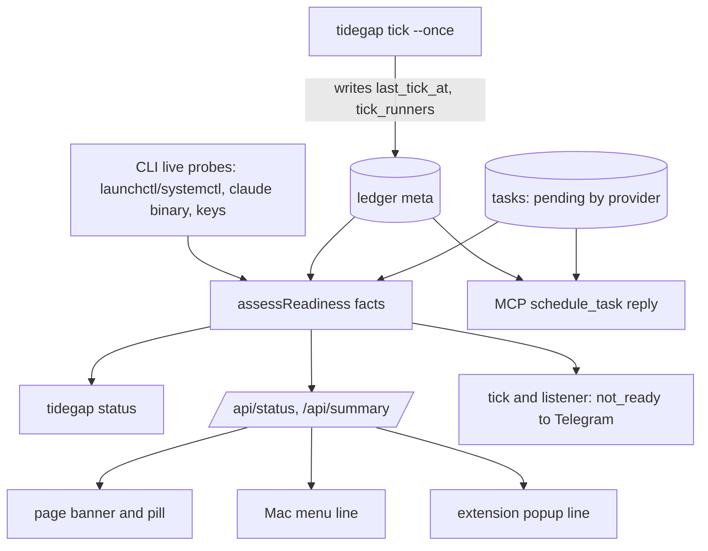
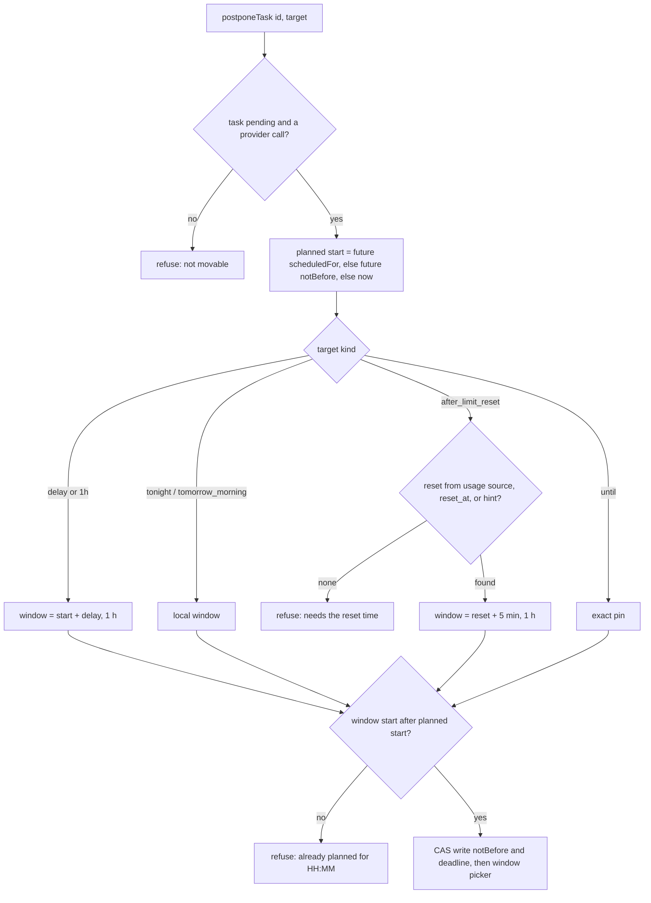
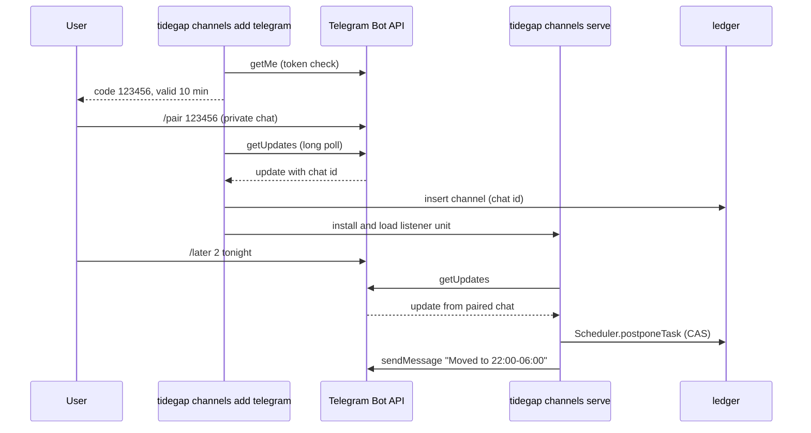
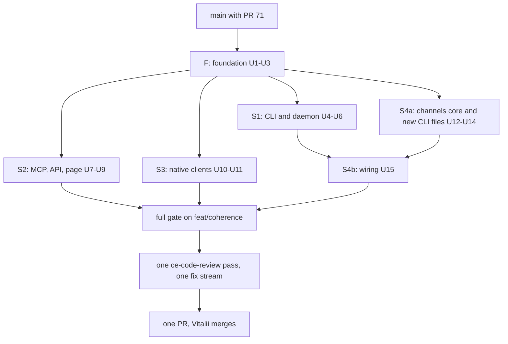

# Coherence Batch (Readiness, Later, Client Actions, Telegram) - Plan

## Goal Capsule

- **Objective:** A user who queues a task through an agent can tell on every surface whether it will run, can push it later (including "after my limit resets") or cancel or run it from the page, the Mac menu, the extension popup and Telegram, and gets a Telegram message when it finishes. No surface except an agent creates tasks.
- **Means:** one core readiness assessment fed by host probes and a ticker-written runner snapshot (KTD1, KTD2); one core `postponeTask` with presets that never move a run earlier (KTD4, KTD5); client task actions promoted into the client contract (KTD8); a core channel registry with a Telegram bot served by a separate always-on listener (KTD10, KTD11).
- **Authority:** R-IDs win on behavior, KTDs on mechanism. Binding: `docs/solutions/logic-errors/compare-and-set-task-transitions.md`, `docs/solutions/best-practices/shared-sqlite-ledger-migrations.md`, `docs/solutions/tooling-decisions/tool-surface-shared-descriptions.md`, `docs/solutions/best-practices/loopback-web-ui-hardening.md`, `docs/solutions/logic-errors/time-of-day-bugs-and-fake-time-sweeps.md`.
- **Execution profile:** one integration branch `feat/coherence`, based on `main` after PR #71 (merged 2026-10-17, `afafaa2`). Foundation lands first, then four parallel streams, then one sequential wiring stream, then one review pass and one PR. See Phased Delivery.
- **Stop conditions:**
  - `packages/cli/src/claude-code.ts` (`findClaudeBinary`) or the PR #71 `buildAdapters` shape in `packages/cli/src/commands/tick.ts` is missing on the stream's base: stop and report. U1, U2 and U4 build on them.
  - The usage-limits plan lands with a reset source that cannot satisfy `LimitResetSource` (KTD5): stop S2 work on "after limit reset" and report.
  - Telegram returns a `getUpdates` shape that differs from the fixtures in U12: stop and report before shipping S4.
- **Who finishes:** stream agents merge into `feat/coherence`. The orchestrator opens one PR after review. Vitalii merges.

---

## Product Contract

### Summary

Add a readiness check that every surface shows, a single "Later" verb with presets, per-task actions in the Mac menu and the extension popup with quick add removed, and a Telegram channel with notifications and five commands. Fix `tidegap install` so that a plain `tidegap install` loads a working daemon, and add `tidegap status`.

### Problem Frame

The product critique of 0.19.0 (`handoff/product-critique-2026-10-17.md`, gaps G2 to G5 and section 4) found that a new user queues a task and nothing runs, and no surface says so. The page shows a green "Dispatcher running" while the log says "nothing to dispatch". QUICKSTART names `tidegap status`, which does not exist, and `tidegap install` without a flag exits 1. The only postpone path, `queue reschedule --by`, sets a new deadline from now and can make a task run sooner. The Mac menu and the extension can only look and quick-add, which breaks the owner rule that only agents create tasks. Notifications are an OS toast only.

PR #71 makes tasks run through the Claude Code subscription when no API key is set, so "a runner exists" is now a real, checkable fact for most users. This batch makes the rest of the story coherent around it. Running a task inside its originating session (G1) is a separate batch.

### Requirements

**Readiness (G2, G3)**

- R1. One readiness result answers "will queued tasks run?" from two facts: a ticker runs (a ticker ran recently, or a tick daemon is installed and loaded), and each pending task's provider has a runner (the `claude` binary or the provider's key). Any ticker counts: the daemon, the page's dispatcher, `tidegap tick --daemon` or OpenClaw.
- R2. Readiness reports a problem only on evidence. A fact nobody can observe from the current process is "unknown" and raises no warning.
- R3. Every not-ready result carries one plain sentence and one fix command, for example "Tasks will not run: no tick daemon. Run `tidegap install`."
- R4. `tidegap status` prints the readiness result with each fact on its own line and exits 0 when ready, 1 when not. It works on a machine with no `~/.tidegap` and no ledger.
- R5. `GET /api/status` and `GET /api/summary` carry the readiness result.
- R6. The MCP `schedule_task` reply replaces the daemon boilerplate with the readiness sentence when not ready, and with one short "runs at <time>" line when ready.
- R7. The page shows an amber banner with the readiness sentence when not ready, and the dispatcher pill is never green while readiness is not ready.
- R8. The Mac menu and the extension popup show the readiness sentence as one line when not ready.

**Install (G3)**

- R9. `tidegap install` with no flag picks `--laptop` on a macOS machine with an internal battery and `--server` otherwise, and prints which mode it picked and why.
- R10. `tidegap install` loads the agent it wrote (`launchctl bootstrap` on macOS, `systemctl --user enable --now` on Linux), replacing an already-loaded copy unless a task is running, and ends by printing `tidegap status` output. `--no-load` writes files only.
- R11. QUICKSTART and README describe the install, `tidegap status` and "Later" flows as they now work.

**Later (G4, limit reset part 1)**

- R12. "Later" moves a pending task so it never runs earlier than its current planned start. A target at or before the planned start is refused with a message that names the planned time.
- R13. Presets: one hour later (after the planned start), tonight, tomorrow morning, after limit reset, and a picked time. Each resolves in the machine's local time zone. Every surface uses the identifiers and tokens in KTD15.
- R14. "After limit reset" uses a reset time the caller gives, else a reset time from the usage module when one is plugged in, else a still-future reset time a user gave before. With none of these it is refused with "needs the reset time".
- R15. The CLI offers `tidegap queue later <id> --until <+2h|tonight|tomorrow|tomorrow 9:00|HH:MM|iso|after-limit-reset> [--reset-at <HH:MM|iso>]` (tokens per KTD15). `queue reschedule --by` becomes an alias of `later --until +<dur>` with a one-line notice.
- R16. MCP has a `postpone_task(task_id, until | preset, reset_at?)` tool, and `schedule_task` accepts `not_before`.
- R17. The UI API has `POST /api/tasks/<id>/postpone`, and every task summary carries the available Later options with their resolved times.
- R18. The page's task menu offers the Later presets with their times, plus "Pick a time…" that opens the existing reschedule dialog.

**Client actions (G5)**

- R19. Mac menu rows and extension popup rows offer Later (presets), Cancel and Run now, each enabled per the task's allowed actions.
- R20. Quick add is removed from the Mac app, the extension popup and Safari. The page keeps no task-creation form.
- R21. A client token gets 403 on `POST /api/tasks` and on `POST /api/tasks/<id>/reply`, the two routes that create a task. Both stay for the page token; `POST /api/tasks` is documented as agent-facing.
- R22. `GET /api/tasks`, `POST /api/tasks/<id>/postpone`, `/cancel` and `/run-now` become part of the documented client contract. The rest of the client-token contract is unchanged.

**Telegram channel v1 (critique section 4)**

- R23. Core holds a channel registry. The OS toast becomes channel `os` and keeps today's behavior and its config switch.
- R24. `tidegap channels add telegram [--no-load]` checks `TELEGRAM_BOT_TOKEN` from `~/.config/tidegap/env`, shows a one-time 6-digit code valid 10 minutes, and pairs the private chat that sends `/pair <code>`. Five wrong codes end the pairing. `--no-load` skips loading the listener unit.
- R25. The bot accepts commands and button presses only from a chat id that is paired at the moment the update arrives. Updates from any other chat get no reply.
- R26. The bot sends: task done (title, time, the first 600 characters of the result unless the task redacts, and a Result button), task failed, a clean window starting, and "tasks will not run" when readiness turns not ready. Each event is sent once per occurrence; a not-ready problem that clears and returns is sent again.
- R27. Commands: `/queue` (next 10, numbered, each with Later, Run now and Cancel buttons), `/later <n|id> <preset>`, `/cancel <n|id>`, `/run <n|id>`, `/result <n|id>`, plus `/pair` and `/help`. Writes go through the same `Scheduler` methods as the page. `/result` and the Result button send no result text for a task with `redact_in_receipt`.
- R28. Commands reach the bot within one long-poll cycle, independent of the 300 s tick interval.
- R29. `tidegap channels list` and `tidegap channels remove <id>` show and revoke a channel; a removed chat loses access on its next update.

**Python parity (foundation)**

- R30. The Python ticker never dispatches a row whose stored `not_before` is in the future.

### Key Decisions

- **"Later" refuses rather than silently keeps a plan when the target is earlier.** A refusal tells the user why the button did nothing; clients avoid it by showing only available presets. Governs R12, R17.
- **`+1h` counts from the planned start, not from now.** "One hour later" on a task planned for 23:00 means midnight, never 22:00. Governs R13.
- **Delay presets mean "not before X"; day presets mean "in that window".** One hour later, a picked time and after limit reset keep a later existing deadline; tonight and tomorrow morning run inside their window even when the old deadline was later. Governs R13.
- **`POST /api/tasks` and `/reply` stay, behind the page token.** No agent uses HTTP today, but tests and scripts do; client tokens lose both. Governs R21.
- **Telegram sends model output to Telegram's servers.** The preview is on by default because the user pairs the bot on purpose; a task with `redact_in_receipt` gets no preview. Governs R26.
- **The page Reply box stays.** Whether Reply counts as "creating a task" under rule 1 is decided with G1 (critique G16). Governs R20.

### Scope Boundaries

- Running a task in its originating session (G1, G14). Separate batch.
- Limit-error requeue (G6, critique section 5 option B). The usage-limits plan owns it; this batch only defines the reset-source interface (KTD5).
- Integrations page, `POST /api/channels`, "Send test" button, and `telegram` as a kind in `ui-clients.json`. CLI-only channel management in v1.
- Group chats, several chats, Slack, Discord, webhook channel, `/mute`, receiving new tasks from Telegram.
- The always-on UI server login agent (G8), settings page (G13), vocabulary pass (G12), CLI empty-ledger hint for `queue list` (G10), mock-region banner (G11), signal-aware daemon sleep (G15).
- A notification click that opens the task in the Mac app or the extension.
- Considered and not built: a pid lock for `tidegap channels serve`. Telegram already answers a second concurrent `getUpdates` with 409, which the listener logs and backs off on. Build it if users report duplicate replies.
- Considered and not built: sending a long `/result` as a `.md` document. v1 splits at 4096 characters into at most 4 messages and then points to `tidegap queue show <id>`. Build it if results routinely exceed 16 KB.
- Considered and not built: a live `launchctl` probe inside the MCP server. The ledger evidence (KTD2) gives the same answer without spawning from an agent's tool call.

### Deferred to Follow-Up Work

- OpenClaw-side readiness: the OpenClaw loop does not write the runner snapshot, so readiness there stays "unknown" for runners (R2). Add the snapshot write to `packages/openclaw-plugin/src/dispatch.ts` later.
- Moving the usage module's reset time into the `after limit reset` preset (usage-limits plan).

---

## Planning Contract

### Key Technical Decisions

- KTD1. **Readiness is a pure core function over gathered facts.** `packages/core-ts/src/readiness.ts` exports the `Readiness` type and `assessReadiness(facts)`, where facts are `{daemon, lastTickAt, tickInterval, runners, pendingByProvider, now}`. It returns `{ready, problems[], line}`. Each problem has `code`, `message`, `fix`, and for `no_runner` the provider and task count. Problems sort in the order `no_daemon`, `daemon_not_loaded`, `daemon_stale`, `no_runner`; `line` is the first problem's sentence plus fix. A pending task's provider has a runner when the runner fact lists that provider (PR #71 registers the `claude-code` adapter under `anthropic` too when no Anthropic key is set). Hosts gather the facts. Core stays free of `child_process` (`packages/core-ts/src/notify.ts` rule, `packages/core-ts/test/environment-purity.test.ts`).
- KTD2. **Two evidence sources, one function; the ticker's snapshot wins.** Every CLI tick writes ledger meta `last_tick_at` and `tick_runners` (`{at, providers: [...], claude_lookup: "done" | "skipped"}`, the providers its `buildAdapters` registered), including on the no-adapter path (U4). The snapshot is the runner fact on every host whenever it is fresher than two tick intervals, because it reflects the daemon's own environment. The CLI host adds live probes: `daemonStatus` plus `launchctl print gui/<uid>/com.tidegap.tick` or `systemctl --user is-active tidegap-tick.timer` for "loaded"; and, only when no fresh snapshot exists, `findClaudeBinary` and the env-file keys. `claude_lookup: "skipped"` (the macOS login-shell lookup did not run because nothing needed it) makes `claude-code` and key-less `anthropic` unknown, not missing. The MCP server, which cannot import the CLI, reads only the ledger. Meta follows `shared-sqlite-ledger-migrations.md` ("ledger-wide facts go in meta").
- KTD3. **The ticker fact.** A `last_tick_at` within two intervals (300 s when a daemon is installed, else 60 s, as in `DispatcherControl` in `packages/cli/src/ui/dispatcher.ts`) satisfies it on every host. Without a recent tick:
  - daemon loaded and never ticked → no problem ("first tick within 5 minutes"), so a fresh install does not end with a warning;
  - daemon loaded or installed with an old tick → `daemon_stale` (the message says the Mac may have slept);
  - daemon installed, not loaded → `daemon_not_loaded`;
  - daemon not installed, or unknown (ledger-only hosts) → `no_daemon`.
- KTD4. **`Scheduler.postponeTask(id, target)` reuses `rescheduleTask` internals and adds the never-earlier guard.** Planned start = `scheduledFor` if in the future, else a future `notBefore`, else now. Targets:
  - `{delayMs}` and preset `1h`: window starts at planned start + delay, one hour long.
  - `tonight`: between 06:00 and 24:00, from 22:00 local (or now, if later) to 06:00 local next morning; between 00:00 and 06:00, from now to 06:00 the same morning. Unavailable when less than one hour of the window remains.
  - `tomorrow_morning`: 09:00 to 12:00 local tomorrow.
  - `after_limit_reset`: reset + 5 min, one hour long.
  - `{until}`: an exact pin, through the existing `{at}` path.

  A window target writes `notBefore` = window start, then the window picker chooses the hour, like the existing day shape. The deadline follows the Key Decision on preset meaning: delay presets, `after_limit_reset` and pins write `max(old deadline, window end)`; `tonight` and `tomorrow_morning` write the window end. The write is a compare-and-set on pending statuses (`compare-and-set-task-transitions.md`). A `quota_reset` task becomes `absolute`, as in `rescheduleTask`. Only the selected occurrence of a series moves.
- KTD5. **Limit reset is a pluggable source.** `SchedulerOptions.limitReset?: LimitResetSource`, a function `(task, now) => {at, source} | null`. Precedence (R14): a caller-given `reset_at`, then the plugged-in source, then ledger meta `limit_reset_hint` (`{at, provider}`), used only while `at` is in the future. A caller-given `reset_at` is stored as the new hint. The usage-limits plan supplies the plugged-in source. The usage branch has no plan pushed as of 2026-10-17 15:33, so this interface is the contract it plugs into.
- KTD6. **`postponeOptions(record, now, limitReset)` lists presets for every surface.** It returns `[{preset, label, not_before, available, reason?}]` in local time. The API adds it to task summaries as `later_options`, the page and clients render it, and Telegram builds its "Later" buttons from it. One list keeps labels and availability identical everywhere. `taskActions` gains `later` (same rule as `reschedule`).
- KTD7. **Python refuses, it does not reach parity.** `packages/core-py/src/tidegap/scheduler.py` skips rows whose stored `not_before` is after now in both the due sweep and `_collect_batch_submit_candidates` (matching TS `isBatchCandidate`), and logs one warning per tick. The docstring states the remaining TS-only behaviors. Parity is size M and nothing in this batch needs it.
- KTD8. **The client contract grows by documentation, not new auth.** Client tokens already reach task actions (`docs/spec/ui-client-api.md`, "Other routes"). This batch moves `GET /api/tasks`, the three action routes and `later_options` into the documented contract, and adds one rule: a client token on `POST /api/tasks` or `POST /api/tasks/<id>/reply` gets 403. The scope check lives with the existing `/api/clients*` check.
- KTD9. **`tidegap install` default mode by battery; reload only when safe.** macOS: `pmset -g batt` lists `InternalBattery` → laptop. Everything else → server. Loading:
  - agent loaded and the written plist is byte-identical → no reload;
  - agent loaded, plist changed, and the ledger has a `running` row → no reload; print the manual reload command, because `bootout` would SIGTERM an in-flight `tick --once`;
  - otherwise `launchctl bootout` (ignore "not loaded") then `launchctl bootstrap gui/<uid> <plist>`; Linux uses `systemctl --user daemon-reload` and `enable --now`.

  Commands run through an injected exec, so tests never touch the real launchd domain. The laptop sudoers step stays a printed instruction, because it needs sudo.
- KTD10. **Channel registry in core, side effects in the host.** `packages/core-ts/src/channels/` holds the types (`Channel {id, kind: "os" | "telegram", enabled, events, config}`, `EventKind = task_done | task_failed | clean_window | not_ready`), `planNotifications(events, channels)` (pure: returns send jobs), the Telegram Bot API client (takes token, base URL and `fetch` as arguments), command parsing and message formatting. One ledger table `channels` follows `shared-sqlite-ledger-migrations.md`; Python never reads it. Buttons carry the task id in `callback_data` with one-letter action and preset codes (KTD15), which keeps the longest callback, a series id `t-<uuid>~<n>`, under Telegram's 64 bytes, so no message-to-task table is needed. Messages are plain text with no `parse_mode`, so titles and results cannot inject markup. Client errors and log lines name the Bot API method and HTTP status only, never the request URL, which holds the token. OpenClaw's `postTelegram` (`packages/openclaw-plugin/src/delivery.ts`) moves onto the core client with its message format unchanged.
- KTD11. **A separate listener, not the tick, receives commands.** The daemon is a 300 s `StartInterval` job running `tidegap tick --once`, which cannot meet R28. `tidegap channels serve` runs a long-poll loop (`getUpdates`, timeout 50 s) under its own KeepAlive unit (`com.tidegap.channels` / `tidegap-channels.service`). Rules:
  - It reads the enabled telegram channel rows from the ledger for every update, so `channels remove` takes effect on the next update (R29).
  - Task events (done, failed, clean window, `no_runner`) stay in the tick, which already knows them. The listener sends `not_ready` for the ticker codes (`no_daemon`, `daemon_not_loaded`, `daemon_stale`) from a ledger-only assessment once per poll cycle, because a stopped tick cannot report itself.
  - It persists the update offset in meta `telegram_update_offset`, so a restart never replays a command.
  - On 401 it sleeps 10 minutes; on 409 or a network error it backs off 5 s to 60 s.
- KTD12. **Event dedupe through meta.** Clean windows use `notified:clean_window:<start>`. Not-ready uses one key `notified:not_ready` holding the last-sent code set: send when the current non-empty set differs from it, clear it when an assessment is ready. Task events are sent only for tasks the tick itself finished in that run.
- KTD13. **Fake Telegram server for tests; loopback-only override.** Tests run a local HTTP server that implements `getMe`, `getUpdates`, `sendMessage`, `answerCallbackQuery` and `editMessageReplyMarkup`. Hosts accept `TIDEGAP_TELEGRAM_API_BASE` only when it is an `http://127.0.0.1` or `http://localhost` URL, so a misconfigured env cannot send the token elsewhere.
- KTD14. **Pairing runs in the foreground command.** `channels add telegram` long-polls itself for up to 10 minutes. Steps:
  1. `getMe` checks the token; `getWebhookInfo` with a webhook set refuses ("this bot is used elsewhere; create a dedicated bot with @BotFather").
  2. Unload a loaded listener unit, so only one `getUpdates` consumer exists.
  3. Show the code: `crypto.randomInt` 6 digits, held in memory only, accepted only from `chat.type === "private"`. A 409 stops with the same "dedicated bot" message.
  4. Write the channel row and set `telegram_update_offset` past the `/pair` update.
  5. Install and load the listener unit through an injected `installListener` hook, unless `--no-load`. S4a ships the hook as a no-op; U15 wires it to the KTD9 loader.

  `channels remove` of the last telegram channel unloads the listener unit through the same hook.
- KTD15. **One preset vocabulary.** Every surface maps to the same core ids.

  | Core id | Label | CLI `--until` | Telegram `/later` | MCP / API `preset` | Callback code |
  |---|---|---|---|---|---|
  | `1h` | One hour later | `+1h` (any `+<dur>`) | `1h` | `1h` | `h` |
  | `tonight` | Tonight | `tonight` | `tonight` | `tonight` | `n` |
  | `tomorrow_morning` | Tomorrow morning | `tomorrow` | `tomorrow` | `tomorrow_morning` | `m` |
  | `after_limit_reset` | After limit reset | `after-limit-reset` (+ `--reset-at`) | `reset [HH:MM]` | `after_limit_reset` (+ `reset_at`) | `r` |
  | pin | Pick a time | `HH:MM`, `tomorrow 9:00`, ISO | `HH:MM` | `until` | none |

  Telegram grammar: `/later <n|id> <1h|tonight|tomorrow|reset [HH:MM]|HH:MM>`; `/help` and the "needs the reset time" reply quote it. Callback data: `<action>:<task_id>[:<preset code>]` with actions `l` (later), `c` (cancel), `x` (run now), `r` (result).

### High-Level Technical Design

Readiness evidence flow:

The MCP path uses only ledger facts (KTD2). The CLI and UI server add live probes.

Later resolution:

Telegram pairing and a command:

New and changed surface:

| Surface | Addition | Stream |
|---|---|---|
| CLI | `tidegap status`; `install` default mode, load, `--no-load`; `queue later`; `reschedule --by` alias | S1 |
| CLI | `tidegap channels add telegram`, `list`, `remove`, `serve [--once]` | S4 |
| MCP | `postpone_task`; `schedule_task.not_before`; readiness line in the reply | S2 |
| UI API | `readiness` in `/api/status` and `/api/summary`; `POST /api/tasks/<id>/postpone`; `later_options` on task summaries; 403 for client tokens on `POST /api/tasks` | S2 |
| Page | readiness banner and amber pill; Later presets in the task menu | S2 |
| Mac app, extension, Safari | readiness line; row actions Later / Cancel / Run now; quick add removed | S3 |
| Ledger | meta keys `tick_runners`, `limit_reset_hint`, `telegram_update_offset`, `notified:*`; table `channels` | F, S1, S4 |

### Stream File Ownership

No file appears in two streams that run at the same time. `CHANGELOG.md` is the only shared file; each stream adds lines under Unreleased and the integration merge keeps both sides.

| Stream | Owns (create or modify) |
|---|---|
| F | `packages/core-ts/src/readiness.ts` (new), `packages/core-ts/src/postpone.ts` (new), `packages/core-ts/src/scheduler.ts`, `packages/core-ts/src/history.ts`, `packages/core-ts/src/types.ts`, `packages/core-ts/src/index.ts`, `packages/cli/src/readiness.ts` (new), `packages/core-py/src/tidegap/scheduler.py`, `docs/spec/ui-client-api.md`, tests `packages/core-ts/test/readiness.test.ts`, `packages/core-ts/test/postpone.test.ts`, `packages/core-ts/test/task-actions.test.ts`, `packages/cli/test/readiness.test.ts`, `packages/core-py/tests/test_tick.py` |
| S1 | `packages/cli/src/index.ts`, `packages/cli/src/commands/status.ts` (new), `packages/cli/src/commands/install.ts`, `packages/cli/src/platform/index.ts`, `packages/cli/src/platform/macos.ts`, `packages/cli/src/platform/linux.ts`, `packages/cli/src/commands/queue.ts`, `packages/cli/src/commands/tick.ts`, `QUICKSTART.md`, `README.md`, `packages/cli/README.md`, tests `packages/cli/test/status.test.ts` (new), `install.test.ts`, `platform-macos.test.ts`, `platform-linux.test.ts`, `queue.test.ts`, `tick.test.ts` |
| S2 | `packages/core-ts/src/tool-surface.ts`, `packages/core-ts/test/tool-surface.test.ts` and its snapshot, `packages/mcp-server/src/server.ts`, `packages/mcp-server/README.md`, `packages/mcp-server/test/*`, `packages/cli/src/ui/api.ts`, `packages/cli/src/ui/summary.ts`, `packages/cli/src/ui/server.ts`, `packages/cli/src/commands/ui.ts`, `packages/cli/ui/*`, tests `packages/cli/test/ui-actions.test.ts`, `ui-server.test.ts`, `ui-summary.test.ts`, `ui-clients.test.ts`; after F, also `docs/spec/ui-client-api.md` (corrections only) |
| S3 | `apps/macos/**`, `apps/extension/**`, `apps/web/src/app/docs/page.tsx` |
| S4a | `packages/core-ts/src/channels/**` (new), `packages/core-ts/src/storage/sqlite.ts`, `packages/core-ts/src/index.ts` (after F), `packages/core-ts/test/channels-*.test.ts` (new), `packages/core-ts/test/fixtures/fake-telegram.ts` (new), `packages/core-ts/test/storage.test.ts`, `packages/openclaw-plugin/src/delivery.ts` and its tests, `packages/cli/src/channels/**` (new), `packages/cli/src/commands/channels.ts` (new), `packages/cli/src/env.ts`, `packages/cli/test/channels-*.test.ts` (new), `packages/cli/test/env.test.ts` |
| S4b | after S1 and S4a merge: `packages/cli/src/index.ts`, `packages/cli/src/commands/tick.ts`, `packages/cli/src/commands/channels.ts`, `packages/cli/src/platform/macos.ts`, `packages/cli/src/platform/linux.ts`, `packages/cli/src/commands/env-file.ts`, `README.md`, `packages/cli/README.md`, tests `packages/cli/test/tick-channels.test.ts` (new), `platform-macos.test.ts`, `platform-linux.test.ts` |

Overlap proof: S1, S2, S3 and S4a are pairwise disjoint (S2's only core file is `tool-surface.ts`; S4a's core files are `channels/**`, `storage/sqlite.ts` and `index.ts`; S1 touches no core file; S3 touches no package file). S4b shares files with S1 and S4a and therefore starts only after both are merged. F shares `index.ts` with S4a and `ui-client-api.md` with S2 and finishes before either starts. Test helpers `packages/*/test/hermetic-home.ts` are read-only for every stream.

Feature to stream map: G2 = F (assessment), S1 (CLI, tick snapshot), S2 (MCP, API, page), S3 (clients). G3 = S1. G4 = F (core), S1 (CLI), S2 (MCP, API, page), S3 (clients). G5 = F (contract doc), S2 (403 rule), S3 (clients). Telegram = S4a, S4b. The brief put the MCP readiness line and the CLI `queue later` in other streams; they moved so that every MCP file belongs to S2 and every CLI command file belongs to S1.

### Phased Delivery

| Stream | Units | Size | Runs |
|---|---|---|---|
| F | U1-U3 | M | alone, first |
| S1 | U4-U6 | M | batch 1 |
| S2 | U7-U9 | M to L | batch 1 |
| S3 | U10-U11 | M | batch 1 |
| S4a | U12-U14 | M to L | batch 1 |
| S4b | U15 | S to M | after S1 and S4a |
| S3 integration QA | Chrome smoke, client-token curl | S | after S2 and S3 merge |

Batch 1 is four agents, the concurrency cap. S3 verifies only unit tests in its worktree, because its smoke and API checks need S2's server code; those run once on `feat/coherence` after S2 and S3 merge. Browser QA jobs (S2 page, S3 Chrome smoke) run one at a time.

### Assumptions

- PR #71 merges unchanged in its exported names (`findClaudeBinary`, `buildAdapters`, `missingProviderKeysForPending`).
- The repo has no quiet one-line gate script; stream agents run the package test files they changed with a line reporter, and the full `pnpm preflight` runs once on the integration branch.
- Local time zone presets use the server machine's zone; the server and every client run on the same Mac (loopback).
- "Tonight" is 22:00 to 06:00 and "tomorrow morning" is 09:00 to 12:00; these are constants, not settings.
- CE documents go to `docs/plans/` in this repo, as for every earlier tidegap plan.

---

## Implementation Units

| U-ID | Title | Key files | Depends on |
|---|---|---|---|
| U1 | Core readiness and postpone | `core-ts/src/readiness.ts`, `postpone.ts`, `scheduler.ts`, `history.ts`, `types.ts` | PR #71 |
| U2 | CLI readiness gatherer | `cli/src/readiness.ts` | U1 |
| U3 | Python not_before guard and client contract doc | `core-py/.../scheduler.py`, `docs/spec/ui-client-api.md` | U1 |
| U4 | `tidegap status` and tick runner snapshot | `cli/src/commands/status.ts`, `tick.ts`, `index.ts` | U2 |
| U5 | `tidegap install` default mode and load | `install.ts`, `platform/*` | U4 |
| U6 | CLI `queue later` and docs | `queue.ts`, `index.ts`, `QUICKSTART.md`, `README.md` | U1 |
| U7 | MCP postpone and readiness reply | `mcp-server/src/server.ts`, `tool-surface.ts` | U1 |
| U8 | UI API readiness, postpone, client scope | `cli/src/ui/api.ts`, `summary.ts`, `server.ts`, `commands/ui.ts` | U2, U3 |
| U9 | Page banner and Later menu | `packages/cli/ui/*` | U8 |
| U10 | Mac app actions, readiness line, quick add removed | `apps/macos/**` | U3 |
| U11 | Extension and Safari actions, readiness line, quick add removed | `apps/extension/**`, `apps/web/.../docs/page.tsx` | U3 |
| U12 | Channel registry, ledger tables, Telegram client | `core-ts/src/channels/**`, `storage/sqlite.ts` | U1 |
| U13 | OpenClaw on the core Telegram client | `openclaw-plugin/src/delivery.ts` | U12 |
| U14 | Pairing, listener and commands (new CLI files) | `cli/src/channels/**`, `commands/channels.ts`, `env.ts` | U12 |
| U15 | Wiring: tick events, os channel, CLI registration, listener unit, docs | `index.ts`, `tick.ts`, `commands/channels.ts`, `platform/*`, `README.md` | U5, U6, U14 |

### U1. Core readiness and postpone

- **Goal:** pure readiness assessment and the `postponeTask` scheduler method with presets and options.
- **Requirements:** R1, R2, R3, R12, R13, R14
- **Dependencies:** PR #71 merged.
- **Files:** `packages/core-ts/src/readiness.ts` (new), `packages/core-ts/src/postpone.ts` (new), `packages/core-ts/src/scheduler.ts`, `packages/core-ts/src/history.ts`, `packages/core-ts/src/types.ts`, `packages/core-ts/src/index.ts`, `packages/core-ts/test/readiness.test.ts` (new), `packages/core-ts/test/postpone.test.ts` (new), `packages/core-ts/test/task-actions.test.ts`
- **Approach:**
  1. `readiness.ts`: `Readiness`, `ReadinessFacts`, `assessReadiness` (KTD1, KTD3), meta key constant `TICK_RUNNERS_META_KEY` with read and write helpers, and `pendingProvidersFromStore(store)`.
  2. `postpone.ts`: `PostponeTarget`, `PostponePreset`, `LimitResetSource`, `resolvePostpone` and `postponeOptions` (KTD4 to KTD6). Pure apart from the meta hint read and write, which take the store.
  3. `scheduler.ts`: `postponeTask(taskId, target)` built on the `rescheduleTask` window and pin paths; `SchedulerOptions.limitReset`.
  4. `history.ts`: `taskActions` gains `later`.
- **Execution note:** write `postpone.test.ts` first, under fake time and `TZ=Europe/Kyiv`.
- **Patterns to follow:** `rescheduleTask` and `rescheduleShape` in `packages/core-ts/src/scheduler.ts`; fake-time sweep in `docs/solutions/logic-errors/time-of-day-bugs-and-fake-time-sweeps.md`.
- **Test scenarios:**
  - Readiness: never ticked, daemon not installed → `no_daemon`, line "Tasks will not run: no tick daemon. Run `tidegap install`."
  - Readiness: never ticked, daemon unknown (ledger-only host) → `no_daemon`.
  - Readiness: daemon loaded, never ticked → ready, note "first tick within 5 minutes".
  - Readiness: daemon not installed, tick 30 s ago (page dispatcher) → ready; tick 3 minutes ago → `no_daemon`.
  - Readiness: installed, not loaded, no recent tick → `daemon_not_loaded` with fix `tidegap install`.
  - Readiness: installed, last tick 11 minutes ago with a 300 s interval → `daemon_stale`; 9 minutes → no problem.
  - Readiness: `no_daemon` and `no_runner` together → `line` names `no_daemon` first.
  - Readiness: snapshot lists `claude-code` and `anthropic`, 2 pending `openai` tasks → one `no_runner` problem for openai with count 2.
  - Readiness: recent tick and no snapshot → runners unknown, `ready: true` (R2).
  - Readiness: no pending tasks and no runner → ready (nothing to run).
  - Readiness: snapshot with `claude_lookup: "skipped"` and a pending anthropic task, no key → no `no_runner` (unknown).
  - Postpone `+1h` on a task whose deadline is Friday keeps the Friday deadline; `tonight` on the same task sets the deadline to 06:00.
  - Postpone `1h` on a task scheduled 23:00 at 21:00 → window 00:00 to 01:00.
  - Postpone `tonight` at 21:30 on a task scheduled 21:45 → `notBefore` 22:00, deadline 06:00.
  - Postpone `tonight` on a task scheduled for 23:00 → refused, message names 23:00.
  - Postpone `tonight` at 05:30 → unavailable (less than one hour left).
  - Postpone `tomorrow_morning` across the DST change on 2026-10-25 in Europe/Kyiv → 09:00 local both days.
  - Postpone `after_limit_reset` with no source, no `reset_at`, no hint → refused "needs the reset time".
  - Postpone `after_limit_reset` with `reset_at` 14:05 → window 14:10 to 15:10, hint stored; a second task with no `reset_at` uses the hint.
  - Hint in the past is ignored.
  - A `LimitResetSource` that returns 13:00 wins over the stored hint.
  - Postpone `{until}` on a `quota_reset` task → `absolute`, exact pin.
  - Postpone on a `running` task → refused; CAS miss (status changed after read) → refused, row untouched.
  - Postpone on a series occurrence leaves the successor untouched.
  - `postponeOptions` marks `after_limit_reset` unavailable with reason when no reset is known, and lists resolved local times otherwise.
  - `taskActions(...).later` matches `reschedule` for each status.
- **Verification:** core tests pass; `pnpm typecheck` passes; no `child_process` import in core.

### U2. CLI readiness gatherer

- **Goal:** one CLI function that gathers live facts and returns `Readiness`, used by `tidegap status`, the UI server and the tick.
- **Requirements:** R1, R2
- **Dependencies:** U1
- **Files:** `packages/cli/src/readiness.ts` (new), `packages/cli/test/readiness.test.ts` (new)
- **Approach:** combine `daemonStatus` (`packages/cli/src/platform/index.ts`, imported, not edited), a loaded probe through an injected exec, and ledger facts. Runners come from a fresh `tick_runners` snapshot; only without one, from `findClaudeBinary` (PR #71 lookup injection) and the env-file keys (KTD2). The result names which source the runner fact came from, and `tidegap status` prints it. Cache the exec probe 30 s per process for the UI server. A missing ledger file counts as "no pending tasks, never ticked" and never opens SQLite.
- **Patterns to follow:** PR #71 `ClaudeLookup` injection and `underTest()` guard in `packages/cli/src/commands/tick.ts`.
- **Test scenarios:**
  - macOS, plist present, `launchctl print` exit 0 → daemon `loaded`.
  - macOS, plist present, `launchctl print` exit 113 → `installed_not_loaded`.
  - Windows → daemon `unknown`, no daemon problem.
  - No ledger file → no SQLite error, `no_daemon` only.
  - No snapshot, fake `claude` binary found, no keys, pending anthropic task → no `no_runner`.
  - Fresh snapshot without openai, `OPENAI_API_KEY` exported in the process env, pending openai task → `no_runner` for openai (the snapshot wins).
  - No binary, no keys, pending anthropic task → `no_runner` for anthropic.
  - Two calls within 30 s spawn the probe once.
- **Verification:** tests pass with a hermetic home; no real `launchctl` call in tests.

### U3. Python not_before guard and client contract doc

- **Goal:** the Python ticker cannot run a postponed task early; the client contract documents every new field and route before S2 and S3 code against it.
- **Requirements:** R30, R5, R17, R21, R22
- **Dependencies:** U1
- **Files:** `packages/core-py/src/tidegap/scheduler.py`, `packages/core-py/tests/test_tick.py`, `docs/spec/ui-client-api.md`
- **Approach:**
  1. Python `tick` reads `not_before` and skips future rows in the due sweep and in `_collect_batch_submit_candidates`, with one warning per tick (KTD7). Update the docstring.
  2. Spec: `readiness` object in `/api/summary` and `/api/status`; `GET /api/tasks` (query, item shape with `actions` and `later_options`); `POST /api/tasks/<id>/postpone` body (`preset` or `until` or `delay_minutes`, optional `reset_at`) and answers (200 summary, 409 refusal text); `/cancel` and `/run-now`; `POST /api/tasks` moved to an "Agent-facing" section with the client-token 403; `/reply` listed as page-only with the same 403.
- **Test scenarios:**
  - Python tick with a due row whose `not_before` is one hour ahead → not dispatched, row still `scheduled`.
  - Python tick with a batch-eligible row (deadline 30 h ahead) whose `not_before` is in the future → not submitted to the Batch API.
  - Python tick with `not_before` in the past → dispatched as before.
- **Verification:** `pnpm lint:py` passes; the spec lists every field S2 and S3 use.

### U4. `tidegap status` and tick runner snapshot

- **Goal:** a status command and the ledger evidence that other hosts read.
- **Requirements:** R1, R4
- **Dependencies:** U2
- **Files:** `packages/cli/src/commands/status.ts` (new), `packages/cli/src/commands/tick.ts`, `packages/cli/src/index.ts`, `packages/cli/test/status.test.ts` (new), `packages/cli/test/tick.test.ts`
- **Approach:** `status` prints one line per fact (daemon, last tick, runners, pending by provider), then the readiness line, and exits 0 or 1 (R4). `--json` prints the `Readiness` object. `runTickOnce` records `last_tick_at` and writes `tick_runners` after `buildAdapters` and before the "no adapters configured" early return, so a no-runner machine reports `no_runner`, not `no_daemon`.
- **Test scenarios:**
  - Clean hermetic home → exit 1, output names `tidegap install`, no stack trace.
  - Seeded ledger with a fresh tick and a runner snapshot → exit 0, "Tasks will run".
  - `--json` output parses and has `ready`, `problems`, `line`.
  - A tick with no adapters writes `last_tick_at` and `tick_runners` with an empty provider list; ledger-only readiness with one pending anthropic task then reports `no_runner`, not `no_daemon`.
  - A tick on an empty queue on macOS where the login-shell lookup was skipped writes `claude_lookup: "skipped"`.
  - A tick with the fake `claude` registers `claude-code` and `anthropic` in the snapshot.
- **Verification:** tests pass; `tidegap status` in an empty temp HOME prints readable lines.

### U5. `tidegap install` default mode and load

- **Goal:** a plain `tidegap install` ends with a loaded daemon and a status report.
- **Requirements:** R9, R10
- **Dependencies:** U4
- **Files:** `packages/cli/src/commands/install.ts`, `packages/cli/src/platform/index.ts`, `packages/cli/src/platform/macos.ts`, `packages/cli/src/platform/linux.ts`, `packages/cli/src/index.ts`, `packages/cli/test/install.test.ts`, `packages/cli/test/platform-macos.test.ts`, `packages/cli/test/platform-linux.test.ts`
- **Approach:** KTD9. Expose `detectInstallMode(exec)` and `loadAgent(unit, exec)` in the platform modules; U15 reuses `loadAgent` for the listener. Remove the "run `launchctl load`" next step from the output and keep the legacy 0.17 unload hint. `--laptop` and `--server` still force a mode.
- **Test scenarios:**
  - No flag, `pmset -g batt` prints `InternalBattery-0` → laptop, notice "picked --laptop: this Mac has a battery".
  - No flag, desktop Mac → server with notice.
  - No flag, Linux → server.
  - Load on macOS runs `bootout` then `bootstrap gui/<uid> <plist>` in that order; `bootout` "not loaded" is ignored.
  - Agent loaded with a byte-identical plist → no `bootout`.
  - Agent loaded, plist changed, a `running` row in the ledger → no `bootout`; output prints the manual reload command.
  - After a successful load with no tick yet, the output does not say "Tasks will not run".
  - `bootstrap` fails → exit 1 with the launchctl error and the manual command.
  - `--no-load` writes the plist and spawns nothing.
  - Linux runs `daemon-reload` then `enable --now tidegap-tick.timer`.
  - Output ends with the status lines from U4.
- **Verification:** tests pass with injected exec; no test touches the real launchd or systemd domain.

### U6. CLI `queue later` and docs

- **Goal:** the CLI postpone verb and documentation that matches the new flows.
- **Requirements:** R11, R15
- **Dependencies:** U1
- **Files:** `packages/cli/src/commands/queue.ts`, `packages/cli/src/index.ts`, `packages/cli/test/queue.test.ts`, `QUICKSTART.md`, `README.md`, `packages/cli/README.md`
- **Approach:** parse `--until` into a `PostponeTarget`: `+2h` and `2h` → delay; `tonight`, `tomorrow` → presets; `tomorrow 9:00` and `HH:MM` → exact local pin (next occurrence of that time); ISO → pin; `after-limit-reset` with `--reset-at`. `reschedule --by` maps to `later --until +<dur>` and prints the alias notice to stderr. QUICKSTART step 3 uses `tidegap install` then `tidegap status`.
- **Test scenarios:**
  - `later <id> --until +2h` on a task scheduled in 30 minutes → not before 2 h 30 min from now.
  - `later <id> --until tonight` on a task already planned for 23:00 → exit 1, message names 23:00.
  - `later <id> --until 9:00` at 10:00 → tomorrow 09:00.
  - `later <id> --until after-limit-reset` without `--reset-at` and no hint → exit 1 "needs the reset time; pass --reset-at".
  - `reschedule <id> --by 2h` on a task due 23:59 never sets an earlier deadline, and prints the alias notice.
  - `--until garbage` → exit 1 listing accepted forms.
- **Verification:** tests pass; `docs-lockstep.test.ts` still passes; QUICKSTART commands exist in `tidegap --help`.

### U7. MCP postpone and readiness reply

- **Goal:** agents can postpone and set `not_before`, and the queue reply says whether the task will run.
- **Requirements:** R6, R16
- **Dependencies:** U1
- **Files:** `packages/core-ts/src/tool-surface.ts`, `packages/core-ts/test/tool-surface.test.ts`, `packages/core-ts/test/__snapshots__/tool-surface.test.ts.snap`, `packages/mcp-server/src/server.ts`, `packages/mcp-server/test/server.task-visibility.test.ts`, `packages/mcp-server/test/tool-surface-derivation.test.ts`, `packages/mcp-server/README.md`
- **Approach:** `postpone_task` and `schedule_task.not_before` are `hosts: ["mcp"]` (`tool-surface-shared-descriptions.md`). `not_before` must be in the future and at or before the deadline, else a clear error. The description of `update_deadline` points to `postpone_task` for "run later". The reply computes readiness from the ledger only (KTD2) and replaces the daemon boilerplate.
- **Test scenarios:**
  - `postpone_task` with `preset: "tonight"` → reply names the new window; ledger row has `not_before` 22:00 local.
  - `postpone_task` refused (earlier target) → tool error text names the planned time.
  - `postpone_task` with `preset: "after_limit_reset"` and `reset_at` → stored hint; second call without `reset_at` succeeds.
  - `schedule_task` with `not_before` after the deadline → error.
  - `schedule_task` on a ledger that never ticked → reply contains "Tasks will not run: no tick daemon. Run `tidegap install`." and no npm boilerplate.
  - `schedule_task` with a fresh tick and a matching runner snapshot → reply has one "runs at" line.
  - Tool-surface snapshot diff shows only the two MCP additions; OpenClaw tool list unchanged.
- **Verification:** MCP tests pass; snapshot reviewed.

### U8. UI API readiness, postpone and client scope

- **Goal:** the server carries readiness and Later options and enforces the client scope on quick add.
- **Requirements:** R5, R17, R21, R22
- **Dependencies:** U2, U3
- **Files:** `packages/cli/src/ui/api.ts`, `packages/cli/src/ui/summary.ts`, `packages/cli/src/ui/server.ts`, `packages/cli/src/commands/ui.ts`, `packages/cli/test/ui-actions.test.ts`, `packages/cli/test/ui-server.test.ts`, `packages/cli/test/ui-summary.test.ts`, `packages/cli/test/ui-clients.test.ts`
- **Approach:** `ApiContext.readiness()` from U2, injected by `commands/ui.ts`. `postpone` route body is strict JSON (`bodyKind` "json") and maps `TaskActionError` to 409 like the other actions. Task list and detail summaries gain `later_options`. The 403 for client tokens on `POST /api/tasks` and `/reply` sits next to the `/api/clients*` scope check (KTD8).
- **Test scenarios:**
  - `GET /api/status` includes `readiness` with `ready`, `line`, `problems`.
  - `GET /api/summary` includes `readiness`; the cursor behavior is unchanged.
  - `POST /api/tasks/<id>/postpone {"preset":"tonight"}` → 200, row moved, `tasks` event emitted.
  - Same route with an earlier target → 409 with the refusal text.
  - Unknown key in the body → 400.
  - `GET /api/tasks` item has `later_options` with `available` flags.
  - Client token on `POST /api/tasks` → 403; page token → 201 as before.
  - Client token on `POST /api/tasks/<id>/reply` → 403; page token → 201 as before.
  - Client token on `/postpone`, `/cancel`, `/run-now` → allowed.
- **Verification:** UI tests pass; the spec from U3 matches the responses (S2 corrects the spec if not).

### U9. Page banner and Later menu

- **Goal:** the page shows readiness and offers Later presets.
- **Requirements:** R7, R18
- **Dependencies:** U8
- **Files:** `packages/cli/ui/app.js`, `packages/cli/ui/dialog.js`, `packages/cli/ui/api.js`, `packages/cli/ui/row.js`, `packages/cli/ui/detail.js`, `packages/cli/ui/app.css`, `packages/cli/test/ui-server.test.ts` (static map, if a file is added)
- **Approach:** the dispatcher pill turns amber with "Running · nothing can run" when the dispatcher runs and readiness is not ready; the banner shows `readiness.line`. The task menu's "Move to…" becomes "Later" with `later_options`; "Pick a time…" opens the existing `rescheduleDialog`. Drag to a day stays. Undo uses the existing toast pattern.
- **Patterns to follow:** `docs/solutions/best-practices/dependency-free-task-ui-patterns.md`.
- **Test scenarios:**
  - Browser QA (orchestrator): readiness not ready → amber banner with the line; pill not green.
  - Browser QA: Later → Tonight on a task → row shows the new time; Undo restores it.
  - Browser QA: an unavailable preset is disabled with its reason as visible secondary text; for after limit reset the reason says how to give the time ("Tell your agent the reset time, or run `tidegap queue later <id> --until after-limit-reset --reset-at HH:MM`").
- **Verification:** the orchestrator's page QA passes (see Verification Contract).

### U10. Mac app actions, readiness line, quick add removed

- **Goal:** the Mac menu acts on tasks and never creates them.
- **Requirements:** R8, R19, R20
- **Dependencies:** U3 (contract)
- **Files:** `apps/macos/Tidegap/MenuBarView.swift`, `apps/macos/Tidegap/AppModel.swift`, `apps/macos/Tidegap/QuickAddView.swift` (delete), `apps/macos/Tidegap.xcodeproj/project.pbxproj`, `apps/macos/TidegapKit/Sources/TidegapKit/APIClient.swift`, `apps/macos/TidegapKit/Sources/TidegapKit/Models.swift`, `apps/macos/TidegapKit/Tests/TidegapKitTests/APIClientTests.swift`, `apps/macos/TidegapKit/Tests/TidegapKitTests/ModelsTests.swift`, `apps/macos/README.md`
- **Approach:** `APIClient` drops `quickAdd` and gains `postpone(id, preset|until)`, `cancel(id)`, `runNow(id)`. `Models` decodes `readiness`, `actions` and `later_options`. Each row gets a menu: Later (options with times; unavailable ones disabled with the reason as visible text), Cancel, Run now. Success shows one line ("Moved to 22:00", "Cancelled"); a 409 shows its message inline. The readiness line sits under the header. The empty state reads "No tasks queued. Ask your agent to schedule one."
- **Test scenarios:**
  - `APIClientTests`: postpone sends `POST /api/tasks/<id>/postpone` with `{"preset":"tonight"}` and the bearer token.
  - `APIClientTests`: a 409 maps to `.error(<server message>)`.
  - `ModelsTests`: a summary without `readiness` (0.19 server) decodes with readiness nil.
  - `ModelsTests`: `later_options` decode with `available: false` and a reason.
- **Verification:** `swift test --package-path apps/macos/TidegapKit` passes; `apps/macos/scripts/build.sh` builds and verifies the signature.

### U11. Extension and Safari actions, readiness line, quick add removed

- **Goal:** the popup acts on tasks and never creates them, in Chrome, Firefox and Safari.
- **Requirements:** R8, R19, R20
- **Dependencies:** U3 (contract)
- **Files:** `apps/extension/src/popup/popup.html`, `apps/extension/src/popup/popup.js`, `apps/extension/src/popup/popup.css`, `apps/extension/src/popup/model.js`, `apps/extension/src/lib/api.js`, `apps/extension/test/popup.test.js`, `apps/extension/test/api.test.js`, `apps/extension/scripts/smoke-chrome.mjs`, `apps/extension/package.json`, `apps/extension/README.md`, `apps/web/src/app/docs/page.tsx`
- **Approach:** remove the quick-add form and its API call. Rows render action buttons from `actions`, and Later expands to `later_options`, with unavailable ones disabled and their reason as visible text. Success shows one line; the empty state reads "No tasks queued. Ask your agent to schedule one." Titles stay text-only (`docs/spec/ui-client-api.md`, untrusted titles). Safari picks the change up through `apps/macos/scripts/sync-safari-extension.sh`, unchanged. The site docs page drops quick add.
- **Test scenarios:**
  - `api.test.js`: postpone, cancel and run-now send the right path, method and token.
  - `popup.test.js`: a row with `actions.runNow: false` renders Run now disabled.
  - `popup.test.js`: readiness not ready renders the line; ready renders nothing.
  - `popup.test.js`: no element for quick add exists.
  - `popup.test.js`: an empty task list renders "No tasks queued. Ask your agent to schedule one."
  - `smoke-chrome.mjs`: loads the built extension, opens the popup against a temp `tidegap ui`, and finds the row actions.
- **Verification:** `node --test test/*.test.js` and `npm run lint` pass in `apps/extension`; `npm run smoke` runs in the integration QA after S2 merges.

### U12. Channel registry, ledger tables, Telegram client

- **Goal:** core types, storage and a testable Telegram client.
- **Requirements:** R23, R25, R26
- **Dependencies:** U1 (core `index.ts` settled)
- **Files:** `packages/core-ts/src/channels/types.ts`, `packages/core-ts/src/channels/plan.ts`, `packages/core-ts/src/channels/telegram.ts`, `packages/core-ts/src/channels/commands.ts`, `packages/core-ts/src/channels/format.ts`, `packages/core-ts/src/channels/index.ts` (all new), `packages/core-ts/src/storage/sqlite.ts`, `packages/core-ts/src/index.ts`, `packages/core-ts/test/channels-plan.test.ts`, `packages/core-ts/test/channels-telegram.test.ts`, `packages/core-ts/test/channels-commands.test.ts`, `packages/core-ts/test/channels-format.test.ts` (all new), `packages/core-ts/test/fixtures/fake-telegram.ts` (new), `packages/core-ts/test/storage.test.ts`
- **Approach:** KTD10, KTD12, KTD13, KTD15. Table `channels(id, kind, enabled, events_json, config_json, created_at)` with `CREATE TABLE IF NOT EXISTS`. Store methods: list, insert, remove. `commands.ts` parses text and callback data (KTD15) into a typed command. `format.ts` owns the message and button table: done → [Result]; failed → none; `/queue` row → [Later ▾] [Run now] [Cancel] by `taskActions`; Later ▾ → available `postponeOptions`; clean window and not ready → none. A press on a task that is no longer pending answers with an `answerCallbackQuery` alert naming its current status and removes the buttons. `format.ts` builds done, failed, clean-window, not-ready and queue texts with `displayTitle` and the preview rule (R26).
- **Test scenarios:**
  - `planNotifications`: a `task_done` event with an enabled telegram channel subscribed to it → one job; a disabled channel → none.
  - Telegram client against the fake server: `sendMessage` posts plain text without `parse_mode`; HTTP 401 → typed `unauthorized` error; network error → typed `network` error.
  - `getUpdates` passes `offset` and `timeout`.
  - Commands: `/later 2 tonight` with a listing map → postpone on the second task; `/cancel abc` with an unknown id → "no task abc".
  - Callback `l:<id>:n` parses to later-tonight; the longest callback, for a series id `t-<uuid>~<n>`, is at most 64 bytes.
  - A press of Cancel on a task that already completed → alert "already completed", buttons removed, no write.
  - `/result` format for a `redactInReceipt` task → "This task is redacted; run `tidegap queue show <id>`", no result text.
  - A network error's message does not contain the token.
  - Format: a 5000-character result previews 600 characters; a `redactInReceipt` task has no preview.
  - Storage: migration is idempotent on a ledger opened twice; existing task rows are untouched.
- **Verification:** core tests pass; environment purity test passes.

### U13. OpenClaw on the core Telegram client

- **Goal:** one Telegram sender for both hosts.
- **Requirements:** R23
- **Dependencies:** U12
- **Files:** `packages/openclaw-plugin/src/delivery.ts`, `packages/openclaw-plugin/test/` (existing delivery tests)
- **Approach:** replace the body of `postTelegram` with the core client; keep `formatChatMessage` and the outcome detail strings unchanged.
- **Test scenarios:**
  - Existing delivery tests pass with the same outcome details.
  - A Telegram HTTP 500 still yields `{ok: false, detail: "Telegram HTTP 500"}`.
- **Verification:** OpenClaw tests and its bundle build pass.

### U14. Pairing, listener and commands (new CLI files)

- **Goal:** `channels add telegram`, `list`, `remove` and `serve` as command functions, not yet registered.
- **Requirements:** R24, R25, R27, R28, R29
- **Dependencies:** U12
- **Files:** `packages/cli/src/channels/pair.ts`, `packages/cli/src/channels/serve.ts`, `packages/cli/src/channels/emit.ts`, `packages/cli/src/commands/channels.ts` (all new), `packages/cli/src/env.ts`, `packages/cli/test/channels-pair.test.ts`, `packages/cli/test/channels-serve.test.ts`, `packages/cli/test/channels-emit.test.ts` (all new), `packages/cli/test/env.test.ts`
- **Approach:** KTD11, KTD13, KTD14. `env.ts` reads `TELEGRAM_BOT_TOKEN` and the loopback-only API base. `serve` handles one update at a time: auth by chat id (R25), parse, run the scheduler method, answer. `serve --once` runs one poll cycle for QA. `emit.ts` turns tick results and readiness into events and sends them (used by U15). `/queue` numbers resolve only against the last listing, expire after 10 minutes or on restart, and are re-checked as pending before acting; with no valid listing the reply is "send /queue first". Each confirmation names the task title. The listener runs the ledger-only not-ready check once per poll cycle (KTD11). `channels add` and `remove` call the injected `installListener` hook (KTD14).
- **Test scenarios:**
  - Pairing: fake server delivers `/pair <right code>` from a private chat → channel row with that chat id, reply "Paired".
  - Pairing: a group chat sends the right code → ignored.
  - Pairing: five wrong codes → exit 1 "pairing stopped".
  - Pairing: no token in env → exit 1 naming `~/.config/tidegap/env`.
  - Serve: update from another chat id → no reply, no ledger change.
  - Serve: channel removed between two updates → the second update gets no reply and no ledger change.
  - Serve: `/cancel 2` with no `/queue` since start → "send /queue first", no write.
  - Serve: no tick for 11 minutes → one not-ready message; the next cycle sends none.
  - Pairing with a loaded listener → hook unloads it before polling; after pairing, the stored offset is past the `/pair` update.
  - Pairing: `getWebhookInfo` reports a webhook → exit 1 with the dedicated-bot message.
  - Serve: `/run 1` after `/queue` → `runNow` on the first listed task, reply names it.
  - Serve: `/later <id> reset` with no reset known → reply "needs the reset time: /later <id> reset 14:05".
  - Serve: `/later <id> reset 14:05` → postponed to 14:10, hint stored.
  - Serve: callback `cancel:<id>` → task cancelled, `answerCallbackQuery` sent, buttons removed.
  - Serve: restart after processing update 41 → next `getUpdates` uses offset 42.
  - Serve: 401 → logs and sleeps (fake clock), no tight loop.
  - Emit: two ticks with the same not-ready problem set → one message; a changed set → a second message.
  - Emit: not ready → ready → the same not ready → two messages.
  - Emit: clean window starting → one message per window start.
- **Verification:** CLI channel tests pass against the fake server; no real network.

### U15. Wiring: tick events, os channel, CLI registration, listener unit, docs

- **Goal:** the tick sends channel events, the OS toast runs as channel `os`, and the commands and listener unit are installed.
- **Requirements:** R23, R26, R28, R29
- **Dependencies:** U5, U6 (S1 merged), U14
- **Files:** `packages/cli/src/index.ts`, `packages/cli/src/commands/tick.ts`, `packages/cli/src/commands/channels.ts`, `packages/cli/src/platform/macos.ts`, `packages/cli/src/platform/linux.ts`, `packages/cli/src/commands/env-file.ts`, `README.md`, `packages/cli/README.md`, `packages/cli/test/tick-channels.test.ts` (new), `packages/cli/test/platform-macos.test.ts`, `packages/cli/test/platform-linux.test.ts`, `packages/cli/test/tick.test.ts`
- **Approach:**
  1. `tick.ts`: replace `notifyFinished` with `emit.ts`; channel `os` is implicit and honors `notifyDisabledInConfig`.
  2. Register `tidegap channels …` in `index.ts`, and wire the `installListener` hook in `commands/channels.ts` to the listener unit and `loadAgent`.
  3. Listener unit: `com.tidegap.channels` plist with `KeepAlive` and `ThrottleInterval`, and `tidegap-channels.service`; loaded through `loadAgent` from U5. `channels remove` of the last telegram channel unloads it.
  4. Env template gains a commented `TELEGRAM_BOT_TOKEN=` line.
  5. README section "Telegram": a dedicated bot (not one OpenClaw or another program polls), and the privacy note (Key Decisions).
- **Test scenarios:**
  - Tick completes a task with notifications on → the OS command spawns as before (existing test still passes).
  - Tick with a paired telegram channel → one `sendMessage` to the fake server with the result preview and a Result button.
  - Tick with no adapters and a paired channel → one `no_runner` not-ready message (the emit runs on the early-return path).
  - Tick with notifications disabled in config → no OS spawn; telegram still sends.
  - A Telegram failure during tick → tick result unaffected, one warning line.
  - The channels plist has `KeepAlive` true and runs `channels serve`.
- **Verification:** CLI tests pass; `tidegap channels --help` lists the four subcommands.

---

## Verification Contract

| Scope | Command or check | Who runs it |
|---|---|---|
| Core TS | `pnpm --filter @tidegap/core test -- <changed test files>`; `pnpm typecheck` | stream agent |
| CLI | `pnpm --filter @tidegap/cli test -- <changed test files>` | stream agent |
| MCP | `pnpm --filter @tidegap/mcp test -- <changed test files>` | S2 |
| Python | `pnpm lint:py` | F |
| Extension | in `apps/extension`: `node --test test/*.test.js`, `npm run lint` | S3 |
| Mac | `swift test --package-path apps/macos/TidegapKit` | S3 |
| Full gate | `pnpm preflight` once on `feat/coherence` after the last merge, nothing else running | orchestrator (Haiku) |
| Mac build | `apps/macos/scripts/build.sh` once on `feat/coherence` | orchestrator (Haiku) |

Read logs with `grep -nE "✘|FAIL|Error|expected" <log> | head -40`.

### QA scripts for the orchestrator

Every script uses a temp HOME and ledger and never touches `~/.tidegap`, port 47821 or the real launchd domain. Common setup: `export HOME=$(mktemp -d)`, `export TIDEGAP_DB_PATH=$HOME/q.db`, run the built CLI from the worktree (`node packages/cli/dist/index.js`, alias `tg` below).

- **F (Haiku):** none beyond tests. Spot check: `pnpm lint:py` output is clean.
- **S1 (Haiku):**
  1. `tg status` in the empty HOME → exit 1, lines name `tidegap install`, no SQLite error.
  2. `tg install --no-load` → plist written under `$HOME/Library/LaunchAgents`, output names the picked mode and its reason, no `launchctl load` text.
  3. Seed one pending anthropic task with a scratchpad script that calls the core `Scheduler.enqueueProviderCall` on `$TIDEGAP_DB_PATH`, run `tg tick --once` with the fake `claude` from `packages/cli/test/fixtures/fake-claude` on `TIDEGAP_CLAUDE_BIN`, then `tg status` → runners line lists `claude-code`.
  4. `tg queue later <id> --until tonight`, then `tg queue show <id>` → not before 22:00 local; repeat → refused with the planned time.
- **S2 (Haiku for MCP, Sonnet for the page flow):**
  1. MCP stdio session: `tools/list` contains `postpone_task`; `schedule_task` on the fresh ledger → reply has the readiness sentence and no npm boilerplate.
  2. `tg ui --port 0` with the temp HOME; open the printed link in an isolated tab; no tick has run → amber banner with the line, pill not green.
  3. Task menu → Later → Tonight → row time changes; Undo restores; Later → After limit reset is disabled with its reason; screenshot each step to the scratchpad.
- **S3 (Haiku, on `feat/coherence` after S2 and S3 merge):**
  1. `tg ui --port 0`; `tg clients add --name qa --kind extension --json` → token.
  2. `cd apps/extension && npm run build && npm run smoke` against that server (Chrome smoke step) → popup shows rows with Later, Cancel, Run now and no quick-add field.
  3. `curl` with the client token: `POST /api/tasks` → 403; `POST /api/tasks/<id>/postpone {"preset":"tonight"}` → 200.
  4. `swift test --package-path apps/macos/TidegapKit`, then `xcodebuild -project apps/macos/Tidegap.xcodeproj -scheme Tidegap -configuration Debug -derivedDataPath $HOME/dd CODE_SIGN_IDENTITY=- build` → succeeds; `QuickAddView` absent from the build log.
- **S4 (Haiku):**
  1. Start the fake Telegram server from `packages/core-ts/test/fixtures/fake-telegram.ts` on a free loopback port; `export TIDEGAP_TELEGRAM_API_BASE=http://127.0.0.1:<port>`, `TELEGRAM_BOT_TOKEN=test:token` in `$HOME/.config/tidegap/env`.
  2. `tg channels add telegram --no-load` → prints a code; inject `/pair <code>` into the fake server → command exits 0, `tg channels list` shows the chat.
  3. Inject `/queue` from the paired chat, then `tg channels serve --once` → fake server received one `sendMessage` with numbered tasks; inject the same from another chat id → no message.
  4. Complete a task with `tg tick --once` (fake `claude`) → fake server received the done message with the preview and buttons.
- **S4 manual check (needs Vitalii's bot token, marked):** on Vitalii's Mac after merge, with a real bot from @BotFather: `tidegap channels add telegram`, pair from the phone, queue a short task through Claude Code, receive the done message, press Later → Tonight, and check `tidegap queue show <id>`.

---

## Definition of Done

- Every R-ID maps to a merged unit whose tests pass, and the full gate passes once on `feat/coherence`.
- The S1 to S4 QA scripts pass and their evidence sits in the session scratchpad.
- `docs/spec/ui-client-api.md` matches the server's responses for every field and route in R5, R17, R21 and R22.
- `CHANGELOG.md` Unreleased lists: Added (status, Later, client actions, Telegram), Changed (install default and load, `reschedule --by` alias, MCP reply), Removed (quick add in the Mac app, extension and Safari).
- No `launchctl load` instruction remains in README, QUICKSTART or CLI output.
- No dead code from abandoned approaches remains in the diff.
- One `ce-code-review` pass is done, its blockers are fixed, the PR is green, and Vitalii merges.

---

## Risks & Dependencies

| Risk | Mitigation |
|---|---|
| PR #71 changes names or is reworked in review | Stop condition; F starts only after it merges |
| `launchctl bootstrap` error codes differ by macOS version | Exit code plus stderr shown to the user with the manual command (U5) |
| A replayed Telegram command after a crash | Offset persisted in meta (KTD11) |
| Telegram bot token leaks through a misconfigured API base | Loopback-only override (KTD13) |
| Python ticker on a shared ledger runs a postponed task early | U3 guard lands in F, before any Later surface ships |
| Usage-limits module arrives with another shape | `LimitResetSource` is the documented plug point (KTD5); stop condition |
| CHANGELOG merge conflicts across four streams | Haiku integration merge keeps both sides; conflict escalates to Opus |

---

## Open Questions

None blocks the start. Each item below has a default already written into Key Decisions or a KTD; it is listed because it is an owner call Vitalii may override before the stream that owns it starts.

1. **Client tokens and task creation** (R21, S2). Default: 403 on `POST /api/tasks` and `/reply`. Override: remove `POST /api/tasks` entirely.
2. **Telegram listener shape** (KTD11, S4). Default: a separate KeepAlive unit. Override: poll inside the 300 s tick, with no new unit and command replies up to 5 minutes late.
3. **Day presets lower a later deadline** (Key Decisions, F). Default: tonight and tomorrow morning run inside their window. Override: keep a later deadline, so "tonight" means "not before tonight".
4. **Result preview in Telegram** (R26, S4). Default: on, 600 characters, off for redacted tasks. Override: off by default, `/result` only.
5. **Page Reply under rule 1** (Key Decisions, S2). Default: keep it for the page token and decide with G1.

---

## Sources

- `handoff/product-critique-2026-10-17.md` (owner's handoff folder): G2 to G5, section 4, section 5, section 6.
- PR #71 and `docs/plans/2026-10-17-1427-feat-claude-code-adapter-plan.md` on `feat/claude-code-adapter`: KTD4 binary discovery, KTD5 selection, KTD10 adapter location.
- `packages/core-ts/src/scheduler.ts` `rescheduleTask`, `runNow`, `cancelTask`; `packages/core-ts/src/history.ts` `taskActions`; `packages/cli/src/ui/api.ts` `status`; `packages/cli/src/platform/index.ts` `daemonStatus`; `packages/cli/src/commands/queue.ts` `parseWhen`; `packages/openclaw-plugin/src/delivery.ts` `postTelegram`.
- `docs/solutions/`: compare-and-set transitions, ledger migrations, tool-surface rules, loopback hardening, time-of-day bugs, safe OS notifications.
